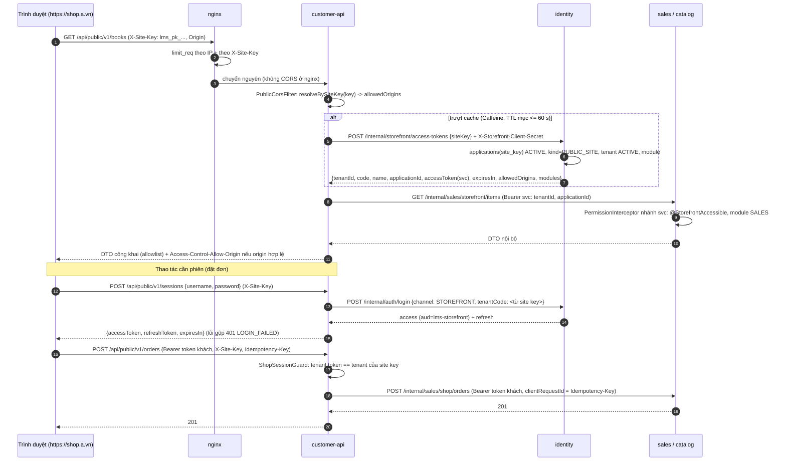
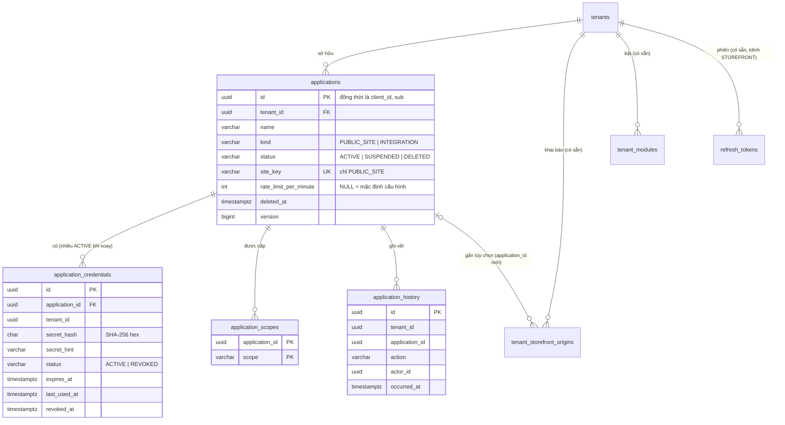

# Thiết kế: SaaS API Authentication (Public API, Integration API, Admin API)

- Ngày: 2026-11-18. Người viết: SA. Trạng thái: **đề xuất**, chưa có code; cần người dùng chốt các câu hỏi ở mục 9 trước khi `be-dev` bắt đầu pha có đánh dấu 🚫.
- Đầu vào: `docs/architecture/SAAS_AUTHENTICATION_AUDIT.md` (Phase 1, bằng chứng code), `docs/architecture/TENANT_ISOLATION.md`.
- Liên quan: ADR-0001 (Outbox, Kafka best-effort), 0003 (khóa `Controller/method`), 0004 (migration tập trung), 0005 (BFF), 0006 (multi-tenant), 0008/0016 (platform admin), 0009/0012 (module, hợp đồng), 0011 (customer-api, token `svc`), 0013 (CORS động, origin theo tenant), 0017 (phiên), 0023 (cổng độc giả). `docs/api/token-audience.md`.
- ℹ️ Khi được duyệt, các quyết định D1 đến D8 nên được chép thành **ADR-0026** (số kế tiếp hiện có trên đĩa là `0025`; ⚠️ kiểm lại lúc tạo). Tài liệu này không tự tạo ADR (giới hạn phạm vi file của nhiệm vụ).
- Icon: ✅ đã kiểm chứng bằng code, ⚠️ chưa kiểm chứng hoặc suy luận, ❌ thiếu, ℹ️ ghi chú, ⏳ chưa làm, 🚫 bị chặn chờ quyết định.

---

## 1. Bối cảnh và mục tiêu

Nền tảng cho thuê (nhà sách A, B, C). Mỗi tenant có thể có website riêng và backend riêng (ERP/CRM). Một tenant đăng ký nhiều **Application**. Cần ba nhóm API cùng tồn tại:

| Nhóm | Người gọi | Xác thực yêu cầu | Hiện trạng (Audit) |
|---|---|---|---|
| A. Public | Trình duyệt chạy website của tenant | Public Site Key + Application + Domain Allowlist; phiên khách cho thao tác cần phiên | ✅ Có `customer-api` `/public/t/{code}/**`, CORS động theo origin của tenant, phiên STOREFRONT; ❌ chưa có site key, Application, `/api/public/v1` |
| B. Integration | Backend của tenant | OAuth 2.0 Client Credentials, RS256, JWKS, scope, xoay/thu hồi credential | ❌ Chưa có gì; ✅ có khóa RS256 + JWKS + tiền lệ token dịch vụ `svc` |
| C. Admin | Nhân viên nội bộ | **Giữ nguyên** đăng nhập, RBAC khóa động, department | ✅ `lms-api` + token STAFF + `PermissionInterceptor` |

Ràng buộc cứng:

- Không tạo hệ xác thực trùng lặp: identity vẫn là nơi duy nhất ký token; mọi service vẫn chỉ tin JWKS của identity.
- Không chuyển kiến trúc, không nâng dependency nếu không cần (không có Spring Authorization Server, không có thư viện rate limit trong repo).
- Không atomicity xuyên DB; Kafka best-effort (ADR-0001): thu hồi credential không được phụ thuộc Kafka.
- Khóa quyền `Controller/method` (ADR-0003): đổi tên controller/method làm mất quyền của role đã gán.
- Tenant của mọi lời gọi lấy từ **credential đã xác thực** (claim `tenantId` do identity ký), không từ body/query/header do client gửi.
- Thay đổi nhỏ, kiểm thử được, rollback được theo pha.

## 2. Quyết định

### D1. Phát token client_credentials: mở rộng identity-service (chọn), không dùng Spring Authorization Server

| Tiêu chí | **A. Mở rộng identity: một endpoint token RFC 6749 §4.4, ký bằng `JwtTokenIssuer` hiện có (chọn)** | B. Spring Authorization Server (SAS) nhúng vào identity | C. IdP ngoài (Keycloak...) |
|---|---|---|---|
| Khóa ký, JWKS | Dùng nguyên `RSAKey`, `JwksController`; service không đổi gì để xác minh | SAS có `JWKSource` riêng; phải nối vào `RSAKey` hiện có để không có hai JWKS | Hai bên ký, service phải tin hai issuer |
| Claim `tenantId`, `modules` | Ghi trực tiếp như `issueService` | Phải viết `OAuth2TokenCustomizer` để thêm | Mapper riêng của IdP, đồng bộ tenant/module sang IdP |
| Dữ liệu client | Bảng của ta, theo mô hình tenant (mục 4.3) | Bảng `oauth2_registered_client`, `oauth2_authorization` không có khái niệm tenant; nhiều secret cùng lúc khi rotation không có sẵn | Ở IdP, ngoài DB của ta |
| Chuỗi filter | Một đường dẫn `permitAll` như `/internal/storefront/access-tokens` | SAS thêm `SecurityFilterChain` riêng có thứ tự, đụng chain hiện có của identity | Không đụng |
| Dependency mới | Không | `spring-security-oauth2-authorization-server` (BOM Boot quản lý) | Hạ tầng mới |
| Tính năng thừa | Không | authorization_code, PKCE, consent, introspection, revocation, OIDC (không cần cho B) | Rất nhiều |
| Chuẩn | Tự bảo đảm định dạng lỗi RFC 6749 §5.2 (ít, kiểm bằng test) | Chuẩn sẵn | Chuẩn sẵn |

Chọn **A**. Lý do: nhu cầu chỉ là một grant; identity đã có khóa, JWKS, tiền lệ token không phải người dùng (`JwtTokenIssuer#issueService`) và mẫu endpoint permitAll có bí mật (`StorefrontAccessController`). SAS không mô hình hóa được "nhiều secret cùng hoạt động" và "client thuộc tenant" mà không viết lại `RegisteredClientRepository`, tức là vẫn tự viết phần khó nhất.

- Đã loại B: chi phí tích hợp lớn hơn phần tự viết, rủi ro hai `SecurityFilterChain` trong identity, thêm bảng không theo mô hình tenant. Có thể chuyển sang B sau nếu cần authorization_code cho bên thứ ba (hợp đồng token giữ nguyên `iss`, `aud`, claim).
- Đã loại C: vận hành thêm một hệ thống, trái "không tạo hệ xác thực trùng lặp".
- Rủi ro: ⚠️ tự viết endpoint token dễ sai chi tiết chuẩn (header `Cache-Control: no-store`, `WWW-Authenticate`, mã lỗi). Giảm bằng bộ test hợp đồng ở mục 6 (T-I1).

### D2. Nơi đặt Integration API: module BFF mới `integration-api` (chọn)

| Tiêu chí | **A. Module mới `integration-api` (khuôn customer-api, không DB) (chọn)** | B. Thêm vào `lms-api` | C. Thêm vào `customer-api` |
|---|---|---|---|
| Ranh giới kênh token | Một `JwtDecoder` bắt buộc `aud=lms-integration`; kênh khác bị từ chối ngay ở decoder | `lms-api` phải nhận cả STAFF lẫn INTEGRATION; `ChannelAudienceFilter` thành ma trận theo đường dẫn | `customer-api` đang bắt buộc `aud=lms-storefront` cho **mọi** route cần đăng nhập; phải tách hai decoder theo đường dẫn |
| Hợp đồng | DTO có phiên bản `/v1`, ổn định cho bên ngoài | DTO của lms-api theo màn hình FE, đổi thường xuyên | DTO công khai cho trình duyệt (bỏ ISBN, số tồn) khác nhu cầu ERP (cần số tồn) |
| CORS | Không cần (server-to-server); không include CORS | nginx CORS `/api/**` có `Allow-Credentials` | `PublicCorsFilter` áp mọi `/public/**` |
| Giới hạn tốc độ/kích thước | Riêng (theo application, Redis) | Chung với nhân viên | Chung với khách vãng lai |
| Cô lập sự cố | Lỗi/tải của tích hợp không làm sập màn hình nhân viên hay website | Chung tiến trình với nhân viên | Chung tiến trình với website |
| Chi phí | Một module, Dockerfile, mục compose, location nginx | Ít nhất | Ít |

Chọn **A** (khuyến nghị, chờ xác nhận Q2). Phạm vi tối thiểu: `lms.integration.{config,web}` + nhóm `catalog`, `inventory`, `orders`, `oauth` theo khuôn `client` (interface + `http`), `dto`, `web` như customer-api; không JPA/JDBC/Kafka; phụ thuộc `common-kernel`, `observability-common`, starter `web`, `validation`, `security`, `oauth2-resource-server`, `actuator`, `data-redis` (rate limit). Cổng đề xuất **8089** (✅ chưa module/cấu hình nào dùng; hiện dùng 8080 đến 8088).

- Đã loại B: trộn kênh nhân viên và kênh máy trong một BFF, mọi thay đổi DTO cho FE có nguy cơ phá hợp đồng tích hợp; `lms-api` không có cơ chế lọc lỗi như customer-api (chuyển nguyên 4xx, lộ tên khóa nội bộ).
- Đã loại C: customer-api là BFF cho trình duyệt (CORS, honeypot, DTO công khai). Gộp làm tăng bề mặt của cổng đang chịu tải internet công khai.
- Rủi ro: thêm một tiến trình (RAM); giảm bằng profile compose riêng `integration` (không bật mặc định).

### D3. Kiểm scope ở service: annotation `@IntegrationScope` + nhánh token integration trong `PermissionInterceptor` (chọn)

| Tiêu chí | **A. `@IntegrationScope("books:read")` trên method + nhánh riêng trong interceptor (chọn)** | B. identity đổi scope thành danh sách khóa `Controller/method` ghi vào claim `permissions`, interceptor không đổi | C. Chỉ BFF kiểm scope; service coi token integration như `svc` |
|---|---|---|---|
| Endpoint nào mở cho tích hợp | Danh sách đóng, nhìn thấy ngay trên code (như `@StorefrontAccessible`) | Bất kỳ endpoint nào có khóa trong bảng ánh xạ, kể cả `@AuthenticatedOnly` | Bất kỳ endpoint `@StorefrontAccessible` |
| Đổi tên controller/method | Không ảnh hưởng (scope không phải khóa) | Bảng ánh xạ ở identity lệch, tích hợp mất quyền âm thầm | Không ảnh hưởng |
| Service tự bảo vệ (ADR-0011 "service không tin BFF") | Có | Có nhưng rộng | Không: token lọt khỏi BFF dùng được mọi `@StorefrontAccessible` |
| Kích thước token | Nhỏ (`scope` là chuỗi) | Lớn theo số khóa | Nhỏ |
| Thay đổi | security-common: 1 annotation + 1 nhánh + resolver | identity: bảng ánh xạ + seed | BFF |

Chọn **A**. Nhánh mới đặt **ngay sau** bước 401 và **trước** nhánh `svc`, `AUTHENTICATED`, `PLATFORM_ADMIN` (mục 4.1.4). Đây là chế độ truy cập theo loại token, như `@StorefrontAccessible`/`@PlatformAdminOnly`, không phải "hằng số permission" mà ADR-0003 cấm: scope là **hợp đồng công khai với bên ngoài** nên phải là chuỗi cố định có phiên bản, khác khóa nội bộ. ADR-0026 phải ghi rõ ngoại lệ này.

- BFF `integration-api` vẫn kiểm scope trước khi gọi xuống (rẻ, trả lỗi sớm, không lộ tên endpoint nội bộ), nhưng **không** là lớp bảo vệ duy nhất.
- Đã loại B: mở rộng quyền ngoài ý muốn và gãy khi đổi tên. Đã loại C: trái nguyên tắc service tự kiểm.

### D4. Public Site Key và cơ chế `{code}` + token `svc`: bổ sung, không thay thế (chọn)

| Tiêu chí | **A. Bổ sung: đường dẫn mới `/api/public/v1/**` nhận diện bằng header `X-Site-Key`; `/public/t/{code}/**` giữ nguyên (chọn)** | B. Thay `{code}` bằng site key trên mọi đường dẫn công khai | C. Site key chỉ là bí danh của `{code}`, không có Application |
|---|---|---|---|
| Tương thích FE storefront hiện có | Không đổi | Phá hợp đồng `/public/t/{code}/**` | Không đổi |
| Nhận diện Application (thống kê, domain theo ứng dụng, thu hồi riêng) | Có | Có | Không: trái yêu cầu "một tenant nhiều Application" |
| Token `svc` | Giữ nguyên cơ chế; thêm claim `applicationId` | Như A | Như hiện có |
| Cache ở customer-api | Thêm khóa theo site key trong `StorefrontAccessCache` (cùng giá trị `StorefrontAccess` + `applicationId`) | Thay khóa | Không đổi |
| Khối lượng | Controller nhóm `publicv1` mỏng gọi lại cùng client/DTO | Sửa mọi controller + FE | Ít nhất |

Chọn **A** (chờ Q1). Site key là **định danh công khai**, không phải bằng chứng xác thực: nó chỉ chọn Application/tenant; bảo vệ thật vẫn là (1) token `svc` chỉ đọc ở endpoint `@StorefrontAccessible`, (2) phiên khách STOREFRONT cho thao tác ghi, (3) giới hạn tốc độ. Domain allowlist chỉ là CORS (như ADR-0013), không chặn client ngoài trình duyệt.

- Đường dẫn cũ `{code}`: coi như "Application mặc định ngầm định" của tenant, không cần site key, giữ cho FE storefront của nền tảng. Gỡ là quyết định sau.
- Đã loại B: phá FE đang chạy. Đã loại C: không đáp ứng Application.

### D5. Bảng mới: toàn cục, không RLS, thêm vào `TENANT_EXEMPT_TABLES` (chọn)

| Tiêu chí | **a. Toàn cục + lọc tường minh + test hai tenant (chọn)** | b. `@TenantId` + RLS FORCE |
|---|---|---|
| Token endpoint (tra `client_id` khi **chưa biết tenant**) | Đọc thẳng | Không đọc được (không có `app.tenant_id`); phải thêm policy đặc biệt hoặc hàm `SECURITY DEFINER` (mẫu mới, chưa có tiền lệ) |
| Cấp token `svc` theo site key (chưa biết tenant) | Đọc thẳng | Như trên |
| Platform admin (token không `tenantId`) | Đọc/ghi theo `tenantId` của đường dẫn | Mỗi use case `callAs` |
| UNIQUE `site_key` toàn hệ thống | Kiểm được trước khi ghi | RLS ẩn dòng tenant khác |
| Tiền lệ | `tenants`, `tenant_modules`, hợp đồng (ADR-0012), origin (ADR-0013) | bảng nghiệp vụ |
| Rủi ro | IDOR nếu use case quên lọc | Thấp hơn cho đường của tenant admin |

Chọn **a**. Bù rủi ro: API của tenant admin không nhận `tenantId` (lấy `TenantContext.require()`), mọi truy vấn theo `(tenant_id, id)`, id của tenant khác trả `404` cùng thân, và test hai tenant bắt buộc (T-P2). Xem `TENANT_ISOLATION.md` mục 8.

### D6. Nơi lưu bộ đếm rate limit: nginx (IP, mã, site key) + Redis ở `integration-api` (theo application) (chọn)

| Tiêu chí | **A. nginx cho khóa có sẵn trong request + Redis fixed-window cho application (chọn)** | B. Chỉ nginx | C. Bộ đếm trong bộ nhớ từng instance |
|---|---|---|---|
| Theo IP, `{code}`, `X-Site-Key` | nginx (đã có mẫu `public_tenant`) | nginx | Có nhưng lệch giữa instance |
| Theo application/tenant của token integration | Redis, khóa từ claim đã xác thực | Không làm được (nginx bản miễn phí không giải mã JWT) | Lệch theo số instance |
| Theo gói thuê | Cấu hình theo application (gói chưa có, Q8) | Không | Lệch |
| Redis chết | Fail-open + log (mẫu `RedisRequestCache`), nginx vẫn chặn theo IP | n/a | n/a |
| Dependency | `spring-boot-starter-data-redis` (đã dùng ở service) | Không | Caffeine |

Chọn **A**. Thuật toán: `INCR` + `EXPIRE` theo cửa sổ 60 giây bằng một script Lua (nguyên tử), khóa `lms:rl:v1:t:{tenantId}:a:{applicationId}:{read|write}:{epochMinute}` và một khóa tổng theo tenant. Không thêm thư viện (Bucket4j) vì fixed-window đủ cho bảo vệ backend; đổi sang sliding window sau là thay đổi nội bộ.

- Phản hồi vượt ngưỡng: `429 RATE_LIMITED`, header `Retry-After` (giây tới cửa sổ kế), `X-RateLimit-Limit`, `X-RateLimit-Remaining`.
- ⚠️ Giới hạn theo `{code}`/site key là đường DoS có chủ đích cho một tenant (site key công khai): ngưỡng phải là ngưỡng bảo vệ backend, giống cảnh báo ADR-0013 2.11.

### D7. Băm client secret: SHA-256 của secret 256 bit (chọn)

| Tiêu chí | **A. Secret 32 byte CSPRNG + SHA-256 (chọn)** | B. BCrypt/Argon2 | C. HMAC-SHA256 với pepper |
|---|---|---|---|
| Chống dò khi lộ DB | Secret 256 bit ngẫu nhiên: dò bằng vét cạn không khả thi; băm chậm không thêm gì | Thêm chi phí cho entropy vốn đã đủ | Thêm một lớp nếu pepper không lộ cùng DB |
| Chi phí mỗi lần cấp token | Micro giây | ~100 ms CPU mỗi lần, khuếch đại DoS lên token endpoint | Micro giây |
| Tiền lệ | `SecureRefreshTokenCodec` (48 byte + SHA-256) | `BcryptPasswordHasher` cho **mật khẩu người dùng** (entropy thấp) | Không |
| Vận hành | Không bí mật mới | Không | Thêm bí mật phải phân phối, xoay |

Chọn **A**. Định dạng hiển thị: `lms_sk_` + base64url(32 byte); lưu `secret_hash` (hex SHA-256) và `secret_hint` (4 ký tự cuối). So sánh bằng `MessageDigest.isEqual`. Hiển thị đầy đủ **một lần** trong phản hồi tạo credential, header `Cache-Control: no-store`.

### D8. Các bảng đề xuất trong yêu cầu: đánh giá từng bảng

| Bảng đề xuất | Quyết định | Lý do |
|---|---|---|
| `tenants` | ⏭️ **Không tạo**, dùng `tenants` có sẵn | `identity/V11` đã có; tạo lại là trùng thực thể |
| `applications` | ✅ Tạo (identity_db) | Khái niệm mới thật sự |
| `application_credentials` | ✅ Tạo | Nhiều secret cùng hoạt động khi rotation; chỉ lưu hash |
| `application_domains` | ⏭️ **Không tạo**; thêm cột `application_id` (NULL được) vào `tenant_storefront_origins` | Đã có bảng origin chuẩn hóa, UNIQUE toàn cục, lịch sử, API platform (ADR-0013). `NULL` = áp cho mọi Application kiểu website của tenant (tương thích ngược) |
| `application_scopes` | ✅ Tạo (bảng nối, CHECK danh sách scope) | Mẫu `tenant_modules`; ràng buộc được ở DB |
| `api_sessions` | ⏭️ **Không tạo** | Phiên khách đã có: `refresh_tokens` kênh `STOREFRONT` (xoay vòng, họ phiên, thu hồi). Chỉ cần bảng mới nếu chọn giỏ hàng/khách vãng lai có phiên server (Q4) |
| `api_audit_logs` (theo request) | ⏭️ **Không tạo** ở giai đoạn này | Khối lượng theo request lớn, ghi Postgres mỗi lời gọi tốn và trùng log truy cập. Thay bằng: (1) `application_history` (DB, chỉ thêm) cho sự kiện bảo mật/vòng đời, (2) log truy cập có cấu trúc ở BFF, (3) bộ đếm sử dụng Redis theo ngày. Xem lại khi có yêu cầu pháp lý lưu từng request |
| (mới) `application_history` | ✅ Tạo | Dấu vết tạo/sửa/xoay/thu hồi, mẫu `tenant_storefront_origin_history` |

## 3. Thiết kế tổng thể

```
                         ┌───────────────────────────── nginx 8080 ─────────────────────────────┐
Trình duyệt nhân viên ──►│ /api/**              → lms-api 8085        (CORS nginx, giữ nguyên)  │
Website của tenant    ──►│ /public/t/{code}/**  → customer-api 8088   (giữ nguyên)              │
                         │ /api/public/v1/**    → customer-api 8088   (mới, X-Site-Key)         │
Backend của tenant    ──►│ /api/integration/v1/** → integration-api 8089 (mới, client_credentials)│
                         │ /internal/**, /.well-known/** → 404                                   │
                         └──────────────────────────────────────────────────────────────────────┘
customer-api ──svc token (tenantId, applicationId)──► sales/catalog (@StorefrontAccessible)
customer-api ──token khách STOREFRONT─────────────► sales/circulation (khóa động)
integration-api ──token integration (aud=lms-integration, scope)──► catalog/sales (@IntegrationScope)
identity: ký mọi token (một issuer, một JWKS); bảng applications* ở identity_db
```

## 4. Thiết kế chi tiết

### 4.1. Ba luồng xác thực

#### 4.1.1. Public Browser (website của tenant)



Quy tắc:

- Site key chỉ chọn Application; **không bao giờ** có client secret ở frontend. Site key không cho phép ghi gì: mọi ghi cần phiên khách (`aud=lms-storefront`).
- Site key thuộc Application `SUSPENDED`/`DELETED`, tenant ngưng, hoặc tắt module → `404 SHOP_NOT_AVAILABLE` cố định (như ADR-0011 2.5); site key sai định dạng trả ngay không gọi identity.
- `X-Site-Key` thiếu ở `/api/public/v1/**` → `404 SHOP_NOT_AVAILABLE` (không phân biệt với key sai).

#### 4.1.2. Backend-to-Backend (OAuth 2.0 Client Credentials)

```mermaid
sequenceDiagram
    autonumber
    participant E as Backend tenant (ERP)
    participant N as nginx
    participant G as integration-api
    participant I as identity
    participant R as Redis
    participant S as catalog / sales
    E->>N: POST /api/integration/v1/oauth/token (Basic client_id:secret, grant_type=client_credentials, scope=books:read)
    N->>N: limit_req zone=oauth_token theo IP
    N->>G: chuyển tiếp
    G->>I: POST /internal/oauth2/token (chuyển nguyên Authorization + form)
    I->>I: application ACTIVE kind=INTEGRATION; so hash với các credential ACTIVE chưa hết hạn (isEqual)
    I->>I: scope yêu cầu ⊆ scope đã cấp ∩ scope khả dụng theo module; tenant ACTIVE
    I->>I: ghi last_used_at (tối đa 1 lần/giờ), ký JWT RS256 (aud=lms-integration, jti, TTL 5 phút)
    I-->>G: 200 {access_token, token_type: Bearer, expires_in: 300, scope}
    G-->>E: 200 (Cache-Control: no-store)
    E->>N: GET /api/integration/v1/inventory?page=0 (Bearer)
    N->>G: chuyển tiếp
    G->>G: JwtDecoder: chữ ký JWKS, exp, iss, aud=lms-integration; kiểm scope inventory:read
    G->>R: INCR lms:rl:v1:t:{tenant}:a:{app}:read:{phút} (fail-open)
    G->>S: GET /internal/sales/stock-items?page=0 (Bearer nguyên token)
    S->>S: TenantContextFilter từ claim tenantId; interceptor nhánh integration: @IntegrationScope("inventory:read"), module SALES
    S-->>G: PageResult
    G-->>E: DTO tích hợp v1 (allowlist), lỗi qua allowlist mã
```

Lỗi token endpoint (RFC 6749 §5.2, thân `{error, error_description}`):

| Tình huống | HTTP | `error` |
|---|---|---|
| Thiếu/sai `grant_type` | 400 | `unsupported_grant_type` / `invalid_request` |
| Thiếu xác thực client, sai secret, credential thu hồi/hết hạn, application không `ACTIVE` hoặc sai loại, tenant ngưng | 401 (+ `WWW-Authenticate: Basic`) | `invalid_client` (một mã cho mọi lý do; lý do thật chỉ ghi log + `application_history` khi thất bại có `client_id` hợp lệ) |
| Scope không được cấp hoặc không hợp lệ | 400 | `invalid_scope` |
| Gửi secret qua query string | 400 | `invalid_request` (không ghi log giá trị) |

#### 4.1.3. Admin hiện có (giữ nguyên, chỉ thêm API quản lý Application)

```mermaid
sequenceDiagram
    autonumber
    participant U as Nhân viên (trình duyệt)
    participant N as nginx
    participant L as lms-api
    participant I as identity
    U->>N: POST /api/auth/login
    N->>L: (limit_req login)
    L->>I: POST /internal/auth/login (channel STAFF mặc định)
    I-->>L: access (không aud hoặc aud=lms-staff) + refresh
    L-->>U: token
    U->>N: POST /api/applications/{id}/credentials (Bearer STAFF)
    N->>L: chuyển tiếp
    L->>L: ChannelAudienceFilter: từ chối aud lms-storefront VÀ lms-integration
    L->>I: POST /internal/applications/{id}/credentials
    I->>I: PermissionInterceptor: khóa ApplicationController/createCredential (hoặc admin=true); tenant từ token
    I-->>L: 201 {credentialId, clientId, clientSecret (một lần), secretHint}
    L-->>U: 201 (Cache-Control: no-store)
```

Không đổi gì ở đăng nhập, refresh, switch-tenant, department, role, khóa động, platform admin `X-Tenant-Id`.

#### 4.1.4. Thứ tự mới trong `PermissionInterceptor#preHandle`

```
PUBLIC                                   -> cho qua (không đổi)
chưa xác thực                            -> 401 (không đổi)
token integration (aud chứa lms-integration):        [MỚI]
    method/class không có @IntegrationScope           -> 403 FORBIDDEN  (kể cả @AuthenticatedOnly, @PlatformAdminOnly, @StorefrontAccessible)
    không có tenantId                                 -> 403 TENANT_REQUIRED
    @RequiresModule(m) mà modules không chứa m        -> 403 MODULE_NOT_ENABLED (không fallback token cũ)
    scope của annotation không nằm trong claim scope  -> 403 INSUFFICIENT_SCOPE
    còn lại                                           -> cho qua (không đăng ký khóa, không kiểm khóa)
token svc                                -> như cũ (nhánh @StorefrontAccessible)
... phần còn lại không đổi
```

- Token integration không bao giờ có `admin`, `platformAdmin`, `svc`, `sid`; identity bảo đảm khi ký (hàng rào 1), interceptor kiểm `aud` trước mọi nhánh platform admin (hàng rào 2).
- Token người dùng ở endpoint `@IntegrationScope`: không đổi (vẫn kiểm khóa `Controller/method`).
- `lms-api` `ChannelAudienceFilter#acceptable`: từ chối thêm `lms-integration`. `customer-api` đã từ chối (decoder bắt buộc `lms-storefront`). `integration-api` bắt buộc `lms-integration` và từ chối `svc`.

### 4.2. Ngữ cảnh gọi (tenantId, applicationId, loại xác thực, subject)

Đối chiếu với `tenant-common` hiện có:

| | Hiện có | Đủ cho yêu cầu? |
|---|---|---|
| ✅ | `TenantContext` thread-local, đặt **chỉ** từ claim `tenantId` của JWT (`TenantContextFilter`), xóa ở `finally` | Đủ cho tenant: token integration và `svc` mang `tenantId` do identity ký |
| ✅ | `TenantContext.runAs/callAs` khôi phục phạm vi cũ; `TenantAwareEventHandler` cho Kafka; `ImportActor` truyền tường minh cho luồng nền | Đủ cho bất đồng bộ |
| ❌ | Không có `applicationId`, loại xác thực | Cần bổ sung, nhưng **không** cần ThreadLocal mới |

Quyết định: **không viết context mới**. Thêm record `CallerIdentity` trong `security-common` (package `lms.security`), dựng theo yêu cầu từ `SecurityContextHolder` (đã là ngữ cảnh theo request, Spring Security tự dọn sau request):

```java
// phác thảo hợp đồng, be-dev chốt
public record CallerIdentity(AuthType type, String subject, UUID tenantId, UUID applicationId, Set<String> scopes) {
    public enum AuthType { STAFF_USER, STOREFRONT_USER, STOREFRONT_SERVICE, INTEGRATION_CLIENT, PLATFORM_ADMIN }
    public static Optional<CallerIdentity> current() { /* đọc JwtAuthenticationToken; null-safe */ }
}
```

- Suy `type` chỉ từ claim đã ký: `aud` chứa `lms-integration` → `INTEGRATION_CLIENT`; có `svc` → `STOREFRONT_SERVICE`; `aud` chứa `lms-storefront` → `STOREFRONT_USER`; `platformAdmin` không `tenantId` → `PLATFORM_ADMIN`; còn lại `STAFF_USER`.
- `tenantId` của `CallerIdentity` chỉ để ghi log/audit; **nguồn duy nhất cho truy vấn vẫn là `TenantContext`** (đã khớp claim, và là thứ RLS dùng). Platform admin act-as-tenant: `TenantContext` là tenant đích, `CallerIdentity.tenantId` null; audit ghi cả hai.
- Không đọc `X-Tenant-Id`, `tenantId`, `applicationId` từ body/query/header của client integration hay site key; header `X-Tenant-Id` vẫn chỉ có tác dụng với platform admin (hiện trạng `PermissionInterceptor#tryActAsTenant`).
- Bất đồng bộ: truyền `CallerIdentity` và `tenantId` **tường minh** vào tác vụ (như `ImportActor`), chạy trong `TenantContext.runAs(tenantId, ...)`. Không thêm `TaskDecorator` toàn cục ở giai đoạn này (không có `@Async` nào trong service, mục 6 `TENANT_ISOLATION.md`).
- BFF (`customer-api`, `integration-api`) không phụ thuộc `tenant-common`/`security-common` (ArchUnit hiện có của customer-api): ngữ cảnh là đối tượng truyền theo tham số (`StorefrontAccess` hiện có + `applicationId`; `IntegrationCaller` mới dựng từ `Jwt` trong controller), không ThreadLocal.
- `CurrentUser.from(jwt)` bắt buộc `sub` là UUID (`security-common/.../CurrentUser.java`): vì vậy `sub` = `client_id` = **UUID của application** (D-phụ, mục 4.3.4). Ghi `createdBy` khi tích hợp ghi dữ liệu sẽ là id application; audit phân biệt bằng `CallerIdentity.type`.

### 4.3. Thiết kế database

#### 4.3.1. ERD



#### 4.3.2. Migration đề xuất (chỉ trong tài liệu, `be-dev` chốt chi tiết)

Số kế tiếp: migration identity mới nhất trên đĩa là **`V31__import_permissions.sql` (chưa được git track, của phiên khác)** → file mới dự kiến **`identity/V32__applications.sql`**. ⚠️ Kiểm lại ngay trước khi tạo và trước khi merge; Flyway không chạy out-of-order, trùng/lùi số làm system-service lỗi khởi động; **không sửa file đã chạy**.

```sql
-- identity/V32__applications.sql (ĐỀ XUẤT). Bảng toàn cục (không RLS), thêm vào TENANT_EXEMPT_TABLES.
-- Lý do không RLS: token endpoint và cấp token storefront tra client_id/site_key khi CHƯA biết tenant (D5).
CREATE TABLE applications (
    id                    UUID                     PRIMARY KEY,           -- = client_id = sub của token integration
    tenant_id             UUID                     NOT NULL REFERENCES tenants (id),
    name                  VARCHAR(100)             NOT NULL,
    kind                  VARCHAR(20)              NOT NULL CHECK (kind IN ('PUBLIC_SITE', 'INTEGRATION')),
    status                VARCHAR(20)              NOT NULL DEFAULT 'ACTIVE'
                                                   CHECK (status IN ('ACTIVE', 'SUSPENDED', 'DELETED')),
    site_key              VARCHAR(64)              UNIQUE,                -- định danh CÔNG KHAI, lưu nguyên văn
    rate_limit_per_minute INTEGER                  CHECK (rate_limit_per_minute > 0),
    created_at            TIMESTAMP WITH TIME ZONE NOT NULL DEFAULT now(),
    created_by            UUID,
    updated_at            TIMESTAMP WITH TIME ZONE NOT NULL DEFAULT now(),
    updated_by            UUID,
    deleted_at            TIMESTAMP WITH TIME ZONE,
    version               BIGINT                   NOT NULL DEFAULT 0,
    CONSTRAINT uq_applications_id_tenant UNIQUE (id, tenant_id),          -- đích của FK kép (chống lệch tenant)
    CONSTRAINT ck_applications_site_key CHECK ((kind = 'PUBLIC_SITE') = (site_key IS NOT NULL)),
    CONSTRAINT ck_applications_deleted  CHECK ((status = 'DELETED') = (deleted_at IS NOT NULL)),
    CONSTRAINT ck_applications_site_key_format CHECK (site_key IS NULL OR site_key ~ '^lms_pk_[A-Za-z0-9_-]{32,56}$')
);
-- Danh sách theo tenant (portal), lọc trạng thái, sắp theo ngày tạo: tenant_id đứng đầu.
CREATE INDEX idx_applications_tenant_status ON applications (tenant_id, status, created_at);
-- Tên duy nhất trong tenant cho ứng dụng chưa xóa.
CREATE UNIQUE INDEX uq_applications_tenant_name ON applications (tenant_id, lower(name)) WHERE status <> 'DELETED';

CREATE TABLE application_credentials (
    id             UUID                     PRIMARY KEY,
    application_id UUID                     NOT NULL,
    tenant_id      UUID                     NOT NULL,
    secret_hash    CHAR(64)                 NOT NULL,                     -- SHA-256 hex, KHÔNG lưu secret
    secret_hint    VARCHAR(8)               NOT NULL,                     -- 4 ký tự cuối để nhận diện
    status         VARCHAR(20)              NOT NULL DEFAULT 'ACTIVE' CHECK (status IN ('ACTIVE', 'REVOKED')),
    created_at     TIMESTAMP WITH TIME ZONE NOT NULL DEFAULT now(),
    created_by     UUID,
    expires_at     TIMESTAMP WITH TIME ZONE,                              -- NULL = không hết hạn
    last_used_at   TIMESTAMP WITH TIME ZONE,
    revoked_at     TIMESTAMP WITH TIME ZONE,
    revoked_by     UUID,
    revoke_reason  VARCHAR(30)              CHECK (revoke_reason IN ('ROTATED', 'MANUAL', 'APPLICATION_DELETED', 'COMPROMISED')),
    CONSTRAINT fk_app_credentials_app FOREIGN KEY (application_id, tenant_id) REFERENCES applications (id, tenant_id),
    CONSTRAINT ck_app_credentials_revoked CHECK ((status = 'REVOKED') = (revoked_at IS NOT NULL)),
    CONSTRAINT ck_app_credentials_expiry  CHECK (expires_at IS NULL OR expires_at > created_at)
);
-- Token endpoint: credential ACTIVE của một application (<= 2 dòng); portal: liệt kê theo application.
-- Không đặt tenant_id đầu: bảng không RLS và mọi truy vấn đi theo application_id (đã duy nhất toàn cục).
CREATE INDEX idx_app_credentials_app_status ON application_credentials (application_id, status);

CREATE TABLE application_scopes (
    application_id UUID                     NOT NULL REFERENCES applications (id),
    scope          VARCHAR(40)              NOT NULL CHECK (scope IN (
                       'books:read', 'books:write', 'inventory:read', 'inventory:write',
                       'orders:read', 'orders:write', 'customers:read', 'customers:write')),
    granted_at     TIMESTAMP WITH TIME ZONE NOT NULL DEFAULT now(),
    granted_by     UUID,
    PRIMARY KEY (application_id, scope)
);

-- Lịch sử chỉ thêm (mẫu tenant_storefront_origin_history, ADR-0013 2.9).
CREATE TABLE application_history (
    id             UUID                     PRIMARY KEY,
    tenant_id      UUID                     NOT NULL,
    application_id UUID                     NOT NULL,                     -- không FK: dòng gốc có thể đã xóa mềm
    credential_id  UUID,
    action         VARCHAR(40)              NOT NULL CHECK (action IN (
                       'CREATED', 'UPDATED', 'SUSPENDED', 'REACTIVATED', 'DELETED',
                       'SCOPES_CHANGED', 'SITE_KEY_ROTATED',
                       'CREDENTIAL_CREATED', 'CREDENTIAL_REVOKED', 'TOKEN_DENIED_REPEATEDLY')),
    detail         VARCHAR(500),                                          -- không bao giờ chứa secret
    actor_id       UUID,                                                  -- NULL = hệ thống
    occurred_at    TIMESTAMP WITH TIME ZONE NOT NULL DEFAULT now()
);
CREATE INDEX idx_application_history_app ON application_history (application_id, occurred_at DESC);
CREATE OR REPLACE FUNCTION application_history_append_only() RETURNS trigger AS $$
BEGIN
    RAISE EXCEPTION 'application_history chỉ cho phép thêm';
END;
$$ LANGUAGE plpgsql;
CREATE TRIGGER trg_application_history_append_only
    BEFORE UPDATE OR DELETE ON application_history
    FOR EACH ROW EXECUTE FUNCTION application_history_append_only();

-- Domain allowlist: dùng lại bảng origin của ADR-0013. NULL = áp cho mọi Application PUBLIC_SITE của tenant
-- (tương thích ngược với dữ liệu hiện có). FK kép bảo đảm application cùng tenant với origin.
ALTER TABLE tenant_storefront_origins ADD COLUMN application_id UUID;
ALTER TABLE tenant_storefront_origins
    ADD CONSTRAINT fk_storefront_origins_application FOREIGN KEY (application_id, tenant_id)
        REFERENCES applications (id, tenant_id);
CREATE INDEX idx_storefront_origins_application ON tenant_storefront_origins (application_id)
    WHERE application_id IS NOT NULL;
```

Và trong `identity/afterMigrate.sql` (callback chạy lại mỗi lần migrate, không có checksum; sửa theo mẫu ADR-0013, đặt **sau** khối `GRANT ... ON ALL TABLES`, bỏ qua khi bảng chưa tồn tại):

```sql
-- ĐỀ XUẤT: lịch sử ứng dụng chỉ thêm
-- IF to_regclass('public.application_history') IS NOT NULL THEN
--     REVOKE UPDATE, DELETE ON application_history FROM identity_app;
-- END IF;
```

Ghi chú dữ liệu:

| | Điểm | Chi tiết |
|---|---|---|
| ℹ️ | RLS | Không bảng mới nào bật RLS (D5). Thêm `applications`, `application_credentials`, `application_history` vào `TenantArchitectureRules.TENANT_EXEMPT_TABLES` (bắt buộc vì có cột `tenant_id`); thêm cả `application_scopes` (không có `tenant_id`, luật không bắt nhưng giữ danh sách làm sổ đăng ký bảng toàn cục, tiền lệ `cms_*`) |
| ℹ️ | `set_config` | Không cần: không ghi dữ liệu vào bảng RLS, không seed |
| ℹ️ | Xóa mềm | `applications.status = DELETED` + `deleted_at`; `site_key` giữ UNIQUE (không tái sử dụng chuỗi đã phát); credential chuyển `REVOKED (APPLICATION_DELETED)` cùng transaction |
| ℹ️ | Nhiều credential khi xoay | Tối đa **2** `ACTIVE`/application, kiểm ở domain dưới khóa dòng `applications ... FOR UPDATE` (mẫu khóa dòng tenant của ADR-0013 2.5); vượt → `409 CREDENTIAL_LIMIT_EXCEEDED`. Quy trình: tạo mới (2 ACTIVE) → client đổi → thu hồi cũ |
| ℹ️ | Hạn dùng | `expires_at` tùy chọn khi tạo (mặc định cấu hình, ví dụ 365 ngày; Q13); token endpoint coi hết hạn như thu hồi |
| ℹ️ | `last_used_at` | Cập nhật tối đa một lần mỗi giờ mỗi credential (tránh ghi mỗi lần cấp token) |
| ℹ️ | Giới hạn số application | Cấu hình `lms.identity.applications.max-per-tenant` (đề xuất 20), kiểm dưới khóa dòng tenant |
| ⚠️ | Catalog cho đồng bộ ERP | Nếu chốt Q7: `catalog/V10__titles_updated_at.sql` (catalog mới nhất trên đĩa `V9__titles_sort_index.sql`), thêm `updated_at` + index `(tenant_id, updated_at, id)`; bảng `titles` có RLS nên migration chỉ DDL, backfill bằng `created_at` trong một câu `UPDATE` cần `set_config` hoặc superuser (⚠️ `be-dev` kiểm cách chạy backfill dưới FORCE RLS) |

#### 4.3.3. Hợp đồng token integration (claim)

```json
{
  "iss": "library-auth-service",
  "sub": "8b0f...-application-uuid",
  "aud": ["lms-integration"],
  "client_id": "8b0f...-application-uuid",
  "tenantId": "42e6...",
  "applicationId": "8b0f...-application-uuid",
  "scope": "books:read inventory:read",
  "modules": ["SALES"],
  "permissions": [],
  "iat": 1763450000,
  "exp": 1763450300,
  "jti": "random-uuid"
}
```

- ℹ️ Yêu cầu gốc ghi `tenant_id`, `application_id`; thiết kế dùng `tenantId`/`applicationId` cho **nhất quán với claim hiện có** (`TenantContextFilter` đọc `tenantId`). Không ghi hai tên cho cùng một giá trị.
- `scope` = giao của (scope yêu cầu hoặc mọi scope đã cấp) với scope khả dụng theo module đang bật: `inventory:*`, `orders:*` cần `SALES`; `books:*` là catalog lõi; `customers:*` chờ Q5.
- TTL đề xuất `PT5M` (`lms.identity.integration.token-ttl`), cùng mức token `svc` (Q10).
- `jti` thêm cho **mọi** token mới (người dùng, `svc`, integration): cộng thêm, không phá token cũ.

#### 4.3.4. Định danh và khóa

| Thứ | Định dạng | Lưu | Hiển thị |
|---|---|---|---|
| `client_id` | UUID của application (cũng là `sub`) | `applications.id` | Luôn |
| client secret | `lms_sk_` + base64url(32 byte CSPRNG) | SHA-256 hex + 4 ký tự cuối | **Một lần** khi tạo |
| site key | `lms_pk_` + base64url(24 byte CSPRNG) | Nguyên văn (công khai), UNIQUE | Luôn (nhúng vào website) |

Xoay site key: `POST .../applications/{id}/site-key/rotation` thay ngay (key cũ hết hiệu lực sau TTL cache ≤ 60 giây). ⚠️ Không có giai đoạn chồng lấp cho site key (website phải triển khai lại); nếu cần chồng lấp thì thêm cột `previous_site_key` sau.

### 4.4. API endpoint và ánh xạ vào controller/BFF hiện có

#### 4.4.1. nginx (thay đổi cộng thêm)

| Location | Đích | Giới hạn | Ghi chú |
|---|---|---|---|
| `location ^~ /api/public/` | customer-api | `client_max_body_size 16k`; `public_read` (IP), vùng mới `public_sitekey` theo `$http_x_site_key` (ngưỡng bảo vệ backend); login dùng vùng `login` | Chỉ include `security-headers.conf` (CORS do customer-api), không trả `OPTIONS`. `^~` để thắng regex import `^/api/[a-z-]+/imports` và `location /api/` |
| `location = /api/integration/v1/oauth/token` | integration-api | vùng mới `oauth_token` 30r/m/IP, `burst=10` | Không CORS |
| `location ^~ /api/integration/` | integration-api | `client_max_body_size 64k`; vùng `integration_ip` theo IP (bảo vệ thô) | Không CORS, không `common.conf` |

⚠️ `PublicCorsFilter#shouldNotFilter` hiện chỉ lọc `/public/`; `RequestSizeLimitFilter` cũng vậy: phải mở rộng cho `/api/public/`. `SecurityConfiguration` của customer-api là danh sách đóng: thêm mẫu cho `/api/public/v1/**` theo từng đường dẫn.

#### 4.4.2. Public API v1 (customer-api, nhóm mới `publicv1`)

Mọi đường dẫn bắt buộc `X-Site-Key`; tenant + application lấy từ site key (không từ đường dẫn).

| Endpoint | Ánh xạ hiện có (tái dùng client/DTO) | Phiên | Ghi chú |
|---|---|---|---|
| `GET /api/public/v1/books` (`keyword`, `page`, `size ≤ 50`, `sort`) | như `BookController#list` → sales `StorefrontController/list` | Không | `search` = tham số `keyword`, **không** tạo `/search` riêng |
| `GET /api/public/v1/books/suggestions` | `BookController` → `StorefrontController/suggestions` | Không | |
| `GET /api/public/v1/books/{bookRef}`, `/{bookRef}/preview` | `BookController` → `StorefrontController/get`, `/preview` | Không | |
| `GET /api/public/v1/banners` | `BannerController` → `StorefrontBannerController/list` | Không | Không có trong yêu cầu nhưng có sẵn; ⚠️ chỉ mở nếu Q1 muốn tương đương đường cũ |
| `GET /api/public/v1/categories` | ❌ chưa có ở sales storefront | Không | 🚫 Q12: catalog có `CategoryController` nhưng storefront chưa lọc theo danh mục; không làm tới khi có nhu cầu lọc |
| `POST /api/public/v1/sessions` (đăng nhập), `POST /sessions/refresh`, `POST /sessions/logout`, `POST /sessions/signup` | `AuthController` (`login`, `refresh` với `tenantId`, `logout`, `signup`) | Tạo phiên | Lỗi gộp `401 LOGIN_FAILED` như hiện có |
| `GET|POST /api/public/v1/cart` | ❌ không có giỏ server | | 🚫 Q4: khuyến nghị giỏ ở trình duyệt, không có endpoint |
| `POST /api/public/v1/orders`, `GET /orders`, `GET /orders/{id}`, `POST /orders/{id}/cancellation` | `OrderController` → sales `ShopController` | Bắt buộc phiên khách | ✅ Hiện body đã **bắt buộc** `clientRequestId` (UUID do FE sinh, `customer-api/.../shop/dto/ShopDtos.java`) → sales UNIQUE (`tenant_id`, `client_request_id`). v1 nhận header `Idempotency-Key` (UUID) và ánh xạ vào cùng trường; thiếu cả hai → `400 VALIDATION_FAILED` (giữ nghĩa "bắt buộc" như hiện có) |

identity: `POST /internal/storefront/access-tokens` nhận **một trong hai** `{tenantCode}` hoặc `{siteKey}` (cả hai hoặc không cái nào → `400`); phản hồi thêm `applicationId` (null với `{code}`). `ResolveStorefrontTenantUseCase` thêm nhánh tra theo site key; `allowedOrigins` = origin bật của tenant có `application_id IS NULL OR = :applicationId`. Token `svc` thêm claim `applicationId` khi có. Giữ quy tắc "mọi nhánh cùng số truy vấn" của use case hiện có.

#### 4.4.3. Integration API v1 (integration-api)

| Endpoint | Scope | Đích hiện có (thêm `@IntegrationScope`) | Pha |
|---|---|---|---|
| `POST /api/integration/v1/oauth/token` | | identity `POST /internal/oauth2/token` (mới, `OAuthTokenController`, `@PublicEndpoint`, permitAll đúng một đường dẫn) | I2 |
| `GET /api/integration/v1/books/{id}` | `books:read` | catalog `TitleController/get` | I3 |
| `POST /api/integration/v1/books/lookup` (`ids ≤ 100`) | `books:read` | `TitleController/lookup` | I3 |
| `POST /api/integration/v1/books/lookup-by-isbn` | `books:read` | `TitleController/lookupByIsbn` | I3 |
| `GET /api/integration/v1/books?updatedSince&page&size` | `books:read` | ❌ cần endpoint phân trang mới ở catalog (`TitleController#search` trả `List` không phân trang, có `@CrossTenantReadable`) | 🚫 Q7 |
| `GET /api/integration/v1/inventory?page&size&lowStockOnly` | `inventory:read` | sales `StockItemController/search` (đã phân trang) | I3 |
| `GET /api/integration/v1/inventory/{titleId}` | `inventory:read` | `StockItemController/get` | I3 |
| `GET /api/integration/v1/orders?status&page&size`, `GET /orders/{id}` | `orders:read` | sales `SalesOrderController` (list/get; `be-dev` xác nhận tên method); **không** mở `/{id}/contact` (PII) | I3 |
| `POST /api/integration/v1/inventory/receipts` | `inventory:write` | `GoodsReceiptController` (có `client_request_id`) | I4 🚫 Q6 |
| `POST /api/integration/v1/books`, `PUT /books/{id}` | `books:write` | `TitleController/create`, `/update` | I4 🚫 Q6 |
| Chuyển trạng thái đơn (`confirmation`, `ready-for-pickup`, `shipping`, `completion`) | `orders:write` | `SalesOrderController` (có `version`) | I4 🚫 Q6 |
| `customers/**` | `customers:*` | ❌ chưa xác định "customer" (người dùng + `reader_profiles`, chứa PII) | 🚫 Q5 |

Quy tắc chung của integration-api:

- DTO v1 là allowlist riêng (không trả `tenantId`, giá vốn chỉ khi scope cho phép, ⚠️ `be-dev` liệt kê trường), lỗi qua allowlist mã như `PublicExceptionHandler`; `403` từ interceptor (chứa tên khóa) được viết lại thành `403 INSUFFICIENT_SCOPE`/`FORBIDDEN` không lộ tên nội bộ; 5xx/mất kết nối → `503 SERVICE_UNAVAILABLE`.
- Idempotency: POST ghi **bắt buộc** `Idempotency-Key` (UUID); nơi có `client_request_id` thì ánh xạ thẳng; nơi chưa có (I4) thì bộ nhớ đệm phản hồi Redis theo `(applicationId, key)` 24 giờ ở BFF (⚠️ chi tiết khi mở I4).
- Log truy cập có cấu trúc mỗi request: `correlationId`, `jti`, `tenantId`, `applicationId`, method, mẫu route, status, thời gian; **không** log thân, header `Authorization`, secret.
- Bộ đếm sử dụng: `INCR lms:usage:v1:t:{tenant}:a:{app}:{yyyyMMdd}` (TTL 35 ngày) ngay trong request (cùng lượt với rate limit), phục vụ thống kê portal.

#### 4.4.4. Admin: quản lý Application (Developer Portal, giai đoạn MVP)

| Lớp | Endpoint | Chế độ quyền |
|---|---|---|
| identity (platform) | `GET|POST /api/platform/tenants/{tenantId}/applications`, `GET|PUT|DELETE .../{appId}`, `POST .../{appId}/suspension`, `POST .../{appId}/reactivation` | `PlatformApplicationController`, `@PlatformAdminOnly`; lms-api **không sửa** (`IdentityGatewayController` chuyển nguyên `/api/platform/**`) |
| identity (tenant) | `GET|POST /internal/applications`, `GET|PUT|DELETE /internal/applications/{id}`, `PUT /{id}/scopes`, `POST /{id}/credentials`, `POST /{id}/credentials/{credId}/revocation`, `POST /{id}/site-key/rotation`, `GET|POST|DELETE /{id}/domains` | `ApplicationController`, khóa động `ApplicationController/<method>` (tenant admin `admin=true` qua ngay); tenant từ `TenantContext.require()` |
| lms-api | `/api/applications/**` → identity `/internal/applications/**` | chỉ xác thực, chuyển tiếp như `GET /api/storefront-origins` hiện có; không log thân |

- Tên method là khóa quyền (ADR-0003): chốt rồi không đổi. Đề xuất: `list`, `get`, `create`, `update`, `delete`, `replaceScopes`, `createCredential`, `revokeCredential`, `rotateSiteKey`, `listDomains`, `addDomain`, `removeDomain`.
- Tạo credential trả `201 {credentialId, clientId, clientSecret, secretHint, createdAt, expiresAt}` với `Cache-Control: no-store`; mọi GET sau đó chỉ có `secretHint`.
- Domain: dùng lại use case origin của ADR-0013 với tham số `applicationId`; vẫn UNIQUE `origin` toàn hệ thống, tối đa 10/tenant.
- Sau mỗi thay đổi: ghi `application_history` cùng transaction; sau commit `PlatformOperationEvent` qua `PublishPlatformEventPort` hiện có (best-effort, chỉ là bản sao cho audit).
- Phạm vi portal đề xuất: MVP = quản lý Application, scope, domain, credential (pha P1). Thống kê sử dụng (đọc bộ đếm Redis) và trang tài liệu API (OpenAPI của integration-api bằng springdoc có sẵn trong BOM) ở pha I5. FE ngoài phạm vi tài liệu này.

### 4.5. Tóm tắt kiểm soát bảo mật theo yêu cầu

| | Yêu cầu | Cách đáp ứng |
|---|---|---|
| ✅ | Không lộ client secret ở frontend | Website chỉ có site key; secret chỉ cho `INTEGRATION`, không bao giờ trả lại sau lần tạo |
| ✅ | Site key không là bằng chứng mạnh; Origin chỉ là lớp bổ sung | Site key chỉ mở đọc công khai qua `svc`; ghi cần phiên khách; CORS như ADR-0013 |
| ✅ | RS256, JWKS | Khóa hiện có; service không đổi cách xác minh |
| ✅ | Xoay khóa ký | Pha P0: fail-fast PEM ở prod; pha I5 (đã làm): JWKS chứa thêm khóa công khai cũ (`auth.jwt.previous-public-key-pem`) trong cửa sổ xoay |
| ✅ | Xoay/thu hồi credential | Tối đa 2 ACTIVE; thu hồi có hiệu lực ngay với token mới; token đã cấp hết sau ≤ 5 phút |
| ✅ | Thu hồi tức thì (tùy chọn, mặc định tắt) | Pha I5 (đã làm): identity ghi `lms:revoked:v1:app:{applicationId}` (giá trị = giây epoch; token có `iat` nhỏ hơn bị từ chối) khi tạm ngưng/xóa Application hoặc thu hồi credential `COMPROMISED`; vận hành có thể ghi `lms:revoked:v1:jti:{jti}` (tồn tại là bị thu hồi). integration-api kiểm, fail-open. Dấu đặt theo cả Application chứ không theo credential, vì token không mang `credentialId` (nên thu hồi khẩn một credential làm token của mọi credential cùng Application cấp trước mốc đó bị từ chối). Tên cũ `lms:app-denied:{applicationId}` trong bản đề xuất không còn dùng |
| ✅ | Rate limit theo tenant/application/IP/endpoint | D6; theo gói chờ Q8 |
| ✅ | CORS allowlist, không wildcard với credentialed | `PublicCorsFilter` không gửi `Allow-Credentials`; integration-api không CORS |
| ✅ | Idempotency key | Ánh xạ `client_request_id` có sẵn; Redis cho phần còn lại (I4) |
| ✅ | Giới hạn kích thước request | nginx + filter ở BFF (16 KB public, 64 KB integration) |
| ✅ | Audit | `application_history` (DB) + event + log truy cập có cấu trúc + bộ đếm |
| ✅ | Che dữ liệu nhạy cảm | DTO allowlist, không log thân/token/secret, `secret_hint` |
| ✅ | Chống brute force | Secret 256 bit; `oauth_token` theo IP; không khóa client theo số lần sai (tránh DoS bởi người biết `client_id`), chỉ ghi `TOKEN_DENIED_REPEATEDLY` vào lịch sử khi vượt ngưỡng |

## 5. Danh sách thay đổi dự kiến theo module/file

| Module | File/lớp (dự kiến) | Thay đổi | Pha |
|---|---|---|---|
| `shared-libraries/security-common` | `JwtClaims` | Hằng `AUDIENCE_INTEGRATION = "lms-integration"`, `SCOPE = "scope"`, `CLIENT_ID`, `APPLICATION_ID` | P0 |
| | `permission/IntegrationScope.java` (mới) | Annotation method/class, `String value()` | P0 |
| | `permission/PermissionKeyResolver` | Đọc `@IntegrationScope` vào `Resolved` (như `storefrontAccessible`) | P0 |
| | `permission/PermissionInterceptor` | Nhánh token integration (4.1.4) | P0 |
| | `CallerIdentity.java` (mới) | Record + `current()` | P0 |
| | ArchRule mới (trong `security-common/.../architecture/` hoặc `tenant-common`) | `@IntegrationScope` giá trị thuộc tập scope; chỉ trên `@*Mapping` trong `infrastructure.web`; scope `:write` không trên `@GetMapping` | P0 |
| `services/identity-service` | `auth/infrastructure/config/JwtKeyConfiguration` | Fail-fast khi PEM trống ngoài dev (cờ `auth.jwt.allow-ephemeral-key` cho demo) | P0 |
| | `auth/infrastructure/security/JwtTokenIssuer` | `jti` cho mọi token; `issueClient(...)` cho token integration | P0, I2 |
| | Context mới `apiclient` (`lms.identity.apiclient.{domain,application,infrastructure}`) | `Application`, `ApplicationCredential`, `Scope`, repository, use case quản lý; persistence 4 entity không `@TenantId`; `PlatformApplicationController`, `ApplicationController` | P1 |
| | `auth/application/IssueClientTokenUseCase` (mới) + `auth/infrastructure/web/OAuthTokenController` (mới) | Token endpoint; `auth` chỉ dùng `apiclient.application` | I2 |
| | `config/SecurityConfiguration` | `permitAll` đúng `POST /internal/oauth2/token` | I2 |
| | `tenant/application/ResolveStorefrontTenantUseCase`, `auth/infrastructure/web/StorefrontAccessController`, `IssueStorefrontTokenUseCase` | Nhánh `siteKey`, trường `applicationId`, claim `applicationId` | P2 |
| | ArchUnit identity (các `*ArchitectureTest`) | Thêm context `apiclient` vào luật phân tầng | P1 |
| `shared-libraries/tenant-common` | `architecture/TenantArchitectureRules.TENANT_EXEMPT_TABLES` | Thêm 4 bảng | P1 |
| `services/system-service` | `db/migration/identity/V32__applications.sql` (⚠️ số), `identity/afterMigrate.sql` | DDL 4.3.2; REVOKE lịch sử | P1 |
| | `db/migration/catalog/V10__titles_updated_at.sql` | Chỉ khi chốt Q7 | I4 |
| `lms-api` | `config/ChannelAudienceFilter` | Từ chối `lms-integration` | P0 |
| | `identity/web/` (controller mới hoặc mở rộng `IdentityGatewayController`) | `/api/applications/**` → identity | P1 |
| `customer-api` | `config/SecurityConfiguration`, `PublicCorsFilter`, `RequestSizeLimitFilter` | Đường dẫn `/api/public/v1/**` | P2 |
| | `storefront/StorefrontAccessCache`, `storefront/client/http/HttpStorefrontAccessClient`, `storefront/dto/StorefrontDtos` | Tra theo site key, `applicationId` | P2 |
| | nhóm mới `publicv1/web/*` | Controller mỏng gọi lại client/DTO hiện có | P2 |
| `integration-api` (module mới) | `pom.xml`, `Dockerfile`, `application.yml`, `config/*` (security bắt buộc `aud`, `iss`; size filter; rate limit; error handler), nhóm `oauth`, `catalog`, `inventory`, `orders` | Mới | I2, I3 |
| `pom.xml` gốc | `<module>integration-api</module>` | | I2 |
| `services/catalog-service` | `TitleController` | `@IntegrationScope("books:read")` trên `get`, `lookup`, `lookupByIsbn` | I3 |
| `services/sales-service` | `StockItemController`, `SalesOrderController` | `@IntegrationScope` trên method đọc | I3 |
| `infrastructure/nginx/nginx.conf` | | 3 location + 3 vùng mới (4.4.1) | P2, I2 |
| `docker-compose.yml` | | Service `integration-api` (profile `integration`), biến `JWT_JWK_SET_URI`, `REDIS_*`, `IDENTITY_SERVICE_URL`, `CATALOG_SERVICE_URL`, `SALES_SERVICE_URL`; identity thêm `AUTH_JWT_ALLOW_EPHEMERAL_KEY` cho demo | P0, I2 |
| Tài liệu | ADR-0026, `docs/api/integration-api.md`, `docs/api/public-api-v1.md`, `docs/api/applications.md`, cập nhật `docs/api/token-audience.md`, README (cổng 8089), CLAUDE.md | | theo pha |

## 6. Phân việc, thứ tự, kiểm thử

### 6.1. Các pha (mỗi pha một nhóm commit, rollback được độc lập)

| Pha | Nội dung | Phụ thuộc | Rollback | Trạng thái |
|---|---|---|---|---|
| P0 | Nền bảo mật: `jti`; fail-fast khóa JWT prod; `ChannelAudienceFilter` chặn `lms-integration`; `@IntegrationScope` + nhánh interceptor + `CallerIdentity` (chưa endpoint nào dùng → không đổi hành vi) | Q9 | Revert commit; không dữ liệu | ✅ |
| P1 | Migration `V32` + context `apiclient` + API platform/tenant quản lý Application, scope, domain, credential (chưa có token endpoint) + lms-api route | P0 (không bắt buộc), Q3 | Bảng mới không ai đọc ngoài portal; tắt route ở lms-api; migration giữ lại (không rollback DDL) | ✅ |
| P2 | Public site key: identity cấp `svc` theo `siteKey`; customer-api `/api/public/v1/**`; nginx `^~ /api/public/` | P1, Q1, Q4 | Gỡ location nginx (đường cũ `{code}` không bị ảnh hưởng) | ✅ |
| I2 | Token endpoint identity + module `integration-api` khung (chỉ `/oauth/token`, health) + nginx + compose | P0, P1, Q2, Q10 | Không bật profile compose; gỡ location nginx | ✅ |
| I3 | Endpoint đọc (books, inventory, orders) + `@IntegrationScope` ở catalog/sales + rate limit Redis + log truy cập + bộ đếm | I2 | Gỡ annotation (service trả 403 cho token integration) | ✅ |
| I4 | Endpoint ghi + idempotency + (tùy chọn) `catalog/V10` | I3, Q5, Q6, Q7 | Gỡ annotation scope `:write` | 🚫 Q5-Q7 |
| I5 | Thống kê sử dụng ở portal, OpenAPI, denylist Redis, JWKS nhiều khóa | I3 | Tắt cờ | ✅ một phần: đã có thống kê tổng theo ngày, thu hồi tức thời, JWKS hai khóa; chưa có OpenAPI/trang tài liệu động |

Đã triển khai ngày 2026-11-18/19 (P0, P1, I2, I3, P2, một phần I5; I4 hoãn theo quyết định Q5-Q7), xem `SAAS_API_AUTHENTICATION_IMPLEMENTATION_REPORT.md`.

Song song được: trong P0, phần `security-common` và `lms-api` độc lập (nhưng service phải build lại sau `security-common`); P2 và I2 song song sau P1 (khác module: customer-api vs integration-api; **cả hai cùng sửa identity** → giao một `be-dev` cho phần identity của cả hai pha để tránh ghi đè). I3: catalog và sales song song.

⚠️ `StorefrontAccessController`, `IssueStorefrontTokenUseCase`, `ResolveStorefrontTenantUseCase`, `StorefrontAccessCache`, `customer-api/.../SecurityConfiguration` **đang có thay đổi chưa commit của phiên khác**: P2 chỉ bắt đầu khi các thay đổi đó đã commit.

### 6.2. Giao việc

| Vai | Việc | Pha |
|---|---|---|
| `be-dev` | security-common (annotation, resolver, interceptor, `CallerIdentity`, ArchRule) + unit test interceptor đủ ma trận (token integration × mọi chế độ endpoint) | P0 |
| `be-dev` | identity: `jti`, fail-fast khóa, `ChannelAudienceFilter` (lms-api) | P0 |
| `be-dev` | identity: migration `V32`, context `apiclient`, hai controller, lms-api route | P1 |
| `be-dev` | identity token endpoint + `integration-api` | I2 |
| `be-dev` | customer-api `publicv1` + identity nhánh site key | P2 |
| `tester` | T-P0: token integration bị 403 ở `@AuthenticatedOnly`, `@PlatformAdminOnly`, `@StorefrontAccessible`, endpoint thường; bị 401 ở lms-api và customer-api; token STAFF/STOREFRONT/`svc` không đổi hành vi (hồi quy toàn bộ WebMvc) | P0 |
| `tester` | T-P2 (IDOR hai tenant): tenant A không đọc/sửa/thu hồi được application, credential, domain của tenant B (404 cùng thân); platform admin thấy cả hai; ArchUnit `TenantArchitectureRulesTest` xanh với bảng mới | P1 |
| `tester` | T-I1 (hợp đồng RFC 6749): `no-store`, `WWW-Authenticate`, mã lỗi bảng 4.1.2, scope con, scope ngoài module bị loại, credential thu hồi/hết hạn, hai credential cùng ACTIVE đều cấp được, secret không xuất hiện trong log | I2 |
| `tester` | T-P3 (site key): key sai/thiếu/application tạm ngưng → cùng `404 SHOP_NOT_AVAILABLE`; CORS chỉ cho domain của application hoặc `application_id IS NULL`; đường `{code}` cũ không đổi | P2 |
| `perf-tester` | P-I1: token endpoint dưới tải (ký RS256 mỗi lần), mục tiêu p95 < 50 ms ⚠️ số đề xuất; P-I2: Redis rate limit thêm bao nhiêu độ trễ, hành vi khi Redis chết (fail-open); P-P1: tải identity khi cấp `svc` theo site key (thêm vào ước lượng ADR-0013 2.3) | I2, I3, P2 |

## 7. Rủi ro và việc chưa kiểm chứng

| | Rủi ro | Mức | Giảm thiểu |
|---|---|---|---|
| ⚠️ | Nhánh interceptor sai thứ tự để token integration lọt `@AuthenticatedOnly` | Cao | Nhánh đặt trước mọi nhánh khác; test ma trận T-P0 |
| ⚠️ | Quên chặn `lms-integration` ở lms-api → token tích hợp gọi được mọi `/api/**` (sau đó service vẫn chặn nhờ nhánh interceptor, nhưng lms-api cũng có endpoint tự xử lý như forward platform) | Cao | P0 làm trước I2; test T-P0 |
| ⚠️ | IDOR trên bảng toàn cục mới | Vừa | D5 + T-P2 |
| ⚠️ | Trùng số migration `V32` với phiên khác (V31 đang chưa track) | Vừa | Kiểm số ngay trước khi tạo và trước merge |
| ⚠️ | Fail-fast khóa JWT làm compose demo hiện tại không khởi động (biến khóa mặc định trống) | Vừa (phá vỡ) | Cờ `AUTH_JWT_ALLOW_EPHEMERAL_KEY=true` trong compose demo; README hướng dẫn sinh khóa (Q9) |
| ⚠️ | Token đã cấp còn dùng được ≤ 5 phút sau khi thu hồi | Vừa | TTL ngắn; denylist I5 |
| ⚠️ | Site key công khai cho phép tiêu hết thùng rate limit của một tenant | Vừa | Ngưỡng bảo vệ backend; vùng theo IP vẫn chặn từng nguồn |
| ⚠️ | Đơn tạo bởi tích hợp ghi `createdBy` = id application; báo cáo hiện có có thể tra id này trong bảng người dùng và không thấy tên | Thấp | `be-dev` kiểm các chỗ hiển thị `createdBy` (⚠️ chưa rà) |
| ⚠️ | Hành vi validator JWT mặc định của Boot ở service (không kiểm `iss`/`aud`) chưa thử | Thấp | integration-api tự kiểm `iss`, `aud`; service dựa vào nhánh interceptor |
| ⚠️ | Không chạy test nào trong phiên này; mọi trích dẫn test chỉ dựa trên tên lớp | | Chạy bù theo ADR-0006 trước P1 |
| ⚠️ | Hai credential ACTIVE + so hash tuần tự: thời gian phản hồi lệch theo số credential (không lộ secret vì so `isEqual` trên hash) | Thấp | Luôn so đủ 2 vị trí (giả lập dòng thiếu) nếu tester thấy cần |

## 8. Việc có nguy cơ phá vỡ (đụng dữ liệu/xác thực hiện tại)

| | Thay đổi | Ảnh hưởng | Cách an toàn |
|---|---|---|---|
| ⚠️ | Fail-fast khi khóa JWT trống ngoài dev | Môi trường đang chạy prod với khóa tạm sẽ **không khởi động** | Cờ cho phép tường minh; thông báo trước; đặt khóa PEM rồi mới bật |
| ⚠️ | Sửa `PermissionInterceptor` (dùng ở mọi service) | Hồi quy phân quyền toàn hệ thống nếu sai | Nhánh cộng thêm, chỉ kích hoạt khi `aud` chứa `lms-integration`; chạy toàn bộ WebMvc test các service |
| ⚠️ | Thêm cột `application_id` vào `tenant_storefront_origins` | identity cũ vẫn chạy (Hibernate `validate` không lỗi khi DB thừa cột ⚠️ theo hành vi Hibernate, chưa thử); identity mới cần cột → system-service phải migrate trước | Thứ tự triển khai: system-service trước (đúng quy trình hiện có) |
| ⚠️ | Phản hồi `/internal/storefront/access-tokens` thêm `applicationId` | customer-api cũ bỏ qua trường lạ (⚠️ giả định Jackson mặc định của Boot `FAIL_ON_UNKNOWN_PROPERTIES=false`, chưa kiểm cấu hình `JacksonLimitsConfiguration`) | Thêm trường null-safe như `allowedOrigins` (ADR-0013 2.3) |
| ⚠️ | Thêm `jti` vào token | Không ảnh hưởng người xác minh; tăng kích thước token vài chục byte | Không cần |
| ℹ️ | nginx thêm `^~ /api/public/`, `^~ /api/integration/` | lms-api hiện không có route nào dưới hai tiền tố này (✅ danh sách controller ở Audit 12.2) | Không cần |
| ℹ️ | `afterMigrate.sql` thêm REVOKE | Callback chạy mỗi lần migrate; sai cú pháp làm system-service lỗi khởi động | Bọc `to_regclass(...) IS NOT NULL` như mẫu ADR-0013 |

## 9. Câu hỏi mở cần người dùng quyết định

1. **Q1. Đường dẫn Public API**: tạo `/api/public/v1/**` mới (tenant theo `X-Site-Key`) và giữ `/public/t/{code}/**` cho FE storefront của nền tảng, hay chỉ thêm `X-Site-Key` vào đường cũ? Khuyến nghị: **tạo đường mới**, giữ đường cũ không đổi (D4).
2. **Q2. Nơi đặt Integration API**: module mới `integration-api` (cổng 8089) hay gộp vào `customer-api`? Khuyến nghị: **module mới** (D2).
3. **Q3. Ai được tạo Application**: tenant admin tự phục vụ (khóa động `ApplicationController/*`, platform admin tạm ngưng được) hay chỉ platform admin? Khuyến nghị: **tenant admin tự phục vụ**, ứng dụng `INTEGRATION` chỉ tạo được khi tenant có hợp đồng ACTIVE.
4. **Q4. Giỏ hàng và khách vãng lai**: có cần giỏ hàng lưu ở server hoặc đặt đơn không đăng nhập (tức cần `api_sessions` ẩn danh)? Khuyến nghị: **không**; giỏ ở trình duyệt, đặt đơn bắt buộc phiên khách như hiện có.
5. **Q5. Scope `customers:*`**: "customer" là tài khoản người dùng + hồ sơ độc giả (có PII). Có mở cho ERP/CRM ở giai đoạn này không, gồm trường nào? Khuyến nghị: **hoãn**, không cấp scope này tới khi có danh sách trường và cơ sở pháp lý.
6. **Q6. `orders:write`, `books:write`, `inventory:write`**: ERP tạo đơn mới hay chỉ cập nhật trạng thái, nhập kho? Khuyến nghị: pha đầu **chỉ đọc**; ghi mở sau theo nhu cầu cụ thể (ưu tiên nhập kho vì đã có `client_request_id`).
7. **Q7. Đồng bộ đầu sách cho ERP**: có cần danh sách đầy đủ phân trang theo `updatedSince` (cần `catalog/V10` thêm `updated_at`)? Khuyến nghị: **có** nếu khách tích hợp đầu tiên cần đồng bộ; nếu chỉ tra theo ISBN/id thì không làm.
8. **Q8. Rate limit theo gói thuê**: hệ thống chưa có khái niệm gói (hợp đồng chỉ có module). Khuyến nghị: giai đoạn đầu **hạn mức theo application** (cột `rate_limit_per_minute`, mặc định cấu hình) + hạn mức tổng theo tenant; gói thuê là ADR riêng.
9. **Q9. Bắt buộc khóa ký JWT cố định ở prod** (fail-fast, có cờ cho demo): đồng ý thay đổi có thể làm môi trường hiện tại không khởi động nếu đang dùng khóa tạm? Khuyến nghị: **đồng ý**, đây là tiền đề cho tích hợp bên ngoài.
10. **Q10. TTL token integration**: 5 phút (thu hồi trễ ≤ 5 phút, client xin token thường hơn) hay 15 phút như token nhân viên? Khuyến nghị: **5 phút**.
11. **Q11. JWKS ra internet**: client tích hợp không cần xác minh token của chính mình; nginx đang chặn `/.well-known/`. Khuyến nghị: **giữ chặn**; chỉ mở nếu có bên thứ ba cần xác minh token do ta ký.
12. **Q12. `GET /categories` công khai**: storefront hiện không lọc theo danh mục. Khuyến nghị: **không làm** tới khi có nhu cầu lọc (tránh endpoint chỉ để đủ danh sách).
13. **Q13. Hạn dùng credential mặc định**: không hết hạn hay 365 ngày? Khuyến nghị: **365 ngày**, nhắc trước 30 ngày (dùng lại cơ chế thông báo hợp đồng sau).

## 10. Điểm chưa kiểm chứng trong thiết kế

- ✅ Cổng 8089 chưa được dùng (grep `8089` trong `*.yml`, `*.conf`, `*.ps1`, `*.md` không có kết quả ngoài tài liệu này).
- ⚠️ Tên method list/get của `SalesOrderController` (chưa đọc thân method).
- ⚠️ Cách chạy backfill `updated_at` dưới FORCE RLS cho `titles`.
- ⚠️ Hành vi Hibernate `validate` với cột thừa, Jackson với trường lạ: dựa trên mặc định của framework, chưa thử trên repo.
- ⚠️ Số migration `V32` (identity) và `V10` (catalog) phải kiểm lại lúc tạo.
