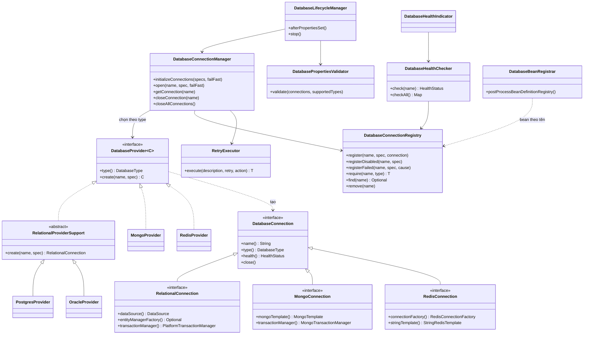
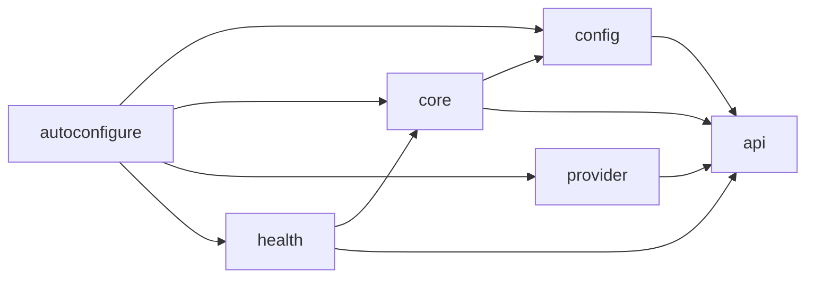
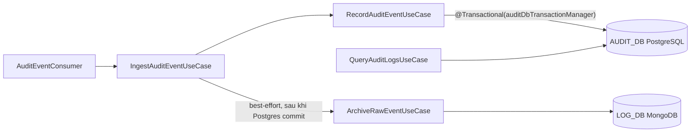

# Báo cáo: Kiến trúc Multi-Database cho Library Management System

Ký hiệu: ✅ đã chạy và kiểm chứng · ⚠️ có hạn chế hoặc chưa kiểm chứng đầy đủ · ❌ lỗi · ⏳ chưa làm · ℹ️ ghi chú.

Phạm vi thực tế (user đã chốt): **PostgreSQL, Oracle, MongoDB, Redis**. MySQL và SQL Server đã bị loại khỏi phạm vi.
Thư viện: `shared-libraries/database-common` (package `lms.database`). Service tích hợp thử: `services/support-service`,
ngữ cảnh `audit` (PostgreSQL + MongoDB).

---

## 1. Phân tích kiến trúc project ban đầu

Phân tích do 3 agent chỉ đọc thực hiện, tại thời điểm dự án còn bố cục 11 service nhỏ (sau đó được gộp thành 4 service
theo bounded context, đổi package gốc `com.company` thành `lms`; kết luận dưới đây vẫn đúng cho mô hình truy cập DB).

| Hạng mục | Hiện trạng |
|---|---|
| Build | Maven, aggregator ở `pom.xml` gốc, parent `spring-boot-starter-parent` 3.5.6 |
| Java | `java.version=21`; JDK trên máy phát triển là 27 (lệch với target 21) |
| Spring Cloud | 2025.0.0 (chỉ dùng cho `api-gateway`) |
| Kiến trúc | Microservices + DDD + Hexagonal: `domain` thuần Java, `application` (use case, port), `infrastructure` (adapter) |
| Thư viện DB | Chỉ `spring-boot-starter-data-jpa` + Flyway + driver PostgreSQL; không có Mongo/Redis/Oracle client |
| Service có DB | Chỉ service đã hiện thực (borrowing, access-control, sau này gộp vào circulation, identity) |
| Test | JUnit 5, Mockito, ArchUnit, WebMvc test, Testcontainers (PostgreSQL) |
| Quy tắc | "Database per service", giao tiếp qua Kafka, ArchUnit ép ranh giới tầng |

Hạn chế của thiết kế ban đầu đối với yêu cầu multi-database:

- Mỗi service cố định một DataSource, một EntityManagerFactory, một TransactionManager do auto-configuration tạo.
- Spring Data JPA tự quét toàn bộ `@Entity` và repository trong package của `@SpringBootApplication`.
- `@Transactional` không chỉ định tên manager; có nhiều manager thì mơ hồ hoặc chạy nhầm DB mà không báo lỗi.
- Flyway cho một DataSource, cú pháp migration đặc thù PostgreSQL.
- Rủi ro cho test hiện có: nạp auto-configuration multi-DB vào mọi service sẽ làm vỡ `@DataJpaTest`/`@WebMvcTest`.

Thành phần tái dùng được: port/adapter đã tách (thêm adapter mới không phải sửa domain), composition root trong
`*BeanConfiguration`, cấu hình theo profile `dev`/`prod`, biến môi trường `${...}` ở prod, thư mục `shared-libraries`.

## 2. Cách Database hiện tại đang hoạt động (trước thay đổi)

- Mỗi service dùng `spring.datasource.*` (dev: URL cố định tới Postgres local; prod: `${DB_URL}`, `${DB_USERNAME}`, `${DB_PASSWORD}`).
- Spring Boot tự tạo `DataSource` (Hikari), `EntityManagerFactory`, `JpaTransactionManager` tên `transactionManager`.
- Flyway tự chạy migration trong `db/migration` lúc khởi động; Hibernate `ddl-auto: validate`.
- Adapter persistence implement đồng thời port ghi (`Save*Port`) và repository của domain, bọc Spring Data repository.
- `@Transactional` đặt ở tầng use case (không có tên manager); use case là POJO được tạo thủ công trong `BeanConfiguration`.
- Redis có trong `docker-compose.yml` nhưng chưa service nào dùng.

## 3. Kiến trúc Multi-Database được đề xuất và triển khai

Quyết định: tạo thư viện dùng chung `shared-libraries/database-common`, chỉ chứa hạ tầng kỹ thuật. Mỗi service tự khai
báo các connection **của chính nó**, nên không vi phạm "database per service" (ví dụ Postgres là dữ liệu chính, Mongo lưu
log thô, Redis làm cache, đều thuộc cùng một service). Auto-configuration chỉ bật khi có `database.connections.*`, nên
các service không dùng thư viện không bị ảnh hưởng.

Cấu hình mẫu (`support-service`):

```yaml
database:
  fail-on-startup-error: true
  connections:
    AUDIT_DB:
      type: POSTGRESQL
      critical: true
      url: ${AUDIT_DB_URL}            # prod: chỉ lấy từ biến môi trường
      username: ${AUDIT_DB_USERNAME}
      password: ${AUDIT_DB_PASSWORD}
      entity-packages: lms.support.audit.infrastructure.persistence
      jpa-properties:
        hibernate.hbm2ddl.auto: none
    LOG_DB:
      type: MONGODB
      critical: false                 # lỗi LOG_DB không làm app dừng, không làm health tổng DOWN
      uri: ${LOG_DB_URI}
```

Mỗi connection có thể cấu hình `enabled`, `pool` (max-size, min-idle, idle-timeout, max-lifetime), `timeout`
(connect, validation), `retry` (max-attempts, backoff, multiplier). Validator gom **toàn bộ** lỗi cấu hình rồi ném một
lần khi khởi động (thiếu url, sai tiền tố JDBC, placeholder chưa resolve, pool/timeout/retry vô lý, tên trùng không phân
biệt hoa thường, type chưa có provider...). `ConnectionSpec.toString()` luôn che password và thông tin trong URI.

### Sơ đồ class



### Sơ đồ phụ thuộc giữa các package (ArchUnit kiểm tra không có chu trình)



`api` không phụ thuộc package nào khác; `api` và `core` không phụ thuộc `provider`; các provider (`relational`, `mongo`,
`redis`) không phụ thuộc lẫn nhau.

### Cách service dùng thư viện



## 4. Design pattern đã sử dụng và lý do

| Pattern | Nơi dùng | Vì sao |
|---|---|---|
| Strategy | `DatabaseProvider` + map theo `DatabaseType` trong `DatabaseConnectionManager` | Chọn cách tạo connection theo loại DB mà không cần `switch`/`instanceof`; thêm DB mới chỉ cần thêm một bean provider |
| Template Method | `RelationalProviderSupport` + `PostgresProvider`/`OracleProvider` | Phần Hikari/EntityManagerFactory/TransactionManager dùng chung; lớp con chỉ khai báo driver, dialect, câu lệnh kiểm tra |
| Adapter | `Default*Connection` bọc Hikari/MongoClient/Lettuce; adapter persistence của service | Che chi tiết công nghệ sau interface nhỏ; domain/application không biết DB |
| Registry | `DatabaseConnectionRegistry` (`ConcurrentHashMap`) | Một nơi duy nhất giữ connection, thread-safe, có trạng thái UP/DISABLED/FAILED |
| Dependency Injection | `List<DatabaseProvider>`, `ObjectProvider`, FactoryBean đặt tên bean | Ưu tiên cơ chế của Spring thay vì tự dựng lookup |
| Repository | Port/adapter persistence ở support-service | Giữ domain thuần |
| Factory Method | `DatabaseProvider.create(...)` | Mỗi provider là một factory method cho một loại connection |

ℹ️ **Không dùng Abstract Factory** và không tạo `DatabaseConnectionFactory` riêng: provider đã đảm nhiệm việc tạo connection,
thêm một lớp factory chỉ tạo thêm một tầng gián tiếp. Cũng **không** ép MongoDB/Redis vào chung abstraction repository của
JPA; interface chung (`DatabaseConnection`) chỉ có tên, loại, health và close.

## 5. Các file được tạo mới

**`shared-libraries/database-common/`** (44 file Java + 1 file `AutoConfiguration.imports` ở phần chính, 16 file test; khoảng 1.8 nghìn dòng mã chính và 1.4 nghìn dòng test):

- `pom.xml`; `META-INF/spring/org.springframework.boot.autoconfigure.AutoConfiguration.imports`.
- `api/`: `DatabaseType`, `DatabaseConnection`, `RelationalConnection`, `MongoConnection`, `RedisConnection`, `DatabaseProvider`,
  `ConnectionSpec`, `PoolProperties`, `TimeoutProperties`, `RetryProperties`, `HealthStatus`, `ConnectionState`; `api/exception/*` (10 lớp).
- `config/`: `DatabaseProperties`, `DatabasePropertiesValidator`.
- `core/`: `DatabaseConnectionRegistry`, `RegisteredConnection`, `DatabaseConnectionManager`, `DatabaseLifecycleManager`, `RetryExecutor`.
- `provider/relational/`: `RelationalProviderSupport`, `PostgresProvider`, `OracleProvider`, `DefaultRelationalConnection`;
  `provider/mongo/`: `MongoProvider`, `DefaultMongoConnection`; `provider/redis/`: `RedisProvider`, `DefaultRedisConnection`.
- `health/`: `DatabaseHealthChecker`, `DatabaseHealthIndicator`.
- `autoconfigure/`: `DatabaseAutoConfiguration`, `DatabaseConnectionsCondition`, `DatabaseBeanRegistrar`, `RelationalConnectionFactoryBeans`, `BeanNames`.
- Test: `ArchitectureTest`, `DatabaseAutoConfigurationTest`, `DatabasePropertiesValidatorTest`, `DatabaseConnectionManagerTest`,
  `DatabaseConnectionRegistryTest`, `RetryExecutorTest`, `DatabaseHealthTest`, và 5 IT: `PostgresProviderIT`, `MongoProviderIT`,
  `RedisProviderIT`, `OracleProviderIT`, `SpringDataRepositoryIT`; `testsupport/` (`FakeProvider`, `Note`, `NoteRepository`, `RelationalAssertions`).

**`services/support-service/`** (ngữ cảnh `lms.support.audit`):

- `domain/`: `AuditLog`, `AuditLogCriteria`, `AuditLogPage`, `AuditLogRepository`, `InvalidAuditEventException`, `InvalidAuditQueryException`.
- `application/`: `RecordAuditEventUseCase`, `QueryAuditLogsUseCase`, `ArchiveRawEventUseCase`, `IngestAuditEventUseCase`,
  các command/response, `SaveAuditLogPort`, `RawEventArchivePort`, `AuditTransactions`.
- `infrastructure/persistence/`: `AuditLogJpaEntity`, `SpringDataAuditLogRepository`, `AuditLogPersistenceAdapter`, `MongoRawEventArchive`.
- `infrastructure/messaging/`: `AuditEventParser`, `AuditEventConsumer`; `infrastructure/web/`: `AuditLogController`, `AuditExceptionHandler`.
- `infrastructure/config/`: `AuditBeanConfiguration`, `AuditPersistenceConfiguration` (Flyway không còn ở đây: system-service chạy, xem ADR-0004); `lms/support/config/SecurityConfiguration`.
- Resource: `db/migration/audit/V1__create_audit_logs.sql`, `application-dev.yml`, `application-prod.yml`.
- Test: `AuditDomainTest`, `AuditUseCasesTest`, `AuditEventParserTest`, `AuditLogSecurityTest`, `ArchitectureTest`, `SupportServiceIT`.

**Khác:** `services/identity-service/src/main/resources/db/migration/V4__add_audit_view_permission.sql`; `docs/architecture/multi-database-report.md` (file này).

## 6. Các file được chỉnh sửa

| File | Thay đổi |
|---|---|
| `pom.xml` (gốc) | Thêm module `shared-libraries/database-common` và `dependencyManagement` cho `database-common` |
| `shared-libraries/security-common/.../Permissions.java` | Thêm hằng số `AUDIT_VIEW` |
| `services/support-service/pom.xml`, `application.yml` | Thay khung bằng cấu hình đầy đủ: `database-common`, JPA, Mongo, Kafka, security; tắt auto-config xung đột |
| `docker-compose.yml` | Thêm `mongo:7`, volume `mongodata`, `support-service` (profile `apps`); không thêm Oracle |
| `infrastructure/postgres/init-databases.sql` | Thêm user và database `audit`/`audit_db` (thay `support_db`) |
| `README.md` | Cập nhật bảng service, số permission, mục "Nhiều database trong một service" |
| `shared-libraries/database-common/.../DatabaseConnectionManager.java` | Connection `critical=false` lỗi lúc khởi động chỉ bị đánh dấu FAILED, kể cả khi `fail-on-startup-error=true` |

ℹ️ Việc đổi package gốc `com.company` → `lms` và gộp 11 service thành 4 là thay đổi của người điều phối, không thuộc báo cáo này.
`api-gateway` đã có sẵn route `/api/audit-logs/**` tới support-service nên không phải sửa.

## 7. Các Database Provider được hỗ trợ

| Provider | Công nghệ | Trạng thái |
|---|---|---|
| PostgreSQL | HikariCP + JPA/Hibernate | ✅ IT Testcontainers đã chạy thật |
| Oracle | HikariCP + JPA/Hibernate (`OracleDialect`, `SELECT 1 FROM DUAL`, `ojdbc11`) | ⚠️ xem mục 10: IT hiện chỉ skipped khi chưa có biến `ORACLE_TEST_*` |
| MongoDB | Spring Data MongoDB (`MongoTemplate`, `MongoTransactionManager`) | ✅ IT Testcontainers đã chạy thật |
| Redis | Spring Data Redis (Lettuce) | ✅ IT Testcontainers đã chạy thật |
| MySQL, SQL Server | — | ℹ️ user đã loại khỏi phạm vi, không có code |

Thêm provider mới (ví dụ MariaDB): thêm giá trị vào `DatabaseType`, một lớp provider và một `@Bean`; không sửa manager hay business logic.

## 8. Cách quản lý Connection Lifecycle

1. `DatabaseLifecycleManager.afterPropertiesSet()`: validate toàn bộ cấu hình (fail-fast, gom hết lỗi), rồi mở lần lượt các connection theo thứ tự cấu hình.
   Mở ngay lúc bean được tạo (không đợi `SmartLifecycle.start()`) vì EntityManagerFactory và repository của service cần dùng trong lúc khởi động.
2. Mỗi connection mở qua `RetryExecutor` (retry + backoff lũy thừa theo cấu hình). Provider kiểm tra kết nối thật ngay trong `create`
   (Hikari fail-fast, Mongo `ping`, Redis `PING`) để lỗi nổi lên sớm và retry được.
3. Kết quả ghi vào `DatabaseConnectionRegistry`: UP, DISABLED (`enabled=false`, không mở) hoặc FAILED. Hết lần retry: connection critical làm app dừng
   (khi `fail-on-startup-error=true`), connection không critical chỉ bị đánh dấu FAILED. Nếu một connection sau lỗi, các connection đã mở được đóng lại.
4. Registry dùng `ConcurrentHashMap`; đăng ký trùng tên ném `DuplicateConnectionException` (đã có test đồng thời); tên không tồn tại, bị tắt, lỗi khởi tạo,
   sai kiểu đều có exception riêng với thông điệp rõ.
5. Health: `DatabaseHealthChecker` kiểm tra thật từng connection; `DatabaseHealthIndicator` gom vào `/actuator/health`. Chỉ connection critical bị DOWN
   mới làm tổng DOWN; DISABLED không phải lỗi.
6. Shutdown: `SmartLifecycle.stop()` (phase 0, thấp hơn web server nên dừng sau cùng) đóng **ngược** thứ tự mở; lỗi đóng một connection được log và
   không chặn các connection còn lại; `close()` của mọi connection idempotent.
7. Bean đặt tên theo quy ước (`DatabaseBeanRegistrar`): connection `AUDIT_DB` → `auditDbDataSource`, `auditDbEntityManagerFactory`, `auditDbTransactionManager`.

## 9. Cách quản lý Transaction

- Mỗi connection quan hệ có `PlatformTransactionManager` riêng (`JpaTransactionManager` nếu có `entity-packages`, ngược lại `DataSourceTransactionManager`).
  Service chọn bằng tên: `@Transactional("auditDbTransactionManager")` (tên gom vào hằng `AuditTransactions.MANAGER`).
  Repository Spring Data gắn qua `@EnableJpaRepositories(entityManagerFactoryRef=..., transactionManagerRef=...)` đặt ở `@Configuration` riêng,
  không đặt trên lớp `Application`.
- ✅ Đã kiểm chứng (`SupportServiceIT`): use case ghi Postgres rồi ghi Mongo rồi ném lỗi → Postgres **rollback** (qua `auditDbTransactionManager`),
  còn bản ghi Mongo **vẫn tồn tại**. Điều này chứng minh `@Transactional` chọn đúng manager **và** không có atomicity xuyên DB.
- ✅ `PostgresProviderIT` kiểm chứng rollback ở DB này không ảnh hưởng DB kia (hai database PostgreSQL độc lập, hai TransactionManager).
- Giới hạn: `@Transactional` **không** phải transaction phân tán. Không dùng JTA/XA (không khuyến nghị cho microservices);
  `ChainedTransactionManager` đã bị loại bỏ ở Spring Data 3.x. Nguyên tắc áp dụng: **mỗi use case chỉ ghi vào một DB**.
- Cách xử lý ở `support-service`: `IngestAuditEventUseCase` ghi Postgres trước (transaction riêng, đã commit khi trả về), rồi lưu bản thô vào Mongo theo kiểu
  best-effort, lỗi Mongo chỉ log. Archive idempotent theo `eventId` (upsert theo `_id`) nên event giao lại sẽ bù bản thô còn thiếu.
  **Không có atomicity xuyên DB**: có thể có audit log mà thiếu bản thô (lỗi Mongo), nhưng không có chiều ngược lại.
- Khi cần nhất quán mạnh hơn: Outbox (ghi sự kiện vào bảng outbox cùng transaction với dữ liệu, relay đẩy sang Mongo/Kafka, consumer idempotent theo `eventId`)
  và Saga cho thao tác xuyên service. ADR-0001 đã ghi nợ kỹ thuật Outbox; hiện chưa hiện thực.

## 10. Kết quả Build và Testing

Số liệu đo trong lần chạy cuối (JDK 27 trên máy, target Java 21; Maven 3.9.9 tải riêng; Docker 29 với `-DargLine=-Dapi.version=1.44`).

**Build và test mặc định (`mvn -B test` toàn reactor):** ✅ BUILD SUCCESS cho cả 11 module, không test nào lỗi hay bị bỏ qua.

| Module | Số test | Kết quả |
|---|---|---|
| security-common | 2 | ✅ |
| messaging-common | 4 | ✅ |
| observability-common | 2 | ✅ |
| database-common (unit, ArchUnit, autoconfig) | 45 | ✅ |
| identity-service | 42 | ✅ |
| circulation-service | 17 | ✅ |
| support-service | 24 | ✅ |
| common-kernel, api-gateway, catalog-service | 0 (không có test) | ℹ️ chỉ biên dịch |

**Integration test thật (Testcontainers, `mvn test -Dtest=... -Dsurefire.failIfNoSpecifiedTests=false -DargLine=-Dapi.version=1.44`):**

| IT | Số test | Kết quả |
|---|---|---|
| `PostgresProviderIT` (database-common) | 5 | ✅ |
| `MongoProviderIT` (database-common) | 5 | ✅ |
| `RedisProviderIT` (database-common) | 4 | ✅ |
| `SpringDataRepositoryIT` (database-common) | 2 | ✅ |
| `SupportServiceIT` (Postgres + Mongo, khởi động nguyên support-service) | 9 | ✅ |
| `IdentityServiceIT` (khởi động nguyên identity-service, luồng RBAC) | 6 | ✅ |
| `AccessControlPersistenceAdapterIT`, `AuthPersistenceAdapterIT` | 3 + 2 | ✅ (gồm migration V1-V4) |
| `BorrowingPersistenceAdapterIT` | 1 | ✅ |

- ⚠️ **Oracle chưa kiểm chứng trong lần chạy cuối:** `OracleProviderIT` cần `ORACLE_TEST_URL`, `ORACLE_TEST_USERNAME`, `ORACLE_TEST_PASSWORD`
  và không nằm trong các lần chạy ở trên. Chỉ có một lần chạy Testcontainers tạm trước đó (xem mục 12).
- ⚠️ Chưa có test với **Kafka thật** cho cả dự án: các IT service dùng broker giả không với tới được; consumer được gọi trực tiếp.
- ⚠️ `circulation-service` chưa có test khởi động nguyên ứng dụng như `identity-service` và `support-service`.
- ℹ️ Lỗi thật phát hiện nhờ `IdentityServiceIT`: khi Kafka sự cố, `KafkaEventPublisher` ném lỗi làm hỏng đăng nhập, gán role, mượn sách. Đã sửa
  thành best-effort (chỉ log) và có `KafkaEventPublisherTest` (xem ADR-0001).
- ℹ️ Ghi chú: đây là kết quả của lần chạy cuối. Không có commit git nào; không có CI.

## 11. Đánh giá khả năng tương thích ngược

- Auto-configuration chỉ bật khi có thuộc tính `database.connections.*` (`DatabaseConnectionsCondition`); service không khai báo thì thư viện không nạp bean nào.
- `database-common` chỉ được `support-service` phụ thuộc; `identity-service`, `circulation-service`, `catalog-service` và `api-gateway` không đổi cấu hình DB.
- `borrowing`/`identity` vẫn dùng auto-configuration của Spring Boot như cũ; không phải di trú.
- Migration identity thêm **V4** (không sửa V1-V3 đã chạy): thêm permission `AUDIT_VIEW` và gán cho SUPER_ADMIN, LIBRARY_ADMIN.
- Kết quả kiểm chứng tương thích: xem bảng ở mục 10 (toàn bộ `mvn test` của reactor).
- Ràng buộc cho service dùng thư viện: phải tắt `DataSourceAutoConfiguration`, `HibernateJpaAutoConfiguration`, `JpaRepositoriesAutoConfiguration`,
  `FlywayAutoConfiguration`, các auto-config Mongo, và `DataSourceTransactionManagerAutoConfiguration` để tránh xung đột (đã cấu hình trong `support-service`).

## 12. Những hạn chế còn tồn tại

- ⚠️ **Oracle** chưa được kiểm chứng trên instance Oracle thật của user: `OracleProviderIT` chỉ chạy khi đặt `ORACLE_TEST_URL`, `ORACLE_TEST_USERNAME`,
  `ORACLE_TEST_PASSWORD`. Trước khi user đổi hướng, một lần chạy Testcontainers tạm (image `gvenzl/oracle-free:slim-faststart`) đã qua (1/1, 213 giây); code `OracleProvider` không đổi từ đó.
- ℹ️ **Flyway và Hibernate validate:** `support-service` không còn chạy Flyway; script `audit` nằm trong `system-service` (chạy lúc khởi động, ADR-0004).
  `support-service` vẫn đặt `hibernate.hbm2ddl.auto=none` vì EntityManagerFactory do `database-common` tạo và chưa có bước validate; muốn validate cần
  thêm cơ chế riêng trong thư viện. `SupportServiceIT` tự migrate AUDIT_DB bằng bean test dùng script từ jar `system-service` (test scope).
- ⚠️ **Consumer Kafka chưa kiểm thử với broker thật:** `SupportServiceIT` tắt listener và gọi trực tiếp `AuditEventConsumer.onEvent(...)`. Việc phân giải
  `${app.kafka.topics.*}` và tạo listener container được kiểm chứng gián tiếp (context khởi động được), nhưng luồng message qua Kafka chưa chạy.
- ⚠️ **Xử lý lỗi consumer:** lỗi hạ tầng tạm thời (Postgres) được ném ra cho Kafka giao lại, nhưng chưa cấu hình backoff, Dead Letter Queue hay giới hạn
  retry; mặc định của Spring Kafka có thể bỏ qua message sau một số lần thử. Chưa kiểm thử.
- ⚠️ Truy vấn ghi `INSERT ... ON CONFLICT` là cú pháp riêng của PostgreSQL, nên adapter audit chưa chạy được trên DB khác.
- ⚠️ Không có atomicity xuyên DB (xem mục 9); chưa có Outbox, Saga, retry bù cho archive Mongo ngoài việc event giao lại.
- ⚠️ Thông điệp lỗi health (tên lớp exception và message) có thể lộ chi tiết kết nối ra `/actuator/health` khi bật `show-details`.
- ℹ️ Không bật/tắt connection lúc runtime, chỉ theo cấu hình lúc khởi động. Redis dùng một kết nối Lettuce dùng chung nên cấu hình `pool` không áp dụng.
  Transaction của MongoDB cần replica set (compose dùng Mongo đơn lẻ vì use case chỉ upsert từng document).
- ℹ️ Chưa tích hợp secret manager; secret đi qua biến môi trường.
- ℹ️ Môi trường: Testcontainers 1.21.3 không nhận Docker 29 trên máy này; phải thêm `-DargLine=-Dapi.version=1.44` khi chạy IT.
  `*IT` không nằm trong `mvn test` mặc định (surefire chỉ chạy `*Test`).
- ℹ️ Chỉ `support-service` có luật ArchUnit "application không import `lms.database`"; các service khác chưa cần.
- ℹ️ Ngữ cảnh `notification` của support-service vẫn là khung.

## 13. Hướng mở rộng trong tương lai

1. Hook migrate-before-EMF trong `database-common` (ví dụ `ConnectionInitializer` chạy sau khi tạo DataSource, trước khi tạo EntityManagerFactory) để bật lại `validate`.
2. Transactional Outbox cho các service phát event; consumer có DLQ, backoff và giới hạn retry; kiểm thử với Kafka thật (Testcontainers Kafka).
3. Hiện thực lưu bản thô qua Outbox hoặc projection thay cho best-effort, nếu cần bảo đảm đầy đủ.
4. Provider mới khi cần (MariaDB, SQL Server, Redis cluster/sentinel) chỉ bằng thêm provider; thêm MongoDB/Redis repository tiêu chuẩn.
5. Bật/tắt và làm mới connection lúc runtime (refresh scope), metrics Micrometer theo từng connection, tracing.
6. Tích hợp secret manager (Vault, AWS Secrets Manager) thay cho biến môi trường; xoay vòng mật khẩu không cần khởi động lại.
7. Nâng Testcontainers lên bản hỗ trợ Docker mới để bỏ cờ `api.version`; chạy `*IT` trong CI bằng failsafe hoặc tag `docker`.
8. Chuẩn hóa luật ArchUnit chung (application không import `lms.database`) thành thư viện/rule dùng lại cho mọi service.
