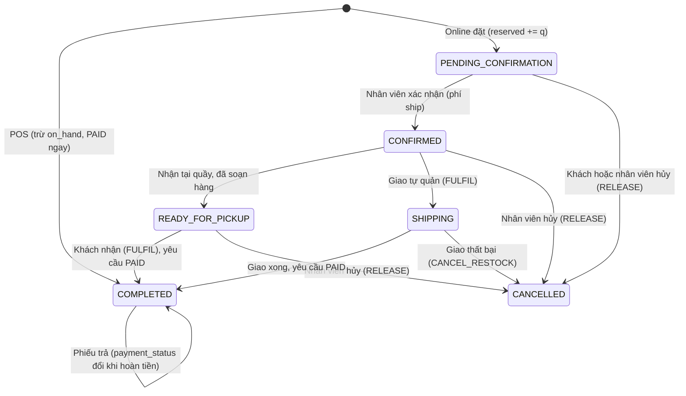

# Thiết kế module bán hàng (SALES) và module theo tenant

- Ngày: 2026-11-16. Người viết: sa. Người nhận: `be-dev`, `tester`, `perf-tester`.
- Quyết định: ADR-0009 (module theo tenant, chặn `MODULE_NOT_ENABLED`, menu), ADR-0010 (sales-service, tiền/VAT, đồng thời, audit, luồng đơn).
- Đề bài: `docs/requirements/2026-11-16-hieu-sach-module-ban-hang.md`.
- Tài liệu này là thiết kế mức ranh giới. Tên lớp, DTO, chi tiết DDL do `be-dev` chốt; tên controller/method phải chốt **trước** khi viết migration seed khóa quyền.

## 1. Bối cảnh và mục tiêu

Nền tảng cho thuê dùng chung lõi (identity, catalog, support, system) cho thư viện và hiệu sách. Tenant thuê module `LENDING` (circulation + bản sao ở catalog) và/hoặc `SALES` (sales-service mới). Mục tiêu và ràng buộc xem ADR-0009 mục 1 và ADR-0010 mục 1.

## 2. Thành phần

```
sales-service (8087), package lms.sales
├── SalesServiceApplication, config/SecurityConfiguration      (/internal/** authenticated, còn lại denyAll)
├── shared/domain          Money (long, VND), Rate (basis point), Rounding (HALF_UP số nguyên)
├── settings
│   ├── domain             SalesSettings (vatRateBps, pricesIncludeVat, returnWindowDays, fixedShippingFee,
│   │                      lowStockThreshold, currency) + defaults()
│   ├── application        GetSalesSettingsUseCase, UpdateSalesSettingsUseCase, SalesSettingsPort
│   └── infrastructure     persistence, web (SalesSettingsController), config
├── stock
│   ├── domain             StockItem (on_hand, reserved, sellingPrice?, lowStockThreshold?), StockMovement (dòng sổ cái),
│   │                      Supplier, GoodsReceipt (+ dòng), lỗi nghiệp vụ
│   ├── application        Register/UpdatePrice/List/Get stock item, Receive (confirm receipt), Adjust, Stocktake,
│   │                      StockReservationService (reserve/release/fulfil/sell/restock: API cho ordering),
│   │                      CatalogLookupPort (tra đầu sách), ports persistence
│   └── infrastructure     persistence (JPQL bulk update có điều kiện), client (HttpCatalogLookupAdapter, token chuyển
│                          tiếp), web (StockItemController, StockAdjustmentController, SupplierController,
│                          GoodsReceiptController), config
├── ordering
│   ├── domain             SalesOrder (+ OrderLine, PaymentRecord), OrderStatus, PaymentStatus, PriceCalculator
│   │                      (thuần, ADR-0010 mục 2.4), SalesReturn (+ ReturnLine, Disposition), Refund
│   ├── application        PlacePosOrder, PlaceOnlineOrder, Confirm, ApplyDiscount, MarkPaid, MarkReadyForPickup,
│   │                      MarkShipping, Complete, Cancel, CancelMyOrder, CreateReturn, MarkRefunded, queries
│   └── infrastructure     persistence, web (PosOrderController, SalesOrderController, ShopController,
│                          SalesReturnController, RefundController), messaging (Kafka best-effort sau commit)
└── audit (gói hạ tầng dùng chung trong service)
    └── SalesAuditPort (application) + adapter JPA ghi sales_audit_log trong transaction đang mở
```

Luật ArchUnit: như các service khác (domain không Spring/jakarta/jackson; application không phụ thuộc infrastructure; context chỉ dùng `application` của context khác); `TenantArchitectureRules` (mọi entity có `@TenantId`, không native query); `ModuleArchitectureRules` (mọi controller `@RequiresModule(SALES)`); test đối chiếu khóa seed (mục 7, B1.6).

Thay đổi ở module khác: xem ADR-0009 mục 3.2 (pha 0) và mục 6 dưới đây.

## 3. Mô hình dữ liệu khái niệm (sales_db)

Mọi bảng có `tenant_id` NOT NULL, `@TenantId`, `ENABLE` + `FORCE ROW LEVEL SECURITY`, policy `tenant_isolation` theo mẫu `catalog/V2__tenant_id.sql`. Khóa ngoại nội bộ dùng khóa kép `(id, tenant_id)` như catalog/circulation. Không FK sang DB khác (`title_id`, `user_id` chỉ là UUID). Không bảng nào miễn tenant. Số tiền `BIGINT` (đồng), tỷ lệ `INT` (basis point), thời gian `TIMESTAMPTZ`.

| Aggregate / bảng | Cột chính (khái niệm) | Ràng buộc, ghi chú |
|---|---|---|
| `SalesSettings` / `sales_settings` | `tenant_id` (PK), `vat_rate_bps`, `prices_include_vat`, `return_window_days`, `fixed_shipping_fee`, `low_stock_threshold`, `walk_in_pii_retention_months`, `currency`, `version`, `updated_at/by` | Một dòng mỗi tenant, **tạo lười**: chưa có dòng thì dùng `SalesSettings.defaults()`, lần lưu đầu mới chèn. Không cần event provision. `currency = 'VND'` (CHECK). Mặc định đã chốt (S5): `vat_rate_bps = 500`, `prices_include_vat = true`, `return_window_days = 7`, `low_stock_threshold = 5`, `fixed_shipping_fee = 0`, `walk_in_pii_retention_months = 12` (1..120); tất cả sửa được. Thuế suất thật tùy loại sách, tenant tự chỉnh |
| Danh bạ tenant / `sales_tenants` | `tenant_id` (PK), `first_seen_at` | **Không RLS, không `@TenantId`**, thêm vào `TENANT_EXEMPT_TABLES`. Chèn nếu chưa có trong transaction tạo đơn; chỉ job ẩn danh đọc (ADR-0010 mục 2.8) |
| `StockItem` / `stock_items` | `id`, `title_id`, `on_hand`, `reserved`, `selling_price` NULL, `low_stock_threshold` NULL, `active`, `created_at`, `updated_at` | `UNIQUE (tenant_id, title_id)`; `CHECK (on_hand >= 0 AND reserved >= 0 AND reserved <= on_hand)`; `selling_price >= 0`. Cờ `lowStock` tính lúc đọc: `on_hand − reserved <= ngưỡng` (ngưỡng mặt hàng, nếu NULL thì ngưỡng tenant) |
| Sổ cái / `stock_ledger` | `id`, `stock_item_id`, `type`, `delta_on_hand`, `delta_reserved`, `ref_type`, `ref_id`, `reason` NULL, `actor_id`, `occurred_at` | Chỉ chèn. `type` theo ADR-0010 mục 2.5. `reason` bắt buộc với `ADJUSTMENT`, `STOCKTAKE`, `WRITE_OFF` (domain + CHECK) |
| `Supplier` / `suppliers` | `id`, `name`, `phone`, `email`, `address`, `note`, `active` | `UNIQUE (tenant_id, lower(name))` |
| `GoodsReceipt` / `goods_receipts`, `goods_receipt_lines` | phiếu: `id`, `receipt_no`, `supplier_id`, `status` (`DRAFT`, `CONFIRMED`, `CANCELLED`), `client_request_id`, `confirmed_at/by`, `version`; dòng: `title_id`, `quantity > 0`, `unit_cost >= 0` | Chỉ `DRAFT` sửa/hủy được. Xác nhận: mọi dòng phải là mặt hàng đã đưa vào bán; cộng `on_hand` + `RECEIPT` trong một transaction. Đã xác nhận thì bất biến; sai thì điều chỉnh |
| `SalesOrder` / `sales_orders` | `id`, `order_no`, `channel` (`POS`, `ONLINE`), `status`, `payment_status`, `payment_method` (`CASH`, `BANK_TRANSFER`, `CARD`, `COD`), `customer_user_id` NULL, `walk_in_name` NULL, `walk_in_phone` NULL, `fulfilment` (`COUNTER`, `PICKUP`, `DELIVERY`), `recipient_name/phone/address` NULL, `vat_rate_bps`, `prices_include_vat`, `currency`, `subtotal`, `discount_total`, `vat_total`, `shipping_fee`, `grand_total`, `order_discount_type/value` NULL, `client_request_id`, `exchange_of_return_id` NULL, `created_by`, `created_at`, `confirmed_at/by`, `paid_at`, `completed_at`, `cancelled_at/by`, `cancel_reason`, `pii_anonymized_at` NULL, `version` | `UNIQUE (tenant_id, order_no)`, `UNIQUE (tenant_id, client_request_id)`. `order_no` dễ đọc theo tenant (bộ đếm theo tenant trong cùng transaction, `be-dev` chọn cách). Trường `walk_in_*`, `recipient_*` là dữ liệu cá nhân (mục 5.7); `walk_in_name/phone` bị ẩn danh sau thời hạn lưu giữ. Chỉ mục phục vụ job: `(tenant_id, completed_at)` lọc `pii_anonymized_at IS NULL` |
| Dòng đơn / `sales_order_lines` | `id`, `order_id`, `line_no`, `title_id`, `title_name` (snapshot), `isbn` (snapshot), `quantity > 0`, `unit_price`, `line_discount`, `allocated_order_discount`, `amount`, `vat_amount`, `line_total` | Trong aggregate đơn. Bất biến số học ở ADR-0010 mục 2.4 |
| Thanh toán / `payment_records` | `id`, `order_id`, `amount`, `method`, `reference` NULL, `recorded_by`, `recorded_at` | Ghi khi đánh dấu đã thu (online) hoặc khi tạo POS. Giai đoạn này một bản ghi thu mỗi đơn, số tiền = `grand_total` (không thu từng phần) |
| `SalesReturn` / `sales_returns`, `sales_return_lines` | phiếu: `id`, `return_no`, `order_id`, `reason`, `late` (mặc định false), `late_reason` (bắt buộc khi `late`, CHECK), `days_overdue`, `client_request_id`, `created_by/at` (với phiếu quá hạn, `created_by` là người cho phép); dòng: `order_line_id`, `quantity`, `disposition` (`RESTOCK`, `WRITE_OFF`), `refund_amount` | Tạo phiếu khóa dòng đơn (`PESSIMISTIC_WRITE`) rồi kiểm số lượng còn trả được |
| `Refund` / `refunds` | `id`, `order_id`, `source` (`CANCELLATION`, `RETURN`), `return_id` NULL, `amount`, `status` (`PENDING`, `REFUNDED`), `method` NULL, `reference` NULL, `refunded_by/at`, `version` | Đơn chưa thu thì không sinh hoàn tiền |
| Nhật ký / `sales_audit_log` | `id` (= eventId), `action`, `aggregate_type`, `aggregate_id`, `actor_id`, `occurred_at`, `data` (JSONB, không PII), `published_at` NULL | Chỉ chèn, cùng transaction (ADR-0010 mục 2.6) |

`payment_status` của đơn: `UNPAID`, `PAID`, `PARTIALLY_REFUNDED`, `REFUNDED` (tính từ hoàn tiền đã `REFUNDED`).

Hai migration sales: `V1` (pha 1: settings, stock, ledger, suppliers, receipts, orders, lines, payments, audit), `V2` (pha 2: returns, refunds, cột online/giao nhận nếu chưa có). Bật RLS sau cùng trong mỗi file. Không seed dữ liệu tenant trong sales (cấu hình tạo lười).

## 4. Máy trạng thái đơn



- Trục thanh toán độc lập: `UNPAID → PAID` được ở `CONFIRMED`, `READY_FOR_PICKUP`, `SHIPPING` (COD thu khi giao). `PENDING_CONFIRMATION` chưa cho đánh dấu thu (đơn chưa được nhận).
- Giảm giá cho đơn online: chỉ khi `UNPAID` và trạng thái `PENDING_CONFIRMATION` hoặc `CONFIRMED`; tính lại toàn bộ dòng.
- Hủy đơn `PAID` → tạo `Refund(CANCELLATION, PENDING)` trong cùng transaction.
- Mọi chuyển trạng thái nằm ở `SalesOrder` (domain), trạng thái không cho phép → `409 ORDER_STATE_CONFLICT`; xung đột phiên bản cũng trả mã này.

## 5. Hợp đồng API (mức ranh giới)

Đường dẫn service dưới `/internal/sales/**`; lms-api ánh xạ 1-1 sang `/api/sales/**` (nhân viên) và `/api/shop/**` (khách), DTO riêng cho FE (ADR-0005). Khóa = `Controller/method` của sales-service (tên dưới đây là đề xuất, `be-dev` chốt rồi **không đổi**). Mọi controller `@RequiresModule(SALES)`. Endpoint tạo chứng từ nhận `clientRequestId`.

### 5.1. Cấu hình, mặt hàng, kho

| Method, đường dẫn (service) | Khóa đề xuất | Vào / ra chính |
|---|---|---|
| GET `/settings` | `SalesSettingsController/get` | → cấu hình hiệu lực (gồm mặc định nếu chưa lưu) |
| PUT `/settings` | `SalesSettingsController/update` | `{vatRateBps, pricesIncludeVat, returnWindowDays, fixedShippingFee, lowStockThreshold, walkInPiiRetentionMonths, version}` |
| POST `/stock-items` | `StockItemController/register` | `{titleId, sellingPrice?, lowStockThreshold?}` → `201` mặt hàng tồn 0 |
| GET `/stock-items` | `StockItemController/search` | query record `{keyword?, lowStockOnly?, page, size}` → trang `{titleId, titleName, onHand, reserved, available, sellingPrice, effectivePrice, lowStock}` (tên đầu sách tra catalog theo lô) |
| GET `/stock-items/{titleId}` | `StockItemController/get` | chi tiết |
| PUT `/stock-items/{titleId}/price` | `StockItemController/updatePrice` | `{sellingPrice | null}` (null = quay về `coverPrice`) |
| GET `/stock-items/{titleId}/ledger` | `StockItemController/ledger` | trang dòng sổ cái |
| POST `/stock-adjustments` | `StockAdjustmentController/adjust` | `{titleId, delta ≠ 0, reason}` |
| POST `/stocktakes` | `StockAdjustmentController/stocktake` | `{titleId, countedOnHand ≥ reserved, reason}` → ghi `STOCKTAKE` với chênh lệch |
| GET/POST `/suppliers`, PUT `/suppliers/{id}` | `SupplierController/search`, `/create`, `/update` | |
| POST `/goods-receipts` | `GoodsReceiptController/create` | `{supplierId, lines[{titleId, quantity, unitCost}], clientRequestId}` → `DRAFT` |
| GET `/goods-receipts`, GET `/goods-receipts/{id}` | `GoodsReceiptController/search`, `/get` | |
| POST `/goods-receipts/{id}/confirmation` | `GoodsReceiptController/confirm` | cộng tồn + sổ cái |
| POST `/goods-receipts/{id}/cancellation` | `GoodsReceiptController/cancel` | chỉ `DRAFT` |

### 5.2. Đơn (nhân viên)

| Method, đường dẫn | Khóa đề xuất | Ghi chú |
|---|---|---|
| POST `/pos-orders` | `PosOrderController/create` | `{lines[{titleId, quantity}], paymentMethod (CASH/BANK_TRANSFER/CARD), customerUserId?, walkIn?{name?, phone?}, clientRequestId}`; có trường giảm giá → `400 DISCOUNT_NOT_ALLOWED` |
| POST `/pos-orders/discounted` | `PosOrderController/createWithDiscount` | như trên + `lines[].discount{type: AMOUNT/PERCENT, value}`, `orderDiscount?` |
| GET `/orders` | `SalesOrderController/search` | query record `{status?, paymentStatus?, channel?, from?, to?, keyword?, page, size}`; liên hệ khách **che một phần** |
| GET `/orders/{id}` | `SalesOrderController/get` | chi tiết, liên hệ che một phần |
| GET `/orders/{id}/contact` | `SalesOrderController/getContact` | liên hệ đầy đủ (khóa riêng) |
| GET `/orders/{id}/receipt` | `SalesOrderController/receipt` | dữ liệu phiếu in: tiền hàng, giảm giá, VAT, phí ship, tổng, thuế suất snapshot |
| POST `/orders/{id}/confirmation` | `SalesOrderController/confirm` | `{shippingFee?, version}` (không gửi thì dùng phí cố định khi `DELIVERY`, 0 khi `PICKUP`) |
| POST `/orders/{id}/discount` | `SalesOrderController/applyDiscount` | khóa riêng |
| POST `/orders/{id}/payment` | `SalesOrderController/markPaid` | `{method, reference?, version}`; số tiền = `grandTotal` |
| POST `/orders/{id}/ready-for-pickup` | `SalesOrderController/markReadyForPickup` | |
| POST `/orders/{id}/shipping` | `SalesOrderController/markShipping` | |
| POST `/orders/{id}/completion` | `SalesOrderController/complete` | yêu cầu `PAID` |
| POST `/orders/{id}/cancellation` | `SalesOrderController/cancel` | `{reason, version}` |

### 5.3. Khách (role khách được gán các khóa này)

| Method, đường dẫn | Khóa đề xuất | Ghi chú |
|---|---|---|
| GET `/shop/items` | `ShopController/listItems` | mặt hàng `active`, `available > 0` hoặc hiển thị hết hàng; giá hiệu lực |
| POST `/shop/orders` | `ShopController/placeOrder` | `{lines, fulfilment (PICKUP/DELIVERY), paymentMethod (BANK_TRANSFER/COD/CASH tại quầy), recipient?{name, phone, address}, clientRequestId}`; `userId` lấy từ token |
| GET `/shop/orders` | `ShopController/myOrders` | chỉ đơn của chính mình |
| GET `/shop/orders/{id}` | `ShopController/myOrder` | đơn người khác → `404 ORDER_NOT_FOUND` |
| POST `/shop/orders/{id}/cancellation` | `ShopController/cancelMyOrder` | chỉ `PENDING_CONFIRMATION` |

### 5.4. Trả hàng và hoàn tiền

| Method, đường dẫn | Khóa đề xuất | Ghi chú |
|---|---|---|
| POST `/returns` | `SalesReturnController/create` | `{orderId, lines[{orderLineId, quantity, disposition}], reason, refundMethod?, clientRequestId}` → phiếu + `Refund(PENDING)`; quá N ngày → `409 RETURN_WINDOW_EXPIRED` |
| POST `/returns/late` | `SalesReturnController/createLate` | Như trên + `lateReason` bắt buộc; bỏ kiểm N ngày, các quy tắc khác giữ nguyên; audit `RETURN_LATE_APPROVED` (người, thời điểm, số ngày quá hạn, lý do). Khóa riêng, mẫu Quản lý cửa hàng (ADR-0010 mục 2.7) |
| GET `/returns/{id}`, GET `/orders/{id}/returns` | `SalesReturnController/get`, `/listByOrder` | |
| GET `/refunds` | `RefundController/search` | lọc `status` |
| POST `/refunds/{id}/completion` | `RefundController/markRefunded` | `{method, reference?, version}` |
| GET `/audit-log` | `SalesAuditController/search` | nhật ký bán hàng (nguồn chuẩn), pha 2 |

### 5.5. Ngoài sales-service

| Service | Endpoint | Ghi chú |
|---|---|---|
| identity | `/api/platform/tenants/{id}/modules[/{module}]` | ADR-0009 mục 2.3 |
| identity | `POST /internal/auth/signup` ← lms-api `POST /api/auth/signup` | ADR-0010 mục 2.3; `201`; lỗi `403 SIGNUP_NOT_AVAILABLE`, trùng → lỗi trùng chung hiện có, `400` validate |
| catalog | tra nhiều đầu sách theo id (`TitleController/lookup`) | trả `{id, name, author, isbn, coverPrice}` cho id thấy được trong tenant; id không thấy thì không có trong kết quả |

### 5.6. Mã lỗi nghiệp vụ (định dạng `ErrorResponse`)

`403 MODULE_NOT_ENABLED`, `403 TENANT_REQUIRED`, `403 FORBIDDEN` (sẵn có); `404 ORDER_NOT_FOUND`, `404 STOCK_ITEM_NOT_FOUND`, `404 SUPPLIER_NOT_FOUND`, `404 RECEIPT_NOT_FOUND`, `404 RETURN_NOT_FOUND`, `404 REFUND_NOT_FOUND`; `409 INSUFFICIENT_STOCK` (details: `titleId`, `available`), `409 TITLE_NOT_AVAILABLE`, `409 STOCK_ITEM_EXISTS`, `409 STOCK_ITEM_NOT_REGISTERED`, `409 ORDER_STATE_CONFLICT`, `409 RECEIPT_STATE_CONFLICT`, `409 RETURN_WINDOW_EXPIRED`, `409 RETURN_QUANTITY_EXCEEDED`, `409 ORDER_NOT_PAID`, `409 SETTINGS_VERSION_CONFLICT`; `400 DISCOUNT_NOT_ALLOWED`, `400 DISCOUNT_EXCEEDS_AMOUNT`, `400 REASON_REQUIRED`, `400 LATE_REASON_REQUIRED`, `400 INVALID_SETTINGS`, `400 INVALID_QUANTITY`, `400 INVALID_PRICE`, `400` validate; `503 CATALOG_UNAVAILABLE`.

### 5.7. Dữ liệu cá nhân

- Danh sách và chi tiết đơn: tên che (giữ ký tự đầu mỗi từ), điện thoại che (giữ 3 số cuối), địa chỉ chỉ hiện quận/huyện nếu tách được, còn lại che. Xem đầy đủ qua `getContact` (khóa riêng). Khách xem đơn của chính mình thấy đầy đủ thông tin của mình.
- Không ghi PII vào log, audit, event Kafka. `toString` của record/entity chứa PII không in các trường đó (kiểm bằng test).
- Lưu giữ (đã chốt S4): tên và điện thoại khách vãng lai bị ẩn danh sau `walkInPiiRetentionMonths` (mặc định 12) tính từ khi đơn kết thúc, bằng job hằng ngày (ADR-0010 mục 2.8). Đơn đã ẩn danh hiển thị liên hệ trống và `piiAnonymizedAt`; `getContact` trả trường rỗng, không lỗi.
- Đơn chuyển khoản quá hạn: không tự hủy (S1); `GET /orders` có bộ lọc `paymentStatus=UNPAID` + `to` (tạo trước thời điểm) để nhân viên tìm và hủy tay.

## 6. Cấu hình và triển khai

| Nơi | Thay đổi |
|---|---|
| `pom.xml` gốc | `<module>services/sales-service</module>` |
| `services/sales-service` | pom (phụ thuộc security-common, tenant-common, messaging-common, observability-common, common-kernel; `system-service` test scope kèm exclusion wildcard như ADR-0007 mục 3.6), Dockerfile theo mẫu catalog, `application.yml` (`server.port: 8087`, `spring.datasource` = `sales_app`, `ddl-auto: validate`, `open-in-view: false`, khối `lms:` ở **cuối file**, `require-tenant: true`, `CATALOG_SERVICE_URL`, `app.kafka.topics.sales-events: sales.events`), `application-dev.yml` tắt kiểm quyền như các service khác |
| `infrastructure/postgres/init-databases.sql` | `CREATE USER sales`, `CREATE DATABASE sales_db OWNER sales`, `CREATE USER sales_app ... NOSUPERUSER NOBYPASSRLS NOCREATEDB NOCREATEROLE` (volume cũ: `docker compose down -v` hoặc chạy tay) |
| system-service | `db/migration/sales/V1__*.sql`, `afterMigrate.sql`; `migration.targets.sales` cuối danh sách (`SALES_DB_URL/USERNAME/PASSWORD`); target được chấp nhận ở API `/internal/migrations/{target}` |
| `docker-compose.yml` | system-service thêm `SALES_DB_*`; service `sales-service` (profile `apps`, `depends_on` postgres healthy, system-service healthy, kafka started, `expose: 8087`, `DB_*` = `sales_app`, `JWT_JWK_SET_URI`, `INTERNAL_API_KEY`, `IDENTITY_SERVICE_URL`, `CATALOG_SERVICE_URL`, `KAFKA_BOOTSTRAP_SERVERS`); lms-api thêm `SALES_SERVICE_URL: http://sales-service:8087` và `depends_on` |
| nginx | `location = /api/auth/signup` với `limit_req` (vùng riêng hoặc dùng chung `login`), còn lại không đổi |
| lms-api | `ServicesProperties.salesUrl`, `SalesClientConfiguration`, `SalesClient`/`HttpSalesClient`, controller + DTO `/api/sales/**`, `/api/shop/**`, `POST /api/auth/signup` |
| support-service | thêm `sales.events` vào `AuditEventConsumer` (best-effort) |
| tenant-common | `tenant_modules` vào `TENANT_EXEMPT_TABLES` |
| Tài liệu | README (bảng service/cổng, glossary), CLAUDE.md (cổng, thứ tự chạy), ADR-0006 (bảng toàn cục, danh sách vai trò `<svc>_app`) |

## 7. Phân việc theo pha

Ký hiệu: B = be-dev, T = tester, P = perf-tester. Việc cùng hàng "song song" giao được cho các agent khác nhau vì phạm vi file tách biệt.

### Pha 0: hạ tầng module và chặn (ADR-0009)

Chi tiết ở ADR-0009 mục 4. Thứ tự: B0.1 → (B0.2 ‖ B0.3 ‖ B0.4) → T0.x. B0.4 gồm cả menu mặc định trong code cho tenant chưa có menu và `MenuAdminController/initializeDefaults` (đã chốt M3); `DefaultMenus` có sẵn mục SALES với `permissionKey` theo tên đề xuất ở mục 5, phải cập nhật nếu B1.3 đổi tên. Pha 1 có thể bắt đầu B1.1, B1.2 song song với pha 0 (khác file), nhưng sales-service cần B0.1 để có `@RequiresModule`.

### Pha 1: sales lõi (tồn kho + POS)

| # | Ai | Việc | Phụ thuộc | Song song với |
|---|---|---|---|---|
| ⏳ B1.1 | be-dev | Khung `sales-service` (pom, app, security, yml, Dockerfile), init SQL, target `sales` + `V1` + `afterMigrate`, compose, pom gốc | B0.1 | B1.2, B1.4 |
| ⏳ B1.2 | be-dev | Domain + application thuần: `Money`, `PriceCalculator` (ADR-0010 mục 2.4), `SalesSettings`, `StockItem`, sổ cái, `GoodsReceipt`, đơn POS; unit test số học (bảng ví dụ gồm/chưa gồm thuế, giảm giá phân bổ, làm tròn biên `.5`) | không | B1.1, B1.4 |
| ⏳ B1.3 | be-dev | Infrastructure: persistence (bulk update có điều kiện, `@Version`, khóa), web (controller mục 5.1, 5.2 POS + đọc đơn + phiếu in), client catalog, `SalesAuditPort` + phát Kafka sau commit, exception handler, ArchUnit | B1.1, B1.2, B1.4 | B1.5 |
| ⏳ B1.4 | be-dev | catalog: endpoint tra nhiều đầu sách (`TitleController/lookup`) + test WebMvc | không | B1.1, B1.2 |
| ⏳ B1.5 | be-dev | lms-api: `SalesClient`, controller `/api/sales/**` pha 1, DTO, test client/controller | hợp đồng mục 5 (không chờ code) | B1.3 |
| ⏳ B1.6 | be-dev | identity `V17` (⚠️ kiểm số): khóa sales vào `permissions` + `role_templates` (module SALES) Thu ngân, Thủ kho, Quản lý cửa hàng; test đối chiếu khóa seed ở sales-service | **tên controller pha 1 đã chốt** (sau B1.3) | B1.7 |
| ⏳ B1.7 | be-dev | support: nghe `sales.events`; system `V3`: mục menu SALES gắn khóa thật (nếu V2 của pha 0 chưa có khóa) | B1.3 | B1.6 |
| ⏳ T1.1 | tester | Unit/WebMvc sales: quyền từng endpoint (thiếu khóa 403, giảm giá ở `create` 400, `createWithDiscount` thiếu khóa 403), `MODULE_NOT_ENABLED` khi token không có SALES | B1.3 | |
| ⏳ T1.2 | tester | IT Testcontainers bằng vai trò `sales_app`: cách ly tenant mọi bảng mới theo mẫu `CatalogTenantIsolationIT` (A không thấy/ghi dữ liệu B, không tenant thì `TENANT_REQUIRED`); `TenantArchitectureRulesTest`; nhập kho xác nhận tăng tồn + sổ cái; đơn nhiều dòng giảm đúng từng dòng; vượt tồn bị từ chối, không tạo đơn một phần; `clientRequestId` gửi lại không trừ hai lần; đối soát `on_hand = Σ sổ cái` | B1.3 | T1.1 |
| ⏳ T1.3 | tester | **Test đồng thời**: N luồng bán cùng đầu sách còn 1 → đúng 1 thành công, tồn 0, không âm; hai đơn nhiều dòng thứ tự ngược nhau không deadlock; hai người đánh dấu thu cùng đơn → một `409` (pha 2) | B1.3 | |
| ⏳ T1.4 | tester | Tenant bật cả hai module: mượn không đổi tồn bán, bán không đổi bản sao khả dụng; `sellingPrice` NULL dùng `coverPrice`, đổi `sellingPrice` không đổi `coverPrice` và phí phạt | B1.3, B0.x | |
| ⏳ T1.5 | tester | Đầu-cuối qua nginx: platform admin bật SALES, đăng nhập lại, nhập kho, bán POS, in phiếu | B1.5, B1.6 | |
| ⏳ P1.1 | perf-tester | POS đồng thời trên đầu sách nóng (ví dụ 50 luồng, 1 đầu sách) và trên nhiều đầu sách; đo p95 và tỷ lệ lỗi ngoài `INSUFFICIENT_STOCK`. Mục tiêu tham khảo ⚠️ chưa có số nền: p95 < 300 ms ở sales-service khi catalog phản hồi < 50 ms | B1.3 | |

### Pha 2: online, khách, trả hàng

| # | Ai | Việc | Phụ thuộc | Song song với |
|---|---|---|---|---|
| ⏳ B2.1 | be-dev | identity: cờ `signup_default` (roles + templates, luật không phải admin, chỉ mục duy nhất), `POST /internal/auth/signup`, mở trong `SecurityConfiguration`; lms-api `POST /api/auth/signup`; nginx `limit_req` | pha 0 | B2.2 |
| ⏳ B2.2 | be-dev | sales: `V2`, máy trạng thái online, `ShopController`, các thao tác nhân viên mục 5.2 (hủy tay, không job hủy tự động), hủy/hoàn tiền, phiếu trả (`RESTOCK`/`WRITE_OFF`), **trả quá hạn `createLate`** (lý do bắt buộc, audit), đổi hàng, che PII + `getContact`, `SalesAuditController` | pha 1 | B2.1 |
| ⏳ B2.3 | be-dev | identity `V18` (⚠️ kiểm số): khóa pha 2 vào `permissions`, cập nhật mẫu Thu ngân/Quản lý cửa hàng (Quản lý cửa hàng có thêm `SalesReturnController/createLate`), mẫu Khách hàng (`signup_default`) với khóa `ShopController/*` | tên controller pha 2 đã chốt | B2.4 |
| ⏳ B2.5 | be-dev | **Cuối pha 2**: chính sách lưu giữ dữ liệu khách vãng lai: `walkInPiiRetentionMonths` trong cấu hình (nếu chưa có ở V1 thì migration sales `V3`), bảng `sales_tenants` + ghi khi tạo đơn, `AnonymizeWalkInContactsUseCase`, job `@Scheduled` hằng ngày (bật/tắt bằng cấu hình), audit theo lô (ADR-0010 mục 2.8) | B2.2 | B2.4 |
| ⏳ B2.4 | be-dev | lms-api `/api/shop/**` và phần còn lại `/api/sales/**`; system: mục menu khách | hợp đồng mục 5 | B2.3 |
| ⏳ T2.1 | tester | Luồng online: đặt giữ tồn, hủy hoàn tồn, xác nhận + phí ship, chuyển khoản/COD chưa "đã thu" tới khi đánh dấu, `COMPLETED` cần `PAID`, giao thất bại hoàn tồn; audit có người/thời điểm/số tiền | B2.2 | |
| ⏳ T2.2 | tester | Khách chỉ thấy đơn của mình (đơn người khác 404); tự đăng ký vào tenant không bật SALES → `SIGNUP_NOT_AVAILABLE`; role đăng ký không bao giờ admin; khách vãng lai không cần tài khoản; PII bị che ở danh sách, không có trong log/audit | B2.1, B2.2 | T2.1 |
| ⏳ T2.3 | tester | Trả hàng: trong N ngày thành công, tồn cộng lại (hoặc hao hụt ghi sổ cái, tồn không đổi); quá N ngày qua `create` bị `409 RETURN_WINDOW_EXPIRED`; quá N ngày qua `createLate` có khóa và lý do thành công, có audit `RETURN_LATE_APPROVED`; `createLate` thiếu lý do 400, thiếu khóa 403; vượt số đã mua (tính cả lần trước) từ chối; hai phiếu trả đồng thời không vượt; tổng hoàn không vượt tổng dòng; thiếu khóa trả/hoàn 403 | B2.2 | T2.1 |
| ⏳ T2.4 | tester | VAT gồm/chưa gồm thuế cho tổng đúng; phí ship không chịu VAT; đổi cấu hình sau đó không đổi đơn cũ; giảm giá không làm tổng âm; tenant chưa lưu cấu hình nhận đúng mặc định (5%, gồm thuế, 7 ngày, ngưỡng 5, ship 0, 12 tháng) | B2.2 | |
| ⏳ T2.5 | tester | Job ẩn danh (IT, vai trò `sales_app`, đồng hồ giả): hai tenant thời hạn khác nhau, chỉ đơn đã kết thúc quá hạn bị xóa tên/điện thoại, đơn và số tiền giữ nguyên, đơn chưa kết thúc không bị đụng, chạy lại không đổi gì, tenant này không ảnh hưởng tenant kia, có audit theo lô không chứa PII | B2.5 | |
| ⏳ P2.1 | perf-tester | Đặt online đồng thời + hủy đồng thời trên cùng đầu sách; kiểm `reserved` cuối cùng đúng bằng tổng đơn còn hiệu lực | B2.2 | |

## 8. Rủi ro và việc chưa kiểm chứng

Tổng hợp ở ADR-0009 mục 5 và ADR-0010 mục 4. Bổ sung riêng cho thiết kế chi tiết:

- ⚠️ `order_no` theo tenant bằng bộ đếm trong cùng transaction tạo một dòng "nóng" mỗi tenant; với quy mô một cửa hàng chấp nhận được, chưa đo.
- ⚠️ Tra catalog theo lô cho danh sách mặt hàng (`GET /stock-items`, `/shop/items`) thêm một lần gọi HTTP mỗi trang; chưa đo.
- ✅ Mọi câu mở (M1 đến M3, S1 đến S6) đã được người dùng chốt ngày 2026-11-16; xem ADR-0009 mục 6 và ADR-0010 mục 5. Nếu đề bài cập nhật sau mâu thuẫn thì lấy quyết định đã chốt làm chuẩn và báo lại sa.
- ⚠️ Job ẩn danh chạy theo danh bạ `sales_tenants`: tenant chưa từng có đơn không có trong danh bạ (đúng, vì không có dữ liệu khách vãng lai). Thiếu dòng do lỗi ghi là không thể vì ghi cùng transaction tạo đơn.
- ⚠️ Nhiều instance sales-service cùng chạy job: an toàn nhờ cập nhật idempotent, nhưng tốn gấp đôi truy vấn; nếu scale nhiều instance thì cân nhắc khóa advisory PostgreSQL.
- ℹ️ Ngoài phạm vi, nợ có sẵn: `borrow_rules` chưa nối `BorrowBookUseCase`; chạy bù kiểm chứng ADR-0006 (`mvn -B test '-Dtest=*Test,*IT' -Dsurefire.failIfNoSpecifiedTests=false -DargLine=-Dapi.version=1.44`) nên làm trước pha 0 để có nền xanh.
