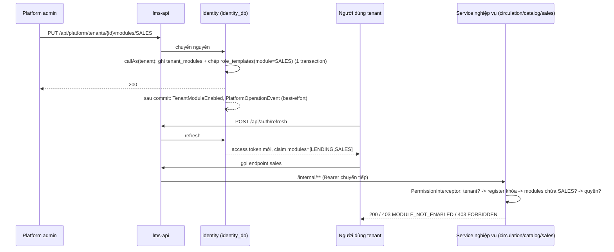

# ADR-0009: Module theo tenant (LENDING, SALES) và điểm chặn chung `MODULE_NOT_ENABLED`

- Trạng thái: đề xuất, các câu mở M1 đến M3 đã được người dùng chốt ngày 2026-11-16 (chưa có code)
- Liên quan: ADR-0003 (phân quyền động), ADR-0005 (BFF), ADR-0006 (multi-tenant), ADR-0007 (menu), ADR-0008 (đọc xuyên tenant), ADR-0010 (module bán hàng)
- Đề bài: `docs/requirements/2026-11-16-hieu-sach-module-ban-hang.md` (mục 5.1, 6, 8, rủi ro 1, 2, 7 ở mục 9)

## Vì sao tách thành hai ADR

ADR này chỉ nói về **cơ chế nền tảng** "tenant thuê module nào, endpoint/menu nào bị chặn". Nó không phụ thuộc sales: làm xong pha 0 thì lending đã chạy dưới cơ chế mới và có thể duyệt, triển khai, kiểm thử độc lập. ADR-0010 nói về **nghiệp vụ bán hàng** (service mới, tiền/VAT, tồn kho đồng thời, luồng đơn), có vòng đời và người duyệt khác. Gộp lại thì một quyết định nghiệp vụ còn tranh cãi (ví dụ VAT) sẽ chặn việc duyệt hạ tầng module.

## 1. Bối cảnh và mục tiêu

Hiện trạng đã đối chiếu trong code (nhánh `main`, kể cả thay đổi chưa commit):

- Tenant ở `identity_db.tenants` (bảng toàn cục, không RLS), aggregate `lms.identity.tenant.domain.Tenant` (id, code, name, organizationId, status). Không có khái niệm module.
- Tạo tenant: `CreateTenantUseCase` chạy trong `TenantContext.callAs(tenantMới)`, một transaction: lưu tenant, chép **toàn bộ** `role_templates` thành role của tenant (`TenantRoleProvisioningAdapter.seedFromTemplates`), gán quản trị viên; sau commit phát `TenantCreated` và `PlatformOperationEvent` lên `identity-events` (best-effort).
- `role_templates`/`role_template_permissions` là bảng toàn cục (V11), 5 mẫu chép từ role seed `a1..a5` (chỉ `a1 SUPER_ADMIN` có `is_admin`). `role_template_permissions.permission_code` **không** có FK, nhưng `role_permissions.permission_code` **có** FK tới `permissions(code)` (V2): chép mẫu có khóa chưa đăng ký sẽ lỗi FK.
- Token: `TokenService.issue` tính `roles/permissions/admin` theo tenant đã chọn trong `TenantContext.callAs`; mọi lần đăng nhập, làm mới, đổi tenant đều đi qua đây. `access-token-ttl: PT15M`, `refresh-token-ttl: P7D`.
- `PermissionInterceptor` (security-common) là chỗ duy nhất trả 403 `TENANT_REQUIRED`, xử lý `@PublicEndpoint`, `@AuthenticatedOnly`, `@PlatformAdminOnly`, `@CrossTenantReadable` (ADR-0008). Lỗi ghi dạng `{"code","message"}`. Interceptor **không được đăng ký** khi `lms.security.permission.enabled=false` (profile dev).
- Menu: `system_db.menus` (ADR-0007, đã có code), lọc ở `MenuTree.visibleFor(MenuViewer{admin, permissions})`, cache Redis lưu cây **chưa lọc** theo tenant. Tenant mới chưa có menu (ADR-0007 Q2 còn để phase 2).
- `lms-api` chuyển nguyên `/api/platform/**` sang identity (`IdentityGatewayController`), không cần sửa khi thêm endpoint platform.
- Migration mới nhất: identity `V15`, system `V1` (⚠️ phải kiểm lại số kế tiếp ngay trước khi tạo file).

Mục tiêu: tenant có tập module `LENDING`, `SALES`; platform admin bật/tắt; endpoint của module tắt trả 403 `MODULE_NOT_ENABLED` hai chiều; menu của module tắt bị ẩn; tenant hiện có giữ hành vi cũ (LENDING).

Ràng buộc: không atomicity xuyên DB; Kafka best-effort (ADR-0001); không hardcode tên role; khóa quyền `Controller/method`; quyền mới chỉ hiệu lực ở token kế tiếp.

## 2. Quyết định

### 2.1. Nơi lưu: bảng `tenant_modules` trong `identity_db`

- Bảng mới `tenant_modules` (khái niệm): `tenant_id` (FK `tenants`), `module` (`LENDING` | `SALES`, CHECK), `enabled`, `updated_at`, `updated_by`; khóa chính `(tenant_id, module)`. Giữ dòng khi tắt (`enabled=false`) để biết lần đổi cuối; lịch sử đầy đủ nằm ở audit.
- Bảng **toàn cục** như `tenants` (không RLS, không `@TenantId`): platform admin không có tenant vẫn phải đọc/ghi được, và token service đọc trước khi vào ngữ cảnh tenant. Thêm `tenant_modules` vào `TenantArchitectureRules.TENANT_EXEMPT_TABLES` và danh sách bảng toàn cục của ADR-0006.
- Quy tắc nghiệp vụ trong `tenant.domain` (aggregate `Tenant` giữ tập module, hoặc value object `TenantModules`; `be-dev` chọn): mã module thuộc tập đóng; tenant luôn có **ít nhất một** module bật (tắt module cuối cùng → 409 `TENANT_MODULE_REQUIRED`, đã chốt M1; tạo tenant với `modules` rỗng → 400); bật lại module đang bật là idempotent.
- Migration identity `V16` (⚠️ kiểm số): tạo bảng, backfill `LENDING` cho **mọi** tenant hiện có (bảng không RLS nên không cần `set_config`), thêm cột `role_templates.module` (NULL = lõi), đặt `LENDING` cho mẫu `a2..a5`, `a1` (quản trị) giữ NULL.

Phương án đã loại:

| Phương án | Lý do loại |
|---|---|
| Cột mảng `tenants.modules` | Không có chỗ cho thời điểm/người đổi theo từng module; CHECK trên mảng khó đọc; thêm module sau phải sửa kiểu dữ liệu. |
| Lưu ở `system_db` (system-service) | Token được phát ở identity; phải gọi chéo service mỗi lần cấp token. Tenant sống ở identity, module là thuộc tính của tenant. |
| Mỗi service giữ bản sao cục bộ qua event (như `known_tenants` của circulation) | Kafka best-effort, chưa có Outbox: mất event là lệch vĩnh viễn, đúng chỗ không được lệch (chặn quyền truy cập). |

### 2.2. Cách tra: claim JWT `modules`, không tra mỗi request

- `TokenService` thêm claim `modules` (mảng chuỗi, ví dụ `["LENDING","SALES"]`) khi token có `tenantId`, đọc từ `tenant_modules` của tenant đã chọn. Phiên nền tảng (không `tenantId`) không có claim. Token phải-đổi-mật-khẩu vẫn mang `modules` (không phải đặc quyền; mọi endpoint có khóa vẫn bị chặn vì `permissions` rỗng).
- `JwtClaims.MODULES = "modules"` ở security-common.
- Hệ quả thời điểm hiệu lực (giống quyền theo ADR-0003):
  - Bật module: người dùng thấy ở lần đăng nhập/làm mới/đổi tenant kế tiếp. FE có thể gọi refresh ngay khi nhận 403 `MODULE_NOT_ENABLED` để lấy token mới (gợi ý cho FE, không bắt buộc).
  - Tắt module: token đã phát vẫn dùng được module đó **tối đa 15 phút** (TTL access token). Refresh sau đó nhận token không còn module. Người dùng đã chấp nhận độ trễ này (đã chốt M2): bật/tắt module là quyết định thương mại hiếm, không phải thu hồi quyền khẩn cấp. Nếu cần dừng ngay: platform admin tạm ngưng tenant (`suspend`), cơ chế sẵn có.

Phương án đã loại:

| Phương án | Lý do loại |
|---|---|
| Mỗi service gọi identity `/internal/tenants/{id}/modules` mỗi request (có cache trong bộ nhớ 30-60 giây) | Thêm phụ thuộc đồng bộ vào identity cho **mọi** request của mọi service; identity chậm/chết thì phải chọn fail-open (sai) hoặc fail-closed (sập cả hệ). Cache trong bộ nhớ vẫn có độ trễ, chỉ ngắn hơn. |
| Cache Redis dùng chung, identity phá cache khi đổi | Thêm Redis vào đường đi bắt buộc của mọi service (hiện chỉ system-service dùng Redis, có đường lui về DB); Redis lỗi thì vẫn phải hỏi identity. Phức tạp hơn nhiều cho nhu cầu đổi hiếm. |
| Claim + danh sách thu hồi (bump "phiên bản module" của tenant, service so sánh) | Vẫn cần tra cứu mỗi request để biết phiên bản mới; quay về phương án trên. |

### 2.3. API platform và tác động phụ khi bật/tắt

Controller mới `PlatformTenantModuleController` ở identity, `@PlatformAdminOnly` (không dùng khóa động, đúng mẫu `PlatformTenantController`; tenant admin nhận 403 `FORBIDDEN`). `lms-api` không phải sửa (chuyển nguyên `/api/platform/**`).

| Method | Đường dẫn (FE gọi `/api/...`, identity nhận nguyên) | Kết quả |
|---|---|---|
| GET | `/api/platform/tenants/{id}/modules` | `200 [{module, enabled, updatedAt, updatedBy}]` |
| PUT | `/api/platform/tenants/{id}/modules/{module}` | Bật, idempotent: `200 {module, enabled:true, ...}` |
| DELETE | `/api/platform/tenants/{id}/modules/{module}` | Tắt: `200 {module, enabled:false, ...}`; `409 TENANT_MODULE_REQUIRED` nếu là module bật cuối cùng |

Lỗi chung: `404 TENANT_NOT_FOUND` (mã hiện có của context tenant, `be-dev` dùng đúng mã đang có), `400 UNKNOWN_MODULE`.

Thay đổi hợp đồng sẵn có (thêm trường, không phá):
- `CreateTenantRequest.modules` tùy chọn, mặc định `["LENDING"]`; rỗng → 400.
- `TenantResponse`/`TenantDetailResponse` thêm `modules` (danh sách đang bật).
- `TenantSummary` (`GET /api/me/tenants`) thêm `modules` để FE hiển thị bộ chọn tenant ("Thư viện"/"Hiệu sách"). Quyết định chặn vẫn dựa vào claim, trường này chỉ để hiển thị.

Bật module (use case `EnableTenantModuleUseCase`, mẫu giống `CreateTenantUseCase`):
1. Trong `TenantContext.callAs(tenantId)` và **một transaction** của identity: ghi `tenant_modules`; chép các `role_templates` có `module = <module>` thành role của tenant, **bỏ qua** mẫu mà tenant đã có role cùng tên (idempotent, không ghi đè chỉnh sửa của tenant admin; ràng buộc `UNIQUE (tenant_id, name)` đã có).
2. Sau commit: phát `TenantModuleEnabled` (payload `tenantId`, `module`, `actorId`) và `PlatformOperationEvent` `TENANT_MODULE_ENABLED` lên `identity-events` (best-effort; support đang nghe topic này nên audit tập trung có bản ghi nếu Kafka giao được). Ghi thêm log INFO `platform-audit operation=tenant-module-enabled` (tiền lệ ADR-0006/0008) để thao tác nền tảng không chỉ dựa vào Kafka.
3. **Không có consumer bắt buộc**: không service nào cần nghe event này để hoạt động đúng (chặn dựa vào claim, menu lọc theo claim, cấu hình sales tạo lười, xem ADR-0010). Đây là chủ đích để không phụ thuộc Kafka best-effort.

Tắt module (`DisableTenantModuleUseCase`): chỉ đổi `enabled=false`, **không** xóa role, dữ liệu nghiệp vụ, menu. Phát `TenantModuleDisabled` + `PlatformOperationEvent` `TENANT_MODULE_DISABLED` sau commit, log `platform-audit`.

Tạo tenant: `seedFromTemplates` đổi thành chép mẫu lõi (`module IS NULL`) cộng mẫu của các module trong `request.modules`, ghi `tenant_modules` trong cùng transaction. Kiểm tra "phải có ít nhất một mẫu" giữ nguyên ý nghĩa (phải có mẫu quản trị).

Tên event: dùng `TenantModuleEnabled`/`TenantModuleDisabled` (thay cho `ModuleEnabled/Disabled` trong đề bài) để rõ chủ thể trên topic `identity-events` dùng chung.

### 2.4. Điểm chặn chung: `@RequiresModule` trong `PermissionInterceptor`

- security-common thêm enum `TenantModule { LENDING, SALES }` và annotation `@RequiresModule(TenantModule.X)` đặt trên **class** controller (method được phép ghi đè). Tập module là quyết định sản phẩm, đổi bằng code; khác với khóa quyền (dữ liệu), nên enum ở đây không vi phạm tinh thần "không hằng số permission" của ADR-0003.
- Thứ tự trong `PermissionInterceptor.preHandle` (chỉ thêm bước, giữ nguyên các nhánh cũ):

```
PUBLIC                                  -> cho qua (module, nếu cần, do use case kiểm: xem đăng ký khách ở ADR-0010)
chưa xác thực                           -> 401
PLATFORM_ADMIN                          -> như cũ, KHÔNG kiểm module
@CrossTenantReadable + platform admin   -> như cũ (ADR-0008), KHÔNG kiểm module
m = module bắt buộc của handler (method thắng class), có thể rỗng
AUTHENTICATED và m rỗng                 -> cho qua (đăng nhập, đổi mật khẩu, menu, /me/tenants... không bị chặn)
(requireTenant hoặc m có giá trị) và token không có tenantId -> 403 TENANT_REQUIRED
mode PERMISSION                         -> register(khóa) như cũ (khóa vẫn hiện cho quản trị dù tenant chưa bật module)
m có giá trị và claim modules không chứa m -> 403 MODULE_NOT_ENABLED
AUTHENTICATED (đã qua kiểm module)      -> cho qua
admin=true hoặc có khóa                 -> cho qua, ngược lại 403 FORBIDDEN
```

- Hệ quả cần nói rõ:
  - `admin=true` (role `is_admin` của tenant) **không** bỏ qua kiểm module: module là hợp đồng thuê, không phải quyền.
  - Endpoint `@AuthenticatedOnly` **có** `@RequiresModule` vẫn bị kiểm module: ngoại lệ trong đề bài chỉ dành cho endpoint chung không thuộc module nào.
  - Platform admin không có tenant: không bị chặn bởi module ở `@PlatformAdminOnly` và đọc xuyên tenant; ở endpoint thường vẫn bị `TENANT_REQUIRED` như hiện nay. Platform admin đã `switch-tenant` được coi như người dùng của tenant đó (theo ADR-0008), chịu module của tenant.
  - Mã lỗi `MODULE_NOT_ENABLED`, HTTP 403, cùng định dạng `{code, message}` mà interceptor đang ghi (khớp `ErrorResponse`). `lms-api` chuyển nguyên lỗi 4xx (ADR-0005), FE phân biệt được với `FORBIDDEN`.
  - Kafka consumer và job nền (ví dụ `ExpireReservationsJob`) **không** đi qua interceptor nên không bị chặn. Chấp nhận: tắt module không dừng xử lý nền với dữ liệu đã có (ℹ️ ở mục 5).
  - Profile dev tắt interceptor (`lms.security.permission.enabled=false`) nên **cũng tắt chặn module**, nhất quán với việc tắt kiểm quyền. Test WebMvc phải bật lại như hiện nay.

Đánh dấu endpoint:

| Service | Controller | Module |
|---|---|---|
| circulation | `BorrowingController`, `ReservationController`, `FineController` | `LENDING` |
| catalog | `BookCopyController` (bản sao cho mượn) | `LENDING` |
| catalog | `TitleController` | không đánh dấu (lõi, dùng chung cho cả hai module) |
| sales (mới) | mọi controller | `SALES` |
| identity, support, system | không đánh dấu | lõi |

Chặn quên đánh dấu (fail-closed bằng test): luật ArchUnit dùng chung (đặt cạnh `TenantArchitectureRules`, ví dụ `ModuleArchitectureRules.controllersMustRequireModule(TenantModule)`): mọi `@RestController` của circulation và sales-service phải có `@RequiresModule` đúng module; catalog có test riêng cho `BookCopyController`. Thêm controller mới vào các service này mà quên annotation thì `mvn test` đỏ.

Phương án đã loại:

| Phương án | Lý do loại |
|---|---|
| Chặn ở `lms-api` (BFF) theo bảng đường dẫn → module | Service nội bộ phải tự thực thi theo JWT, không tin BFF (ADR-0005, ADR-0008); bảng đường dẫn tách khỏi code controller, dễ lệch. |
| Interceptor riêng (ví dụ ở tenant-common) | Hai nơi cùng quyết định thứ tự `TENANT_REQUIRED`/module/quyền; `PermissionInterceptor` vẫn phải sửa để không trả `FORBIDDEN` trước. Cùng lý do ADR-0008 đã chọn một chỗ chặn. |
| Thuộc tính cấu hình mỗi service (`lms.security.module.default: SALES`) | catalog có cả lõi lẫn LENDING nên vẫn cần annotation; hai cơ chế cho một việc; quyết định ẩn trong YAML. |
| Kiểm trong từng use case | Rải khắp nơi, dễ sót, trái yêu cầu "điểm chặn chung". |

### 2.5. Menu theo module: cột `menus.module`, lọc theo claim

- Migration system `V2` (⚠️ kiểm số): thêm `menus.module` (NULL = lõi, CHECK `LENDING`/`SALES`). Vì `menus` đã `FORCE ROW LEVEL SECURITY`, phần ghi dữ liệu phải `SELECT set_config('app.tenant_id', '00000000-0000-0000-0000-0000000000d1', true)` trước: đặt mục `circulation` (Mượn trả) của tenant mặc định thành `LENDING`, thêm các mục bán hàng (`module = SALES`, `permission_key` là khóa sales tương ứng, chốt sau khi sales đặt tên controller) cho tenant mặc định. Tenant mặc định chỉ bật LENDING nên các mục này bị ẩn.
- `MenuViewer` thêm `modules` (từ claim); `MenuTree.visibleFor` loại mục có `module` không thuộc `viewer.modules` (và cả cây con), **kể cả với admin**. Mục `module = NULL` giữ quy tắc cũ.
- Cache không đổi: cache lưu cây chưa lọc, lọc ở mỗi request, nên bật/tắt module **không cần phá cache**.
- `MenuAdminController` create/update nhận thêm `module` (tùy chọn); sai mã → 400 `MENU_MODULE_INVALID`. `lms-api` thêm trường này vào DTO quản trị menu; DTO `GET /api/menus/me` không đổi.
- **Tenant chưa có menu (đã chốt M3, làm ở pha 0)**, thay cho hướng "nghe `TenantCreated` bằng Kafka" của ADR-0007 Q2:
  - Menu mặc định là hằng ở `menu.application` (ví dụ `DefaultMenus`): mỗi mục có `code`, `label`, `path`, `sortOrder`, `permissionKey`, `module`; khớp seed của tenant mặc định (lõi, LENDING, SALES).
  - `GetMyMenuUseCase`: tenant không có dòng nào trong `menus` → dùng `DefaultMenus` (id tất định từ `code` để FE có khóa ổn định), lọc bằng `MenuTree.visibleFor` như thường (theo quyền và `modules`). Có ít nhất một dòng → chỉ dùng dữ liệu của tenant (không trộn với mặc định).
  - Cache: có thể cache kết quả "rỗng" như cây bình thường; menu mặc định không cần cache riêng (hằng trong bộ nhớ).
  - Quản trị: `GET /internal/menus` (quản trị) trả rỗng kèm cờ `usingDefaults: true` khi tenant chưa có dữ liệu; thêm `POST /internal/menus/defaults` (`MenuAdminController/initializeDefaults`, khóa động) chép `DefaultMenus` thành dữ liệu của tenant (idempotent nhờ `UNIQUE (tenant_id, code)`, đã có dữ liệu thì `409 MENU_ALREADY_INITIALIZED`), phá cache sau commit. Tenant admin sửa menu sau bước này.
  - Không cần Kafka trong system-service. FE vẫn có thể rơi về `MFE_NAV_LINKS` khi API lỗi; khi đó FE tự lọc theo claim `modules` (⚠️ chưa kiểm chứng FE đọc claim từ token thế nào).

Phương án đã loại:

| Phương án | Lý do loại |
|---|---|
| Quy ước theo tiền tố `code` (`sales.*`, `lending.*`) | Ngầm, dễ sai khi tenant admin tự tạo mục; không kiểm được bằng CHECK. |
| Suy module từ `permission_key` (tên controller) | system-service không biết controller nào thuộc module nào; mục không có khóa thì không suy được. |
| Chỉ ẩn ở FE | Mọi FE phải tự làm; menu trả về lộ cấu trúc module chưa thuê. Lọc BE rẻ (đã có `visibleFor`). |
| Seed/xóa menu khi bật/tắt module qua event | Cần Kafka cho system-service, mất event là lệch; tắt module xóa menu làm mất chỉnh sửa của tenant. |

## 3. Thiết kế

### 3.1. Luồng



### 3.2. Thành phần thay đổi

| Module | Thay đổi |
|---|---|
| security-common | `TenantModule`, `@RequiresModule`, `JwtClaims.MODULES`, nhánh kiểm module trong `PermissionInterceptor`, đọc annotation trong `PermissionKeyResolver` (trả thêm `requiredModule` trong `Resolved`) |
| tenant-common | `tenant_modules` vào `TENANT_EXEMPT_TABLES`; luật ArchUnit module (hoặc đặt ở security-common nếu có archunit, `be-dev` chọn) |
| identity | `V16`; domain module của tenant; `PlatformTenantModuleController`, `Enable/DisableTenantModuleUseCase`; `TokenService` + `TokenIssuerPort.Claims` + `JwtTokenIssuer` thêm `modules`; `CreateTenantUseCase`/`seedFromTemplates` theo module; `TenantSummary`, `TenantResponse` thêm `modules`; event mới |
| circulation, catalog | `@RequiresModule(LENDING)` theo bảng 2.4; test ArchUnit |
| system | `V2`; `MenuViewer.modules`, `MenuTree`, DTO quản trị; `DefaultMenus` + `MenuAdminController/initializeDefaults` (M3) |
| lms-api | DTO quản trị menu thêm `module`, `usingDefaults`; `POST /api/admin/menus/defaults`; các route platform và `/api/me/tenants` chuyển nguyên nên không đổi (⚠️ kiểm lại `IdentityGatewayController` khi làm) |

## 4. Phân việc (pha 0 của kế hoạch chung ở `docs/architecture/sales-module-design.md`)

| # | Ai | Việc | Phụ thuộc |
|---|---|---|---|
| ⏳ B0.1 | be-dev | security-common: enum, annotation, claim, interceptor + unit test bảng quyết định (mọi tổ hợp mode × tenant × module × admin × platformAdmin) | không |
| ⏳ B0.2 | be-dev | identity: V16, domain, API platform, claim trong token, tạo tenant theo module, seed role theo module, event | B0.1 |
| ⏳ B0.3 | be-dev | circulation + catalog: đặt annotation, test ArchUnit | B0.1 (song song B0.2, B0.4) |
| ⏳ B0.4 | be-dev | system-service: V2, lọc menu theo module, DTO quản trị, menu mặc định trong code cho tenant chưa có menu + `initializeDefaults` (M3); lms-api DTO menu và route `defaults` | B0.1 (song song B0.2, B0.3) |
| ⏳ T0.1 | tester | WebMvc (bật `lms.security.permission.enabled`, `@MockitoBean PermissionKeyRegistrar`): token không có SALES gọi endpoint sales 403 `MODULE_NOT_ENABLED`; token không có LENDING gọi borrowing/book-copies 403; `admin=true` vẫn bị chặn; `@AuthenticatedOnly` chung không bị chặn; platform admin `@PlatformAdminOnly` không bị chặn | B0.1, B0.3 |
| ⏳ T0.2 | tester | IT identity: backfill LENDING cho tenant hiện có (`TenantMigrationIT`); tạo tenant mặc định LENDING và tạo với `[SALES]`; bật SALES chép role mẫu, bật lần hai không nhân bản và không ghi đè role đã sửa; tắt module cuối 409; tenant admin gọi API platform 403; refresh sau khi bật có claim mới | B0.2 |
| ⏳ T0.3 | tester | `mvn test` toàn bộ + IT lending hiện có (`CatalogTenantIsolationIT`, `BorrowingPersistenceAdapterIT`...) vẫn xanh với tenant mặc định có LENDING | B0.2, B0.3 |
| ⏳ T0.4 | tester | Menu: chỉ LENDING không thấy mục SALES; chỉ SALES không thấy "Mượn trả"; cả hai thấy đủ; bật/tắt không cần phá cache; tenant mới (không có dòng `menus`) nhận menu mặc định đã lọc theo module và quyền; `initializeDefaults` chép đúng một lần (lần hai 409), sau đó dùng dữ liệu tenant | B0.4 |

## 5. Rủi ro và việc chưa kiểm chứng

- ℹ️ Độ trễ tắt module tối đa bằng TTL access token (15 phút): người dùng đã chấp nhận (M2). Nếu sau này đổi TTL thì độ trễ đổi theo.
- ⚠️ Menu mặc định trong code (M3) phải khớp seed `V2` của tenant mặc định và khóa quyền thật; đổi tên controller mà quên sửa `DefaultMenus` thì mục chỉ admin thấy. Test nên so `permissionKey` của `DefaultMenus` với định dạng khóa và với danh sách khóa seed sales.
- ⚠️ Tenant đang có token cũ trước khi triển khai (không có claim `modules`): sau khi triển khai, mọi endpoint LENDING bị 403 tới khi refresh. Giảm thiểu: trong thời gian chuyển tiếp, interceptor coi **thiếu hẳn claim** `modules` là `[LENDING]` (đúng với dữ liệu backfill), có cờ cấu hình để gỡ sau một chu kỳ refresh token (7 ngày). `be-dev` cài cờ, mặc định bật trong đợt triển khai đầu.
- ⚠️ Số migration `V16` (identity) và `V2` (system) phải kiểm lại ngay trước khi tạo; nhiều người cùng thêm.
- ⚠️ Migration `V2` ghi vào `menus` (FORCE RLS): thiếu `set_config` sẽ ghi 0 dòng mà không báo lỗi với `UPDATE`. Cần IT khởi động trên DB trống và kiểm số dòng.
- ⚠️ Đổi `seedFromTemplates` ảnh hưởng `CreateTenantUseCase` đang chạy: cần IT tạo tenant sau khi đổi (thuộc nợ kiểm chứng ADR-0006).
- ⚠️ Tên controller/method là khóa quyền; đánh annotation không đổi khóa, nhưng mọi đổi tên khi làm việc này sẽ làm role mất quyền.
- ⚠️ FE chưa kiểm chứng: cách FE lấy `permissions` (giải mã token hay từ API) quyết định cách nó lấy `modules`.
- ℹ️ Job nền và consumer Kafka không bị chặn theo module; tắt LENDING không dừng hết hạn đặt trước. Chấp nhận (dữ liệu giữ nguyên là yêu cầu).
- ℹ️ Profile dev tắt cả kiểm quyền lẫn kiểm module.
- ℹ️ ADR-0007 ghi "đề xuất (chưa có code)" nhưng code menu đã có trong `services/system-service`; tài liệu lệch code, không sửa trong ADR này.

## 6. Câu hỏi đã chốt (người dùng quyết, 2026-11-16)

- ✅ M1. Tenant phải có **ít nhất một** module: tắt module cuối → 409 `TENANT_MODULE_REQUIRED`; tạo tenant với `modules` rỗng → 400. Muốn ngưng tenant thì `suspend`.
- ✅ M2. Chấp nhận độ trễ tối đa 15 phút (TTL access token) sau khi tắt module; cần dừng ngay thì `suspend` tenant.
- ✅ M3. Tenant chưa có menu nhận menu mặc định trong code, lọc theo module và quyền; làm ở pha 0 (mục 2.5). Thay cho ADR-0007 Q2.
