# ADR-0012: Hợp đồng thuê dịch vụ theo tenant (context `contract` ở identity-service)

- Trạng thái: đã cài đặt (2026-11-17, migration identity `V19__tenant_contracts.sql`; xem mục 8 "Kết quả cài đặt"). Quyết định nghiệp vụ Q1 đến Q8 và bảy câu mở của ADR (mục 7) đã được người dùng chốt ngày 2026-11-17.
- Cập nhật 2026-11-17 (sau khi chốt mục 7): thêm nguyên nhân suspend `tenants.suspension_cause` và tự kích hoạt lại tenant bị suspend do hết hạn (mục 2.3.5); sửa mục 2.2, 2.3.2, 2.3.3, 2.5, 3, 4, 5.
- Liên quan: ADR-0001 (Kafka best-effort, Outbox), ADR-0003 (phân quyền động), ADR-0005 (BFF), ADR-0006 (multi-tenant, platform admin, ACTIVE/SUSPENDED), ADR-0009 (module theo tenant, claim `modules`, 409 `TENANT_MODULE_REQUIRED`)
- Đề bài: `docs/requirements/2026-11-17-hop-dong-thue-dich-vu.md` (quy tắc R1 đến R14, tiêu chí AC1 đến AC32, câu mở mục 15). ADR này trả lời các điểm "để `sa` chốt" ở mục 12 và mục 15 của đề bài.

## 1. Bối cảnh và mục tiêu

### 1.1. Hiện trạng đã đối chiếu trong code (nhánh `main`, gồm thay đổi chưa commit, 2026-11-17)

| | Điểm | Kết quả thật |
|---|---|---|
| ✅ | Context `tenant` ở identity | `lms.identity.tenant` có `Tenant` (ACTIVE/SUSPENDED, `createdAt`), `TenantModules` (bất biến "ít nhất một module bật", `enable`/`disable` trả `Optional` rỗng khi không đổi), `Enable/DisableTenantModuleUseCase`, `SetTenantStatusUseCase`, `PlatformTenantModuleController` (`@PlatformAdminOnly`, `/api/platform/tenants/{id}/modules`). |
| ✅ | Mẫu transaction | Use case gọi `TenantContext.callAs(tenantId)` **trước**, rồi `TransactionalRunner.inTransaction` (kết nối nhận `app.tenant_id` lúc mở transaction), khóa dòng tenant bằng `tenants.findByIdForUpdate`, sau commit mới phát event và ghi log `platform-audit`. `Enable` chép role mẫu (`roles.seedModuleTemplates`) nên ghi bảng `roles` có RLS: bắt buộc có tenant trong ngữ cảnh. |
| ✅ | Event | `PlatformOperationEvent` (operation, actorId, tenantId, targetId, detail) và `TenantModuleEvents.Enabled/Disabled` qua `PublishPlatformEventPort` → `KafkaEventPublisher` (best-effort, envelope lấy `tenantId` từ `TenantContext`), topic `identity-events`. |
| ✅ | Audit ở support | `AuditEventConsumer` nghe cả `identity-events` và ghi `audit_logs` **theo tenant của envelope**: event nền tảng có `tenantId` của tenant nằm trong audit của chính tenant đó (người có quyền xem audit của tenant đọc được). |
| ✅ | Thông báo ở support | `notifications` (audit_db, RLS, `UNIQUE (tenant_id, event_id)`), mỗi dòng cho **một** `user_id`. `CreateNotificationUseCase` idempotent theo `eventId`. Tiền lệ consumer: `ReservationReadyConsumer` (group `...-notification`, `TenantAwareEventHandler`). Không có API tạo thông báo từ ngoài. |
| ✅ | Danh sách quản trị viên tenant | `TenantRoleProvisioningPort.listTenantAdmins()` (tầng `tenant.application`, chạy trong `callAs(tenant)`), đang dùng ở `GetTenantUseCase`. |
| ✅ | Job định kỳ | identity **chưa có** `@Scheduled`/`@EnableScheduling`. Tiền lệ: `ExpireReservationsJob` (circulation, lặp từng tenant trong `TenantContext.runAs`, lỗi một tenant không dừng lượt) và `ContactAnonymizationJob` (system-service, bật bằng `@ConditionalOnProperty` + `@EnableScheduling` ở lớp cấu hình lồng). Không dùng ShedLock hay advisory lock ở đâu. |
| ✅ | `Clock` | identity có `ClockConfiguration` (bean `Clock`). |
| ✅ | Bảng toàn cục | `TENANT_EXEMPT_TABLES` (tenant-common) hiện có 12 bảng, gồm `tenants`, `tenant_modules`. Luật chỉ áp cho entity **có cột `tenant_id`**. |
| ✅ | Quyền DB | `identity/afterMigrate.sql` cấp `SELECT, INSERT, UPDATE, DELETE ON ALL TABLES` cho `identity_app` rồi `REVOKE ALL ON flyway_schema_history`. Callback chạy lại sau mỗi lần migrate (không có checksum). |
| ✅ | Migration identity | Mới nhất `V16__tenant_modules.sql`. ⚠️ `V17` đang được **dự kiến** cho B1.6 sales (`docs/architecture/sales-module-design.md`), `V18` cho B2.3, ADR-0011 cũng nhắm số kế tiếp. Migration của ADR này lấy **số trống kế tiếp ngay lúc tạo file** (gọi là `V<n>` trong tài liệu). |
| ✅ | BFF | `lms-api` `IdentityGatewayController` chuyển nguyên `/api/platform/**`; route tenant phải thêm tay. Postgres là `postgres:16`. |

### 1.2. Mục tiêu và ràng buộc

Mục tiêu: ghi nhận hợp đồng thuê (module, thời hạn, giá, thanh toán thủ công) của từng tenant; hợp đồng là nguồn sự thật bật/tắt module; tự xử lý hết hạn có ân hạn; nhắc sắp hết hạn trong hệ thống; lịch sử đối soát được trong DB.

Ràng buộc: không atomicity xuyên DB; Kafka best-effort (ADR-0001), không được là nguồn sự thật; khóa quyền `Controller/method`; claim `modules` trễ tối đa 15 phút (ADR-0009 M2, giữ nguyên TTL); bất biến "tenant còn ít nhất một module" (ADR-0009 M1) không được phá; múi giờ nghiệp vụ `Asia/Ho_Chi_Minh`, lưu UTC; không thiết kế vượt nhu cầu (chưa có gói, giới hạn dùng, hóa đơn, cổng thanh toán, email).

## 2. Quyết định

### 2.1. Nơi đặt: context mới `contract` trong identity-service, bảng toàn cục ở `identity_db`

- Package `lms.identity.contract` với `domain/`, `application/`, `infrastructure/{web,persistence,messaging,scheduling,config}`. `contract` **chỉ** dùng `lms.identity.tenant.application` (thêm luật ArchUnit vào `IdentityArchitectureTest`, giống `authChiDungTangApplicationCuaTenant`). `tenant` vẫn không biết context nào khác (luật `tenantKhongBietCacContextKhac` thêm `lms.identity.contract..`).
- Bảng ở `identity_db`, **toàn cục** (không RLS, không `@TenantId`), giống `tenants`/`tenant_modules`: platform admin không có tenant phải đọc/ghi; job quét xuyên tenant; việc lọc theo tenant cho tenant admin làm tường minh trong use case (mục 2.5). Mọi bảng mới có cột `tenant_id` thêm vào `TenantArchitectureRules.TENANT_EXEMPT_TABLES` và danh sách bảng toàn cục ở ADR-0006 mục 7.
- Ranh giới với `tenant_modules`: `tenant_modules` vẫn là **trạng thái chạy** (claim `modules` đọc từ đây, `PermissionInterceptor` không đổi). Hợp đồng là **nguồn quyết định**: nó chỉ tác động vào `tenant_modules` tại các **điểm chuyển** (bắt đầu áp dụng, hết ân hạn, hủy), qua cùng logic miền `TenantModules` và cùng tác động phụ (chép role mẫu, event) với đường bật/tắt tay. Hợp đồng không đối soát liên tục (mục 2.3.4).

Để hợp đồng và module đổi trong **một transaction** của `identity_db`, context `tenant` tách phần lõi của hai use case bật/tắt ra thành thao tác chạy trong transaction hiện có:

- `tenant.application.TenantModuleOperations` (POJO, không tự mở transaction, không phát event): `enable(tenantId, module, actor)`, `disable(tenantId, module, actor)` trả thay đổi (rỗng nếu không đổi), `enabledModules(tenantId)`, `lockTenant(tenantId)`, `suspend(tenantId, actor)`. `EnableTenantModuleUseCase`, `DisableTenantModuleUseCase`, `SetTenantStatusUseCase` dùng lại các thao tác này, **giữ nguyên hành vi, event, log và hợp đồng API hiện có**. Event phát sau commit do người gọi đảm nhiệm (danh sách thay đổi trả về giúp người gọi phát đúng `TenantModuleEnabled/Disabled`, `TenantStatusChanged`, `PlatformOperationEvent` như đường tay).
- `tenant.application.ManualModuleChangeRecorder` (cổng ra, tùy chọn qua `ObjectProvider`): `Enable/DisableTenantModuleUseCase` (đường tay của platform admin) gọi trong cùng transaction khi có thay đổi thật. Adapter ở `contract.infrastructure` ghi dòng lịch sử "ngoại lệ ngoài hợp đồng" (R14, AC19). Chiều phụ thuộc vẫn là `contract → tenant.application`.

Phương án đã loại:

| Phương án | Lý do loại |
|---|---|
| Đặt trong context `tenant` (gợi ý của đề bài) | Đơn giản hơn một chút (không cần `TenantModuleOperations` công khai), nhưng `tenant` đã ~90 lớp và là context nền; tiền, thanh toán bất biến, job, nhắc hạn có vòng đời và người duyệt khác. Tách context cho ArchUnit giữ `tenant` không với tới thanh toán; chi phí chỉ là hai interface ở `tenant.application`. |
| Service riêng (`billing-service`, DB riêng) | Bật/tắt module và token ở identity: mọi điểm chuyển thành gọi chéo service, không atomicity, cần bù trừ hoặc Outbox. Lưu lượng rất nhỏ, không có lý do mở rộng riêng. Thêm cổng, compose, nginx, migration target mới. |
| Đặt ở system-service (`system_db`) | Cùng vấn đề gọi chéo như trên; `system_db` có RLS theo tenant, không hợp dữ liệu nền tảng. |
| Gọi nguyên `Enable/DisableTenantModuleUseCase` hiện có từ use case hợp đồng | Mỗi use case tự `callAs` + mở transaction + phát event sau "commit" của nó. Gọi lồng thì event phát trước khi transaction ngoài commit; gọi tuần tự thì hợp đồng và module lệch khi một bước lỗi (ví dụ module đã bật nhưng hợp đồng chưa HIỆU LỰC). |

### 2.2. Mô hình dữ liệu khái niệm và ràng buộc DB

Năm bảng (tên chốt, cột khái niệm, `be-dev` chốt kiểu/chỉ mục):

| Bảng | Cột chính | Ràng buộc |
|---|---|---|
| `tenant_contracts` | `id`, `tenant_id` (FK `tenants`), `name` (gói/tên tự do), `status` (`DRAFT`/`ACTIVE`/`EXPIRED`/`CANCELLED`), `legacy` (bool), `starts_at`, `ends_at` (TIMESTAMPTZ, nửa mở `[starts_at, ends_at)`, `ends_at` NULL chỉ khi `legacy`), `total_amount` (BIGINT VND), `billing_cycle_unit` (`DAY`/`MONTH`/`YEAR`, NULL được), `billing_cycle_value` (>0, NULL được), `internal_note`, `modules_applied_at` (NULL = chưa áp dụng module), `retained_module` (NULL, xem 2.3.3), `cancel_reason`, `created_at/by`, `updated_at/by`, `version` | CHECK `total_amount >= 0`; CHECK `ends_at IS NULL = legacy`; CHECK `ends_at > starts_at`; CHECK `status='CANCELLED'` ⇒ `cancel_reason` có; CHECK cặp chu kỳ cùng NULL hoặc cùng có; **EXCLUDE** chồng lấn (bên dưới) |
| `tenant_contract_modules` | `contract_id` (FK), `module` (CHECK `LENDING`/`SALES`) | PK `(contract_id, module)`; "ít nhất một module" kiểm ở domain |
| `tenant_contract_payments` | `id`, `contract_id` (FK), `tenant_id`, `paid_on` (DATE, ngày thanh toán theo giờ VN), `amount` (BIGINT, khác 0), `note`, `reference`, `reverses_payment_id` (FK tự tham chiếu, NULL), `recorded_by`, `recorded_at` | CHECK `amount <> 0`; CHECK `(reverses_payment_id IS NULL) = (amount > 0)`; **UNIQUE** `reverses_payment_id` (mỗi dòng đảo nhiều nhất một lần); trigger chặn UPDATE/DELETE; REVOKE UPDATE, DELETE cho `identity_app` |
| `tenant_contract_history` | `id`, `tenant_id`, `contract_id` (NULL được, cho ngoại lệ ngoài hợp đồng), `type`, `actor_id` (NULL khi `actor_type='SYSTEM'`), `actor_type` (`USER`/`SYSTEM`), `occurred_at`, `data` (JSONB: trước/sau, module đã tắt, tenant có bị suspend, lý do) | Chỉ thêm: trigger chặn UPDATE/DELETE, REVOKE như bảng thanh toán |
| `tenant_contract_reminders` | `contract_id`, `days_before`, `ends_at` (mốc nhắc gắn với ngày kết thúc lúc nhắc), `sent_at`, `recipient_count`, `skipped` (bool) | PK `(contract_id, days_before, ends_at)`: chống gửi trùng; kéo dài ngày kết thúc thì `ends_at` đổi nên mốc tự "mở lại" |

Sửa bảng có sẵn `tenants` (cùng migration): thêm `suspension_cause`, `suspended_by_contract_id` (FK `tenant_contracts`, NULL), backfill tenant đang `SUSPENDED` thành `MANUAL`; chi tiết ở 2.3.5. Tiền chỉ có **tổng** ở cấp hợp đồng: `tenant_contract_modules` không có cột giá (đã chốt, mục 7 câu 3).

Thời gian: API nhận/trả `startDate`, `endDate` là `LocalDate` theo giờ VN; DB lưu `starts_at = startDate 00:00 +07:00` và `ends_at = (endDate + 1 ngày) 00:00 +07:00`, đổi sang UTC. Việt Nam không có giờ mùa hè nên chuyển đổi hai chiều chính xác. Mọi so sánh trong job/use case dùng `Instant` và `Clock`, không dùng `LocalDate.now()` không có zone. Ân hạn **không lưu**: `graceEndsAt = ends_at + lms.contract.grace-period` tính lúc đọc (đổi cấu hình đổi hành vi, AC15).

Ràng buộc "tối đa một hợp đồng HIỆU LỰC tại mỗi thời điểm" (R1), hai lớp:

1. Ứng dụng (lớp chính, cho mã lỗi rõ): mọi thao tác ghi hợp đồng khóa dòng tenant (`lockTenant`, cùng khóa mà bật/tắt module và suspend đang dùng) rồi kiểm chồng lấn với các hợp đồng `ACTIVE` khác của tenant → `409 CONTRACT_OVERLAP`.
2. DB (lưới an toàn): `EXCLUDE USING gist (tenant_id WITH =, tstzrange(starts_at, ends_at, '[)') WITH &&) WHERE (status = 'ACTIVE')`, cần `CREATE EXTENSION IF NOT EXISTS btree_gist` (gói contrib có trong image `postgres:16`, là extension "trusted" từ PG13). ⚠️ Chưa kiểm chứng vai trò chạy migration của system-service có quyền tạo extension trên `identity_db`; nếu không, bỏ ràng buộc DB, giữ lớp 1 và ghi lại vào ADR này.

Chống sửa thanh toán (R8, AC17), ba lớp: (1) code: domain `ContractPayment` là record bất biến, cổng chỉ có `append`/`findByContract`, entity JPA `@Immutable`, không có endpoint PUT/DELETE; (2) trigger `BEFORE UPDATE OR DELETE ... RAISE EXCEPTION` (chặn cả chủ bảng); (3) trong `identity/afterMigrate.sql`, ngay sau câu `GRANT ... ON ALL TABLES`, thêm `REVOKE UPDATE, DELETE ON tenant_contract_payments, tenant_contract_history FROM identity_app` (callback không có checksum nên sửa được; thứ tự quan trọng vì GRANT chạy lại mỗi lần).

Dòng đảo: **chỉ đảo toàn phần** (`amount = -gốc.amount`), dòng gốc phải dương, mỗi dòng gốc đảo một lần (UNIQUE). Sửa sai = đảo toàn phần + ghi dòng đúng. Đơn giản hơn đảo từng phần (đề bài cho phép "không vượt quá"), và vẫn thỏa R8; ✅ người dùng đã chốt (mục 7, câu 5).

Số đã thu = tổng `amount` (kể cả dòng đảo), số còn nợ = `total_amount` − số đã thu (có thể âm nếu thu thừa, chỉ hiển thị). Ghi thanh toán được cho hợp đồng `ACTIVE`, `EXPIRED`, `CANCELLED` (thu nợ sau hết hạn/hủy), không cho `DRAFT` (R10).

Backfill legacy trong **cùng** migration `V<n>` (bảng không RLS nên không cần `set_config`): với mỗi tenant có ít nhất một module bật, tạo một hợp đồng `legacy=true`, `ACTIVE`, `starts_at = tenants.created_at`, `ends_at` NULL, `total_amount` 0, chu kỳ NULL, `name` cố định (ví dụ "Hợp đồng chuyển tiếp"), `modules_applied_at = now()`, module = các dòng `tenant_modules.enabled = true`; một dòng lịch sử `LEGACY_BACKFILLED`, `actor_type='SYSTEM'`. Tenant không có module bật (không nên tồn tại do bất biến M1) thì không tạo và migration ghi `RAISE NOTICE`. Hợp đồng legacy không bao giờ hết hạn, không nhận nhắc hạn, nên job ngay sau migration không tắt module nào (AC30).

Phương án đã loại:

| Phương án | Lý do loại |
|---|---|
| Lưu `start_date`/`end_date` kiểu DATE | Đơn giản khi đọc, nhưng mọi truy vấn của job phải tự đổi múi giờ (dễ sai ở biên 23:59/00:00); người dùng đã chọn lưu UTC. Trả DATE ở API là đủ cho người dùng. |
| Lưu ân hạn theo từng hợp đồng | Người dùng chốt "cấu hình được, mặc định 7 ngày" và AC15 yêu cầu đổi cấu hình đổi hành vi; ân hạn riêng từng khách chưa có nhu cầu. Thêm sau bằng cột NULL = theo cấu hình nếu cần. |
| Chỉ kiểm chồng lấn trong ứng dụng | Đủ khi mọi đường ghi đều khóa tenant, nhưng một đường ghi quên khóa (ví dụ migration tay) sẽ phá R1 im lặng. EXCLUDE rẻ, giữ nếu tạo được extension. |
| Bảng thanh toán có UPDATE kèm cột `voided` | Trái R8 (bất biến); lịch sử sửa phải dựng lại từ log. |
| Đánh dấu nhắc hạn bằng cột trên hợp đồng (`last_reminded_days`) | Không giữ được thời điểm và số người nhận từng mốc; kéo dài ngày kết thúc phải nhớ xóa cột. Bảng có PK làm luôn khóa chống trùng giữa nhiều instance. |

### 2.3. Máy trạng thái và quy tắc

#### 2.3.1. Trạng thái lưu và cờ suy ra

Trạng thái lưu đúng bốn giá trị của người dùng (Q4): `DRAFT` (NHÁP), `ACTIVE` (HIỆU LỰC), `EXPIRED` (HẾT HẠN), `CANCELLED` (ĐÃ HỦY). `ACTIVE` nghĩa là **đã chốt, có hiệu lực pháp lý**; trong `ACTIVE` có ba pha **suy ra**, không lưu:

| Pha (trường `phase` trong response) | Điều kiện | Module của hợp đồng |
|---|---|---|
| `UPCOMING` (sắp bắt đầu) | `now < starts_at` | chưa áp dụng |
| `IN_EFFECT` (đang áp dụng) | `starts_at <= now < ends_at` (legacy: `ends_at` vô hạn) | đã áp dụng |
| `IN_GRACE` (đang ân hạn, cờ `inGrace=true`) | `ends_at <= now < ends_at + ân hạn` | vẫn bật |

Quyết định cho câu mở 1 của đề bài: **cho kích hoạt trước ngày bắt đầu**; module được bật khi tới `starts_at` (ngay trong request nếu `starts_at <= now`, ngược lại bởi job). Lý do: gia hạn sớm là việc thường gặp (khách ký gia hạn trước hạn); nếu chỉ cho kích hoạt khi tới ngày thì platform admin phải nhớ quay lại đúng ngày, quên thì module bị tắt sau ân hạn. R1 vẫn giữ vì hợp đồng nối tiếp có khoảng `[starts_at, ends_at)` không chồng với hợp đồng cũ.

#### 2.3.2. Chuyển trạng thái

```mermaid
stateDiagram-v2
    [*] --> DRAFT: tạo / renew
    DRAFT --> DRAFT: sửa (module, ngày, giá, chu kỳ, ghi chú)
    DRAFT --> ACTIVE: activate (kiểm chồng lấn, cắt legacy)
    DRAFT --> CANCELLED: cancel (lý do)
    ACTIVE --> ACTIVE: áp dụng module khi tới starts_at; sửa ghi chú; kéo dài endDate
    ACTIVE --> EXPIRED: job, now >= ends_at + ân hạn
    ACTIVE --> CANCELLED: cancel (lý do), tắt module ngay, không ân hạn
    EXPIRED --> [*]
    CANCELLED --> [*]
```



| Thao tác | Điều kiện | Tác động |
|---|---|---|
| `activate` | `DRAFT`; không chồng `ACTIVE` khác (trừ legacy, dòng dưới) | `status=ACTIVE`. Nếu `starts_at <= now`: áp dụng module ngay (2.3.3) trong cùng transaction. |
| Cắt hợp đồng legacy | Khi `activate` hợp đồng C của tenant đang có legacy L `ACTIVE` chồng lấn | Đặt `L.ends_at = C.starts_at` (L đi vào ân hạn từ đó, hết ân hạn thì job xử lý như mọi hợp đồng), lịch sử `LEGACY_SUPERSEDED`. `C.starts_at <= L.starts_at` → `409 CONTRACT_OVERLAP`. Hợp đồng không legacy chồng lấn → `409 CONTRACT_OVERLAP` (không tự cắt). |
| Áp dụng module | `ACTIVE`, `modules_applied_at IS NULL`, `starts_at <= now` | Bật từng module của hợp đồng (idempotent, chép role mẫu như đường tay); dọn module giữ lại (2.3.3); tự kích hoạt lại tenant nếu đang `SUSPENDED` với nguyên nhân `CONTRACT_EXPIRED` (2.3.5); `modules_applied_at = now`; lịch sử `MODULES_APPLIED` (kèm `tenantReactivated`). Module bị platform admin tắt tay trước đó được bật lại ở điểm này (đúng R14: "có hợp đồng kích hoạt mới bao phủ"). |
| `update` | `DRAFT`: mọi trường nội dung. `ACTIVE`: chỉ `internalNote`. `EXPIRED`/`CANCELLED`: không gì | Sai → `409 CONTRACT_NOT_EDITABLE`. Lịch sử `UPDATED` với trước/sau. |
| `extend` (kéo dài) | `ACTIVE`, không legacy, `newEndDate > endDate` hiện tại, không chồng `ACTIVE` khác | Đổi `ends_at`; hợp đồng đang ân hạn quay về `IN_EFFECT`. Lịch sử `EXTENDED`. Mốc nhắc tự mở lại (khóa có `ends_at`). Rút ngắn không cho (dùng `cancel`). |
| `cancel` | `DRAFT` hoặc `ACTIVE`, có `reason` | `DRAFT` hoặc `ACTIVE` chưa áp dụng module: chỉ đổi trạng thái. `ACTIVE` đã áp dụng: thu hồi module (2.3.3) ngay, không ân hạn (R6). |
| Hết hạn (job) | `ACTIVE`, không legacy, `now >= ends_at + ân hạn` | Thu hồi module (2.3.3), `status=EXPIRED`, lịch sử `EXPIRED` kèm kết quả. |
| `renew` | Nguồn `ACTIVE` hoặc `EXPIRED` | Tạo `DRAFT` mới: module chép từ nguồn, `startDate` mặc định = `endDate` nguồn + 1 (legacy: bắt buộc nhập), `endDate`, `totalAmount` bắt buộc trong body. Không tự kích hoạt. |

Hợp đồng tạo qua API bắt buộc có `endDate` (đã chốt, mục 7 câu 7: không có hợp đồng không thời hạn tạo mới qua API; chỉ legacy do migration tạo mới có `ends_at` NULL). `startDate` trong quá khứ được phép (ghi nhận hợp đồng ký muộn); khi kích hoạt thì áp dụng module ngay.

#### 2.3.3. Thu hồi module khi hết hạn/hủy, module cuối cùng và suspend

Trong một transaction, sau khi khóa dòng tenant:

1. `cover` = module của hợp đồng `ACTIVE` khác của cùng tenant có `starts_at <= now < ends_at + ân hạn` (hợp đồng nối tiếp đã tới ngày, hoặc legacy). Chỉ một hợp đồng thỏa nhờ R1, nhưng code không giả định điều đó.
2. `toDisable` = module của hợp đồng đang thu hồi − `cover` − module đang tắt. Module bật tay ngoài hợp đồng **không nằm trong** tập này nên không bị đụng (R14, AC20), không cần cột "nguồn" cho module.
3. Nếu `enabledModules − toDisable` rỗng (tenant sẽ không còn module nào): tắt mọi module trong `toDisable` **trừ một** (giữ module đầu tiên theo thứ tự enum `ModuleCode`, tất định), ghi `retained_module` lên hợp đồng, rồi suspend tenant nếu đang `ACTIVE`, với nguyên nhân `CONTRACT_EXPIRED` (job hết hạn) hoặc `CONTRACT_CANCELLED` (platform admin hủy hợp đồng), xem 2.3.5. Không bao giờ gọi đường sinh 409 `TENANT_MODULE_REQUIRED` (AC10).
4. Ghi trạng thái hợp đồng + lịch sử (module đã tắt, module giữ lại, tenant có bị suspend do bước này) cùng transaction. Sau commit phát event (2.6).

Dọn module giữ lại khi áp dụng hợp đồng mới: tìm các hợp đồng `EXPIRED`/`CANCELLED` của tenant có `retained_module` không NULL; nếu module đó không thuộc hợp đồng đang áp dụng thì tắt nó (giờ đã có module khác bật nên không vi phạm M1), rồi xóa dấu `retained_module` (cột của hợp đồng, không phải bảng bất biến). Nhờ đó module chỉ được giữ để thỏa bất biến không trở thành "bật miễn phí" khi khách chuyển sang gói module khác.

Tenant `SUSPENDED`:
- Job vẫn xử lý hợp đồng của tenant đang suspended (tắt module, `EXPIRED`), **không** suspend lần nữa và **không** đổi nguyên nhân suspend đang có (suspend tay giữ `MANUAL`).
- Áp dụng hợp đồng mới cho tenant suspended: bật module; tự `activate` tenant **chỉ khi** nguyên nhân là `CONTRACT_EXPIRED` (đã chốt, 2.3.5).
- Suspend/activate tay của platform admin không đổi hợp đồng.

#### 2.3.5. Nguyên nhân suspend và tự kích hoạt lại (đã chốt 2026-11-17)

Người dùng chốt: kích hoạt hợp đồng mới **tự activate lại** tenant, **chỉ khi** lần suspend đang có do **job hết hạn** gây ra; tenant bị platform admin suspend vì lý do khác không bao giờ tự activate.

Chọn: cột mới **`tenants.suspension_cause`** (VARCHAR, NULL khi `ACTIVE`; CHECK `MANUAL` | `CONTRACT_EXPIRED` | `CONTRACT_CANCELLED`; CHECK `status = 'ACTIVE'` ⇔ `suspension_cause IS NULL`) và **`tenants.suspended_by_contract_id`** (UUID NULL, chỉ có giá trị khi nguyên nhân là `CONTRACT_*`, để đối soát). Thêm trong cùng migration `V<n>`; backfill tenant đang `SUSPENDED` thành `MANUAL` (không biết nguyên nhân cũ thì coi là tay, an toàn: không bao giờ tự mở).

Quy tắc (domain `Tenant`, context `tenant`):

| Thao tác | Điều kiện | Kết quả `status` / `suspension_cause` |
|---|---|---|
| Suspend tay (`POST /api/platform/tenants/{id}/suspend`) | mọi trạng thái | `SUSPENDED` / `MANUAL`. Tenant đang suspend do hợp đồng mà platform admin suspend tay thêm → nguyên nhân **đổi thành `MANUAL`** (leo thang có chủ đích: từ đó không tự mở). |
| Activate tay (`POST .../activate`) | mọi trạng thái | `ACTIVE` / NULL (xóa nguyên nhân và `suspended_by_contract_id`). |
| Suspend do job hết hạn (2.3.3 bước 3) | chỉ khi tenant đang `ACTIVE` | `SUSPENDED` / `CONTRACT_EXPIRED`, `suspended_by_contract_id` = hợp đồng hết hạn. Đang `SUSPENDED` (bất kỳ nguyên nhân) → không đổi gì. |
| Suspend do hủy hợp đồng (platform admin `cancel`, 2.3.3 bước 3) | chỉ khi tenant đang `ACTIVE` | `SUSPENDED` / `CONTRACT_CANCELLED`. **Không** tự mở khi áp dụng hợp đồng mới: người dùng chỉ cho tự mở với suspend do job hết hạn; hủy là quyết định chủ động của platform admin, mở lại phải activate tay. |
| Áp dụng module của hợp đồng mới (API `activate` khi đã tới ngày, hoặc job khi tới `starts_at`) | tenant `SUSPENDED` **và** `suspension_cause = CONTRACT_EXPIRED` | `ACTIVE` / NULL, cùng transaction với bật module. Nguyên nhân khác: giữ nguyên `SUSPENDED`. |

- Điểm tự mở là **lúc áp dụng module** (tới `starts_at`), không phải lúc bấm `activate` hợp đồng có ngày bắt đầu ở tương lai: tenant không được mở trước khi hợp đồng mới có hiệu lực.
- Tự mở dùng cùng thao tác `TenantModuleOperations.activateIfSuspendedBy(CONTRACT_EXPIRED)` trong transaction đang giữ khóa dòng tenant (đọc nguyên nhân sau khi khóa, nên không đua với suspend tay đồng thời). Sau commit phát `TenantStatusChanged {status: ACTIVE}` (circulation `known_tenants` cần, như activate tay) và `PlatformOperationEvent` `TENANT_ACTIVATED` với `detail` `cause=contract:<id>`; log `platform-audit operation=tenant-reactivated-by-contract`; lịch sử hợp đồng ghi `tenantReactivated=true`.
- Token: tenant `ACTIVE` lại thì đăng nhập/làm mới được ngay (cơ chế sẵn có kiểm tenant ACTIVE lúc cấp token); không có độ trễ phía mở.

Ảnh hưởng code hiện có (context `tenant`, phần của B1):
- `Tenant` (domain): `suspend()` thành `suspend(SuspensionCause cause, UUID contractId)` hoặc tách `suspendManually()` / `suspendByContract(cause, contractId)`; `activate()` xóa nguyên nhân; thêm `suspensionCause()`, `suspendedByContractId()`; `restore(...)` nhận thêm hai trường. Enum `SuspensionCause` ở `tenant.domain`.
- `TenantJpaEntity`, `TenantPersistenceAdapter`: hai cột mới (ddl `validate` nên phải có migration trước khi chạy service).
- `SetTenantStatusUseCase.suspend` (đường của `PlatformTenantController`) gọi suspend với `MANUAL`; `activate` không đổi ngữ nghĩa. Event và log hiện có giữ nguyên; `PlatformOperationEvent` `TENANT_SUSPENDED` thêm `cause=MANUAL` vào `detail`.
- `PlatformTenantController`: **không đổi đường dẫn, method, body** (`POST /{id}/suspend`, `/{id}/activate` không body); không đổi khóa (controller `@PlatformAdminOnly`).
- `TenantResponse`/`TenantDetailResponse`: thêm trường `suspensionCause` (NULL khi `ACTIVE`), chỉ thêm, không phá FE; FE platform hiển thị "Tạm ngưng do hết hạn hợp đồng" để platform admin biết tenant sẽ tự mở khi có hợp đồng mới. Không thêm vào `TenantSummary` của `/api/me/tenants` (người dùng tenant không cần).
- `TenantModuleOperations` (2.1) thêm `suspendByContract(tenantId, cause, contractId)` (no-op nếu đã suspended) và `activateIfSuspendedBy(tenantId, cause)` (trả có đổi hay không, để người gọi phát event).

Phương án đã loại:

| Phương án | Lý do loại |
|---|---|
| Đọc nguyên nhân từ `tenant_contract_history` (dòng suspend gần nhất của hợp đồng) | Suspend/activate tay không ghi vào lịch sử hợp đồng, nên chuỗi "job suspend → platform admin activate → platform admin suspend tay" vẫn thấy dòng gần nhất là của job và **mở nhầm** tenant bị khóa tay. Muốn đúng phải ghi mọi suspend/activate tay vào lịch sử hợp đồng rồi so thời điểm: phức tạp hơn một cột và dễ sai. |
| Chỉ dùng cờ boolean `suspended_by_contract` | Không phân biệt hết hạn với hủy (người dùng chỉ cho tự mở với hết hạn); thêm nguyên nhân sau phải đổi kiểu cột. |
| Bảng lịch sử trạng thái tenant riêng (`tenant_status_history`) | Đúng về đối soát nhưng vượt nhu cầu; quyết định tự mở chỉ cần nguyên nhân **hiện tại**. Lịch sử suspend/activate đã có ở event + log `platform-audit`, và lịch sử hợp đồng cho phần do hợp đồng gây ra. |
| Tự mở cả khi suspend do hủy hợp đồng | Trái chốt của người dùng (chỉ suspend do job hết hạn). |

#### 2.3.4. Hợp đồng và bật/tắt tay không đè nhau

Chọn: **hợp đồng chỉ tác động ở điểm chuyển**, không đối soát liên tục; job chỉ tắt module **thuộc hợp đồng đang thu hồi**.

| Tình huống | Hành vi |
|---|---|
| Platform admin tắt tay module thuộc hợp đồng đang `IN_EFFECT` | Module tắt. Job không bật lại. Bật lại khi platform admin bật tay, hoặc khi một hợp đồng mới chứa module được áp dụng (R14). |
| Platform admin bật tay module ngoài mọi hợp đồng | Module giữ nguyên qua mọi lần hết hạn của hợp đồng khác (không thuộc `toDisable`). |
| Module bật tay **và** thuộc hợp đồng hết hạn | Bị tắt (hợp đồng bao phủ nó; thao tác tay trước đó không tạo "quyền riêng"). |
| Mọi thao tác tay | `ManualModuleChangeRecorder` ghi lịch sử `MANUAL_MODULE_ENABLED`/`MANUAL_MODULE_DISABLED`, `contract_id` = hợp đồng đang áp dụng (NULL nếu không có), `data.outsideContract` = module không thuộc hợp đồng đang áp dụng; vẫn có log `platform-audit` và event như hiện nay. |
| Hiển thị cho platform admin | `modulesOutsideContract` = module đang bật − module của hợp đồng đang áp dụng, tính lúc đọc (không lưu cột nguồn). |

Phương án đã loại:

| Phương án | Lý do loại |
|---|---|
| Đối soát liên tục: job đưa `tenant_modules` về đúng tập module của hợp đồng đang áp dụng | Xóa mọi ngoại lệ tay mỗi giờ, trái Q7/R14. |
| Cột `tenant_modules.source` (`CONTRACT`/`MANUAL`) | Cần đổi bảng và mọi đường ghi của ADR-0009; phép trừ tập ở bước 2 cho đúng kết quả mà không cần cột. |
| Tắt luôn module cuối và suspend (bỏ qua bất biến M1) | `TenantModules` và đường 409 dựa vào bất biến; token phát cho tenant sau khi activate lại sẽ có `modules` rỗng. Giữ một module + dấu `retained_module` an toàn hơn. |
| Chặn kích hoạt trước ngày bắt đầu | Buộc platform admin quay lại đúng ngày; quên thì khách bị tắt module dù đã gia hạn. |

### 2.4. Job định kỳ và nhắc hạn

#### 2.4.1. Cơ chế

- Spring `@Scheduled(cron = "${lms.contract.job.cron:0 7 * * * *}", zone = "Asia/Ho_Chi_Minh")`, **mỗi giờ** (phút 7, tránh đỉnh giờ tròn). Bật bằng `@ConditionalOnProperty(lms.contract.job.enabled, mặc định true)` + `@EnableScheduling` ở lớp cấu hình lồng như `CmsBeanConfiguration`; test tắt bằng thuộc tính. Lớp job (`contract.infrastructure.scheduling.ContractLifecycleJob`) chỉ điều phối; quy tắc nằm ở use case `ProcessContractLifecycleUseCase` (application) với `runOnce()` gọi được trực tiếp trong IT.
- Độ trễ tối đa xử lý: 1 giờ (chu kỳ) + 15 phút (TTL token) so với mốc `ends_at + ân hạn`. Câu mở 8 của đề bài: chấp nhận (đúng đề xuất của BA).
- Cấu hình: `application.yml` của identity **đã có** khối `lms:` (dòng 90, đã kiểm 2026-11-17), nên thêm `contract:` vào trong khối đó, không tạo khối `lms:` thứ hai:

```yaml
lms:
  contract:
    zone: Asia/Ho_Chi_Minh
    grace-period: P7D
    reminder-days: [30, 7, 1]
    job:
      enabled: true
      cron: "0 7 * * * *"
```

- Mỗi lượt gồm ba bước, theo thứ tự (áp dụng trước để hợp đồng nối tiếp bao phủ trước khi hợp đồng cũ bị thu hồi):
  1. Áp dụng module cho hợp đồng `ACTIVE`, `modules_applied_at IS NULL`, `starts_at <= now`.
  2. Hết hạn hợp đồng `ACTIVE`, không legacy, `ends_at + ân hạn <= now`.
  3. Nhắc hạn (2.4.3).
- Mỗi hợp đồng xử lý trong **một lần** `TenantContext.callAs(tenantId, () -> tx.inTransaction(...))`: đặt tenant **trước** khi mở transaction (bật module chép role vào bảng `roles` có RLS, và envelope event cần tenant; AC13). Lỗi một hợp đồng: log `ERROR` kèm `contractId`, đi tiếp hợp đồng khác (AC12), lượt sau thử lại.

#### 2.4.2. Nhiều instance chạy cùng lúc: khóa dòng tenant + kiểm lại điều kiện

Chọn: không có khóa toàn cục. Truy vấn ứng viên đọc không khóa; trong transaction của từng hợp đồng: `lockTenant(tenantId)` (`SELECT ... FOR UPDATE` dòng `tenants`, cùng khóa của bật/tắt tay, suspend, và mọi API hợp đồng), **đọc lại hợp đồng** và kiểm lại điều kiện (còn `ACTIVE`? `modules_applied_at` còn NULL? đã quá ân hạn?). Instance thứ hai chờ khóa rồi thấy điều kiện không còn đúng → no-op, không ghi lịch sử, không phát event (AC11). Nhắc hạn dựa thêm vào PK của `tenant_contract_reminders`.

Lý do: lưu lượng nhỏ (số hợp đồng cỡ số tenant); khóa dòng tenant đã cần để tuần tự hóa với thao tác tay và giữ bất biến "ít nhất một module"; một thứ tự khóa duy nhất (dòng tenant trước) tránh deadlock. Hiện compose chạy một instance identity, nhưng thiết kế không dựa vào điều đó.

Phương án đã loại:

| Phương án | Lý do loại |
|---|---|
| ShedLock (bảng `shedlock` + thư viện) | Thêm phụ thuộc và bảng chỉ để tránh việc trùng vốn đã vô hại; vẫn phải idempotent từng hợp đồng vì khóa ShedLock có thể hết hạn giữa lượt. |
| `pg_try_advisory_lock` | Cần native query (phải thêm vào danh sách rà của `noUnreviewedNativeQueries`); advisory lock gắn phiên, dễ rò khi dùng pool kết nối. |
| `FOR UPDATE SKIP LOCKED` trên `tenant_contracts` | Vẫn phải khóa dòng tenant để không đua với bật/tắt tay; hai khóa trên hai bảng tăng nguy cơ deadlock, lợi ích chỉ là bớt việc trùng. |
| Job ở system-service hoặc service riêng gọi API identity | Thêm đường gọi đồng bộ xuyên service, cần danh tính máy (không có tenant/JWT); identity giữ dữ liệu nên chạy tại chỗ đơn giản nhất. |

#### 2.4.3. Nhắc sắp hết hạn

- Quy tắc mốc: mốc `d` (trong `reminder-days`) đến hạn khi ngày hôm nay theo giờ VN `>= endDate − d`. Mỗi lượt, với hợp đồng `ACTIVE`, không legacy, đang `IN_EFFECT`: lấy mốc **gấp nhất** đã đến hạn mà chưa có dòng `(contract_id, d, ends_at)`; ghi dòng đó (`skipped=false`) và ghi `skipped=true` cho các mốc lớn hơn chưa có dòng (job ngừng lâu thì không dội ba thông báo cùng lúc). Hợp đồng `UPCOMING`, đang ân hạn, `EXPIRED`, `CANCELLED`, legacy: không nhắc.
- Người nhận: mọi người dùng giữ role `is_admin` **của tenant** tại thời điểm nhắc, lấy qua `tenant.application` (bọc `TenantRoleProvisioningPort.listTenantAdmins()` thành một truy vấn ở `tenant.application`). Câu mở 7 của đề bài: chọn phương án này, không thêm "người liên hệ chỉ định" (✅ người dùng đã chốt, mục 7 câu 6). Không có người nhận: vẫn ghi dòng mốc với `recipient_count=0` và log `WARN`.
- Đường đi: identity phát event `TenantContractExpiringSoon` lên `identity-events` **sau commit** dòng mốc, trong `callAs(tenantId)` (envelope có `tenantId`). Payload: `contractId`, `contractName`, `endDate` (ngày VN), `daysBefore`, `recipientUserIds[]`. `eventId` tất định `UUID.nameUUIDFromBytes("contract-reminder:" + contractId + ":" + d + ":" + endsAt)`.
- support-service: consumer mới `ContractExpiringConsumer` trong context `notification` (group `${...group-id}-notification` như `ReservationReadyConsumer`, topic `identity-events`, lọc `eventType`), qua `TenantAwareEventHandler`, tạo **một thông báo cho mỗi người nhận** bằng `CreateNotificationUseCase` hiện có, với `eventId` của từng dòng = `UUID.nameUUIDFromBytes(eventId + ":" + userId)` (vì `UNIQUE (tenant_id, event_id)` chỉ cho một dòng mỗi `eventId`). Kiểu thông báo `CONTRACT_EXPIRING`; nội dung tiếng Việt dựng ở support từ payload (không có tiền, không có ghi chú nội bộ). Không đổi bảng `notifications`, không có migration audit.
- Chống trùng hai đầu: PK dòng mốc ở identity (mỗi mốc phát một lần), `eventId` tất định + `UNIQUE (tenant_id, event_id)` ở support (Kafka giao lại không nhân bản). Mất event Kafka = mất thông báo đó (ADR-0001), chấp nhận vì thông báo không phải nguồn sự thật: `GET /api/platform/contracts/expiring` và `GET /api/contracts/current` đọc từ DB (AC26).

Phương án đã loại:

| Phương án | Lý do loại |
|---|---|
| identity gọi HTTP `POST /internal/notifications` của support | Thêm endpoint nội bộ có đặc quyền ghi thông báo cho người khác; support chết thì job phải tự retry; khác khuôn hiện có (thông báo sinh từ event). |
| support tự quét hạn hợp đồng (gọi identity định kỳ) | support không giữ hợp đồng; cần danh tính máy xuyên tenant; trùng logic múi giờ ở hai nơi. |
| Một event cho mỗi người nhận | Nhiều message hơn, `eventId` vẫn phải tất định theo người nhận; một event kèm danh sách đủ dùng và payload nhỏ. |
| Ghi dòng mốc sau khi Kafka xác nhận | `KafkaEventPublisher` không trả kết quả (best-effort); muốn "chắc chắn gửi" phải có Outbox (ADR-0001), ngoài phạm vi. |

### 2.5. API

Mọi đường dẫn dưới đây là phía FE (`/api/...`). Platform: identity nhận nguyên `/api/platform/**` (giống `PlatformTenantModuleController`), `lms-api` không phải sửa. Tenant: identity nhận `/internal/contracts...`, `lms-api` thêm route `/api/contracts...` (ADR-0005).

#### 2.5.1. Platform admin: `PlatformContractController`, `@PlatformAdminOnly`

| Method | Đường dẫn | Vào | Ra |
|---|---|---|---|
| POST | `/api/platform/tenants/{tenantId}/contracts` | `{name, modules[], startDate, endDate, totalAmount, billingCycle?{unit,value}, internalNote?}` | `201 ContractResponse` (`DRAFT`) |
| GET | `/api/platform/tenants/{tenantId}/contracts` | | `200 {contracts: ContractResponse[], enabledModules[], modulesOutsideContract[]}`, mới nhất trước |
| GET | `/api/platform/contracts/{id}` | | `200 ContractDetailResponse` = `ContractResponse` + `payments[]` |
| PUT | `/api/platform/contracts/{id}` | trường của POST + `version` | `200 ContractResponse` |
| POST | `/api/platform/contracts/{id}/activate` | không body | `200 ContractResponse` |
| POST | `/api/platform/contracts/{id}/extend` | `{endDate, version}` | `200 ContractResponse` |
| POST | `/api/platform/contracts/{id}/cancel` | `{reason}` | `200 ContractResponse` |
| POST | `/api/platform/contracts/{id}/renew` | `{startDate?, endDate, totalAmount, billingCycle?, name?, internalNote?}` | `201 ContractResponse` (`DRAFT` mới) |
| POST | `/api/platform/contracts/{id}/payments` | `{paidOn, amount (>0), reference?, note?}` | `201 PaymentResponse` |
| POST | `/api/platform/contracts/{id}/payments/{paymentId}/reverse` | `{note?}` | `201 PaymentResponse` (dòng đảo) |
| GET | `/api/platform/contracts/{id}/history` | | `200 HistoryEntry[]` (mới nhất trước) |
| GET | `/api/platform/contracts/expiring` | query `withinDays` (mặc định 30, tối đa 365) | `200 ExpiringContract[]`: `ACTIVE`, không legacy, `ends_at <= now + withinDays` hoặc đang ân hạn |

`extend` là endpoint riêng thay cho kéo dài qua `PUT` để `PUT` trên hợp đồng `ACTIVE` chỉ có một nghĩa (ghi chú) và lịch sử có loại riêng. Endpoint `expiring` chỉ có một tham số query nên không cần record (quy ước chỉ áp từ hai tham số).

`ContractResponse` (platform): `id, tenantId, name, status, phase (UPCOMING|IN_EFFECT|IN_GRACE|null), inGrace, legacy, modules[], startDate, endDate (null nếu legacy), graceEndsDate, totalAmount, paidAmount, outstandingAmount, billingCycle, internalNote, modulesAppliedAt, retainedModule, cancelReason, createdAt, createdBy, updatedAt, updatedBy, version`.
`PaymentResponse`: `id, paidOn, amount, reference, note, reversesPaymentId, reversedByPaymentId, recordedBy, recordedAt`.
`HistoryEntry`: `id, type, contractId, actorType, actorId, occurredAt, data`.
`ExpiringContract`: `contractId, tenantId, tenantCode, tenantName, name, endDate, daysLeft, inGrace, graceEndsDate, outstandingAmount`.

Tiền là số nguyên VND (JSON number, `long`), không có số lẻ, không có mã tiền tệ.

#### 2.5.2. Tenant admin chỉ đọc: `TenantContractController`

| Method | FE gọi | identity nhận | Khóa quyền | Ra |
|---|---|---|---|---|
| GET | `/api/contracts` | `/internal/contracts` | `TenantContractController/list` | `200 TenantContractView[]` (không gồm `DRAFT`), mới nhất trước |
| GET | `/api/contracts/current` | `/internal/contracts/current` | `TenantContractController/current` | `200 TenantContractView` hợp đồng đang `IN_EFFECT` hoặc `IN_GRACE`; không có → `404 CONTRACT_NOT_FOUND` |

`TenantContractView`: `id, name, status, phase, inGrace, graceEndsDate, modules[], startDate, endDate, totalAmount, paidAmount, outstandingAmount, billingCycle`. Tiền chỉ là **tổng** phải trả của hợp đồng, không có giá riêng từng module (đã chốt, mục 7 câu 3). **Không** có `internalNote`, lịch sử, dòng thanh toán (mã tham chiếu, ghi chú, người ghi), `retainedModule`, `modulesOutsideContract`, `cancelReason`, `legacy` (AC23). DTO riêng, không tái dùng `ContractResponse` rồi xóa trường (dễ lộ khi thêm trường mới).

Phân quyền: chọn **khóa động** `Controller/method` (ADR-0003). Role `is_admin` của tenant đi qua sẵn (`admin=true`), nên tenant admin xem được ngay mà không cần seed; tenant admin có thể gán khóa cho role khác (ví dụ kế toán của thư viện) mà không đổi code; người dùng thường 403 `FORBIDDEN` vì khóa chưa gán (AC24). Token không `tenantId` → 403 `TENANT_REQUIRED` (interceptor sẵn có). Endpoint **không nhận id** nào: use case lấy tenant từ `TenantContext.require()` và lọc `tenant_id` tường minh (bảng toàn cục, không có `@TenantId`/RLS bảo vệ), nên không có đường đọc hợp đồng tenant khác (AC22); nếu sau này thêm `/{id}` thì hợp đồng tenant khác trả `404 CONTRACT_NOT_FOUND` (không lộ sự tồn tại). Không đặt `@RequiresModule` (hợp đồng là lõi, phải xem được cả khi module bị tắt).

Phương án đã loại:

| Phương án | Lý do loại |
|---|---|
| `@AuthenticatedOnly` + kiểm claim `admin` trong use case | Gắn cứng khái niệm "admin" vào code; không cho tenant tự giao việc xem cho role khác; lệch khuôn ADR-0003. |
| Tenant admin gọi API `/api/platform/**` với kiểm sở hữu | Trộn hai mô hình quyền trên một controller; mở `@PlatformAdminOnly` cho người không phải platform admin. |
| Seed khóa mới vào role mẫu bằng migration | Không cần cho role `is_admin`; với role khác là quyết định của tenant. Tránh thêm một migration tranh số với sales. |

#### 2.5.3. Mã lỗi (định dạng `{code, message}` như hiện có)

| HTTP | `code` | Khi |
|---|---|---|
| 400 | `INVALID_MODULES` / `UNKNOWN_MODULE` | module rỗng / mã lạ (tái dùng mã của ADR-0009) |
| 400 | `INVALID_CONTRACT` | thiếu `endDate`, `endDate < startDate`, `totalAmount < 0`, chu kỳ không hợp lệ, `extend` không dài hơn, `renew` legacy thiếu `startDate` |
| 400 | `INVALID_PAYMENT` | `amount <= 0` khi ghi, `paidOn` trống |
| 404 | `TENANT_NOT_FOUND` / `CONTRACT_NOT_FOUND` / `PAYMENT_NOT_FOUND` | không tồn tại (thanh toán không thuộc hợp đồng trong đường dẫn cũng là 404) |
| 409 | `CONTRACT_OVERLAP` | kích hoạt/kéo dài chồng hợp đồng `ACTIVE` khác (không legacy) |
| 409 | `CONTRACT_NOT_EDITABLE` | sửa trường không được phép theo trạng thái (R5), hoặc thao tác không hợp lệ ở trạng thái hiện tại (kích hoạt hợp đồng không phải `DRAFT`, hủy `EXPIRED`...) |
| 409 | `CONTRACT_VERSION_CONFLICT` | `version` cũ (hai platform admin sửa cùng lúc) |
| 409 | `PAYMENT_NOT_ALLOWED` | ghi thanh toán vào `DRAFT` |
| 409 | `PAYMENT_ALREADY_REVERSED` / `PAYMENT_NOT_REVERSIBLE` | đảo lần hai / đảo một dòng đảo |
| 401 / 403 | `FORBIDDEN`, `TENANT_REQUIRED` | không token / không phải platform admin hoặc thiếu khóa / thiếu tenant |

### 2.6. Audit: lịch sử trong DB là nguồn chính, event và log là best-effort

- Mọi thay đổi (tạo, sửa, kích hoạt, áp dụng module, cắt legacy, kéo dài, hủy, hết hạn, thanh toán, đảo, nhắc hạn, thao tác tay) ghi một dòng `tenant_contract_history` **trong cùng transaction** với thay đổi (AC28). Job ghi `actor_type='SYSTEM'`, `actor_id` NULL (AC29).
- Sau commit: `PlatformOperationEvent` với `operation` `CONTRACT_CREATED`, `CONTRACT_UPDATED`, `CONTRACT_ACTIVATED`, `CONTRACT_MODULES_APPLIED`, `CONTRACT_EXTENDED`, `CONTRACT_CANCELLED`, `CONTRACT_EXPIRED`, `CONTRACT_PAYMENT_RECORDED`, `CONTRACT_PAYMENT_REVERSED`; cộng các event sẵn có cho tác động phụ (`TenantModuleEnabled/Disabled`, `TENANT_MODULE_ENABLED/DISABLED`, `TenantStatusChanged`, `TENANT_SUSPENDED`) với `detail` có `cause=contract:<id>`; log INFO `platform-audit operation=contract-...` (tiền lệ ADR-0009). Kafka lỗi không làm hỏng request hay job (ADR-0001).
- `detail` của event **chỉ** chứa mã/id/trạng thái/module (ví dụ `contract=<id>, status=EXPIRED, disabled=[SALES], suspended=false`): không ghi chú nội bộ, lý do hủy, mã tham chiếu thanh toán. Lý do: envelope mang `tenantId` của tenant nên bản ghi rơi vào audit **của tenant** (`AuditEventConsumer`), người có quyền xem audit của tenant đọc được.
- Không thêm consumer bắt buộc: không service nào cần nghe event hợp đồng để hoạt động đúng; ngoại lệ duy nhất có chủ đích là thông báo nhắc hạn (mất thì chỉ mất thông báo).

Phương án đã loại: chỉ dựa vào `PlatformOperationEvent` + `audit_logs` (mất event là mất lịch sử đối soát tiền, người dùng chốt Q8 phải có DB); Outbox ngay bây giờ (đúng hướng dài hạn ADR-0001 nhưng là việc nền tảng cho mọi service, không riêng hợp đồng).

### 2.7. Quyền platform admin: tất cả hoặc không

`@PlatformAdminOnly` cho mọi endpoint platform hợp đồng, kể cả tiền. Mọi platform admin xem/ghi được giá, thanh toán, ghi chú nội bộ. Người dùng đã chấp nhận (ngoài phạm vi: vai trò kế toán, tách quyền xem tiền). Khi cần tách: thêm khóa quyền cấp nền tảng (hiện chưa có cơ chế, platform admin không có role) là một ADR riêng; controller nên tách sẵn phần thanh toán thành `PlatformContractPaymentController` để lúc đó chỉ đổi annotation một controller.

## 3. Thiết kế

### 3.1. Thành phần

```
identity-service
 ├─ tenant (sửa)
 │   domain:      Tenant + SuspensionCause (MANUAL | CONTRACT_EXPIRED | CONTRACT_CANCELLED), suspendedByContractId
 │   persistence: TenantJpaEntity thêm suspension_cause, suspended_by_contract_id
 │   web:         PlatformTenantController không đổi API; TenantResponse/TenantDetailResponse thêm suspensionCause
 │   application: TenantModuleOperations (mới, tách từ Enable/Disable/SetTenantStatus; có suspendByContract,
 │                activateIfSuspendedBy),
 │                ManualModuleChangeRecorder (cổng mới), truy vấn quản trị viên tenant
 │   Enable/DisableTenantModuleUseCase, SetTenantStatusUseCase: dùng lại thao tác, hành vi không đổi
 └─ contract (mới)  ── chỉ dùng tenant.application ──▶ tenant
     domain:      Contract (máy trạng thái, pha suy ra, kiểm chồng lấn), ContractPeriod (LocalDate ⇄ Instant theo zone),
                  ContractPayment (bất biến, đảo toàn phần), ModuleRevocationPlan (bước 1-3 mục 2.3.3), ReminderSchedule
     application: Create/Update/Activate/Extend/Cancel/RenewContractUseCase, Record/ReversePaymentUseCase,
                  Get/List/ListExpiring/HistoryQuery, GetMyContractsUseCase (tenant), ProcessContractLifecycleUseCase (job)
     infrastructure: web (PlatformContractController, PlatformContractPaymentController, TenantContractController),
                  persistence (5 bảng), messaging (event), scheduling (ContractLifecycleJob), config (BeanConfiguration)
system-service: identity/V<n>__tenant_contracts.sql (bảng, ràng buộc, trigger, backfill), identity/afterMigrate.sql (REVOKE)
tenant-common:  TENANT_EXEMPT_TABLES += tenant_contracts, tenant_contract_payments, tenant_contract_history
                (và bảng nào khác có cột tenant_id)
lms-api:        route /api/contracts, /api/contracts/current → identity /internal/contracts...
support-service: notification/infrastructure/messaging/ContractExpiringConsumer (mới)
```

### 3.2. Luồng hết hạn (job)

```mermaid
sequenceDiagram
    participant J as ContractLifecycleJob (identity, mỗi giờ)
    participant UC as ProcessContractLifecycleUseCase
    participant DB as identity_db
    participant K as Kafka identity-events
    participant S as support (notification, audit)
    J->>UC: runOnce(now)
    UC->>DB: chọn ứng viên (không khóa): áp dụng / hết hạn / nhắc
    loop từng hợp đồng
        UC->>UC: TenantContext.callAs(tenantId)
        UC->>DB: BEGIN; SELECT tenants FOR UPDATE; đọc lại hợp đồng, kiểm lại điều kiện
        alt điều kiện không còn đúng (instance khác đã làm)
            UC->>DB: COMMIT (không ghi gì)
        else áp dụng module (tới starts_at)
            UC->>DB: bật module, dọn retained_module; tenant SUSPENDED + CONTRACT_EXPIRED → ACTIVE
            UC->>DB: modules_applied_at, history MODULES_APPLIED; COMMIT
            UC--)K: TenantModuleEnabled, TenantStatusChanged(ACTIVE), PlatformOperationEvent (best-effort)
        else hết hạn
            UC->>DB: tắt module không được bao phủ (giữ 1 + suspend CONTRACT_EXPIRED nếu là module cuối)
            UC->>DB: status=EXPIRED, retained_module, history EXPIRED
            UC->>DB: COMMIT
            UC--)K: PlatformOperationEvent, TenantModuleDisabled, TenantStatusChanged (best-effort)
        end
    end
    K--)S: audit_logs; TenantContractExpiringSoon → notifications (1 dòng/người nhận)
```

### 3.3. Ranh giới hợp đồng cho FE (ngoài repo, `apps/admin`)

- Platform admin: danh sách/chi tiết hợp đồng theo tenant, form tạo/sửa (`DRAFT`), nút kích hoạt/kéo dài/hủy (lý do bắt buộc)/gia hạn, bảng thanh toán với nút "đảo" (không có sửa/xóa), tab lịch sử, trang "sắp hết hạn" (`withinDays`), hiển thị `modulesOutsideContract` và `retainedModule` như cảnh báo. Danh sách/chi tiết tenant hiển thị `suspensionCause` (`MANUAL` "Tạm ngưng tay", `CONTRACT_EXPIRED` "Tạm ngưng do hết hạn, tự mở khi hợp đồng mới có hiệu lực", `CONTRACT_CANCELLED` "Tạm ngưng do hủy hợp đồng"). Tenant chưa có hợp đồng: cảnh báo "chưa có hợp đồng" (tạo tenant không bắt buộc kèm hợp đồng). Xử lý `409 CONTRACT_OVERLAP`, `CONTRACT_NOT_EDITABLE`, `CONTRACT_VERSION_CONFLICT` (tải lại).
- Tenant admin: thẻ "Hợp đồng hiện tại" (`/api/contracts/current`, 404 = chưa có hợp đồng) và danh sách (`/api/contracts`), hiển thị cờ ân hạn và số còn nợ. Ẩn mục menu khi nhận 403.
- Thông báo `CONTRACT_EXPIRING` đi qua API thông báo sẵn có (`docs/api/notifications.md`), không có API mới.
- Sau khi module đổi do hợp đồng, FE có thể gọi refresh khi nhận 403 `MODULE_NOT_ENABLED` (như ADR-0009).

## 4. Phân việc

Thứ tự phụ thuộc: B1 và B2 song song → B3 → B4; B5 sau B2; B6 song song từ đầu (chỉ phụ thuộc hợp đồng event ở 2.4.3).

| # | Ai | Việc | Phụ thuộc | Song song với |
|---|---|---|---|---|
| ⏳ B1 | be-dev | identity `tenant`: tách `TenantModuleOperations` (enable/disable/lockTenant, `suspendByContract`, `activateIfSuspendedBy` trong transaction hiện có), cổng `ManualModuleChangeRecorder` (gọi từ đường tay khi có thay đổi), truy vấn quản trị viên tenant ở `tenant.application`. Nguyên nhân suspend (2.3.5): `SuspensionCause`, `Tenant` + `TenantJpaEntity` + adapter hai trường mới, `SetTenantStatusUseCase.suspend` ghi `MANUAL` (event thêm `cause=MANUAL` vào `detail`), `activate` xóa nguyên nhân, `TenantResponse`/`TenantDetailResponse` thêm `suspensionCause`. `PlatformTenantController` không đổi API. Cập nhật `docs/api/platform-tenant-modules.md` (hoặc tài liệu API tenant platform tương ứng) về trường mới. Mọi test hiện có của tenant/module xanh. | IT của B1 cần cột từ migration B2 (ddl `validate`): code làm song song, chạy IT sau khi có B2 | B2, B6 |
| ⏳ B2 | be-dev | Migration `V<n>` (⚠️ lấy số trống kế tiếp **ngay lúc tạo**, hiện thấy `V16` là cuối nhưng `V17` đã được sales B1.6 dự kiến): 5 bảng, CHECK, EXCLUDE + `btree_gist` (fallback nếu không tạo được extension), trigger chặn UPDATE/DELETE, backfill legacy + lịch sử; `ALTER TABLE tenants` thêm `suspension_cause` (CHECK, CHECK nhất quán với `status`), `suspended_by_contract_id` (FK sau khi tạo `tenant_contracts`), backfill tenant `SUSPENDED` → `MANUAL`. `afterMigrate.sql`: REVOKE sau GRANT. `TENANT_EXEMPT_TABLES`; ADR-0006 mục 7 thêm tên bảng. Domain `contract` (thuần Java) + persistence + luật ArchUnit `contract` chỉ dùng `tenant.application`. | không | B1, B6 |
| ⏳ B3 | be-dev | Use case và API platform (2.5.1, 2.5.3), lịch sử cùng transaction, event + log sau commit, adapter `ManualModuleChangeRecorder` ghi lịch sử ngoại lệ, cắt legacy, thu hồi module (2.3.3). Viết `docs/api/platform-contracts.md`. | B1, B2 | B5 |
| ⏳ B4 | be-dev | `ProcessContractLifecycleUseCase` (áp dụng, hết hạn, nhắc) + `ContractLifecycleJob` (`@Scheduled` có `zone`, `@ConditionalOnProperty`), cấu hình `lms.contract` trong khối `lms:` đã có của `application.yml`, event `TenantContractExpiringSoon` (eventId tất định). | B3 | B5, B6 |
| ⏳ B5 | be-dev | API tenant chỉ đọc ở identity (`/internal/contracts`, `/current`, khóa động, DTO riêng) + route `lms-api` `/api/contracts`, `/api/contracts/current`. Viết `docs/api/tenant-contracts.md`. | B2 (domain đọc) | B3, B4 |
| ⏳ B6 | be-dev | support `ContractExpiringConsumer`: một thông báo/người nhận, `eventId` dẫn xuất, `TenantAwareEventHandler`, bỏ qua message hỏng. Cập nhật `docs/api/notifications.md` (kiểu `CONTRACT_EXPIRING`). | hợp đồng event mục 2.4.3 | B1 đến B5 |
| ⏳ T1 | tester | Unit domain: chuyển trạng thái và R5 (sửa sai trạng thái 409), pha suy ra, biên múi giờ (`endDate` D: còn hiệu lực 23:59:59 giờ VN của D, hết `IN_EFFECT` lúc 00:00 VN ngày D+1 = 17:00 UTC ngày D; không phải 24:00 UTC), ân hạn đọc từ cấu hình, `ModuleRevocationPlan` (bao phủ, module bật tay ngoài hợp đồng, module cuối → giữ một + suspend), mốc nhắc gấp nhất và đánh dấu bỏ qua, đảo toàn phần (số tiền dòng đảo luôn bằng `-gốc`)/đảo hai lần/đảo dòng đảo bị từ chối. `Tenant` (2.3.5): suspend tay → `MANUAL`; suspend tay trên tenant đang `CONTRACT_EXPIRED` → `MANUAL`; activate tay xóa nguyên nhân; `suspendByContract` trên tenant đã suspended không đổi nguyên nhân; `activateIfSuspendedBy(CONTRACT_EXPIRED)` chỉ mở khi đúng nguyên nhân (không mở `MANUAL`, `CONTRACT_CANCELLED`). Tạo hợp đồng thiếu `endDate` → 400 `INVALID_CONTRACT`. | B1, B2 | T2 |
| ⏳ T2 | tester | WebMvc (bật `lms.security.permission.enabled`, `@MockitoBean PermissionKeyRegistrar`): tenant admin/người thường gọi `/api/platform/...contracts` 403, không token 401; tenant endpoint: `admin=true` 200, người thường thiếu khóa 403, không `tenantId` 403 `TENANT_REQUIRED`; JSON tenant không có `internalNote`, `payments`, `modulesOutsideContract`, `retainedModule`, không có giá theo module (chỉ `totalAmount`, `paidAmount`, `outstandingAmount`). Không có mapping PUT/DELETE cho thanh toán. `POST /api/platform/tenants/{id}/suspend` và `/activate` giữ nguyên hợp đồng (không body), response có `suspensionCause`. | B1, B3, B5 | T1 |
| ⏳ T3 | tester | IT identity (Testcontainers, vai trò `identity_app`): backfill (mỗi tenant đúng một legacy khớp `tenant_modules`, chạy `runOnce` ngay sau không tắt gì, AC30); kích hoạt chồng lấn 409 (cả khi bỏ qua kiểm ứng dụng: EXCLUDE bắt); tenant khác không ảnh hưởng; kích hoạt bật module + chép role không nhân bản; gia hạn nối tiếp kích hoạt sớm không làm tắt module; quá ân hạn tắt đúng module, giữ dữ liệu/role/menu; module cuối → SUSPENDED không 409; `runOnce` hai lần và hai luồng song song cho kết quả như một lần (đếm dòng lịch sử, event); lỗi một hợp đồng không chặn hợp đồng khác; job ghi role qua RLS khi đặt `TenantContext` (AC13); `UPDATE`/`DELETE` thanh toán bằng `identity_app` bị từ chối; thao tác tay sinh lịch sử ngoại lệ, module tắt tay không bị bật lại, module bật tay ngoài hợp đồng không bị tắt; dọn `retained_module` khi áp dụng hợp đồng khác module. Tự kích hoạt lại (2.3.5): (a) job hết hạn suspend → `CONTRACT_EXPIRED`; hợp đồng mới tới `starts_at` → tenant `ACTIVE`, nguyên nhân NULL, có `TenantStatusChanged`, đăng nhập vào tenant được lại; (b) hợp đồng mới `activate` với ngày bắt đầu ở tương lai → tenant **vẫn** `SUSPENDED` tới khi job áp dụng; (c) tenant suspend tay (`MANUAL`) rồi có hợp đồng mới áp dụng → vẫn `SUSPENDED`; (d) chuỗi job suspend → activate tay → suspend tay → hợp đồng mới áp dụng → vẫn `SUSPENDED`; (e) job suspend rồi platform admin suspend tay thêm → hợp đồng mới không mở; (f) suspend do hủy hợp đồng (`CONTRACT_CANCELLED`) → hợp đồng mới không mở; (g) suspend tay và job áp dụng chạy đồng thời → kết quả nhất quán với một thứ tự tuần tự (khóa dòng tenant); (h) migration: tenant đang `SUSPENDED` trước khi migrate có `MANUAL`. Tenant tạo mới không kèm hợp đồng: `runOnce` không đổi module/trạng thái. | B3, B4 | T4 |
| ⏳ T4 | tester | support: consumer tạo đúng một thông báo/người nhận, giao lại cùng event không nhân bản, event thiếu tenant bị bỏ qua, thông báo nằm đúng tenant (RLS). | B6 | T3 |
| ⏳ T5 | tester | Hồi quy: `mvn test` toàn bộ, IT identity hiện có (`TenantMigrationIT`, module ADR-0009, suspend/activate tenant) xanh; circulation vẫn nhận `TenantStatusChanged` khi tenant được tự mở (`known_tenants` về ACTIVE); độ trễ claim: sau khi job tắt module, token cũ còn dùng được tới hết TTL, refresh nhận `modules` mới. | B1 đến B6 | |
| ⏭️ P1 | perf-tester | Không bắt buộc: lưu lượng rất nhỏ. Nếu làm: `runOnce` với 5.000 hợp đồng đến hạn cùng lúc, đo thời gian lượt và thời gian giữ khóa dòng tenant (không được làm đăng nhập/refresh của tenant đó chờ quá 1 giây). | B4 | |

## 5. Rủi ro và việc chưa kiểm chứng

- ⚠️ Số migration identity: `V17` đang được sales B1.6 dự kiến, ADR-0011 cũng nhắm số kế tiếp. Lấy số ngay lúc tạo file, không sửa file đã chạy; nếu hai nhánh cùng tạo một số thì Flyway lỗi lúc khởi động system-service.
- ⚠️ `CREATE EXTENSION btree_gist` dưới vai trò chạy migration của system-service chưa kiểm chứng. Không tạo được thì bỏ EXCLUDE, R1 chỉ còn kiểm ở ứng dụng (dưới khóa dòng tenant).
- ⚠️ `REVOKE` trong `afterMigrate.sql` phải nằm **sau** `GRANT ... ON ALL TABLES` (callback chạy lại mỗi lần migrate). Đặt sai thứ tự thì quyền UPDATE/DELETE quay lại im lặng; trigger vẫn chặn.
- ⚠️ Tách `TenantModuleOperations` sửa ba use case đang chạy của ADR-0009 và suspend: rủi ro hồi quy event/log; cần test hiện có xanh trước khi làm B3.
- ⚠️ `PlatformOperationEvent` của job có `actorId` NULL: chưa kiểm chứng `AuditEventParser`/`audit_logs` chấp nhận actor NULL. Nếu không, dùng UUID hằng "system" cấu hình được và ghi lại ở đây.
- ⚠️ Event nền tảng rơi vào audit của tenant (envelope có `tenantId`): tenant có quyền xem audit thấy được loại thao tác hợp đồng và (đã có từ ADR-0009) bật/tắt module tay. Đề bài muốn tenant admin không thấy "ngoại lệ ngoài hợp đồng"; ADR này giảm thiểu bằng `detail` tối thiểu, chưa loại bỏ hẳn. Loại hẳn cần đổi cách phát event nền tảng (không gắn tenant), ảnh hưởng ADR-0009, nên để riêng.
- ⚠️ Kafka best-effort: mất `TenantContractExpiringSoon` là mất thông báo của mốc đó (dòng mốc đã ghi nên không gửi lại). Chấp nhận theo đề bài mục 8; danh sách sắp hết hạn đọc từ DB.
- ⚠️ Mất `TenantStatusChanged` khi job suspend: circulation (`known_tenants`) không biết tenant bị suspend và `ExpireReservationsJob` vẫn chạy cho tenant đó. Có từ trước với suspend tay; không chặn người dùng vì token không cấp được cho tenant SUSPENDED.
- ℹ️ Độ trễ: module bị tắt dùng được thêm tối đa 1 giờ (chu kỳ job) + 15 phút (TTL token). Cần dừng ngay thì platform admin suspend tay.
- ℹ️ Tenant tạo sau triển khai chưa có hợp đồng (đã chốt: tạo tenant không bắt buộc kèm hợp đồng, `POST /api/platform/tenants` không đổi): job không động tới (không có hợp đồng nào để thu hồi), module chạy như ADR-0009 cho tới khi platform admin tạo hợp đồng. Hệ quả: tenant không hợp đồng dùng module vô thời hạn; FE platform phải cảnh báo.
- ⚠️ Tự mở tenant (2.3.5) sửa `Tenant`, `TenantJpaEntity`, `SetTenantStatusUseCase` đang chạy; `ddl-auto: validate` nên identity không khởi động được nếu chạy code mới trên DB chưa migrate (system-service phải chạy trước, đúng thứ tự hiện có).
- ⚠️ Tenant đã `SUSPENDED` trước khi triển khai được backfill `MANUAL`, kể cả nếu thực tế bị khóa vì lý do thương mại: không tự mở. Chấp nhận (an toàn hơn mở nhầm); platform admin activate tay.
- ⚠️ Mất event `TenantStatusChanged(ACTIVE)` khi tự mở: circulation giữ tenant ở trạng thái suspended trong `known_tenants` và `ExpireReservationsJob` bỏ qua tenant đó tới khi có event kế tiếp. Có từ trước với activate tay (ADR-0001).
- ℹ️ Suspend do hủy hợp đồng (`CONTRACT_CANCELLED`) không tự mở: theo đúng chốt "chỉ job hết hạn"; platform admin activate tay sau khi xử lý.
- ⚠️ Cắt legacy làm module legacy không có trong hợp đồng mới bị tắt sau ân hạn kể từ `startDate` của hợp đồng mới; platform admin phải chọn module của hợp đồng đầu tiên cẩn thận. FE nên cảnh báo khi kích hoạt hợp đồng thiếu module đang bật.
- ⚠️ Bảng hợp đồng toàn cục, không RLS: lọc `tenant_id` cho tenant admin là trách nhiệm của use case. Test T2/T3 phải có ca hai tenant.
- ⚠️ Khóa quyền `TenantContractController/list`, `/current` gắn với tên lớp/method: đổi tên làm role đã gán mất quyền (ADR-0003). Khóa chỉ được đăng ký ở lần gọi đầu, nên tenant admin muốn gán cho role khác phải chờ endpoint được gọi một lần (giới hạn chung của ADR-0003).
- ⚠️ Khối `lms:` đã có trong `application.yml` của identity: thêm `contract:` vào khối đó; tạo khối `lms:` thứ hai sẽ làm cấu hình bị ghi đè hoặc lồng nhầm.
- ℹ️ Profile dev tắt kiểm quyền/module; job vẫn chạy ở dev (dữ liệu legacy không bao giờ hết hạn nên vô hại).
- ℹ️ FE ngoài repo; hợp đồng API ở mục 2.5 và 3.3, chi tiết ở `docs/api/platform-contracts.md`, `docs/api/tenant-contracts.md` (B3, B5 viết).

## 6. Quyết định đã chốt ở bước SA (trả lời đề bài mục 12 và 15)

- ✅ Nơi đặt: context `contract` mới trong identity, bảng toàn cục, chỉ dùng `tenant.application` (2.1).
- ✅ Kích hoạt trước ngày bắt đầu được; module bật khi tới ngày (2.3.1). Trả lời câu mở 1 của đề bài.
- ✅ Job: `@Scheduled` mỗi giờ, zone VN, khóa dòng tenant + kiểm lại điều kiện, không ShedLock (2.4). Trả lời câu mở 8 và điểm 12.2.
- ✅ Module cuối: giữ một module, đánh dấu `retained_module`, suspend; không đi đường 409 (2.3.3). Điểm 12.3.
- ✅ Nhận biết module ngoài hợp đồng bằng phép trừ tập lúc thu hồi và lúc hiển thị, không cột nguồn (2.3.4). Điểm 12.8.
- ✅ Tenant admin: khóa động, endpoint không nhận id, hợp đồng tenant khác (nếu có `/{id}` sau này) trả 404 (2.5.2). Câu mở 6 của đề bài.
- ✅ Thanh toán bất biến: code + trigger + REVOKE (2.2). Điểm 12.6.
- ✅ Nguyên nhân suspend lưu ở cột `tenants.suspension_cause`, không suy từ lịch sử hợp đồng (2.3.5).

## 7. Câu hỏi đã chốt ngày 2026-11-17 (người dùng quyết)

1. ✅ Tenant bị suspend: áp dụng hợp đồng mới **tự `activate`** tenant, **chỉ khi** lần suspend hiện tại do **job hết hạn** gây ra (`suspension_cause = CONTRACT_EXPIRED`). Suspend tay (`MANUAL`) và suspend do hủy hợp đồng (`CONTRACT_CANCELLED`) không tự mở. Thiết kế ở 2.3.5; ảnh hưởng `Tenant`, `SetTenantStatusUseCase`, `TenantResponse` (thêm `suspensionCause`), `PlatformTenantController` không đổi API. Thay giả định "không tự activate" của đề bài (mục 7.8, câu mở 2).
2. ✅ Tạo tenant **không bắt buộc** kèm hợp đồng; `POST /api/platform/tenants` không đổi; tenant không hợp đồng không bị job động tới.
3. ✅ Tenant admin chỉ thấy **tổng** tiền phải trả (cùng số đã thu, còn nợ); không có giá riêng từng module (không có cột giá ở `tenant_contract_modules`).
4. ✅ **Giữ** thao tác kéo dài ngày kết thúc hợp đồng `ACTIVE` (`POST /api/platform/contracts/{id}/extend`, 2.3.2).
5. ✅ Dòng đảo **chỉ đảo toàn phần**, mỗi dòng gốc đảo **một lần** (2.2). Khác chữ của đề bài R8 ("không vượt quá"): body của `.../reverse` không có `amount` (chỉ `note`), số tiền dòng đảo luôn là `-gốc.amount`, nên không có đường đảo một phần.
6. ✅ Người nhận nhắc hạn là **mọi người dùng có role `is_admin` của tenant** tại thời điểm nhắc (2.4.3).
7. ✅ **Không** có hợp đồng không thời hạn tạo mới qua API; `endDate` bắt buộc, chỉ legacy do migration có `ends_at` NULL.

Không còn câu hỏi mở chặn thiết kế. ⚠️ Các điểm chưa kiểm chứng kỹ thuật ở mục 5 (`btree_gist`, `actorId` NULL trong audit, số migration) do `be-dev` xác nhận khi làm.

## 8. Kết quả cài đặt (2026-11-17) và điểm lệch có chủ đích so với văn bản trên

- Migration: `identity/V19__tenant_contracts.sql` (5 bảng, CHECK, EXCLUDE, trigger, backfill legacy, cột `tenants.suspension_cause`/`suspended_by_contract_id`) và `afterMigrate.sql` (REVOKE sau GRANT). `V21` trở đi để cho ADR-0013.
- `btree_gist`: kiểm chứng chủ DB không phải superuser (đúng như vai trò `identity` thật) tạo được extension (`ContractMigrationIT`); migration vẫn bọc `CREATE EXTENSION` trong khối bắt lỗi và chỉ thêm EXCLUDE khi extension có (cảnh báo nếu không).
- Audit: bản ghi audit ở support không có cột actor (`audit_logs` không lưu `actorId`), nên `PlatformOperationEvent` của job có `actorId` NULL được nhận bình thường (đã kiểm bằng đọc mã `audit`, chưa chạy end-to-end với Kafka thật).
- Hủy hợp đồng mà phải suspend tenant: `suspension_cause = CONTRACT_CANCELLED`, **không** tự activate lại khi hợp đồng mới được áp dụng (khớp mục 2.3.5); suspend tay luôn `MANUAL`; tenant `SUSPENDED` trước migrate được backfill `MANUAL`. Chỉ `CONTRACT_EXPIRED` tự mở.
- CHECK `ends_at`: viết `legacy OR ends_at IS NOT NULL` (thay vì `ends_at IS NULL = legacy` ở mục 2.2) vì hợp đồng legacy bị cắt (mục 2.3.2) có `ends_at` khác NULL. Job hết hạn chọn theo `ends_at IS NOT NULL` (gồm legacy đã bị cắt); nhắc hạn và `extend` loại legacy.
- Trigger `trg_tenants_normalize_suspension` (BEFORE INSERT/UPDATE trên `tenants`): SQL tay đặt `status = 'SUSPENDED'` mà không biết cột mới thì thành `MANUAL`, `ACTIVE` xóa nguyên nhân; CHECK nhất quán `(status = 'ACTIVE') = (suspension_cause IS NULL)` luôn đúng.
- Hợp đồng ACTIVE: `PUT` yêu cầu thân giống hợp đồng hiện tại ngoại trừ `internalNote`. Hệ quả: hợp đồng legacy (không có `endDate`) không sửa ghi chú qua `PUT` (thân bắt buộc `endDate`); chấp nhận, legacy là dữ liệu chuyển tiếp.
- Tổ chức mã: use case ghi gộp trong `ManageContractUseCase` (tạo, sửa, kích hoạt, kéo dài, hủy, gia hạn), `ContractPaymentUseCase`, `ContractQueryUseCase`, `GetMyContractsUseCase`, `ProcessContractLifecycleUseCase`; điểm chuyển dùng chung ở `ContractTransitions`; `TenantModuleOperations`, `PlatformEvents` (nhà máy event cho context khác), `ListActiveTenantAdminsQuery` và `ManualModuleChangeRecorder` ở `tenant.application`. Người nhận nhắc hạn = quản trị viên có membership `ACTIVE` trong tenant.
- Chưa kiểm chứng end-to-end: phát/nhận Kafka thật (IT dùng broker giả `localhost:1`, event best-effort); job lập lịch thật (chỉ gọi trực tiếp `runOnce`); khởi động cả hệ thống bằng Docker Compose.
