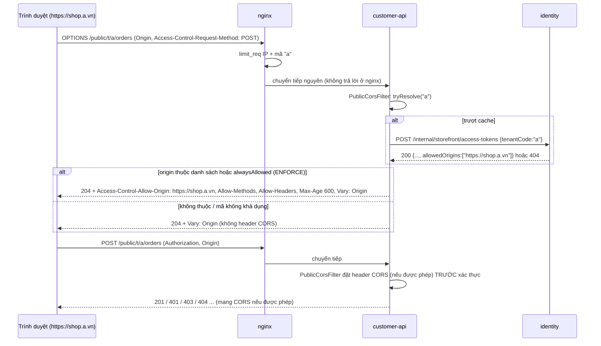

# ADR-0013: Danh sách origin theo tenant và CORS động cho `customer-api` (`/public/**`)

- Trạng thái: đề xuất (chưa có code). Quyết định nghiệp vụ đã được người dùng chốt trong đề bài ngày 2026-11-17; các câu mở C1 đến C7 của đề bài **SA chọn theo đề xuất** (người dùng chưa trả lời trực tiếp), xem mục 2 và mục 6.
- Liên quan: ADR-0003 (phân quyền động), ADR-0004 (migration tập trung), ADR-0005 (BFF `lms-api`, nginx), ADR-0006 (multi-tenant, bảng toàn cục), ADR-0009 (module SALES), ADR-0011 (customer-api, token `svc`, `StorefrontAccessCache`), ADR-0012 (hợp đồng thuê, cùng sửa identity và migration identity)
- Đề bài: `docs/requirements/2026-11-17-customer-api-origin-theo-tenant.md` (quy tắc mục 5, ràng buộc mục 9, AC1 đến AC15 ở mục 10, câu mở C1 đến C7 ở mục 12)
- ℹ️ ADR này **thay** dòng "CORS do nginx" của ADR-0011 2.9 (bảng Security, nginx) **cho `/public/**`**; CORS của `/api/**` giữ nguyên ở nginx.

## 1. Bối cảnh và mục tiêu

### 1.1. Hiện trạng đã đối chiếu trong code (nhánh `main`, gồm thay đổi chưa commit, 2026-11-17)

| | Điểm | Kết quả thật |
|---|---|---|
| ✅ | CORS ở nginx | `nginx.conf`: `map $http_origin $cors_origin` chỉ có `http://localhost:3000`, `http://localhost:5173`. `snippets/common.conf` thêm `Access-Control-Allow-Origin $cors_origin`, `Access-Control-Allow-Credentials true`, `Vary Origin`, ba header bảo mật, và `if ($request_method = OPTIONS) { ... return 204; }`. **Mọi** location (`/api/**` lẫn `/public/**`) include `common.conf`, nên preflight `/public/**` hiện do nginx trả lời. |
| ✅ | Chuyển tiếp `Origin` | `snippets/proxy.conf` không ghi đè header `Origin` (nginx chuyển nguyên header của client theo mặc định); chỉ ẩn `X-Content-Type-Options`, `X-Frame-Options`, `Referrer-Policy`, `X-XSS-Protection` của upstream. |
| ✅ | CORS ở `lms-api` | Không có cấu hình CORS nào trong `lms-api/src/main` (grep `Cors`, `Access-Control`): `/api/**` không có nguy cơ hai header. |
| ✅ | Giới hạn tốc độ | Vùng theo `$binary_remote_addr`: `login` (10r/m), `public_read` (20r/s), `public_form` (5r/m, chỉ POST). **Chưa có** `public_preview` trong `nginx.conf` (B-C8 của ADR-0011 chưa làm). Location `/public/` thường + regex `(?:[/;].*)?$` cho contact, signup, login. Không có `set_real_ip_from`. Image `nginx:1.27-alpine`. |
| ✅ | `customer-api` Security | `SecurityConfiguration`: `OPTIONS` `permitAll`; danh sách đóng `PUBLIC_API` (`GET /public/site/**`, `POST /public/site/contact-requests`, `GET /public/t/*`, `POST /public/t/*/auth/login`, `POST /public/auth/{refresh,logout}`); còn lại `denyAll`; `ServiceTokenRejectionFilter` sau `BearerTokenAuthenticationFilter`. Lỗi 401/403 ghi thẳng qua `JsonErrorWriter`. |
| ✅ | `StorefrontAccessCache` | Caffeine trong bộ nhớ, `expireAfter`: dương = `expiresIn − refreshMargin` (token 5 phút, margin 60 giây → **tới 4 phút**), phủ định = `negativeTtl` 60 giây; mã sai định dạng `^[a-z0-9-]{2,50}$` → 404 không gọi identity; có constructor nhận `Ticker` (test đồng hồ giả được). |
| ✅ | `HttpStorefrontAccessClient` | `POST /internal/storefront/access-tokens`, header `X-Storefront-Client-Secret`, body `{tenantCode}`, nhận `{tenantId, code, name, accessToken, expiresIn}`; 404 → rỗng; lỗi khác → 503. |
| ✅ | identity cấp token | `StorefrontAccessController` (`auth.infrastructure.web`, `@PublicEndpoint`) → `IssueStorefrontTokenUseCase` (`auth.application`) → `StorefrontTenantPort` → `InProcessStorefrontTenantAdapter` → `ResolveStorefrontTenantUseCase` (`tenant.application`, `@Transactional(readOnly)`: đọc tenant theo mã, kiểm ACTIVE, kiểm SALES). Trả `StorefrontTenant(id, code, name, modules)`. |
| ✅ | Refresh/logout khách | `AuthController` của customer-api: `POST /public/auth/refresh`, `/public/auth/logout` **không có `{code}`**, chuyển thẳng identity `/internal/auth/refresh|logout`. identity `RefreshTokenUseCase`: refresh token có cột `tenant_id` (V12, bảng `refresh_tokens` toàn cục), xoay vòng mỗi lần dùng, **dùng lại token cũ thì thu hồi mọi phiên** của người dùng. |
| ✅ | API platform | `PlatformTenantModuleController` ở identity map thẳng `/api/platform/tenants/{id}/modules`, `@PlatformAdminOnly`; `lms-api` `IdentityGatewayController` chuyển nguyên `/api/platform/**` và có tiền lệ route tenant `GET /api/me/tenants` → `/internal/me/tenants`. identity `SecurityConfiguration`: `/api/platform/**` và `/internal/**` authenticated. |
| ✅ | Bảng toàn cục | `TenantArchitectureRules.TENANT_EXEMPT_TABLES` có 12 bảng (gồm `tenants`, `tenant_modules`, `refresh_tokens`, `cms_*`). |
| ✅ | Migration identity | Mới nhất trên đĩa: `V16__tenant_modules.sql`. ⚠️ `V17` dự kiến cho sales B1.6, `V18` cho sales B2.3 (`docs/architecture/sales-module-design.md`), ADR-0011 B-C10 và ADR-0012 cũng nhắm số kế tiếp. `afterMigrate.sql` cấp `SELECT, INSERT, UPDATE, DELETE ON ALL TABLES` + default privileges cho `identity_app`. |
| ✅ | Tenant mặc định | `00000000-0000-0000-0000-0000000000d1`, mã `default`, chỉ bật `LENDING` (V16): storefront của nó trả `404 SHOP_NOT_AVAILABLE` tới khi bật SALES. |
| ✅ | Profile | `customer-api` **không có** `spring.profiles.default` (giống `lms-api`), không có `application-dev.yml`. Compose chạy `customer-api` không đặt profile. |

### 1.2. Mục tiêu

Mỗi tenant khai báo website riêng (origin) được gọi `customer-api` từ **trình duyệt**; trình duyệt của trang lạ gọi `/public/t/{code}/**` không nhận header CORS. Platform admin quản lý danh sách qua API platform; tenant admin chỉ xem.

### 1.3. Ràng buộc

- ⚠️ `Origin` giả được ngoài trình duyệt: danh sách origin **chỉ là kiểm soát CORS**, không phải xác thực, không chống bot cào (đề bài 1.1). Phiên khách dùng **bearer token, không cookie**, nên CORS ở đây không bảo vệ dữ liệu người dùng; nó chỉ ngăn trang lạ dùng API trong trình duyệt của khách.
- `customer-api` không JPA/JDBC/Kafka/`security-common`/`tenant-common` (ArchUnit `CustomerApiArchitectureTest`), không vô hiệu hóa cache chéo instance: hiệu lực ~60 giây dựa hoàn toàn vào TTL.
- Không lộ tenant: phản hồi cho origin không hợp lệ không khác theo việc tenant tồn tại hay không; tenant không khả dụng vẫn `404 SHOP_NOT_AVAILABLE` cùng thân.
- Không atomicity xuyên DB; Kafka best-effort (ADR-0001). Khóa quyền `Controller/method` (ADR-0003).
- Không thiết kế vượt nhu cầu: không wildcard, không xác minh domain, không khóa API.

## 2. Quyết định

### 2.1. Nơi quyết định CORS: `customer-api` quyết cho `/public/**`, nginx chỉ chuyển tiếp

| Tiêu chí | **A. nginx chuyển tiếp `Origin`, `customer-api` quyết, preflight đi qua `customer-api` (chọn)** | B. nginx `auth_request` hỏi `customer-api` rồi tự đặt header | C. Sinh cấu hình nginx (`map`) từ DB rồi reload |
|---|---|---|---|
| Biết `{code}` → tenant → danh sách | Có sẵn `StorefrontAccessCache` | Phải mở endpoint con trả quyết định qua header, nginx đọc `auth_request_set` | Map hai khóa (`Origin` + mã) sinh từ DB |
| Không lộ tenant | Một chỗ quyết, cùng nhánh 404 | Hai chỗ phải giữ đồng nhất | Phải tự bảo đảm trong bộ sinh |
| Hiệu lực 60 giây | TTL cache | Như A + một vòng gọi nội bộ mỗi request | Cần job sinh + `nginx -s reload` mỗi lần đổi, cần quyền ghi volume cấu hình nginx (đang `:ro`) |
| Độ phức tạp vận hành | Thấp: một filter Java, test bằng WebMvc | Trung bình: mỗi request `/public/**` thêm một subrequest | Cao: thành phần mới, reload, quyền file |
| Test được | Unit/WebMvc + đồng hồ giả (AC3) | Cần nginx thật | Cần nginx thật + job |

Chọn **A**.

- nginx: location `/public/**` **không** include phần CORS và không trả lời `OPTIONS`; chuyển nguyên `Origin` (mặc định của `proxy_pass`, không thêm `proxy_set_header Origin`). Tách `snippets/common.conf` thành hai (mục 3.4): `security-headers.conf` (ba header bảo mật) và `common.conf` = `include security-headers.conf` + CORS + khối `OPTIONS` cho `/api/**`. Location `/public/**` chỉ include `security-headers.conf`. Kết quả: không có hai `Access-Control-Allow-Origin` trong một phản hồi (AC12) và `/api/**` không đổi hành vi.
- `customer-api`: filter riêng `PublicCorsFilter` (không dùng `http.cors()`/`CorsFilter` mặc định của Spring, xem dưới) gắn vào `SecurityFilterChain` **trước mọi filter có thể trả lỗi** (trước `BearerTokenAuthenticationFilter`, `ServiceTokenRejectionFilter`, exception translation), để phản hồi 401/403/404/503 cũng mang header CORS khi origin được phép (FE storefront đọc được mã lỗi). Đăng ký **chỉ** trong chain (`FilterRegistrationBean` tắt tự đăng ký servlet), tránh chạy hai lần.
- Đã loại `CorsConfigurationSource` + `DefaultCorsProcessor` của Spring: processor mặc định trả **403 "Invalid CORS request"** cho request thường có `Origin` không được phép, trái quy tắc 5.7 (origin chưa đăng ký chỉ mất CORS, không bị 403). Thay processor cũng được nhưng phải viết lại gần hết logic, không lợi gì hơn một filter nhỏ.
- `Access-Control-Allow-Credentials` **không** gửi cho `/public/**` (khác nginx hiện tại gửi `true`): phiên khách là bearer token, không cookie. Bỏ cờ này làm trang được phép cũng không thể gửi cookie kèm, và chế độ REPORT/OFF (2.7) phản hồi lại origin bất kỳ an toàn tương đương `*`. ⚠️ FE storefront phải gọi `fetch` không `credentials: 'include'` (axios `withCredentials: false`); xem câu hỏi Q1 mục 6.

### 2.2. Thuật toán quyết định CORS ở `customer-api`

```
PublicCorsFilter cho mọi request /public/**:
  luôn đặt  Vary: Origin                      (kể cả khi không có Origin: phản hồi có Cache-Control public)
  origin = header Origin
  nếu không có Origin                          -> chuyển tiếp, không header CORS        (AC7, quy tắc 5.7)
  nếu nhiều header Origin, có dấu phẩy, dài > 300 ký tự, hoặc = "null" (mọi chữ hoa/thường)
                                               -> không cho phép                        (AC6)
  o = origin.toLowerCase(Locale.ROOT)
  allowed =
      o ∈ alwaysAllowed (domain nền tảng + origin dev, cấu hình)                         (AC10)
   or (đường dẫn /public/t/{code}/** và tryResolve(code) có giá trị và o ∈ access.allowedOrigins)
  theo chế độ (2.7):
      ENFORCE: dùng allowed
      REPORT : nếu !allowed thì ghi log "cors-would-reject" (giới hạn tần suất) rồi coi như allowed
      OFF    : allowed = true (trừ "null"/không hợp lệ ở trên), không resolve, không log
  nếu là preflight (OPTIONS + Access-Control-Request-Method):
      trả 204 ngay (không vào controller); nếu allowed thì kèm
        Access-Control-Allow-Origin: <origin nguyên văn>, Allow-Methods: GET, POST, OPTIONS,
        Allow-Headers: Authorization, Content-Type, X-Correlation-Id, Max-Age: 600
      nếu không allowed: vẫn 204, không header CORS (một dạng duy nhất, không phụ thuộc tenant)
  request thường: nếu allowed thì đặt Access-Control-Allow-Origin: <origin>,
        Access-Control-Expose-Headers: X-Correlation-Id; rồi chuyển tiếp
```

- `tryResolve(code)`: phương thức mới của `StorefrontAccessCache` trả `Optional<StorefrontAccess>`; mã sai định dạng, `SHOP_NOT_AVAILABLE` → rỗng; identity lỗi (503) → rỗng (fail-closed về CORS) và **không** chặn request: controller tự gọi `resolve` lần nữa và trả 503/404 như cũ (lần gọi thứ hai trúng cache dương/phủ định; lỗi identity không đệm nên có thể gọi identity hai lần khi identity đang lỗi, chấp nhận).
- **Không lộ tenant** (quy tắc 5.8, AC8): tenant không tồn tại, bị ngưng, tắt SALES đều cho `tryResolve` rỗng, tức cùng nhánh với "origin không có trong danh sách". Với preflight: cùng `204` không header. Với request thường: mã/thân do controller trả như hiện nay (`404 SHOP_NOT_AVAILABLE` cố định); CORS chỉ có khi origin thuộc `alwaysAllowed`, như nhau với mọi mã. Hệ quả chấp nhận: website của tenant gọi storefront đang không khả dụng nhận lỗi CORS chứ không đọc được `404` (FE coi lỗi mạng là "cửa hàng tạm không khả dụng").
- Không có mã lỗi `ORIGIN_NOT_ALLOWED`. Không đổi mã/thân phản hồi theo origin.
- Đường dẫn không có `{code}` (`/public/site/**`, `/public/auth/refresh|logout` cũ): chỉ `alwaysAllowed` (2.4, C2).
- `Max-Age: 600` (10 phút) giảm số preflight; không làm chậm việc thu hồi vì **phản hồi thật** vẫn phải có `Access-Control-Allow-Origin` (bị bỏ sau ≤ 60 giây). Phản hồi `GET` có `Cache-Control: public, max-age=30|60` có thể được trình duyệt dùng lại thêm tối đa 30-60 giây: tổng trễ thu hồi xấu nhất ~2 phút cho dữ liệu đã đệm ở trình duyệt, ⚠️ chấp nhận vì dữ liệu công khai.
- Trường hợp nginx trả `429` (vượt `limit_req`): phản hồi không có CORS (nginx không biết origin nào được phép) → trình duyệt báo lỗi CORS. ⚠️ Chấp nhận; FE coi lỗi mạng là "thử lại sau".

### 2.3. Nguồn dữ liệu và cache ở `customer-api` (C4, C5)

| Tiêu chí | **A. Nhúng `allowedOrigins` vào phản hồi cấp token storefront, một mục cache, TTL mục = min(token − margin, 60 giây) (chọn)** | B. Endpoint riêng `/internal/storefront/origins`, cache riêng TTL 60 giây, cache token giữ nguyên | C. `customer-api` kéo toàn bộ bảng origin mỗi 60 giây |
|---|---|---|---|
| Số vòng gọi khi trượt | 1 | 2 (token + origin) | 0 theo request, 1 lô mỗi 60 giây |
| Hiệu lực đổi origin | ≤ 60 giây | ≤ 60 giây | ≤ 60 giây |
| Thay đổi identity | Thêm một truy vấn vào `ResolveStorefrontTenantUseCase`, thêm một trường vào phản hồi | Thêm controller, bí mật, `permitAll` thứ hai, use case | Endpoint liệt kê origin mọi tenant |
| Tải identity | Mỗi mã đang dùng: 1 lần cấp token (ký RS256) mỗi 60 giây mỗi instance (trước: mỗi 4 phút) | Origin mỗi 60 giây, token mỗi 4 phút | Rất thấp, nhưng tải toàn bộ dữ liệu |
| Hệ quả phụ | Ngưng tenant/tắt SALES được `customer-api` thấy sau ≤ 60 giây (trước: ≤ 4 phút) | Không đổi | Không đổi |
| Ràng buộc 9.2 "không nhúng vào claim token" | Đạt (chỉ là trường của phản hồi nội bộ, không phải claim) | Đạt | Đạt |

Chọn **A**: ít thành phần nhất, một vòng gọi, khớp gợi ý đề bài 7.3, và "tách khỏi vòng đời token" được bảo đảm bằng cách **giới hạn TTL của mục cache** (không phải cache riêng).

- identity: `StorefrontTenant` thêm `allowedOrigins` (`List<String>`, chỉ origin `enabled`, đã chuẩn hóa); `AccessTokenResponse` thêm `allowedOrigins`. Không đưa vào claim JWT.
- `customer-api`: `StorefrontAccess` thêm `List<String> allowedOrigins` (null → rỗng, để chạy được với identity cũ trong lúc triển khai cuốn chiếu); lưu dạng `Set` trong mục cache. `ShopView` công khai **không** có trường này.
- TTL mục dương: `min(expiresIn − refreshMargin, originTtl)`, `app.storefront.origin-ttl: 60s` (C5). Phủ định giữ `negative-ttl: 60s` hiện có. Giới hạn kích thước 10 000 giữ nguyên.
- ⚠️ Tải identity tăng tối đa ~4 lần so với hiện nay (cấp token mỗi 60 giây thay vì mỗi 4 phút cho mỗi mã đang được truy cập, mỗi instance). Ví dụ 500 mã hoạt động × 2 instance ≈ 17 lời gọi/giây. P-O1 đo; nếu quá tải thì chuyển sang B (không đổi hợp đồng công khai).
- Đã loại C: thiết kế vượt nhu cầu (chỉ cần khi có quyết định CORS không biết `{code}`, mà C2 đã giải bằng cách khác).

### 2.4. Đường dẫn không có `{code}` và refresh/logout của khách (C2)

Vấn đề: storefront chạy ở domain riêng của tenant (`https://shop.tenant-a.vn`) phải gọi refresh/logout. Nếu `/public/auth/refresh|logout` chỉ cho domain nền tảng và localhost thì **trình duyệt chặn refresh**: khách bị đăng xuất sau mỗi lần access token hết hạn (15 phút), logout không gọi được (refresh token không bị thu hồi). Quy tắc C2 nguyên văn làm hỏng luồng đăng nhập khách.

| Tiêu chí | **A. Thêm `/public/t/{code}/auth/refresh` và `/logout`; identity kiểm tenant của refresh token trước khi xoay vòng (chọn)** | B. Như A nhưng `customer-api` kiểm sau (giải mã access token mới, so `tenantId`) | C. Tra tenant từ refresh token qua endpoint riêng của identity rồi quyết CORS | D. Giữ đường dẫn cũ, cho mọi origin đã đăng ký của mọi tenant |
|---|---|---|---|---|
| CORS | Theo `{code}` như mọi `/public/t/**` | Như A | Phải gọi identity trước khi biết header, kể cả preflight (preflight không có body: **không làm được**) | Origin của tenant A dùng được phiên tenant B |
| Rotation | Sai tenant → `401`, token **không** bị xoay | Token đã xoay rồi mới phát hiện: khách giữ token cũ, dùng lại → identity coi là tái sử dụng, **thu hồi mọi phiên** | Như A | Không đổi |
| Thay đổi identity | Tham số tùy chọn `tenantId` cho `/internal/auth/refresh` | Không | Endpoint mới | Không |
| Lộ thông tin | Không: chỉ người có refresh token mới thử được | Không | Thêm một oracle "token thuộc tenant nào" | Không |

Chọn **A**.

- `customer-api`: thêm `POST /public/t/{code}/auth/refresh`, `POST /public/t/{code}/auth/logout` (phân giải storefront trước như login; `{code}` không khả dụng → `404 SHOP_NOT_AVAILABLE`). Refresh gửi identity `{refreshToken, tenantId: <tenantId đã phân giải>}`. Logout **không** kiểm tenant (thu hồi token nào cũng vô hại, idempotent).
- identity: `/internal/auth/refresh` nhận thêm trường tùy chọn `tenantId` (UUID). Có giá trị và khác `refresh_tokens.tenant_id` (kể cả phiên nền tảng có `tenant_id` NULL) → `InvalidRefreshTokenException` (`401`). Vị trí kiểm: **sau** bước "token đã thu hồi → thu hồi mọi phiên" (giữ nguyên phát hiện tái sử dụng) và **trước** `tokenService.issueForTenant` (token đúng nhưng sai tenant không bị xoay vòng, khách vẫn dùng được ở đúng mã). `lms-api` không gửi trường này nên hành vi `/api/auth/refresh` không đổi. Quy tắc nằm ở `RefreshTokenUseCase` (application), không ở controller.
- `customer-api` ánh xạ `401` của refresh có `tenantId` sai thành cùng `401` như token không hợp lệ (không phân biệt "sai tenant" với "token hỏng").
- Đường dẫn cũ `/public/auth/refresh|logout` **giữ** (tương thích FE storefront hiện có trên domain nền tảng), CORS chỉ `alwaysAllowed`; đánh dấu không khuyến nghị trong `docs/api/customer-api.md`, FE storefront chuyển sang đường dẫn có `{code}`. Gỡ đường dẫn cũ là quyết định sau (không trong ADR này).
- `/public/site/**` (trang giới thiệu SaaS, form liên hệ): chỉ `alwaysAllowed` (domain nền tảng + dev). Đúng đề xuất C2.
- `SecurityConfiguration.PUBLIC_API` thêm hai mẫu `POST /public/t/*/auth/refresh`, `POST /public/t/*/auth/logout` (bỏ qua header `Authorization` như các đường dẫn công khai khác). nginx: hai đường dẫn này rơi vào `location /public/` (vùng `public_read` + vùng theo mã); không cần location riêng.

### 2.5. Mô hình dữ liệu và migration ở `identity_db` (C1, C3, C6)

Bảng (tên chốt; `be-dev` chốt kiểu chi tiết, chỉ mục phụ):

| Bảng | Cột | Ràng buộc |
|---|---|---|
| `tenant_storefront_origins` | `id` UUID PK, `tenant_id` UUID NOT NULL FK `tenants(id)`, `origin` VARCHAR(300) NOT NULL, `enabled` BOOLEAN NOT NULL DEFAULT TRUE, `created_at` TIMESTAMPTZ, `created_by` UUID, `updated_at` TIMESTAMPTZ, `updated_by` UUID | **UNIQUE (`origin`)** toàn hệ thống (C1); CHECK `origin = lower(origin)` và `origin ~ '^https?://[a-z0-9.-]+(:[0-9]{1,5})?$'` (lưới an toàn khi ai chèn tay); chỉ mục `(tenant_id)` |
| `tenant_storefront_origin_history` | `id` UUID PK, `tenant_id` UUID NOT NULL, `origin_id` UUID NOT NULL (không FK: dòng gốc có thể đã xóa), `origin` VARCHAR(300) NOT NULL, `action` (`ADDED`/`ENABLED`/`DISABLED`/`REMOVED`, CHECK), `actor_id` UUID NOT NULL, `occurred_at` TIMESTAMPTZ NOT NULL | Chỉ thêm: trigger `BEFORE UPDATE OR DELETE ... RAISE EXCEPTION` (mẫu ADR-0012 2.2); chỉ mục `(tenant_id, occurred_at DESC)` |

**C3: bảng toàn cục, không RLS, thêm vào `TENANT_EXEMPT_TABLES`** (cả hai bảng có cột `tenant_id` nên luật ArchUnit sẽ đòi `@TenantId` nếu không liệt kê).

| Tiêu chí | **a. Toàn cục + `TENANT_EXEMPT_TABLES` (chọn)** | b. `@TenantId` + RLS/FORCE |
|---|---|---|
| Platform admin (token không `tenantId`) | Đọc/ghi trực tiếp, lọc theo `tenantId` của đường dẫn | Mọi use case phải `TenantContext.callAs(tenantId)` trước khi mở transaction |
| Cấp token storefront (không có tenant lúc gọi) | Đọc thẳng theo `tenant_id` | Phải `callAs` bên trong `ResolveStorefrontTenantUseCase` |
| UNIQUE `origin` toàn hệ thống | Kiểm được trong ứng dụng trước khi ghi (đọc xuyên tenant) | RLS ẩn dòng của tenant khác: chỉ phát hiện trùng qua lỗi ràng buộc DB |
| Tiền lệ | `tenants`, `tenant_modules`, bảng hợp đồng ADR-0012: cấu hình của tenant do nền tảng sở hữu | Bảng nghiệp vụ do tenant tự ghi |
| Bảo vệ đọc của tenant admin | Use case lọc tường minh bằng `TenantContext.require()`, endpoint không nhận id | RLS bảo vệ thêm một lớp |

Lý do chọn **a**: dữ liệu do platform admin sở hữu và ghi; mọi đường đọc chính (cấp token, platform API, kiểm trùng) không có tenant trong ngữ cảnh. Tenant admin chỉ có một endpoint đọc không nhận id. Rủi ro lọc sai được phủ bằng test hai tenant (T-O2).

**C1: origin duy nhất toàn hệ thống** (UNIQUE `origin`, gồm cả dòng đang tắt). Một domain xác định đúng một tenant; thêm origin đã thuộc tenant khác → `409 ORIGIN_DUPLICATED` (thông điệp nói rõ "đã gán cho tenant khác", `details` có `tenantId` của chủ: chỉ platform admin thấy). Muốn chuyển domain sang tenant khác: xóa rồi thêm. Đã loại "cho gán nhiều tenant" (UNIQUE `(tenant_id, origin)`): cần cho đại lý chạy nhiều cửa hàng chung một origin khác path, nhưng chưa có nhu cầu; nới ràng buộc sau là thay đổi không phá dữ liệu (xóa UNIQUE, thêm UNIQUE mới), còn siết sau thì phải dọn dữ liệu trùng.

**Tối đa 10 mỗi tenant** (đếm cả dòng tắt) kiểm ở domain, dưới **khóa dòng tenant** (`tenants.findByIdForUpdate`, cùng khóa của bật/tắt module) để hai yêu cầu thêm đồng thời không vượt 10. Trùng đồng thời → bắt lỗi UNIQUE → `409 ORIGIN_DUPLICATED`. Giá trị 10 là cấu hình `lms.identity.storefront.max-origins-per-tenant: 10`.

**C6: production chỉ `https`**: `http` chỉ được chấp nhận khi host là `localhost` hoặc `127.0.0.1`, hoặc cấu hình `lms.identity.storefront.allow-http-origins: ${STOREFRONT_ALLOW_HTTP_ORIGINS:false}` bật (staging dùng domain thử không TLS). Đã loại "cho `http` mọi nơi" (trang `http` dễ bị chèn script trên đường truyền rồi gọi API dưới danh nghĩa tenant) và "chỉ `https`, kể cả localhost" (dev không có TLS).

Migration: **một file** `identity/V<n>__tenant_storefront_origins.sql` (hai bảng, CHECK, trigger, chỉ mục). ⚠️ `<n>` = số trống kế tiếp **ngay lúc tạo file và kiểm lại ngay trước khi merge** (hiện thấy `V16` cuối, `V17`/`V18` đã được sales giữ chỗ, ADR-0011 B-C10 và ADR-0012 cũng nhắm số kế tiếp). Flyway mặc định không chạy out-of-order: nếu `V<n+1>` của người khác đã chạy ở một DB trước file này thì system-service lỗi khi khởi động; phải đổi số trước khi merge, **không** sửa file đã chạy. Bảng không RLS nên không cần `set_config('app.tenant_id', ...)`; không seed dữ liệu (kể cả tenant mặc định, xem 2.7). Quyền `identity_app` do `afterMigrate.sql` hiện có cấp tự động; **không** sửa `afterMigrate.sql` (tránh đụng việc REVOKE của ADR-0012; trigger đã chặn sửa/xóa lịch sử).

### 2.6. Chuẩn hóa origin và so khớp (quy tắc 5.1, AC4)

**Khi lưu (identity, domain thuần Java `StorefrontOrigin.parse(raw, allowHttp)`):**

1. `trim`; rỗng, dài > 300, chứa `*`, bằng `null` (không phân biệt hoa thường) → `ORIGIN_INVALID`.
2. Phân tích bằng `java.net.URI`; lỗi cú pháp → `ORIGIN_INVALID`.
3. Scheme bắt buộc, chỉ `http`/`https` (không phân biệt hoa thường) → chữ thường.
4. Không có userinfo (`user@`), query, fragment; path chỉ được rỗng hoặc đúng `/` (dấu `/` cuối bị bỏ). Ngược lại `ORIGIN_INVALID`.
5. Host bắt buộc; tên miền quốc tế chuyển sang ASCII (`java.net.IDN.toASCII`, lỗi → `ORIGIN_INVALID`) vì trình duyệt gửi `Origin` dạng punycode; chữ thường; từ chối dấu chấm cuối và địa chỉ IPv6 (chưa có nhu cầu, tránh so khớp dạng `[::1]`).
6. Cổng: bằng cổng mặc định của scheme (80/443) → bỏ; ngoài `1..65535` → `ORIGIN_INVALID`.
7. `http` chỉ khi host `localhost`/`127.0.0.1` hoặc `allowHttp` (C6), ngược lại `ORIGIN_INVALID`.
8. Kết quả `scheme://host[:port]`. Ví dụ: `HTTPS://Shop.Example.com/` → `https://shop.example.com`; `https://shop.example.com:443` → `https://shop.example.com`; `https://shop.example.com:8443` khác `https://shop.example.com`.

Lỗi `400 ORIGIN_INVALID`, `details` một mã lý do (`SCHEME`, `PATH`, `WILDCARD`, `NULL`, `HOST`, `PORT`, `HTTP_NOT_ALLOWED`, `SYNTAX`) để admin FE hiện thông điệp; `be-dev` chốt tập mã.

**Khi so khớp (`customer-api`):** trình duyệt đã gửi `Origin` ở dạng tuần tự hóa chuẩn (scheme/host chữ thường, punycode, không cổng mặc định, không `/` cuối). `customer-api` chỉ `toLowerCase(Locale.ROOT)` rồi so khớp **chính xác** với tập đã chuẩn hóa; không chuẩn hóa lại, không phân tích URI (tránh hai bộ chuẩn hóa lệch nhau). Hệ quả: không cần chia sẻ code chuẩn hóa giữa identity và `customer-api` (customer-api không được phụ thuộc code service). Cấu hình `alwaysAllowed` của `customer-api` được kiểm lúc khởi động (dạng `scheme://host[:port]`, chữ thường, không `/` cuối, không `*`); sai thì **không khởi động**.

**Thông điệp lỗi không lộ tenant:** mọi phản hồi công khai giữ như ADR-0011 2.5 (`404 SHOP_NOT_AVAILABLE` cố định). Không trả `ORIGIN_NOT_ALLOWED`. Log "would-reject" ở REPORT chỉ ghi mã + origin, mức INFO, giới hạn một dòng cho mỗi cặp `(code, origin)` mỗi 60 giây (bộ Caffeine nhỏ giới hạn kích thước), để `Origin` ngẫu nhiên không làm ngập log.

### 2.7. Cờ chế độ nghiêm, origin luôn được phép, dev và tenant mặc định (C5)

Cấu hình `customer-api` (khối `app:` hiện có, thêm khóa con `public-cors`; không tạo khối cấp cao thứ hai):

```yaml
app:
  public-cors:
    mode: ${PUBLIC_CORS_MODE:ENFORCE}                 # OFF | REPORT | ENFORCE
    platform-origins: ${PUBLIC_CORS_PLATFORM_ORIGINS:} # domain nền tảng, phân tách dấu phẩy
    dev-origins: ${PUBLIC_CORS_DEV_ORIGINS:http://localhost:3000,http://localhost:5173}
    max-age: 600s
  storefront:
    origin-ttl: 60s                                   # mới, 2.3
```

| Chế độ | Hành vi | Môi trường |
|---|---|---|
| `OFF` | Phản hồi lại mọi `Origin` hợp lệ cú pháp (không `null`), không resolve, không log | dev (docker compose đặt `PUBLIC_CORS_MODE: ${PUBLIC_CORS_MODE:-OFF}`) |
| `REPORT` | Quyết như `ENFORCE`, nhưng khi sẽ từ chối thì vẫn cho phép và ghi log "cors-would-reject" | staging, và production trong giai đoạn chuyển đổi |
| `ENFORCE` | Áp quy tắc 5.5 | production; **mặc định của `application.yml`** |

- Diễn giải "tương thích" của quy tắc 5.10: `REPORT`/`OFF` **cho phép mọi origin** (không phải "chỉ localhost như nginx hiện nay"), vì mục đích là bật dần: tenant triển khai website, platform admin khai báo, xem log, rồi chuyển `ENFORCE`. An toàn nhờ không có `Allow-Credentials` (2.1). ⚠️ Cần người dùng xác nhận (Q2 mục 6).
- Mặc định `ENFORCE` trong `application.yml` (fail-closed): môi trường nào quên đặt biến vẫn nghiêm. `customer-api` không có profile `dev` (1.1), nên "dev tắt" thực hiện bằng biến môi trường trong `docker-compose.yml`. Chạy `mvn -pl customer-api spring-boot:run` dùng `ENFORCE`, nhưng `localhost:3000`/`5173` thuộc `dev-origins` nên FE dev không bị chặn (AC10).
- `dev-origins` mặc định có localhost, **khớp hành vi nginx hiện tại** (đang cho localhost ở mọi môi trường). Production phải đặt `PUBLIC_CORS_DEV_ORIGINS=` (rỗng). Khởi động ở `ENFORCE` với `platform-origins` rỗng → log WARN (trang SaaS sẽ không gọi được từ trình duyệt).
- Tenant mặc định (`...00d1`, mã `default`): **không seed** origin. Dev đi qua `dev-origins`/`OFF`. Tenant này chỉ có `LENDING` nên storefront vẫn `404 SHOP_NOT_AVAILABLE` tới khi platform admin bật SALES (không đổi so với ADR-0011).
- `alwaysAllowed` = `platform-origins` ∪ `dev-origins`, áp cho mọi đường dẫn `/public/**`, kể cả mã tenant không khả dụng (đồng nhất, không lộ tenant).

### 2.8. API platform và tenant admin chỉ xem (C7)

**Platform admin**: `PlatformStorefrontOriginController` ở identity, `@PlatformAdminOnly` cấp class, map thẳng `/api/platform/tenants/{tenantId}/storefront-origins` (tiền lệ `PlatformTenantModuleController`; `lms-api` chuyển nguyên `/api/platform/**`, **không sửa** `lms-api`). Đặt trong context `tenant` của identity (2.10).

| Method | Đường dẫn | Vào | Ra | Lỗi |
|---|---|---|---|---|
| GET | `/api/platform/tenants/{tenantId}/storefront-origins` | | `200 {maxOrigins, origins: [StorefrontOriginResponse]}`, sắp theo `createdAt` | `404 TENANT_NOT_FOUND` |
| POST | `/api/platform/tenants/{tenantId}/storefront-origins` | `{origin}` | `201 StorefrontOriginResponse` (`enabled=true`) | `400 ORIGIN_INVALID`, `409 ORIGIN_DUPLICATED`, `409 ORIGIN_LIMIT_EXCEEDED`, `404 TENANT_NOT_FOUND` |
| PUT | `/api/platform/tenants/{tenantId}/storefront-origins/{originId}` | `{enabled}` (bắt buộc) | `200 StorefrontOriginResponse` | `404 STOREFRONT_ORIGIN_NOT_FOUND` (gồm `originId` thuộc tenant khác, AC13), `400` validate |
| DELETE | `/api/platform/tenants/{tenantId}/storefront-origins/{originId}` | | `204` | `404 STOREFRONT_ORIGIN_NOT_FOUND` |

`StorefrontOriginResponse`: `id, origin, enabled, createdAt, createdBy, updatedAt, updatedBy`. Không cho sửa chuỗi `origin` (xóa rồi thêm: lịch sử rõ ràng, không cần kiểm trùng khi sửa). `PUT` với giá trị không đổi là no-op (không ghi lịch sử, không event). Tên method chốt: `list`, `add`, `update`, `remove` (không là khóa quyền vì `@PlatformAdminOnly`, nhưng giữ ổn định).

**Tenant admin chỉ xem**: `TenantStorefrontOriginController` ở identity, `GET /internal/storefront-origins`, **khóa động `TenantStorefrontOriginController/list`** (ADR-0003); `lms-api` thêm route `GET /api/storefront-origins` → identity `/internal/storefront-origins` trong `IdentityGatewayController` (tiền lệ `GET /api/me/tenants`).

- Ra: `200 {origins: [{origin, enabled}]}`. DTO riêng, **không** có `createdBy`/`updatedBy` (id platform admin) và không tái dùng `StorefrontOriginResponse`.
- Tenant lấy từ `TenantContext.require()`; endpoint không nhận id; use case lọc `tenant_id` tường minh (bảng toàn cục). Token không `tenantId` → `403 TENANT_REQUIRED` (interceptor có sẵn); không token → `401`; người thường thiếu khóa → `403` (AC9).
- Role `is_admin` của tenant có `admin=true` nên tenant admin xem được ngay, không cần seed migration (tránh thêm một migration tranh số). Không `@RequiresModule(SALES)`: tenant đã tắt SALES vẫn xem được cấu hình.
- Đã loại: `@AuthenticatedOnly` + kiểm `admin` trong code (gắn cứng khái niệm admin, lệch ADR-0003, cùng lý do ADR-0012 2.5.2); cho tenant admin gọi `/api/platform/**` có kiểm sở hữu (trộn hai mô hình quyền); tên `/api/tenant/storefront-origins` (không có tiền lệ tiền tố `/api/tenant`; `lms-api` dùng tên tài nguyên phẳng như `/api/contracts` của ADR-0012).

### 2.9. Audit thay đổi origin: lưu DB trong cùng transaction, event và log là phụ

| Tiêu chí | **A. Bảng lịch sử chỉ thêm, ghi cùng transaction + event/log sau commit (chọn)** | B. Chỉ cột `created_by/updated_by` + `PlatformOperationEvent` (Kafka) | C. Chỉ log `platform-audit` |
|---|---|---|---|
| Mất dấu vết khi Kafka lỗi | Không | Có (ADR-0001 best-effort) | Phụ thuộc lưu log |
| Ghi nhận xóa | Có (dòng `REMOVED` giữ chuỗi origin) | Mất khi xóa dòng | Có trong log |
| Chi phí | Một bảng, một trigger | Không | Không |

Chọn **A** (đúng yêu cầu "lưu DB, không chỉ Kafka", mẫu ADR-0012 2.6).

- Mỗi `add`/`update` có đổi/`remove` ghi một dòng `tenant_storefront_origin_history` cùng transaction với thay đổi.
- Sau commit: `PlatformOperationEvent` `STOREFRONT_ORIGIN_ADDED|ENABLED|DISABLED|REMOVED` (`tenantId` = tenant bị đổi, `targetId` = `originId`, `detail` = `origin=<chuỗi>`) qua `PublishPlatformEventPort` hiện có + log INFO `platform-audit operation=storefront-origin-...`. Event rơi vào audit của tenant (`AuditEventConsumer`): chấp nhận vì tenant admin vốn xem được danh sách origin.
- Không có API đọc lịch sử ở giai đoạn này (đọc bằng SQL khi điều tra). ℹ️ Thêm `GET .../storefront-origins/history` sau là thay đổi cộng thêm.

### 2.10. Nơi đặt code ở identity: context `tenant`

- `tenant.domain`: `StorefrontOrigin` (chuẩn hóa 2.6, value object), `TenantStorefrontOrigins` (tập của một tenant: giới hạn 10, trùng trong tenant, bật/tắt, xóa), `StorefrontOriginRepository`, exception `InvalidStorefrontOriginException`, `StorefrontOriginDuplicatedException`, `StorefrontOriginLimitExceededException`, `StorefrontOriginNotFoundException`.
- `tenant.application`: `ListStorefrontOriginsUseCase`, `AddStorefrontOriginUseCase`, `SetStorefrontOriginEnabledUseCase`, `RemoveStorefrontOriginUseCase` (khóa dòng tenant, lịch sử cùng transaction, event sau commit, theo mẫu `EnableTenantModuleUseCase` nhưng **không** cần `callAs` vì bảng không RLS), `ListMyStorefrontOriginsUseCase` (tenant admin); `ResolveStorefrontTenantUseCase` thêm `allowedOrigins`.
- `tenant.infrastructure`: persistence (2 entity, không `@TenantId`), web (2 controller), ánh xạ lỗi trong `TenantExceptionHandler`.
- `auth`: `StorefrontAccessController.AccessTokenResponse` thêm `allowedOrigins`; `RefreshTokenUseCase` thêm `tenantId` tùy chọn (2.4). `auth` vẫn chỉ dùng `tenant.application` (luật ArchUnit hiện có).
- Đã loại: context mới `storefront` (cần nối `auth → storefront.application → tenant`, thêm luật ArchUnit cho ~12 lớp; `ResolveStorefrontTenantUseCase` đã ở `tenant`); đặt trong `auth` (auth là thông tin đăng nhập, không phải cấu hình tenant).

### 2.11. nginx: giới hạn theo `{code}` và IP thật sau CDN/LB

Vùng mới theo mã tenant, giữ mọi vùng theo IP:

```nginx
# Mã hợp lệ (cùng mẫu với customer-api) làm khóa; mã khác (chữ hoa, ký tự lạ) dồn chung một khóa "~invalid";
# đường dẫn không có mã: khóa rỗng, không bị vùng này giới hạn.
map $uri $public_code_key {
    "~^/public/t/(?<pcode>[a-z0-9-]{2,50})(?:[/;]|$)" $pcode;
    "~^/public/t/"                                    "~invalid";
    default                                           "";
}
limit_req_zone $public_code_key zone=public_tenant:10m rate=50r/s;   # ⚠️ số đề xuất, P-O2 đo
```

- Thêm `limit_req zone=public_tenant burst=100 nodelay;` vào **mọi** location `/public/**` (cả `/public/` và các location regex contact/signup/login, và `public_preview` khi B-C8 làm), cạnh `limit_req` theo IP sẵn có (nhiều `limit_req` trong một location được phép; location có `limit_req` riêng không kế thừa từ cấp ngoài nên phải liệt kê đủ).
- Dùng `$uri` (đã giải mã `%XX`, gộp `//`) chứ không `$request_uri`, để `%61bc` và `abc` cùng một khóa. Chữ hoa rơi vào khóa chung `~invalid` (customer-api vẫn chấp nhận chữ hoa vì chuẩn hóa, nhưng mọi biến thể chữ hoa của mọi tenant chia một thùng): không vượt được giới hạn theo mã bằng cách đổi hoa thường. FE storefront luôn dùng mã chữ thường.
- `OPTIONS` (preflight) cũng tính vào cả hai vùng; `Max-Age: 600` giảm số preflight.
- ⚠️ Giới hạn theo mã tạo đường **từ chối dịch vụ có chủ đích cho một tenant**: kẻ tấn công từ nhiều IP (mỗi IP dưới ngưỡng `public_read`) có thể tiêu hết thùng của một mã, khách thật của tenant đó nhận 429. Vì vậy ngưỡng theo mã phải là **ngưỡng bảo vệ backend** (cao, ví dụ 50r/s burst 100), không phải ngưỡng chống cào. Xem Q3 mục 6.

IP thật sau CDN/LB: thêm `snippets/real-ip.conf`, include ở cấp `http`, **mặc định không có chỉ thị nào** (nginx đang là biên). Khi đặt sau LB/CDN, môi trường đó gắn file có:

```nginx
set_real_ip_from 10.0.0.0/8;          # CIDR của LB/CDN, KHÔNG để 0.0.0.0/0
real_ip_header X-Forwarded-For;       # Cloudflare: CF-Connecting-IP
real_ip_recursive on;
```

⚠️ Chưa kiểm chứng `nginx:1.27-alpine` có module `realip` (bản chính thức thường build `--with-http_realip_module`; `nginx -V` để xác nhận). Tin `X-Forwarded-For` từ nguồn không thuộc CIDR đã khai là cho khách tự chọn IP, vô hiệu hóa mọi vùng theo IP.

## 3. Thiết kế

### 3.1. Thành phần

```
Trình duyệt (website tenant https://shop.a.vn)
   │ Origin: https://shop.a.vn
   ▼
nginx 8080  location /public/**: limit_req theo IP + theo {code}; include security-headers.conf (KHÔNG CORS, KHÔNG trả OPTIONS)
   │ chuyển nguyên Origin
   ▼
customer-api 8088
   PublicCorsFilter (trước filter xác thực) ──tryResolve(code)──> StorefrontAccessCache (Caffeine, TTL mục ≤ 60 s)
   │                                                                   │ trượt
   │                                                                   ▼
   │                                    identity POST /internal/storefront/access-tokens
   │                                    → {tenantId, code, name, accessToken, expiresIn, allowedOrigins[]}
   ▼
controller như ADR-0011 (404 SHOP_NOT_AVAILABLE, 401, 503 ... đều mang CORS nếu origin được phép)

Platform admin ──/api/platform/tenants/{id}/storefront-origins──> nginx ──> lms-api (chuyển nguyên) ──> identity
     PlatformStorefrontOriginController (@PlatformAdminOnly) → use case (khóa dòng tenant) → 2 bảng toàn cục identity_db
Tenant admin ──GET /api/storefront-origins──> lms-api ──> identity GET /internal/storefront-origins
     TenantStorefrontOriginController/list (khóa động, tenant từ token)
```

### 3.2. Luồng preflight và request thật



### 3.3. Hợp đồng ở ranh giới (`be-dev` chốt chi tiết)

| Lớp | Thay đổi | Vào / ra |
|---|---|---|
| identity `POST /internal/storefront/access-tokens` | Thêm trường ra | `+ allowedOrigins: string[]` (chỉ origin bật, đã chuẩn hóa; rỗng nếu chưa khai báo) |
| identity `POST /internal/auth/refresh` | Thêm trường vào tùy chọn | `{refreshToken, tenantId?}`; `tenantId` sai → `401` như token không hợp lệ, không xoay vòng |
| identity platform | 4 endpoint mục 2.8 | như bảng 2.8 |
| identity tenant | `GET /internal/storefront-origins` | `{origins: [{origin, enabled}]}` |
| lms-api | `GET /api/storefront-origins` | chuyển nguyên tới identity |
| customer-api | `POST /public/t/{code}/auth/refresh`, `/logout` | như `/public/auth/refresh|logout` hiện có; `404 SHOP_NOT_AVAILABLE` nếu mã không khả dụng |
| customer-api | Header CORS trên mọi `/public/**` | `Vary: Origin` luôn có; `Access-Control-Allow-Origin: <origin>` khi được phép; **không** `Allow-Credentials` |

Tài liệu: `docs/api/platform-storefront-origins.md` (mới: API platform + tenant, mã lỗi, quy tắc chuẩn hóa, câu giới hạn 1.1); `docs/api/customer-api.md` thêm mục CORS (câu giới hạn 1.1 nguyên văn, đường dẫn refresh/logout mới, không `credentials`), AC15.

### 3.4. nginx sau khi sửa (phác thảo, `be-dev` viết thật)

```
snippets/security-headers.conf   X-Content-Type-Options, X-Frame-Options, Referrer-Policy (add_header ... always)
snippets/common.conf             include security-headers.conf; CORS $cors_origin; Vary Origin; khối if OPTIONS → 204   (chỉ cho /api/**)
snippets/real-ip.conf            rỗng mặc định (2.11)
nginx.conf                       http: include real-ip.conf; map $public_code_key; limit_req_zone public_tenant
                                 location /public/ và các location regex /public/**: include security-headers.conf (thay common.conf),
                                 thêm limit_req zone=public_tenant; giữ client_max_body_size 16k, vùng theo IP
                                 map $cors_origin: giữ cho /api/** (thêm origin admin FE production như trước)
```

Câu chú thích đầu `nginx.conf` ("Nginx lo: CORS...") sửa thành "CORS cho `/api/**`; `/public/**` do `customer-api`".

## 4. Phân việc

Thứ tự: B-O1 ‖ B-O3 ‖ B-O4 ‖ B-O6 bắt đầu ngay (chỉ cần hợp đồng mục 3.3); B-O2 sau B-O1 (cùng người); B-O5 sau B-O1 (hợp đồng tenant); nhập B-O4 và B-O6 **cùng một lần triển khai**.

```
B-O1 (identity tenant: migration, domain, platform API, lịch sử) ──> B-O2 (allowedOrigins trong cấp token) ─┐
B-O3 (identity auth: refresh có tenantId) ────────────────────────────────────────────────────────────────┤
B-O4 (customer-api: filter, cache TTL, cấu hình, refresh/logout có {code}; client giả) ───────────────────┼──> T-O5 đầu-cuối
B-O6 (nginx: tách snippet, vùng theo mã, real-ip) ────────────────────────────────────────────────────────┤
B-O1 ──> B-O5 (lms-api route tenant + tài liệu API) ──────────────────────────────────────────────────────┘
```

| # | Ai | Việc | Phạm vi thư mục | Phụ thuộc | Song song với |
|---|---|---|---|---|---|
| ⏳ B-O1 | be-dev | Migration `identity/V<n>__tenant_storefront_origins.sql` (⚠️ số trống ngay lúc tạo và trước merge); `TENANT_EXEMPT_TABLES` += `tenant_storefront_origins`, `tenant_storefront_origin_history`; ADR-0006 mục 7 (dòng 18, danh sách bảng toàn cục) thêm hai bảng; `tenant.domain` (chuẩn hóa 2.6, giới hạn 10), `tenant.application` (4 use case platform + 1 tenant, khóa dòng tenant, lịch sử cùng transaction, event + log sau commit), persistence, `PlatformStorefrontOriginController`, `TenantStorefrontOriginController`, ánh xạ lỗi; cấu hình `lms.identity.storefront.{max-origins-per-tenant, allow-http-origins}` **trong khối `lms.identity.storefront` đã có** của `application.yml` | `services/identity-service/src/main/java/lms/identity/tenant/**`, `services/identity-service/src/main/resources/application.yml` (chỉ khối `lms.identity.storefront`), `services/system-service/src/main/resources/db/migration/identity/` (chỉ file mới), `shared-libraries/tenant-common` (chỉ `TENANT_EXEMPT_TABLES`), `docs/decisions/0006-multi-tenant.md` (một dòng) | không | B-O3, B-O4, B-O6 |
| ⏳ B-O2 | be-dev (cùng người B-O1) | `ResolveStorefrontTenantUseCase` + `StorefrontTenant` thêm `allowedOrigins`; `StorefrontAccessController.AccessTokenResponse` thêm trường | `tenant/application/ResolveStorefrontTenantUseCase.java`, `StorefrontTenant.java`, `auth/infrastructure/web/StorefrontAccessController.java`, `auth/application/IssueStorefrontTokenUseCase.java` | B-O1 (repository) | B-O3, B-O4 |
| ⏳ B-O3 | be-dev | identity `RefreshTokenUseCase` nhận `tenantId` tùy chọn (kiểm sau bước phát hiện tái sử dụng, trước xoay vòng); body `/internal/auth/refresh` thêm trường; test use case (đúng tenant, sai tenant không xoay, phiên nền tảng + `tenantId` → 401, không gửi trường → như cũ) | `services/identity-service/src/main/java/lms/identity/auth/application/RefreshTokenUseCase.java`, `AuthDtos.java` (auth), controller `/internal/auth/refresh` | không | B-O1, B-O4, B-O6 |
| ⏳ B-O4 | be-dev | customer-api: `PublicCorsFilter` (2.2) trong `lms.customer.web` hoặc `config`, đăng ký chỉ trong chain, trước filter xác thực; `PublicCorsProperties` (`app.public-cors.*`, kiểm cấu hình lúc khởi động); `StorefrontAccessCache.tryResolve` + TTL mục `min(..., origin-ttl)`; `StorefrontAccess.allowedOrigins`; `AuthController` thêm `/public/t/{code}/auth/refresh|logout`, `AuthClient.refresh(token, tenantId)`; `SecurityConfiguration.PUBLIC_API` thêm hai mẫu, sửa Javadoc "CORS do nginx"; log REPORT có giới hạn tần suất; `docker-compose.yml` thêm `PUBLIC_CORS_MODE: ${PUBLIC_CORS_MODE:-OFF}` cho `customer-api`; `docs/api/customer-api.md` mục CORS (AC15) | `customer-api/**`, `docker-compose.yml` (chỉ khối `customer-api`), `docs/api/customer-api.md` | hợp đồng 3.3 (client giả cho identity) | B-O1, B-O3, B-O6 |
| ⏳ B-O5 | be-dev | lms-api: `IdentityGatewayController` thêm `GET /api/storefront-origins` → `/internal/storefront-origins` + test; viết `docs/api/platform-storefront-origins.md` (API platform, tenant, mã lỗi, chuẩn hóa, câu giới hạn 1.1) | `lms-api/src/main/java/lms/api/identity/web/IdentityGatewayController.java` và test tương ứng (⚠️ thư mục `lms-api/.../identity` đang có thay đổi chưa commit của người khác: sửa có mục tiêu), `docs/api/` | hợp đồng B-O1 | B-O2, B-O3, B-O4 |
| ⏳ B-O6 | be-dev | nginx: `snippets/security-headers.conf` mới, `common.conf` include nó (hành vi `/api/**` không đổi), `real-ip.conf` rỗng + include cấp `http`; `map $public_code_key`, vùng `public_tenant`, `limit_req` trong mọi location `/public/**`; location `/public/**` include `security-headers.conf` thay `common.conf`; sửa chú thích; `nginx -t` trong container | `infrastructure/nginx/**` | không | B-O1, B-O3, B-O4 (nhập cùng B-O4) |
| ⏳ T-O1 | tester | Unit `StorefrontOrigin.parse` (AC4): `HTTPS://Shop.Example.com/` = `https://shop.example.com`; `:443`/`:80` bỏ; khác cổng/scheme là khác; path, query, fragment, `*`, `null`, thiếu scheme, `ftp:`, userinfo, IPv6, dấu chấm cuối, cổng 0/65536 → `ORIGIN_INVALID`; IDN → punycode; `http://shop.vn` bị từ chối khi `allowHttp=false`, `http://localhost:5173` được | | B-O1 | T-O3, T-O4 |
| ⏳ T-O2 | tester | identity WebMvc (bật kiểm khóa, `@MockitoBean PermissionKeyRegistrar`) + IT (`identity_app`): platform admin 200/201/204; tenant admin/người thường gọi `/api/platform/...` 403; không token 401 (AC9); `/internal/storefront-origins`: `admin=true` 200, thiếu khóa 403, không `tenantId` 403 `TENANT_REQUIRED`, JSON không có `createdBy`; thêm thứ 11 → 409, trùng cùng tenant → 409, trùng tenant khác → 409 (AC5, C1); hai yêu cầu thêm đồng thời ở 9 origin → đúng 10; `PUT`/`DELETE` `originId` của tenant B qua đường dẫn tenant A → 404 và B không đổi (AC13); tenant admin A chỉ thấy origin A; lịch sử ghi đúng một dòng mỗi thay đổi, `UPDATE`/`DELETE` lịch sử bị trigger chặn; `access-tokens` trả `allowedOrigins` chỉ gồm origin bật; tenant không khả dụng vẫn `404` cùng thân | | B-O1, B-O2 | T-O3 |
| ⏳ T-O3 | tester | customer-api WebMvc + unit (client giả, `Ticker` giả): AC1 (preflight có `Allow-Origin` = origin gửi lên, `Vary: Origin`), origin lạ không header; AC2 (origin A với mã B không có, với mã A có); AC3 (tắt/xóa: sau 60 s giả không còn; trước 60 s còn); AC6 (`null`, `NULL`, nhiều header, có dấu phẩy); AC7 (không `Origin` → 200, không gọi identity thêm); AC8 (mã không tồn tại/ngưng/không SALES/sai định dạng: cùng `404` cùng thân với origin hợp lệ hay không; preflight cùng `204` không header); AC10 (`dev-origins`, `platform-origins` luôn được, kể cả mã không khả dụng); AC14 (`OFF`/`REPORT`/`ENFORCE`, `REPORT` ghi log một lần mỗi cặp trong 60 s); không bao giờ có `Access-Control-Allow-Credentials`; `401` của `/orders` không token vẫn mang CORS khi origin được phép; identity 503 → không CORS, request vẫn ra 503; `/public/site/**` và `/public/auth/refresh` cũ chỉ `alwaysAllowed`; `/public/t/{code}/auth/refresh` gửi `tenantId` đúng; cấu hình `platform-origins` sai làm ứng dụng không khởi động; ArchUnit customer-api xanh | | B-O4 | T-O1, T-O2, T-O4 |
| ⏳ T-O4 | tester | nginx (compose): `nginx -t`; AC12 (preflight `/public/**` tới `customer-api`: kiểm bằng log/`X-Correlation-Id` hoặc header chỉ customer-api đặt; không có hai `Access-Control-Allow-Origin`; `/api/**` preflight vẫn 204 từ nginx với `localhost:5173`); AC11 (vượt `public_tenant` cho mã `a` → 429, mã `b` cùng lúc vẫn 200; vùng IP giữ nguyên; `/public/t/A/...` và `/public/t/a%2D/...` rơi đúng khóa; `/public/site/**` không bị vùng theo mã); `Origin` được chuyển nguyên tới customer-api | | B-O4, B-O6 | T-O3 |
| ⏳ T-O5 | tester | Đầu-cuối compose (`PUBLIC_CORS_MODE=ENFORCE`): platform admin thêm `https://shop-a.test` cho tenant A (bật SALES) → trong ≤ 60 s preflight từ origin đó có CORS; tắt → ≤ 60 s mất; origin của A gọi mã B không có; khách đăng nhập rồi refresh qua `/public/t/a/auth/refresh` từ origin của A thành công, refresh token của tenant B qua mã A → 401 và token B vẫn dùng được ở mã B; dev (`OFF`, localhost) không bị chặn | | B-O1 đến B-O6 | |
| ⏳ P-O1 | perf-tester | Tải identity khi TTL mục 60 s: số lời gọi `access-tokens`/phút và CPU ký token với 100/500/2000 mã hoạt động × 2 instance customer-api; p95 `/public/t/{code}/books` lúc mục hết hạn (độ trễ đuôi do nạp lại đồng bộ); ⚠️ chưa có số nền | | B-O2, B-O4 | P-O2 |
| ⏳ P-O2 | perf-tester | nginx: chọn ngưỡng `public_tenant` (rate/burst) theo năng lực backend; đo kịch bản nhiều IP dồn vào một mã (mức 429 khách thật gặp); chi phí preflight thêm khi `Max-Age` 600 | | B-O6 | P-O1 |

Việc phía FE (ngoài repo, bên FE làm):

- ⏳ Admin FE (`apps/admin`): trang platform "Domain storefront" theo tenant: danh sách (origin, bật/tắt, người/ngày cập nhật), thêm (hiện lỗi theo `details` của `ORIGIN_INVALID`), bật/tắt, xóa có xác nhận, hiện `n/10`; ghi rõ câu giới hạn 1.1 và "hiệu lực trong khoảng 1 phút". Trang tenant admin chỉ xem (`GET /api/storefront-origins`), ẩn khi 403.
- ⏳ FE storefront: dùng `/public/t/{code}/auth/refresh|logout`; `fetch` không gửi cookie (`credentials` mặc định hoặc `'omit'`); mã tenant chữ thường; lỗi mạng/CORS hiển thị "cửa hàng tạm không khả dụng, thử lại sau".

Commit tách nhóm: `feat(identity):` (B-O1, B-O2, B-O3 có thể tách), `feat(customer-api):`, `feat(lms-api):`, `build:` (nginx, compose), `docs:`.

Thứ tự triển khai: system-service (migrate `V<n>`) → identity (trường mới cộng thêm, tương thích ngược) → **cùng lúc** customer-api + nginx. Nếu nginx mới lên trước customer-api mới: `/public/**` tạm không có CORS (production hiện chưa có origin storefront nào trong map nginx ngoài localhost, nên chỉ ảnh hưởng dev). Nếu customer-api mới lên trước nginx mới: phản hồi có hai `Access-Control-Allow-Origin` (trình duyệt từ chối) → phải đi cùng nhau.

## 5. Rủi ro và việc chưa kiểm chứng

- ⚠️ Giới hạn cam kết: allowlist không chống bot/curl; dữ liệu công khai vẫn cào được (đề bài 1.1). Tài liệu API và màn hình admin phải ghi rõ (AC15).
- ⚠️ CORS fail-closed khi identity lỗi: website tenant thấy lỗi CORS thay vì `503` có thân. Chấp nhận; FE xử lý lỗi mạng.
- ⚠️ `429` từ nginx không mang CORS: trình duyệt báo lỗi CORS, FE không phân biệt được với chặn origin.
- ⚠️ Giới hạn theo `{code}` cho phép làm nghẽn có chủ đích storefront của một tenant từ nhiều IP (2.11). Ngưỡng cao giảm nhưng không loại bỏ; chống thật cần WAF (ngoài phạm vi).
- ⚠️ Tải identity tăng tới ~4 lần do TTL mục 60 s (2.3); chưa đo (P-O1). Phương án thoát: endpoint origin riêng (2.3 B) mà không đổi hợp đồng công khai.
- ⚠️ Bỏ `Access-Control-Allow-Credentials` cho `/public/**`: FE storefront đang gửi `credentials: 'include'` (nếu có) sẽ bị chặn. Chưa kiểm FE (ngoài repo), Q1.
- ⚠️ Chế độ `REPORT`/`OFF` cho phép mọi origin: nếu production để quên `REPORT` thì allowlist không có tác dụng. Mặc định `application.yml` là `ENFORCE`; WARN lúc khởi động khi khác `ENFORCE`.
- ⚠️ `dev-origins` mặc định có localhost ở mọi môi trường (giống nginx hiện nay); production phải đặt rỗng. Rủi ro thấp (trang ở `localhost` trên máy khách, bearer token, dữ liệu công khai).
- ⚠️ Số migration identity tranh chấp với sales B1.6/B2.3, ADR-0011 B-C10, ADR-0012: lấy số ngay lúc tạo, kiểm lại trước merge; Flyway không chạy out-of-order.
- ⚠️ `PublicCorsFilter` phải chạy trước filter xác thực và chỉ một lần; đặt sai vị trí thì `401` không có CORS (FE không đọc được mã lỗi) hoặc header bị thêm hai lần. T-O3 phải phủ.
- ⚠️ `Vary: Origin` phải có trên **mọi** phản hồi `/public/**` (kể cả không có `Origin`): thiếu thì cache dùng chung (CDN/proxy) có thể trả phản hồi mang CORS của origin A cho origin B. nginx `security-headers.conf` không được thêm `Vary` lần nữa.
- ⚠️ Tổng trễ thu hồi xấu nhất: 60 s (cache mục) + 30-60 s (`Cache-Control` của phản hồi `GET` đã đệm ở trình duyệt). "Khoảng 60 giây" của đề bài đúng cho request mới, không đúng cho phản hồi đã đệm.
- ⚠️ Module `realip` trong `nginx:1.27-alpine` chưa kiểm (`nginx -V`). Cấu hình `set_real_ip_from` rộng quá cho phép giả IP.
- ⚠️ Chuyển đổi IDN (`java.net.IDN`, IDNA2003) có thể khác trình duyệt (UTS#46) với một số ký tự hiếm; tên miền tiếng Việt thông dụng dự kiến không lệch, chưa kiểm. Platform admin có thể nhập thẳng dạng punycode.
- ⚠️ Kiểm `tenantId` ở refresh đặt sau bước phát hiện tái sử dụng: token đã thu hồi gửi qua mã sai vẫn kích hoạt "thu hồi mọi phiên" (giữ nguyên hành vi bảo mật hiện có, đúng chủ đích).
- ⚠️ Hai đường dẫn refresh/logout song song (cũ không `{code}`, mới có `{code}`) tới khi FE chuyển xong; gỡ đường cũ cần quyết định sau.
- ⚠️ ADR-0011 2.9 ("CORS do nginx", "dùng chung `map $cors_origin`, thêm origin storefront khi có") lỗi thời cho `/public/**`; ADR này thay thế phần đó.
- ℹ️ Không seed origin cho tenant mặc định; storefront của nó vẫn `404` tới khi bật SALES.
- ℹ️ identity không biết domain nền tảng nên không chặn platform admin thêm domain nền tảng cho một tenant (vô hại: domain nền tảng vốn luôn được phép).
- ℹ️ Không có API đọc lịch sử thay đổi origin; dữ liệu có trong DB.

## 6. Câu hỏi mở cho người dùng

Các câu C1 đến C7 của đề bài đã được SA chọn theo đề xuất (mục 2.4 đến 2.8). Còn lại những điểm làm đổi hướng hoặc cần xác nhận:

- Q1. FE storefront hiện có gửi cookie/`credentials: 'include'` khi gọi `/public/**` không? Khuyến nghị **không gửi**, và `customer-api` bỏ `Access-Control-Allow-Credentials` (2.1). Nếu FE cần cookie thì chế độ `REPORT`/`OFF` không được phản hồi lại mọi origin (phải giới hạn về `alwaysAllowed`) và cần xem lại 2.7.
- Q2. "Chế độ nghiêm tắt = tương thích": hiểu là **cho phép mọi origin và chỉ ghi log** (khuyến nghị, để bật dần), hay "chỉ cho domain nền tảng + localhost như nginx hiện nay"? Cách thứ hai làm website tenant không chạy được trước khi bật `ENFORCE`, mất ý nghĩa bật dần.
- Q3. Giới hạn theo `{code}` mở đường làm nghẽn có chủ đích storefront của một tenant (2.11). Chấp nhận với ngưỡng cao (đề xuất 50r/s, burst 100, chờ P-O2 đo), hay bỏ vùng theo mã và chỉ giữ theo IP? Khuyến nghị **giữ với ngưỡng cao**, coi là bảo vệ backend chứ không chống cào.
- Q4. C2 thay đổi so với đề xuất đề bài: thêm `/public/t/{code}/auth/refresh|logout` (origin của tenant được phép) vì nếu chỉ cho domain nền tảng thì khách trên domain riêng bị đăng xuất mỗi 15 phút. Đồng ý? Khuyến nghị **đồng ý**; giữ đường cũ để tương thích.
- Q5. Origin duy nhất toàn hệ thống (C1): có trường hợp một đại lý/website dùng chung một origin cho nhiều tenant không? Khuyến nghị **không cho** tới khi có nhu cầu thật (nới sau dễ).
