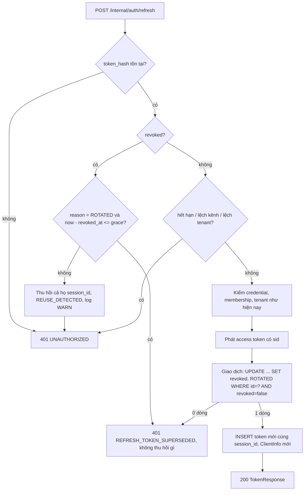

# ADR-0017: Phiên đăng nhập nhiều thiết bị (họ phiên, cửa sổ ân hạn, quản lý phiên theo thiết bị)

- Trạng thái: chấp nhận thiết kế, chưa cài đặt. Phạm vi do người dùng chốt: "Sửa lỗi + quản lý phiên". **Không** làm giới hạn số thiết bị tối đa. Ngày 2026-11-17 người dùng đã chốt Q1 đến Q6 (mục 6). Q4 và Q6 khác khuyến nghị ban đầu: làm luôn API cho quản trị viên tenant xem và thu hồi phiên của nhân viên, admin thấy IP đầy đủ và việc xem phải ghi audit (mục 2.9).
- Liên quan: ADR-0003 (khóa `Controller/method`, `@AuthenticatedOnly`), ADR-0004 (migration tập trung ở system-service), ADR-0005 (BFF `lms-api`, nginx), ADR-0006 (multi-tenant, `TENANT_EXEMPT_TABLES`), ADR-0011 (customer-api, token `svc`), ADR-0013 mục 2.4 (refresh kiểm tenant), ADR-0016 (platform admin hành động trong tenant qua `X-Tenant-Id`), `docs/api/token-audience.md` (kênh STAFF/STOREFRONT).
- Số hiệu: tác vụ gốc đề nghị `0016`, nhưng `0016-platform-admin-hanh-dong-trong-tenant.md` đã tồn tại, nên dùng `0017`. Migration dự kiến `identity/V24__refresh_tokens_session_family.sql` (V23 hiện **chưa commit**, be-dev phải liệt kê lại thư mục trước khi tạo file).

## 1. Bối cảnh và mục tiêu

### 1.1. Hiện trạng đã đọc trong code

| # | Sự thật | Nguồn |
|---|---|---|
| H1 | Đăng nhập không thu hồi phiên khác: `TokenService.issue(...)` luôn tạo refresh token mới, `rotate(null, refresh)` chỉ chèn thêm. Bảng không ràng buộc một token/người dùng (DB có admin 54 phiên hoạt động). | `identity-service/.../auth/application/TokenService.java`, `.../infrastructure/persistence/AuthPersistenceAdapter.java` |
| H2 | **Lỗi:** dùng lại refresh token đã thu hồi thì `refreshSavePort.revokeAllByUserId(userId)`, tức đăng xuất **mọi** thiết bị, mọi tenant, mọi kênh. | `.../auth/application/RefreshTokenUseCase.java`, nhánh `if (token.isRevoked())` |
| H3 | **Lỗi phụ (race thật ở DB):** xoay vòng là `JpaRepository.save` (merge) của dòng cũ với `revoked=true` rồi chèn dòng mới, không điều kiện `WHERE revoked = false`, không `@Version`. Hai request cùng token tới gần như cùng lúc đều đọc `revoked=false` và **cùng** phát token mới: một họ có hai token hoạt động, không bị phát hiện. | `AuthPersistenceAdapter.rotate`, `RefreshTokenJpaEntity` |
| H4 | FE giữ refresh token ở `localStorage` (khóa `lms_rt`, **dùng chung mọi tab** của cùng trình duyệt), access token chỉ trong bộ nhớ từng tab; single-flight `refreshing` chỉ trong **một** tab. Mở/khôi phục nhiều tab cùng lúc là các tab cùng gửi một refresh token: tab chậm dùng lại token tab nhanh vừa xoay, và H2 đăng xuất mọi thiết bị. Đây gần như chắc là nguyên nhân thực tế người dùng gặp. | `library-management-system-fe/apps/web/src/api/token-store.ts`, `client.ts` |
| H5 | Refresh token không có khái niệm thiết bị/họ phiên: không lưu user-agent, IP, thời điểm dùng; không có API liệt kê phiên hay đăng xuất một thiết bị. `LogoutUseCase` thu hồi đúng token gửi lên. | `RefreshToken.java`, `LogoutUseCase.java`, `AuthController.java` (identity, lms-api) |
| H6 | `refresh_tokens` là bảng **toàn cục, không RLS**: đã nằm trong `TenantArchitectureRules.TENANT_EXEMPT_TABLES`; `tenant_id` là cột thường, lọc ở tầng ứng dụng vì refresh đọc trước khi biết tenant (V12, V13, V18). | `shared-libraries/tenant-common/.../TenantArchitectureRules.java`, `system-service/.../migration/identity/V12__*.sql`, `V18__*.sql` |
| H7 | Các luồng thu hồi hàng loạt có chủ ý, **giữ nguyên**: `ChangePasswordUseCase`, `ConfirmPasswordResetUseCase`, `ResetCredentialPasswordUseCase`, `RevokeUserSessionsUseCase` (sự kiện RoleRevoked) gọi `revokeAllByUserId`; `RevokeTenantSessionsUseCase`/`RevokeUserSessionsInTenantUseCase` (`POST /api/users/{id}/sessions/revocation`) thu hồi theo tenant. | các use case cùng tên trong `auth.application`, `user.application` |
| H8 | `SwitchTenantSessionUseCase` thu hồi token hiện tại và phát token mới cùng kênh qua `TokenService.issueForTenant(credential, choice, current)`; mọi đường phát token đi qua **một** điểm `TokenService.issue(...)`. | `SwitchTenantSessionUseCase.java`, `TokenService.java` |
| H9 | TTL: access `PT15M`, refresh `P7D` (`identity-service/src/main/resources/application.yml`). Access token là JWT không tra lại kho: thu hồi phiên chỉ chặn refresh, access đã phát còn dùng được tối đa 15 phút. | `application.yml`, javadoc `RevokeTenantSessionsUseCase` |
| H10 | nginx đặt `X-Real-IP $remote_addr` (ghi đè giá trị client gửi) và `X-Forwarded-For $proxy_add_x_forwarded_for` (client **nối thêm** được). identity chỉ `expose: 8081` trong compose (không mở ra host). | `infrastructure/nginx/snippets/proxy.conf`, `docker-compose.yml` |
| H11 | Token `svc` (customer-api) bị `PermissionInterceptor.handleServiceToken` trả 403 ở endpoint không `@StorefrontAccessible`. lms-api từ chối token `aud=lms-storefront` (`ChannelAudienceFilter`). | `shared-libraries/security-common/.../PermissionInterceptor.java`, `docs/api/token-audience.md` |
| H12 | Lỗi refresh hiện trả `401 UNAUTHORIZED` (`AuthExceptionHandler`); customer-api chỉ chuyển mã trong `PublicExceptionHandler.FORWARDED_CODES`. | `.../auth/infrastructure/web/AuthExceptionHandler.java`, `customer-api/.../web/PublicExceptionHandler.java` |

### 1.2. Mục tiêu

1. Dùng lại refresh token chỉ ảnh hưởng **phiên (thiết bị) chứa token đó**, không đụng thiết bị khác.
2. Race hợp lệ (nhiều tab, retry) không làm mất phiên.
3. Người dùng xem được các thiết bị đang đăng nhập, đăng xuất một thiết bị, đăng xuất mọi thiết bị khác hoặc tất cả.

### 1.3. Ràng buộc

- Không atomicity xuyên DB: mọi thay đổi nằm trong `identity_db`, mỗi use case ghi một DB.
- Không thêm hạ tầng mới (Redis denylist, bảng mới) khi chưa cần.
- Hợp đồng `/api/auth/login|refresh|logout|switch-tenant` hiện có **không đổi** về hình dạng (chỉ thêm mã lỗi mới, thêm claim JWT mới).
- Domain Java thuần; quy tắc nằm ở `auth.domain`/`auth.application`, controller chỉ chuyển đổi.

## 2. Quyết định

### 2.1. Mô hình họ phiên: cột `session_id` trên `refresh_tokens` (chọn A1)

Mỗi lần **đăng nhập** (mật khẩu, đăng nhập ngoài, đăng ký rồi đăng nhập) tạo một `session_id` mới. Mọi lần **xoay vòng** (refresh, đổi tenant) giữ nguyên `session_id`. Một phiên = một thiết bị/trình duyệt. Tại mọi thời điểm, mỗi phiên còn sống có đúng **một** token hoạt động (đầu họ).

Dùng lại token đã thu hồi (ngoài cửa sổ ân hạn, mục 2.2) thì thu hồi **cả họ**: `UPDATE refresh_tokens SET revoked = true ... WHERE session_id = :sid AND revoked = false`. Thiết bị khác không bị ảnh hưởng.

| Phương án | Ưu | Nhược | Kết luận |
|---|---|---|---|
| **A1. Thêm cột `session_id` + siêu dữ liệu vào `refresh_tokens`** | Không bảng mới, không đổi `TENANT_EXEMPT_TABLES`; xoay vòng vẫn là một giao dịch chèn/sửa trên một bảng; "phiên hoạt động" = token chưa thu hồi, chưa hết hạn (mỗi phiên đúng một dòng); `last_used_at` có sẵn = `created_at` của đầu họ, không ghi thêm. | Siêu dữ liệu chép sang mỗi dòng xoay vòng (xử lý bằng xóa siêu dữ liệu ở dòng đã xoay và job dọn, mục 2.6). | ✅ **Chọn** |
| A2. Bảng mới `auth_sessions` (aggregate phiên), `refresh_tokens.session_id` là FK | Mô hình DDD sạch hơn; siêu dữ liệu không lặp; dễ thêm đặt tên thiết bị, giới hạn số thiết bị về sau. | Thêm bảng, thêm entity, thêm mục `TENANT_EXEMPT_TABLES` (sửa shared-libraries); refresh phải ghi hai bảng; nhiều việc hơn cho nhu cầu hiện tại. | ⏭️ Loại, ghi là hướng mở rộng khi làm giới hạn thiết bị/đặt tên thiết bị |
| A3. Giữ `revokeAll`, chỉ thêm cửa sổ ân hạn | Ít thay đổi nhất. | Ngoài cửa sổ (retry muộn, token cũ sau logout bị gửi lại) vẫn đăng xuất mọi thiết bị: không đạt mục tiêu 1. | ❌ Loại |
| A4. Lưu `previous_token_hash` / `replaced_by` (chuỗi cha-con) thay cho `session_id` | Truy vết được chuỗi. | Thu hồi cả họ phải đi theo chuỗi (truy vấn đệ quy) hoặc vẫn cần khóa họ; liệt kê thiết bị cũng cần khóa họ. | ❌ Loại, `session_id` đủ và đơn giản hơn |
| A5. Bỏ phát hiện dùng lại (chỉ 401) | Hết đăng xuất oan. | Mất tín hiệu token bị đánh cắp: kẻ cắp và chủ cùng dùng được đến khi một bên xoay. | ❌ Loại |

Quyết định phụ:

- **Đổi tenant giữ `session_id`** (cùng thiết bị). Tenant hiển thị của phiên là `tenant_id` của đầu họ. `RevokeTenantSessionsUseCase` (thu hồi theo `user_id + tenant_id`) vẫn đúng: thu hồi đầu họ là kết thúc cả phiên.
- **Logout** (`LogoutUseCase`) thu hồi cả họ của token gửi lên (đầu họ là token duy nhất còn hoạt động, nên hành vi gần như cũ; thêm `revoked_reason = LOGOUT`). Token đã thu hồi gửi lên logout vẫn idempotent, không thu hồi gì thêm.
- **Ghi lý do và thời điểm thu hồi**: thêm `revoked_at`, `revoked_reason` (`ROTATED`, `LOGOUT`, `SESSION_REVOKED`, `REUSE_DETECTED`, `BULK`). Cần để phân biệt "vừa bị xoay" (cửa sổ ân hạn) với "đã đăng xuất/bị thu hồi".

### 2.2. Race refresh hợp lệ: cửa sổ ân hạn "từ chối mềm", không phát token (chọn B1)

Quy tắc trong `RefreshTokenUseCase`, khi token tìm thấy đã `revoked`:

1. `revoked_reason = ROTATED` và `now - revoked_at <= grace` (mặc định `PT30S`): **401 `REFRESH_TOKEN_SUPERSEDED`**, không thu hồi gì, không phát token. Client đọc lại refresh token mới nhất (đã có trong `localStorage` do tab khác ghi) và thử lại.
2. Trường hợp khác (quá cửa sổ, hoặc lý do khác `ROTATED`): thu hồi cả họ (`REUSE_DETECTED`), log `WARN` kèm `userId`, `sessionId` (không token), **401 `UNAUTHORIZED`** như hiện nay.

Đồng thời sửa H3: bước xoay vòng phải là **cập nhật có điều kiện** trong cùng giao dịch với việc chèn token mới:

```sql
UPDATE refresh_tokens SET revoked = true, revoked_at = :now, revoked_reason = 'ROTATED'
 WHERE id = :id AND revoked = false
```

Số dòng = 0 (request song song đã xoay trước trong vài mili giây) thì **không chèn** token mới, rollback, trả 401 `REFRESH_TOKEN_SUPERSEDED`. Nhờ vậy một họ không bao giờ có hai đầu.

| Phương án | Ưu | Nhược | Kết luận |
|---|---|---|---|
| **B1. Từ chối mềm trong cửa sổ (mã riêng), FE thử lại bằng token mới nhất** | Không phát thêm token cho token cũ: kẻ cắp có token cũ trong 30 giây không lấy được gì; không cần lưu token gốc; đơn giản. | Retry sau mất phản hồi mạng (client không bao giờ nhận token mới) không cứu được: thiết bị đó phải đăng nhập lại, nhưng **chỉ thiết bị đó**. | ✅ **Chọn** |
| B2. Trong cửa sổ, coi là retry hợp lệ: xoay tiếp từ đầu họ (thu hồi đầu họ, phát đầu mới) | Cứu được cả ca mất phản hồi mạng. | Kẻ cắp có token cũ trong cửa sổ chiếm được họ phiên (đẩy chủ ra, phát hiện chậm một vòng); logic phức tạp hơn; nhiều tab vẫn phải đồng bộ. | ⏭️ Loại ở giai đoạn này; bật được sau nếu số liệu cho thấy mất phản hồi mạng là phổ biến |
| B3. Trong cửa sổ, trả lại đúng token kế nhiệm | Hành vi "idempotent" đẹp nhất. | Phải lưu token gốc (hoặc mã hóa) của token kế nhiệm: phá nguyên tắc chỉ lưu băm. | ❌ Loại |
| B4. Không cửa sổ, chỉ dựa FE đồng bộ tab | Không nới bảo mật chút nào. | Một FE cũ hoặc một tab chưa nâng cấp vẫn làm mất phiên; không chống được race mili giây (H3 vẫn cần sửa). | ❌ Loại |

Rủi ro bảo mật của B1: trong 30 giây sau mỗi lần xoay, token cũ bị dùng lại **không** kích hoạt thu hồi họ, tức tín hiệu đánh cắp bị trễ tối đa đến lần dùng tiếp theo ngoài cửa sổ. Không có token nào được phát nhờ cửa sổ này, nên không mở thêm quyền truy cập. Cấu hình `auth.refresh-reuse-grace` (Duration, `PT0S` = tắt), chặn trên `PT2M` khi khởi động.

### 2.3. Siêu dữ liệu thiết bị: tóm tắt, tối thiểu, chỉ để người dùng tự nhận ra thiết bị (chọn C1)

Lưu trên dòng đầu họ:

| Cột | Kiểu | Ý nghĩa | Ghi khi |
|---|---|---|---|
| `session_id` | UUID NOT NULL | Họ phiên | Đăng nhập: mới; xoay vòng: chép |
| `session_started_at` | TIMESTAMPTZ NOT NULL | Thời điểm đăng nhập của phiên | Đăng nhập: `now`; xoay vòng: chép |
| `device_summary` | VARCHAR(100) NULL | Tóm tắt user-agent, ví dụ `Chrome trên Windows`, `Safari trên iOS`, `Không rõ` | Mỗi lần phát token, nếu có header; không có thì chép từ token cũ |
| `client_ip` | VARCHAR(45) NULL | IP lần dùng gần nhất (IPv4/IPv6 dạng chuẩn) | Như trên |
| `revoked_at` | TIMESTAMPTZ NULL | | Khi thu hồi |
| `revoked_reason` | VARCHAR(20) NULL | `ROTATED`, `LOGOUT`, `SESSION_REVOKED`, `REUSE_DETECTED`, `BULK` | Khi thu hồi |

`last_used_at` **không** thêm cột: bằng `created_at` của đầu họ (mỗi lần refresh là một lần xoay). `expires_at` của đầu họ là hạn phiên (TTL trượt 7 ngày, như hiện nay).

Quyền riêng tư:

- **Không lưu user-agent thô**: identity tóm tắt ngay (lớp Java thuần `DeviceSummary` trong `auth.domain`, nhận diện vài họ trình duyệt/hệ điều hành bằng chuỗi con, không thư viện ngoài) rồi bỏ chuỗi gốc. Đánh đổi: đổi thuật toán tóm tắt không tính lại được dữ liệu cũ (chấp nhận, phiên sống tối đa 7 ngày).
- **IP chỉ giữ bản gần nhất trên đầu họ**: khi xoay vòng, dòng cũ bị xóa `client_ip` và `device_summary` (đặt NULL cùng câu UPDATE thu hồi), nên không hình thành lịch sử IP. Dòng còn lại bị job xóa (mục 2.6). Không định vị địa lý.
- Không log IP/user-agent trong log ứng dụng của luồng phiên; log phát hiện dùng lại chỉ có `userId`, `sessionId`.
- IP đầy đủ chỉ trả cho **chính chủ** phiên (mục 2.4, Q3 đã chốt). Quản trị viên tenant (có khóa `UserController/listSessions`) cũng thấy IP **đầy đủ** của người trong tenant mình. Q6 đã chốt; mọi lần xem đều ghi audit, mục 2.9.4. IP và thiết bị không vào sự kiện Kafka hay audit.

Lấy siêu dữ liệu (đường đi):

```
Trình duyệt --(User-Agent)--> nginx --(X-Real-IP = $remote_addr, User-Agent)--> lms-api / customer-api
   --(X-Client-Ip, X-Client-User-Agent, chỉ ở các lời gọi phát token)--> identity /internal/auth/*
```

- BFF xác định IP client: dùng `X-Real-IP` **chỉ khi** `request.getRemoteAddr()` thuộc danh sách proxy tin cậy (cấu hình `lms.api.client-ip.trusted-proxies`, mặc định loopback và dải riêng `10.0.0.0/8, 172.16.0.0/12, 192.168.0.0/16`); ngược lại dùng `remoteAddr`. **Không** đọc `X-Forwarded-For` (client nối thêm được). Khi đặt sau LB/CDN, `real-ip.conf` của nginx đã là chỗ cấu hình IP thật (H10), BFF không cần đổi.
- BFF gắn `X-Client-Ip` và `X-Client-User-Agent` (cắt còn 512 ký tự) **chỉ** ở các lời gọi `login`, `refresh`, `switch-tenant`, `external/exchange` (trong `HttpAuthClient`), không thêm vào `TokenRelayInterceptor` chung.
- identity đọc hai header ở web adapter (`AuthController`, `ExternalAuthController`), kiểm `client_ip` parse được thành IP (sai thì NULL), rồi truyền record `ClientInfo(String ip, String userAgent)` xuống use case. Siêu dữ liệu là **thông tin hiển thị**, không dùng cho quyết định bảo mật nào; ai gọi thẳng identity (chỉ trong mạng nội bộ) giả được thì chỉ làm sai nhãn phiên của chính token đó.

Phương án đã loại: C2 lưu user-agent thô 512 ký tự (dư dữ liệu, tăng khả năng định danh trình duyệt); C3 lưu lịch sử IP mỗi lần refresh (vượt nhu cầu, tăng PII); C4 BFF tự tóm tắt user-agent (hai nơi cài, lệch nhau).

### 2.4. API quản lý phiên của chính mình (chọn D1)

Nhận diện "phiên hiện tại": thêm claim JWT **`sid`** (= `session_id`) vào access token kênh STAFF và STOREFRONT (hằng `JwtClaims.SESSION_ID = "sid"` trong security-common). Token `svc` không có `sid`. Access token phát trước khi triển khai không có `sid` (hết sau tối đa 15 phút).

Phương án đã loại: gửi refresh token lên để xác định phiên hiện tại (tăng số lần refresh token đi qua mạng, FE phải đọc `localStorage` cho mọi lời gọi); trả `sessionId` trong `TokenResponse` (FE phải lưu thêm, không cần khi đã có claim).

**identity** (controller mới `SessionController` trong `auth.infrastructure.web`, mọi method `@AuthenticatedOnly`, chủ thể là `sub` của token, không theo tenant):

| Method | Đường dẫn | Vào | Ra | Lỗi |
|---|---|---|---|---|
| GET | `/internal/auth/sessions` | (không) | `200 List<SessionView>` sắp `lastUsedAt` giảm dần | 401 |
| DELETE | `/internal/auth/sessions/{sessionId}` | `@PathVariable UUID` | `204` | `404 SESSION_NOT_FOUND` (không có, không phải của mình, hoặc đã kết thúc; một mã chung, không lộ phiên người khác) |
| POST | `/internal/auth/sessions/revocation` | `@Valid @RequestBody RevokeSessionsRequest(boolean keepCurrent)` | `200 RevokedSessionsResponse(int revokedSessions)` (dùng lại record hình dạng như `user.application.RevokedSessionsResponse`) | `409 SESSION_NOT_IDENTIFIED` khi `keepCurrent=true` mà token không có `sid` |

`SessionView` (record ở `auth.application`): `sessionId`, `channel` (`STAFF`|`STOREFRONT`), `tenantId` (null = phiên nền tảng), `tenantName` (tra qua `tenant.application`, null nếu không tra được), `deviceSummary`, `ipAddress`, `startedAt`, `lastUsedAt`, `expiresAt`, `current` (boolean, so với claim `sid`).

**lms-api** (BFF, cùng `AuthController` `/api/auth` hoặc controller riêng trong `lms.api.identity.web`; không nằm trong `PUBLIC_API` nên mặc định yêu cầu đăng nhập):

| lms-api | identity |
|---|---|
| `GET /api/auth/sessions` | `GET /internal/auth/sessions` |
| `DELETE /api/auth/sessions/{sessionId}` | `DELETE /internal/auth/sessions/{sessionId}` |
| `POST /api/auth/sessions/revocation` body `{keepCurrent}` | `POST /internal/auth/sessions/revocation` |

Phản hồi có `Cache-Control: no-store` (chứa IP).

Quy tắc nghiệp vụ (ở `auth.application`, use case `ListMySessionsUseCase`, `RevokeMySessionUseCase`, `RevokeMySessionsUseCase`):

- R1. Phạm vi là **mọi phiên của tài khoản**: mọi tenant, phiên nền tảng, cả kênh STAFF và STOREFRONT (tài khoản là toàn cục; đăng xuất mọi nơi phải thật sự là mọi nơi). Q2 đã chốt.
- R2. Xóa phiên hiện tại được phép (tương đương logout). FE tự xóa token cục bộ sau 204.
- R3. Thu hồi phiên từ xa chỉ chặn refresh; access token của thiết bị kia còn dùng được tối đa 15 phút (H9). FE ghi rõ trên giao diện.
- R4. `keepCurrent=true`: thu hồi mọi phiên trừ `sid` hiện tại; `false`: thu hồi tất cả kể cả hiện tại.
- R5. Không mã khóa quyền: `@AuthenticatedOnly` nên không có khóa ADR-0003 nào được đăng ký, không cần gán role. Tài khoản `mustChangePassword` cũng dùng được (hợp lý: người vừa bị lộ mật khẩu cần đăng xuất thiết bị khác). Token `svc` bị 403 sẵn (H11, ⚠️ xem 5).
- R6. Platform admin không tenant gọi được (`@AuthenticatedOnly` bỏ qua `TENANT_REQUIRED`). Header `X-Tenant-Id` (ADR-0016) không ảnh hưởng vì chủ thể là `sub`.

Quản trị viên xem và thu hồi phiên của người khác là API riêng ở context `user`, thiết kế ở mục 2.9 (Q4 đã chốt "Làm luôn"). API "của tôi" ở trên không nhận `userId` nào.

### 2.5. Migration `identity/V24__refresh_tokens_session_family.sql`

Phác (be-dev chốt câu chữ):

```sql
ALTER TABLE refresh_tokens ADD COLUMN session_id UUID;
ALTER TABLE refresh_tokens ADD COLUMN session_started_at TIMESTAMP WITH TIME ZONE;
ALTER TABLE refresh_tokens ADD COLUMN device_summary VARCHAR(100);
ALTER TABLE refresh_tokens ADD COLUMN client_ip VARCHAR(45);
ALTER TABLE refresh_tokens ADD COLUMN revoked_at TIMESTAMP WITH TIME ZONE;
ALTER TABLE refresh_tokens ADD COLUMN revoked_reason VARCHAR(20);

-- Dọn một lần: token hết hạn quá 1 ngày không còn tác dụng (kể cả phát hiện dùng lại)
DELETE FROM refresh_tokens WHERE expires_at < now() - INTERVAL '1 day';

-- Dữ liệu cũ: không dựng lại được chuỗi xoay vòng, mỗi dòng còn lại là một họ riêng
UPDATE refresh_tokens SET session_id = id, session_started_at = created_at WHERE session_id IS NULL;
UPDATE refresh_tokens SET revoked_at = created_at, revoked_reason = 'BULK' WHERE revoked AND revoked_at IS NULL;

ALTER TABLE refresh_tokens ALTER COLUMN session_id SET NOT NULL;
ALTER TABLE refresh_tokens ALTER COLUMN session_started_at SET NOT NULL;

CREATE INDEX idx_refresh_tokens_session_active ON refresh_tokens (session_id) WHERE revoked = false;
CREATE INDEX idx_refresh_tokens_user_active ON refresh_tokens (user_id) WHERE revoked = false;
CREATE INDEX idx_refresh_tokens_expires_at ON refresh_tokens (expires_at);
```

- Không RLS, không `set_config('app.tenant_id', ...)`: bảng toàn cục (H6), đã nằm trong `TENANT_EXEMPT_TABLES`; entity `RefreshTokenJpaEntity` tiếp tục **không** có `@TenantId`. Không thêm bảng, nên không sửa `TenantArchitectureRules`.
- `afterMigrate.sql` đã cấp `SELECT, INSERT, UPDATE, DELETE` mọi bảng cho `identity_app`: job dọn (DELETE) chạy được, không cần đổi.
- Backfill `revoked_reason = 'BULK'` cho dòng cũ đã thu hồi: chúng không bao giờ rơi vào cửa sổ ân hạn (đúng, vì không biết là xoay vòng hay logout). Hệ quả: token cũ đã xoay trước migration bị dùng lại chỉ thu hồi "họ một dòng" của chính nó (đã thu hồi), tức **mất phát hiện dùng lại** cho token phát trước migration trong tối đa 7 ngày (⚠️ chấp nhận, mục 5).
- Không sửa file V1 đến V23.

### 2.6. Dọn dẹp: job hằng ngày xóa token hết hạn (chọn E1)

- Hàng thu hồi nhưng **chưa hết hạn** phải giữ để phát hiện dùng lại. Hàng **đã hết hạn** thì vô dụng: `findByTokenHash` vẫn thấy nhưng `ensureUsable` từ chối, và thu hồi họ của phiên đã hết hạn không còn ý nghĩa.
- `RefreshTokenCleanupJob` (`auth.infrastructure.scheduling`, `@Scheduled(cron = "${lms.auth.refresh-cleanup.cron:0 30 3 * * *}", zone = "${lms.contract.zone:Asia/Ho_Chi_Minh}")`) gọi use case `PurgeExpiredRefreshTokensUseCase` xóa `expires_at < now - 1 ngày`, theo lô (ví dụ 1000 dòng/lần, lặp đến khi hết). `@EnableScheduling` đã có trong `ContractBeanConfiguration`. Chạy song song nhiều instance vô hại (DELETE idempotent), không cần ShedLock.
- Thêm khối cấu hình: đặt dưới khối `lms:` đã có ở cuối `identity-service/src/main/resources/application.yml` (không tạo khối `lms:` thứ hai; file đang có thay đổi chưa commit của phiên khác).
- Đã loại: E2 xóa ngay dòng `ROTATED` (mất phát hiện dùng lại); E3 `pg_cron`/partition (hạ tầng mới, vượt nhu cầu).

Ước lượng: mỗi phiên hoạt động tạo tối đa khoảng 96 dòng/ngày (refresh mỗi 15 phút khi tab mở), giữ 8 ngày, khoảng 770 dòng/phiên ở trạng thái ổn định; index một phần theo `revoked = false` giữ truy vấn liệt kê và thu hồi nhỏ. ⚠️ chưa đo.

### 2.7. Ảnh hưởng FE (repo `library-management-system-fe`, không sửa ở đây)

Hợp đồng FE cần:

1. **Đồng bộ refresh giữa các tab** (bắt buộc, sửa tận gốc H4): bọc `refreshSession()` bằng Web Locks API `navigator.locks.request("lms-refresh", ...)`. Sau khi giữ khóa, **đọc lại** `lms_rt` từ `localStorage` ngay trước khi gọi `/api/auth/refresh` (tab khác có thể vừa ghi token mới). Trình duyệt không có Web Locks thì giữ hành vi hiện tại, dựa vào cửa sổ ân hạn.
2. **Xử lý `401 REFRESH_TOKEN_SUPERSEDED`**: đọc lại `lms_rt`; nếu khác token vừa gửi thì thử lại **một** lần; nếu giống thì xóa phiên.
3. **Phiên bị thu hồi từ xa**: refresh trả `401 UNAUTHORIZED` thì xóa phiên, về trang đăng nhập với thông điệp chung "Phiên đăng nhập đã kết thúc" (BE không phân biệt "bị đăng xuất từ thiết bị khác" với "hết hạn", chủ ý không lộ thêm). Tùy chọn: `BroadcastChannel("lms-auth")` báo các tab khác khi đăng xuất/đăng nhập để không tab nào giữ token cũ.
4. **Màn hình "Thiết bị đăng nhập"** (trong hồ sơ cá nhân): danh sách từ `GET /api/auth/sessions` (thiết bị, IP, tenant/kênh, đăng nhập lúc, dùng gần nhất, nhãn "Thiết bị này" theo `current`); nút "Đăng xuất" từng phiên (`DELETE`), "Đăng xuất các thiết bị khác" (`keepCurrent=true`), "Đăng xuất tất cả" (`keepCurrent=false`, sau đó xóa token cục bộ). Ghi chú "thiết bị kia có thể còn truy cập tối đa 15 phút".
5. Không cần đổi gì khi đăng nhập/refresh/logout (hình dạng không đổi).

### 2.8. Ảnh hưởng customer-api (kênh STOREFRONT) và token `svc`

- Họ phiên, cửa sổ ân hạn, sửa race H3 áp dụng **tự động** cho kênh STOREFRONT (cùng `RefreshTokenUseCase`): khách dùng lại token không còn đăng xuất phiên nhân viên của cùng tài khoản, và ngược lại.
- Thêm `REFRESH_TOKEN_SUPERSEDED` vào `PublicExceptionHandler.FORWARDED_CODES` (thông điệp do customer-api viết) để storefront FE áp dụng được mục 2.7 điểm 2; nếu không thêm, mã bị gộp thành 401 chung (vẫn an toàn, chỉ mất khả năng thử lại).
- Nên gắn `X-Client-Ip`/`X-Client-User-Agent` ở `customer-api/.../auth/client/http/HttpAuthClient` cho login/refresh (cùng quy tắc proxy tin cậy) để phiên storefront có nhãn thiết bị; không bắt buộc cho giai đoạn này.
- **Không** thêm API phiên ở `/public/**` giai đoạn này (khách xem thiết bị ở storefront là việc sau). Nhân viên/khách dùng chung tài khoản đăng xuất phiên storefront được từ ứng dụng nhân viên (R1).
- Token `svc`: không có refresh token, không có `sid`, không tạo phiên; endpoint phiên trả 403 cho `svc` qua `PermissionInterceptor` (H11). Không đổi gì ở `IssueStorefrontTokenUseCase`.
- Refresh theo tenant (ADR-0013 2.4): thứ tự kiểm giữ nguyên, nhưng nhánh "đã thu hồi" giờ là cửa sổ ân hạn hoặc thu hồi họ, vẫn đứng **trước** kiểm kênh/tenant.

### 2.9. Quản trị viên tenant xem và thu hồi phiên của người dùng (Q4: làm luôn)

#### 2.9.1. Hiện trạng cần tái dùng (chưa commit, của phiên khác)

| Thành phần | Vai trò hiện nay | Quan hệ với ADR này |
|---|---|---|
| `identity` `user.infrastructure.web.UserController.revokeSessions`, `POST /internal/users/{id}/sessions/revocation` | Thu hồi mọi refresh token của người dùng trong tenant hiện tại, trả `RevokedSessionsResponse(int revokedSessions)` | **Giữ nguyên đường dẫn và khóa** `UserController/revokeSessions`, dùng làm thao tác "thu hồi tất cả phiên của người đó trong tenant". Không tạo endpoint trùng. Thêm quy tắc 2.9.3 và sự kiện audit 2.9.4. |
| `user.application.RevokeUserSessionsInTenantUseCase` | `TenantContext.require()`, `UserAccountGuard.requireMember` (404 nếu không thuộc tenant), gọi `AccountCredentialPort.revokeSessionsInTenant` | Mở rộng: thêm kiểm quyền với người đích (2.9.3). Hai use case mới đặt cạnh, dùng chung guard. |
| `user.application.AccountCredentialPort` + `auth.infrastructure.client.InProcessAccountCredentialAdapter` | Cổng từ context `user` sang `auth` (context `user` không biết `auth`; adapter nằm ở `auth`, dùng `user.application`) | Thêm hai phương thức `sessionsInTenant(userId, tenantId)` và `revokeSessionInTenant(userId, tenantId, sessionId)`. Adapter gọi use case mới ở `auth.application`. |
| `auth.application.RevokeTenantSessionsUseCase`, `TenantSessionRevokerPort` | `UPDATE ... WHERE user_id AND tenant_id AND revoked=false` | Giữ. Câu UPDATE thêm `revoked_at`, `revoked_reason = SESSION_REVOKED`. |
| lms-api `identity.web.UserController.revokeSessions`, `POST /api/users/{id}/sessions/revocation` | Proxy | Giữ. Thêm 2 endpoint proxy mới ở cùng controller. |

Đã loại: đặt API admin ở `auth` (`/internal/auth/users/{id}/sessions`). Cách này nhân đôi quy tắc thành viên tenant vốn nằm ở `UserAccountGuard`, và lệch khuôn quản trị người dùng hiện có (mọi thao tác admin lên người dùng nằm ở `UserController`).

#### 2.9.2. API

identity (`user.infrastructure.web.UserController`, **không** `@AuthenticatedOnly`, **không** `@CrossTenantReadable`):

| Method | Đường dẫn | Khóa ADR-0003 (tự sinh) | Vào | Ra | Lỗi |
|---|---|---|---|---|---|
| GET | `/internal/users/{id}/sessions` | `UserController/listSessions` | `@PathVariable UUID id` | `200 List<UserSessionView>` | `404 USER_NOT_FOUND`, `403 USER_OPERATION_NOT_ALLOWED`, `403 TENANT_REQUIRED` |
| DELETE | `/internal/users/{id}/sessions/{sessionId}` | `UserController/revokeSession` | 2 `@PathVariable` | `204` | như trên, thêm `404 SESSION_NOT_FOUND` |
| POST | `/internal/users/{id}/sessions/revocation` (đã có) | `UserController/revokeSessions` (đã có) | | `200 RevokedSessionsResponse` | như GET |

lms-api (`lms.api.identity.web.UserController`, proxy nguyên mã lỗi): `GET /api/users/{id}/sessions`, `DELETE /api/users/{id}/sessions/{sessionId}`, `POST /api/users/{id}/sessions/revocation` (đã có). Phản hồi GET có `Cache-Control: no-store`.

`UserSessionView` (record ở `user.application`, ánh xạ từ DTO của port): `sessionId`, `channel`, `deviceSummary`, `ipAddress` (đầy đủ, Q6 đã chốt), `startedAt`, `lastUsedAt`, `expiresAt`. **Không** có `tenantId` (luôn là tenant hiện tại), **không** có `current`. Mỗi lần xem phiên của người khác đều ghi audit (2.9.4).

ℹ️ Tên khóa `UserController/revokeSession` (một phiên) và `UserController/revokeSessions` (tất cả) chỉ khác chữ `s`. Màn hình gán quyền nên hiển thị mô tả rõ. Đổi tên method về sau sẽ đổi khóa và role đã gán mất quyền (ADR-0003), nên be-dev chốt tên ngay từ đầu.

Role nào được dùng: là dữ liệu. Không migration seed nào gán ba khóa này cho role thường; role có `is_admin` (claim `admin=true`) dùng được ngay. Tenant muốn cho bộ phận hỗ trợ dùng thì tự gán khóa cho role đó. Quyền mới có hiệu lực từ lần đăng nhập hoặc refresh kế tiếp.

#### 2.9.3. Quy tắc ai được xem và thu hồi phiên của ai

Quy tắc đặt ở `user.application` (guard dùng chung cho cả 3 use case, gồm cả use case `revokeSessions` đã có), theo thứ tự:

| # | Quy tắc | Lỗi |
|---|---|---|
| G1 | Phải có tenant hiện tại: `TenantContext.require()`. Platform admin không tenant phải dùng `X-Tenant-Id` (ADR-0016). Không có chế độ xem xuyên tenant (không gắn `@CrossTenantReadable`). | `403 TENANT_REQUIRED` |
| G2 | Người đích có membership ở tenant hiện tại: `UserAccountGuard.requireMember`. Người ngoài tenant được coi như không tồn tại. | `404 USER_NOT_FOUND` |
| G3 | Người đích có role `is_admin` **trong tenant hiện tại**: chỉ người gọi có claim `admin=true` (hoặc platform admin) được xem hoặc thu hồi. Đối chiếu khuôn có sẵn ở `accesscontrol.application.UserRoleUseCase` ("chỉ quản trị viên mới gán hoặc thu hồi được role quản trị", tham số `callerIsAdmin`). Ở đây truyền `callerIsAdmin` từ controller xuống command; cờ "đích là admin" tra qua port mới `TargetAdminLookupPort.isTenantAdmin(userId)` (adapter gọi `accesscontrol.application`, chạy dưới tenant hiện tại). | `403 USER_OPERATION_NOT_ALLOWED` |
| G4 | Người đích là platform admin (`AccountCredentialPort.isPlatformAdmin`): chỉ người gọi là platform admin được thao tác. Áp đúng tinh thần `UserAccountGuard.requireAccountManageable` (quản trị viên tenant không thay đổi được tài khoản người vận hành). | `403 USER_OPERATION_NOT_ALLOWED` |
| G5 | Người gọi thao tác lên chính mình qua API admin: cho phép, quy tắc như trên. | |
| G6 | Không kiểm "tài khoản chỉ thuộc một tenant" (`requireAccountManageable` phần đếm membership). Thao tác chỉ chạm phiên của tenant hiện tại, không đụng tài khoản toàn cục; khớp ghi chú của `RevokeUserSessionsInTenantUseCase`. | |

ℹ️ G3 và G4 là **thay đổi hành vi** của endpoint `POST /internal/users/{id}/sessions/revocation` chưa commit: hiện ai có khóa `UserController/revokeSessions` đều thu hồi được phiên của admin tenant. Đây là sửa chặt hơn, nên làm cùng đợt.

#### 2.9.4. Phạm vi tenant, chống IDOR, quyền riêng tư, audit

Phạm vi và chống IDOR: `refresh_tokens` không có RLS (H6), nên **mọi** câu truy vấn và cập nhật của API admin phải lọc tường minh đủ ba điều kiện trong **cùng một câu SQL**, không đọc trước rồi mới ghi:

```sql
-- liệt kê
SELECT ... FROM refresh_tokens
 WHERE user_id = :userId AND tenant_id = :tenantId AND revoked = false AND expires_at > :now
-- thu hồi một phiên
UPDATE refresh_tokens SET revoked = true, revoked_at = :now, revoked_reason = 'SESSION_REVOKED'
 WHERE session_id = :sessionId AND user_id = :userId AND tenant_id = :tenantId AND revoked = false
```

- `tenantId` luôn lấy từ `TenantContext`, không bao giờ lấy từ đường dẫn hay body.
- Cập nhật được 0 dòng thì trả `404 SESSION_NOT_FOUND`. Đó là cùng một mã cho các trường hợp: phiên không tồn tại, phiên của người khác (`sessionId` hợp lệ nhưng `{id}` khác), phiên ở tenant khác, phiên nền tảng (`tenant_id` NULL không bao giờ bằng tham số), phiên đã kết thúc. Không lộ sự tồn tại của phiên.
- Phiên nền tảng và phiên ở tenant khác của cùng tài khoản **không bao giờ** xuất hiện trong danh sách admin.
- Phiên kênh STOREFRONT ở tenant này (khách của cửa hàng là thành viên tenant) có trong danh sách, kèm `channel`.
- Hệ quả của việc đổi tenant giữ `session_id` (2.1): thiết bị vừa đổi từ tenant A sang B thì đầu họ thuộc B, admin A không còn thấy và không thu hồi được phiên đó. Đúng ngữ nghĩa ("phiên đang ở tenant nào"), ghi vào tài liệu API.

Quyền riêng tư (Q6 đã chốt 2026-11-17, khác khuyến nghị ban đầu):

- Admin thấy `deviceSummary`, `channel`, `startedAt`, `lastUsedAt`, `expiresAt` và **IP đầy đủ** (`ipAddress`, cùng giá trị chủ phiên thấy). Không có hàm che IP nào.
- Bù cho việc lộ IP đầy đủ: mọi lần xem phiên của **người khác** đều ghi audit (mục Audit bên dưới), phản hồi có `Cache-Control: no-store`, IP không vào log ứng dụng hay vào sự kiện.
- Phương án đã loại: che IP (`/24`, `/48`), vì người dùng chọn IP đầy đủ; không hiện IP cho admin.

Audit (sự kiện qua `PublishAuthEventPort`, theo khuôn `AccountUnlockedEvent` của `UnlockCredentialUseCase`):

| Sự kiện (domain `auth`, record Java thuần) | Trường | Phát khi |
|---|---|---|
| `UserSessionsViewedEvent` | `eventId`, `targetUserId`, `viewedBy`, `tenantId`, `sessionCount`, `occurredAt` | `GET /internal/users/{id}/sessions` thành công và `viewedBy != targetUserId` |
| `UserSessionsRevokedEvent` | `eventId`, `targetUserId`, `revokedBy`, `tenantId`, `sessionId` (null nếu thu hồi tất cả), `revokedCount`, `occurredAt` | Thu hồi một phiên hoặc tất cả phiên của **người khác**, kể cả qua endpoint `revokeSessions` đã có |

- Cả hai sự kiện **không** chứa IP, user-agent, `deviceSummary` hay danh sách `sessionId` đã xem.
- Chỉ audit khi người gọi thao tác lên người khác. Tự xem hoặc tự thu hồi phiên của mình không phát sự kiện, dù gọi qua API "của tôi" (2.4) hay qua API admin với `{id}` là chính mình (G5).
- Không phát sự kiện khi bị từ chối (404, 403).
- Thứ tự trong use case: kiểm G1 đến G4, đọc danh sách, rồi mới phát sự kiện (best-effort). Phát sự kiện lỗi không làm hỏng việc xem; lỗi chỉ được log.
- Đường đi: `KafkaAuthEventPublisher` gửi lên topic `app.kafka.topics.auth-events`. `support-service` `AuditEventConsumer` đã nghe topic này, đọc `eventType` và `tenantId` từ envelope (`TenantAwareEventHandler`). Sự kiện được phát dưới tenant hiện tại của người gọi, nên bản ghi audit thuộc tenant đó và admin tenant xem lại được.
- Kafka là best-effort (ADR-0001): xem và thu hồi vẫn thành công khi publish lỗi, bản ghi audit có thể mất. Nếu cần audit bắt buộc thì phải dùng Outbox, ngoài phạm vi ADR này.

## 3. Thiết kế

### 3.1. Thành phần thay đổi

| Tầng | Thành phần | Thay đổi |
|---|---|---|
| domain | `RefreshToken` | Thêm `sessionId`, `sessionStartedAt`, `deviceSummary`, `clientIp`, `revokedAt`, `revokedReason`. Factory `startSession(...)` (đăng nhập) và `next(...)`/`rotateTo(...)` (chép `sessionId`, `sessionStartedAt`). `revoke(reason, now)`; `isRecentlyRotated(now, grace)`. Giữ các overload `restore(...)` cũ (test đang dùng) bằng cách suy `sessionId = id`. |
| domain | `RevokeReason` (enum), `DeviceSummary` (Java thuần), `SessionNotFoundException`, `RefreshTokenSupersededException` (con của `InvalidRefreshTokenException` hoặc ngang hàng) | Mới |
| domain | `RefreshTokenRepository` | Thêm `findActiveByUserId(UUID userId, Instant now)` |
| application | `SaveRefreshTokenPort` | `rotate` trả `boolean` (false = đã bị xoay song song) hoặc ném; thêm `revokeSession(UUID sessionId, RevokeReason, Instant)`, `revokeSessionOfUser(UUID userId, UUID sessionId, Instant)` → int, `revokeAllExcept(UUID userId, UUID keepSessionId, Instant)` → int, `deleteExpiredBefore(Instant, int batch)` → int. `revokeAllByUserId` ghi thêm `revoked_at`, `revoked_reason = BULK`. |
| application | `TokenService` | Nhận `ClientInfo` (nullable) ở các đường phát; quyết định `sessionId` duy nhất tại `issue(...)`: `replacedOrNull == null` thì phiên mới, ngược lại chép. Gắn `sid` vào `TokenIssuerPort.Claims`. |
| application | `RefreshTokenUseCase` | Thay nhánh `revokeAllByUserId` bằng: cửa sổ ân hạn → `RefreshTokenSupersededException`; ngoài ra → `revokeSession(sessionId, REUSE_DETECTED)` rồi 401. Nhận `ClientInfo`. |
| application | `LoginUseCase`, `ExchangeExternalTicketUseCase`, `SwitchTenantSessionUseCase`, `LogoutUseCase` | Truyền `ClientInfo`; logout thu hồi họ (`LOGOUT`). |
| application | `ListMySessionsUseCase`, `RevokeMySessionUseCase`, `RevokeMySessionsUseCase`, `PurgeExpiredRefreshTokensUseCase`, record `ClientInfo`, `SessionView`, `RevokeSessionsRequest` | Mới; bean trong `AuthBeanConfiguration`. Tên tenant qua port mới hoặc mở rộng `TenantAccessPort` (chỉ dùng `tenant.application`, ArchUnit kiểm). |
| infrastructure/persistence | `RefreshTokenJpaEntity`, `RefreshTokenJpaRepository`, `AuthPersistenceAdapter` | Cột mới; câu `@Modifying` có điều kiện cho rotate/thu hồi họ/thu hồi trừ phiên/xóa lô. |
| infrastructure/security | `JwtTokenIssuer` | Ghi claim `sid` khi có. |
| infrastructure/web | `AuthController`, `ExternalAuthController` (identity) | Đọc `X-Client-Ip`, `X-Client-User-Agent` thành `ClientInfo`. |
| infrastructure/web | `SessionController` (identity, mới) | 3 endpoint mục 2.4. |
| infrastructure/web | `AuthExceptionHandler` | `RefreshTokenSupersededException` → 401 `REFRESH_TOKEN_SUPERSEDED`; `SessionNotFoundException` → 404 `SESSION_NOT_FOUND`; 409 `SESSION_NOT_IDENTIFIED`. Handler supersede phải đứng trước handler chung của `InvalidRefreshTokenException`. |
| infrastructure/scheduling | `RefreshTokenCleanupJob` (mới) | Mục 2.6. |
| auth.application | `ListTenantUserSessionsUseCase`, `RevokeTenantUserSessionUseCase` (mới), `RevokeTenantSessionsUseCase` (sửa: ghi `revoked_at`/`revoked_reason`), `UserSessionsRevokedEvent`, `UserSessionsViewedEvent` (domain, mới) | Phục vụ adapter `InProcessAccountCredentialAdapter` cho mục 2.9. Truy vấn lọc đủ `user_id + tenant_id (+ session_id)` trong một câu. |
| user.application | `AccountCredentialPort` (thêm 2 phương thức), `ListUserSessionsUseCase`, `RevokeUserSessionUseCase` (mới), `RevokeUserSessionsInTenantUseCase` (thêm G3, G4), guard G1 đến G4, `TargetAdminLookupPort` (mới, hoặc mở rộng `UserRoleLookupPort`), `UserSessionView` (IP đầy đủ), phát audit xem/thu hồi qua phương thức của `AccountCredentialPort` hoặc port audit riêng (be-dev chọn, phải đi qua `auth.application`) | Mục 2.9.3, 2.9.4. |
| user.infrastructure | `UserController` (thêm `listSessions`, `revokeSession`; truyền `callerIsAdmin` từ claim `admin`/`platformAdmin`), adapter `TargetAdminLookupPort` sang `accesscontrol.application`, `UserBeanConfiguration`, handler lỗi `SESSION_NOT_FOUND` | Mục 2.9.2. |
| auth.infrastructure.client | `InProcessAccountCredentialAdapter` | Cài 2 phương thức mới của `AccountCredentialPort`. |
| shared-libraries | `security-common` `JwtClaims` | Thêm `SESSION_ID = "sid"`. |
| lms-api | `identity.web.AuthController` (hoặc `SessionController`), `AuthClient`, `HttpAuthClient`, `AuthDtos`; bộ lấy IP client + cấu hình `lms.api.client-ip.trusted-proxies` | 3 endpoint proxy; gắn header client ở login/refresh/switch/exchange. |
| lms-api | `identity.web.UserController`, `UserClient`, `HttpUserClient`, `UserDtos` | Thêm `GET /api/users/{id}/sessions`, `DELETE /api/users/{id}/sessions/{sessionId}` (mục 2.9.2). |
| customer-api | `PublicExceptionHandler`, (tùy chọn) `auth.client.http.HttpAuthClient` | Mục 2.8. |
| system-service | `db/migration/identity/V24__refresh_tokens_session_family.sql` | Mục 2.5. |

### 3.2. Luồng refresh mới



Ghi chú: access token được ký trước bước giao dịch (như hiện nay). Nhánh 0 dòng bỏ access token vừa ký (không trả ra), không rò rỉ.

### 3.3. Nhiều tab cùng trình duyệt (sau khi FE có Web Locks)

```
Tab A: lock -> đọc lms_rt=T1 -> refresh(T1) -> nhận T2 -> ghi lms_rt=T2 -> unlock
Tab B:            chờ lock ................................ lock -> đọc lms_rt=T2 -> refresh(T2) -> T3
FE cũ / không Web Locks: Tab B gửi T1 trong 30 giây -> 401 REFRESH_TOKEN_SUPERSEDED -> đọc lại lms_rt=T2 -> thử lại
```

## 4. Phân việc

Thứ tự phụ thuộc: B1 → (B2 ∥ B3) → B4 → (B5 ∥ B5a) → (B6 ∥ B7) → T, P.

| # | Ai | Việc | Phạm vi file | Phụ thuộc |
|---|---|---|---|---|
| ⏳ B1 | be-dev | Migration V24 (liệt kê lại thư mục, lấy số kế tiếp thật) | `services/system-service/src/main/resources/db/migration/identity/V24__refresh_tokens_session_family.sql` | Không |
| ⏳ B2 | be-dev | Hằng `JwtClaims.SESSION_ID` | `shared-libraries/security-common/.../JwtClaims.java` | Không (song song B1) |
| ⏳ B3 | be-dev | Domain + port + persistence: `RefreshToken`, `RevokeReason`, `DeviceSummary`, ngoại lệ mới, `RefreshTokenRepository`, `SaveRefreshTokenPort`, `RefreshTokenJpaEntity`, `RefreshTokenJpaRepository`, `AuthPersistenceAdapter` (rotate có điều kiện) | `identity-service/.../auth/domain/*`, `.../auth/application/SaveRefreshTokenPort.java`, `.../auth/infrastructure/persistence/*` | B1 |
| ⏳ B4 | be-dev | Use case: `TokenService` (sessionId, `ClientInfo`, `sid`), `RefreshTokenUseCase` (ân hạn + thu hồi họ), `LoginUseCase`, `ExchangeExternalTicketUseCase`, `SwitchTenantSessionUseCase`, `LogoutUseCase`, 4 use case mới, `JwtTokenIssuer`, `AuthBeanConfiguration`, cấu hình `auth.refresh-reuse-grace` | `.../auth/application/*`, `.../auth/infrastructure/{config,security}/*`, `application.yml` | B2, B3 |
| ⏳ B5 | be-dev | identity web: đọc header client, `SessionController`, `AuthExceptionHandler`, job dọn | `.../auth/infrastructure/web/*`, `.../auth/infrastructure/scheduling/RefreshTokenCleanupJob.java` | B4 |
| ⏳ B5a | be-dev | identity, phần admin (mục 2.9): use case `auth.application` cho liệt kê và thu hồi một phiên theo tenant, sửa `RevokeTenantSessionsUseCase`, `UserSessionsRevokedEvent` và `UserSessionsViewedEvent` (chỉ phát khi người gọi khác người đích, sau khi qua G1 đến G4, không chứa IP/thiết bị), `InProcessAccountCredentialAdapter`; ở `user`: `AccountCredentialPort`, 2 use case mới, G3/G4 cho `RevokeUserSessionsInTenantUseCase`, `TargetAdminLookupPort` + adapter, `UserSessionView` với IP đầy đủ, `UserController.listSessions`/`revokeSession` (truyền `actorId` từ `sub`), handler lỗi | `.../auth/application/*`, `.../auth/domain/UserSessions{Revoked,Viewed}Event.java`, `.../auth/infrastructure/client/InProcessAccountCredentialAdapter.java`, `.../user/application/*`, `.../user/infrastructure/{web,client,config}/*` | B4 (cùng persistence B3); làm song song B5 được nếu chia file như cột trước |
| ⏳ B6 | be-dev | lms-api: 3 endpoint proxy "của tôi", header client ở `HttpAuthClient`, bộ lấy IP + `trusted-proxies`; thêm 2 endpoint proxy admin ở `UserController`/`UserClient` | `lms-api/src/main/java/lms/api/identity/{web,client,dto}/*`, `lms-api/.../application.yml` (khối cuối file) | B5, B5a (hợp đồng), code song song được với mock |
| ⏳ B7 | be-dev | customer-api: `FORWARDED_CODES` + (tùy chọn) header client | `customer-api/.../web/PublicExceptionHandler.java`, `.../auth/client/http/HttpAuthClient.java` | B5 |
| ⏳ T1 | tester | Đơn vị domain/application (xem dưới) | `identity-service/src/test/...` | B4 |
| ⏳ T2 | tester | WebMvc identity + lms-api + customer-api | các `src/test` tương ứng | B5, B6, B7 |
| ⏳ T3 | tester | IT Testcontainers identity (vai trò `identity_app`) | `identity-service/src/test/.../*IT.java` | B5 |
| ⏳ P1 | perf-tester | Đo refresh dồn dập và job dọn | xem dưới | B5 |

ℹ️ `AuthController`, `AuthPersistenceAdapter`, `RefreshTokenJpaRepository`, `AuthExceptionHandler`, `AuthBeanConfiguration`, `application.yml` của identity, cùng `UserController`, `UserBeanConfiguration`, `AccountCredentialPort`, `InProcessAccountCredentialAdapter`, `RevokeUserSessionsInTenantUseCase`, `RevokeTenantSessionsUseCase` (B5a sửa các file này) **đang có thay đổi chưa commit của phiên khác** (quên mật khẩu, mở khóa, thu hồi phiên theo tenant). be-dev nên bắt đầu sau khi các thay đổi đó được commit, hoặc sửa có mục tiêu bằng Edit, không ghi đè.

### 4.1. Test cần có

Đơn vị (tester, T1):

- ✅ mong đợi: `RefreshTokenUseCase` dùng lại token `ROTATED` trong cửa sổ → `REFRESH_TOKEN_SUPERSEDED`, **không** gọi thu hồi nào; ngoài cửa sổ → chỉ `revokeSession(sessionId)`, **không** `revokeAllByUserId`; token `LOGOUT`/`BULK` dùng lại → thu hồi họ; `grace = PT0S` → luôn thu hồi họ.
- Thứ tự kiểm giữ nguyên ADR-0013 2.4: token đúng nhưng sai tenant/kênh không bị thu hồi (test hiện có phải còn xanh).
- `TokenService`: đăng nhập tạo `sessionId` mới mỗi lần; refresh và switch-tenant chép `sessionId`, `sessionStartedAt`; `ClientInfo` null thì chép siêu dữ liệu cũ; claim `sid` có ở STAFF và STOREFRONT.
- `rotate` trả 0 dòng → không chèn, ném supersede.
- `DeviceSummary`: vài user-agent phổ biến, chuỗi rỗng, chuỗi 10 000 ký tự, ký tự điều khiển → `Không rõ`/cắt 100.
- Use case phiên: không xóa được phiên người khác (404 chung); `keepCurrent` thiếu `sid` → 409; xóa phiên hiện tại được.
- Luồng chủ ý giữ `revokeAll` (đổi mật khẩu, đặt lại mật khẩu, RoleRevoked) vẫn thu hồi mọi phiên.
- Admin (mục 2.9), use case `user.application`:
  - G2: người ngoài tenant → `USER_NOT_FOUND`.
  - G3: người gọi không `admin` thao tác lên người có role `is_admin` trong tenant → `USER_OPERATION_NOT_ALLOWED` ở cả 3 use case, kể cả `revokeSessions` đã có. Admin thao tác lên admin thì được.
  - G4: đích là platform admin, người gọi là admin tenant → bị chặn; người gọi là platform admin thì được.
  - G5: tự thao tác lên mình thì được.
  - `UserSessionView` của API admin mang IP đầy đủ (bằng giá trị trong DB).
  - Thu hồi phiên của người khác phát đúng một `UserSessionsRevokedEvent`; xem phiên của người khác phát đúng một `UserSessionsViewedEvent` với `sessionCount` đúng. Cả hai không chứa IP, user-agent, `deviceSummary` hay `sessionId` đã xem (kiểm cả bản tuần tự hóa JSON).
  - Không phát sự kiện khi: tự xem hoặc tự thu hồi (API "của tôi", và API admin với `{id}` = chính mình); bị từ chối 403/404.
  - Publish lỗi (port ném ngoại lệ) thì xem và thu hồi vẫn thành công.

WebMvc (T2, bật `lms.security.permission.enabled=true` và `@MockitoBean PermissionKeyRegistrar`):

- `SessionController`: 401 không token; 200 với token có/không `tenantId` (platform admin); token `svc` → 403; token `mustChangePassword` → 200; không có khóa nào được đăng ký (`@AuthenticatedOnly`).
- `AuthExceptionHandler`: mã `REFRESH_TOKEN_SUPERSEDED`, `SESSION_NOT_FOUND`, `SESSION_NOT_IDENTIFIED`.
- lms-api: proxy 3 endpoint, `Cache-Control: no-store`; `X-Real-IP` chỉ được tin khi remote addr thuộc `trusted-proxies`; `X-Forwarded-For` bị bỏ qua; header client chỉ gắn ở login/refresh/switch/exchange.
- customer-api: `REFRESH_TOKEN_SUPERSEDED` được chuyển tiếp; các mã khác như cũ.
- `UserController` (identity), 2 endpoint mới:
  - Khóa `UserController/listSessions`, `UserController/revokeSession` tự đăng ký khi gọi lần đầu.
  - Role không có khóa → 403; role có khóa → 200; token `admin=true` → 200.
  - Token không tenant và không `X-Tenant-Id` → `403 TENANT_REQUIRED`.
  - Token `svc` → 403.
  - Phản hồi GET có `ipAddress` đầy đủ, không có `tenantId`, `current`, và có `Cache-Control: no-store`.
- lms-api: proxy 2 endpoint admin giữ nguyên mã lỗi, GET có `no-store`.

ArchUnit (chạy `mvn test` sẵn có): `DeviceSummary`, `ClientInfo`, use case mới không phụ thuộc Spring/jakarta ở `domain`; `auth` chỉ dùng `tenant.application`; `TenantArchitectureRulesTest` xanh (không bảng mới).

IT Testcontainers (T3, chạy `-Dtest=<TênIT>`, Docker 29 thêm `-DargLine=-Dapi.version=1.44`):

- Migration V24 lên DB có dữ liệu cũ: backfill `session_id = id`, NOT NULL, xóa dòng hết hạn.
- Hai thiết bị đăng nhập; thiết bị A dùng lại token cũ ngoài cửa sổ → A bị thu hồi, B refresh vẫn 200.
- Hai request refresh **song song thật** cùng token (hai luồng, `CountDownLatch`) → đúng một 200, một `REFRESH_TOKEN_SUPERSEDED`, DB có đúng một token hoạt động cho họ đó.
- Liệt kê, xóa một phiên, `keepCurrent` true/false chạy bằng vai trò `identity_app`.
- Job dọn xóa đúng dòng `expires_at < now - 1 ngày`, giữ dòng đã thu hồi chưa hết hạn.
- IDOR và phạm vi tenant (mục 2.9.4), chạy bằng `identity_app`, có dữ liệu ở hai tenant A, B:
  - Người dùng U là thành viên A và B, có phiên ở A, ở B và một phiên nền tảng (nếu U là platform admin). Admin A liệt kê U thì chỉ thấy phiên ở A.
  - Admin A `DELETE /internal/users/{U}/sessions/{sessionId}` với các `sessionId` sau, đều phải `404 SESSION_NOT_FOUND` và không dòng nào trong DB bị đổi:
    - phiên của U ở B;
    - phiên nền tảng của U;
    - phiên của người khác V ở A, nhưng `{id}` = U;
    - phiên đã kết thúc.
  - Admin A với `{id}` là người chỉ thuộc B → `404 USER_NOT_FOUND`.
  - `POST /sessions/revocation` của admin A không đụng phiên của U ở B hay phiên nền tảng.
  - U đổi tenant từ A sang B: phiên đó biến khỏi danh sách của admin A.
  - Admin A thu hồi một phiên của U: thiết bị đó refresh bị 401; các thiết bị khác của U vẫn 200.

Hiệu năng (P1):

- Refresh dồn dập (ví dụ 200 phiên, mỗi phiên 3 tab gọi cùng lúc): tỉ lệ 401 không mong đợi = 0, p95 refresh không tăng đáng kể so với trước (thêm một UPDATE có điều kiện).
- `GET /api/auth/sessions` với tài khoản 50+ phiên và 30 000 dòng lịch sử: p95 và kế hoạch truy vấn dùng `idx_refresh_tokens_user_active`.
- Job dọn trên 1 triệu dòng: thời gian, khóa bảng không chặn refresh.

## 5. Rủi ro và việc chưa kiểm chứng

- ⚠️ Cửa sổ ân hạn 30 giây làm trễ tín hiệu đánh cắp: token bị cắp dùng trong 30 giây sau lần xoay không gây thu hồi họ (nhưng cũng không phát token nào). Chấp nhận; cấu hình được, `PT0S` để tắt.
- ⚠️ Mất phản hồi mạng khi refresh (client không nhận token mới) vẫn làm **thiết bị đó** phải đăng nhập lại (B1 không cứu). Nếu đo thấy phổ biến, cân nhắc B2.
- ⚠️ Token phát trước V24 bị xoay rồi dùng lại sẽ không kích hoạt thu hồi họ (mỗi dòng cũ là một họ riêng), trong tối đa 7 ngày sau triển khai. Phương án bù nếu cần: một lần thu hồi mọi phiên khi triển khai (buộc mọi người đăng nhập lại); khuyến nghị không làm.
- ⚠️ Thu hồi phiên từ xa không chặn access token đã phát (tối đa 15 phút). Hướng mở rộng nếu cần chặn tức thì: danh sách `sid` bị thu hồi trong Redis, kiểm ở `security-common` (thêm phụ thuộc Redis cho mọi service, không làm giai đoạn này).
- ⚠️ Chưa kiểm chứng `PermissionInterceptor` xử lý token `svc` **trước** nhánh `AUTHENTICATED` (nếu ngược lại, token `svc` gọi được endpoint `@AuthenticatedOnly`; với API phiên thì chỉ trả danh sách rỗng của `sub` dịch vụ, nhưng phải xác nhận bằng WebMvc test).
- ⚠️ lms-api `ApiExceptionHandler.handleDownstream` đọc thân lỗi 4xx của service (đã đọc, nhưng chưa chạy thử với mã mới). Phía FE, `refreshSession()` gọi `fetch` trực tiếp và hiện chỉ xét status, chưa đọc `code`; FE phải thêm đọc `code` (có sẵn `parseError` trong `client.ts`) để xử lý `REFRESH_TOKEN_SUPERSEDED`.
- ⚠️ `trusted-proxies` mặc định gồm dải riêng: nếu lms-api được mở cổng ra mạng nội bộ khác (không qua nginx), máy trong dải đó giả được `X-Real-IP`. Chỉ ảnh hưởng nhãn hiển thị, không ảnh hưởng bảo mật.
- ⚠️ Số migration `V24`: V23 chưa commit, nhiều phiên cùng sửa; phải liệt kê lại thư mục ngay trước khi tạo file.
- ⚠️ Kích thước bảng và thời gian job dọn chưa đo (ước lượng 2.6).
- ⚠️ `DeviceSummary` bằng chuỗi con có thể nhận sai (trình duyệt nhân Chromium tự xưng Chrome). Chấp nhận, chỉ là nhãn.
- ⚠️ IDOR ở API admin: `refresh_tokens` không có RLS, nên an toàn hoàn toàn dựa vào điều kiện `user_id + tenant_id (+ session_id)` trong câu SQL (mục 2.9.4). Một truy vấn mới thiếu `tenant_id` sẽ lộ phiên tenant khác mà ArchUnit không bắt. Giảm rủi ro bằng IT ở T3 và bằng cách chỉ cho phép truy vấn phiên theo tenant đi qua phương thức có tham số `tenantId` bắt buộc.
- ⚠️ G3/G4 làm chặt hơn endpoint `POST /internal/users/{id}/sessions/revocation` chưa commit: role không admin đang có khóa `UserController/revokeSessions` sẽ mất khả năng thu hồi phiên của admin tenant. Chưa kiểm chứng role seed nào đang có khóa này.
- ⚠️ G3 xác định "đích là admin" theo role `is_admin` **trong tenant hiện tại** (tra lúc gọi). Người vừa được gán role admin mà vẫn giữ token cũ thì vẫn bị coi là admin, đúng ý. Chưa kiểm chứng `accesscontrol.application` có sẵn truy vấn "người dùng có role admin trong tenant" hay phải thêm.
- ⚠️ Riêng tư: admin tenant (và mọi role được gán khóa `UserController/listSessions`) thấy IP đầy đủ của nhân viên và khách storefront trong tenant (Q6 đã chốt). Bù lại bằng audit mọi lần xem. Tenant nên chỉ gán khóa này cho role quản trị; tài liệu cho tenant cần ghi rõ dữ liệu IP được hiển thị cho quản trị viên. Cơ sở pháp lý/chính sách riêng tư của bên thuê chưa được xem xét (ngoài kỹ thuật).
- ⚠️ Audit xem và thu hồi qua Kafka là best-effort (ADR-0001): có thể mất bản ghi, nên **không** bảo đảm mọi lần admin xem IP đều có dấu vết. Nếu yêu cầu audit bắt buộc thì cần Outbox. `AuditEventConsumer` đã nghe topic `auth-events` và đọc `eventType` chung (đã đọc code); chưa chạy thử với hai kiểu sự kiện mới, chưa kiểm cách hiển thị ở màn audit.
- ⚠️ Khối lượng audit: mỗi lần mở màn hình phiên của một người là một bản ghi. Chưa ước lượng; nếu FE tự làm mới danh sách định kỳ thì phải tránh (chỉ tải khi người dùng mở hoặc bấm làm mới).
- ⚠️ Admin thu hồi phiên không chặn access token đã phát (tối đa 15 phút), giống mục trên.
- ℹ️ Sự kiện audit cho "người dùng tự đăng xuất thiết bị" và "phát hiện dùng lại token" chưa làm. Hướng mở rộng.
- ℹ️ Ngoài phạm vi, ghi để sau: giới hạn số thiết bị tối đa (A2 thuận hơn khi làm), đặt tên thiết bị, API phiên cho khách storefront, platform admin xem phiên xuyên tenant.

## 6. Câu hỏi đã chốt và còn mở

| # | Trạng thái | Câu hỏi | Quyết định / khuyến nghị |
|---|---|---|---|
| Q1 | ✅ Đã chốt 2026-11-17 | Độ dài cửa sổ ân hạn, có phát token trong cửa sổ không? | `PT30S`; trong cửa sổ trả `401 REFRESH_TOKEN_SUPERSEDED`, **không** phát token (B1). |
| Q2 | ✅ Đã chốt 2026-11-17 | Phạm vi danh sách và "đăng xuất tất cả/thiết bị khác" của chính mình? | Mọi tenant, mọi kênh. |
| Q3 | ✅ Đã chốt 2026-11-17 | IP cho chủ phiên? | IP đầy đủ, chỉ chủ phiên thấy, chỉ giữ bản gần nhất. |
| Q4 | ✅ Đã chốt 2026-11-17 (khác khuyến nghị ban đầu) | Admin tenant xem và thu hồi phiên của nhân viên? | Làm luôn, thiết kế ở mục 2.9. |
| Q5 | ✅ Đã chốt 2026-11-17 | Đổi mật khẩu giữ phiên hiện tại? | Giữ hành vi cũ (thu hồi mọi phiên), ngoài phạm vi. |
| Q6 | ✅ Đã chốt 2026-11-17 (khác khuyến nghị ban đầu) | Admin tenant thấy IP của nhân viên ở mức nào? | IP **đầy đủ**; việc xem phiên của người khác **phải** ghi audit (`UserSessionsViewedEvent`, mục 2.9.4). Tự xem phiên của mình thì không audit. |

Không còn câu hỏi mở.
