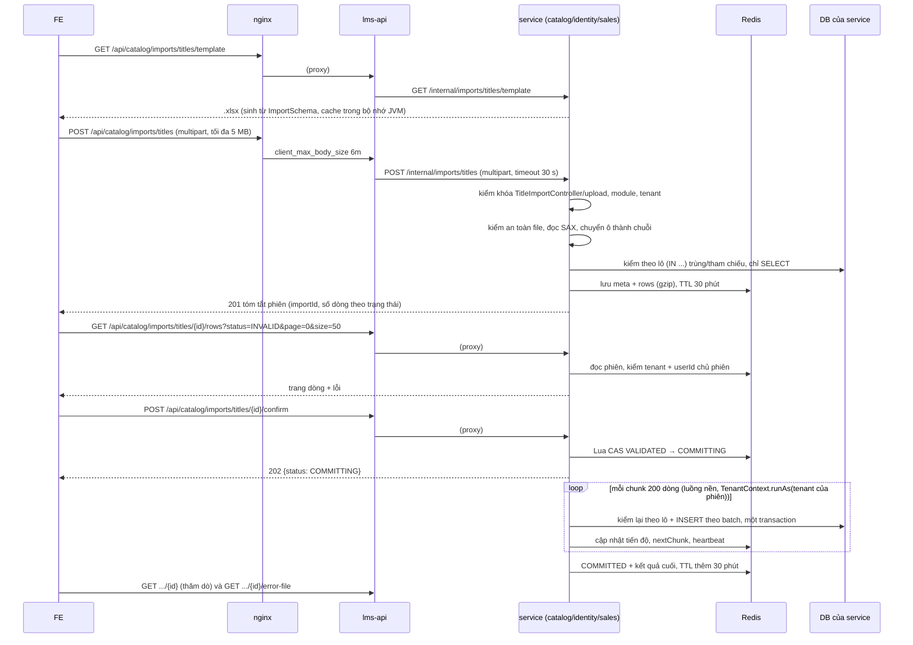

# ADR-0024: Nhập master data hàng loạt từ Excel (.xlsx): file mẫu, preview lưu Redis, confirm mới ghi DB

- Trạng thái: đề xuất (SA). Chưa có code. Phạm vi, kiến trúc (thư viện dùng chung, không service mới), cách xử lý dòng trùng và giới hạn (5.000 dòng, 5 MB, phiên 30 phút) đã được người dùng chốt; các câu hỏi còn mở ở mục 9.
- Liên quan: ADR-0001 (Kafka best-effort), ADR-0003 (khóa `Controller/method`), ADR-0004 (migration tập trung ở system-service), ADR-0005 (BFF `lms-api`, nginx), ADR-0006 (multi-tenant, RLS fail-closed), ADR-0009 (module theo tenant, `@RequiresModule`), ADR-0010 (sales-service), ADR-0016 (platform admin `X-Tenant-Id`), ADR-0018 (dữ liệu demo), ADR-0022 (hiện trạng Redis, `save()` qua `merge`).
- Ghi chú số hiệu: số 0023 đã được phiên khác dùng (`0023-cong-doc-gia-tren-customer-api.md`, chưa commit) nên ADR này lấy 0024.

## 1. Bối cảnh và mục tiêu

### 1.1. Yêu cầu

LMS là SaaS cho thuê: tenant mới mang theo hàng nghìn đầu sách, bản sao, độc giả, mặt hàng, không thể nhập tay. Cần một cụm chức năng thống nhất cho mọi loại master data:

1. Tải file mẫu `.xlsx` cho từng loại dữ liệu.
2. Người dùng điền và upload; hệ thống đọc, kiểm tra, trả **preview từng dòng** (hợp lệ / lỗi kèm lý do / trùng). Dữ liệu preview nằm trong Redis, **không ghi DB**.
3. Người dùng bấm Confirm thì mới ghi DB, chỉ ghi dòng hợp lệ; dòng trùng khóa đã có thì bỏ qua; tải được file lỗi.

Phạm vi đã chốt: catalog-service (đầu sách + bản sao, tác giả, NXB, thể loại, vị trí kệ), identity-service (người dùng + độc giả), sales-service (mặt hàng tồn kho, nhà cung cấp). Giới hạn: tối đa 5.000 dòng, 5 MB mỗi file, phiên Redis 30 phút.

### 1.2. Ràng buộc từ hệ thống hiện có (đã đối chiếu code)

| Ràng buộc | Bằng chứng | Hệ quả cho thiết kế |
|---|---|---|
| FE chỉ gọi nginx → `lms-api` → `/internal/**` của service | ADR-0005, `infrastructure/nginx/nginx.conf` | Upload phải đi qua cả nginx và `lms-api` |
| nginx `client_max_body_size 1m` toàn cục, `proxy_read_timeout 30s` | `nginx.conf:18`, `snippets/proxy.conf` | Cần location riêng cho import (6 MB) |
| `lms-api` `read-timeout: 5s` cho mọi client nội bộ | `lms-api/src/main/resources/application.yml` (`app.services.read-timeout`), `ServiceClients.create` | Cần client riêng timeout dài hơn cho import |
| Chưa có endpoint multipart nào trong repo | grep `MultipartFile` chỉ thấy test của customer-api | Spring mặc định `max-file-size 1MB`: phải cấu hình |
| Chưa có thư viện xlsx/CSV nào | grep `pom.xml` không có `poi`, `fastexcel`, `commons-csv` | Thêm phụ thuộc mới, chỉ ở `import-common` |
| Heap mặc định của service trong Docker là `-Xmx256m`, Tomcat 20 luồng | `docker-compose.yml` (`JVM_XMX:-256m`, `TOMCAT_THREADS_MAX:-20`) | Không được đọc cả workbook vào DOM |
| Redis `maxmemory 64mb`, `allkeys-lru`, không persistence, cổng 6379 mở ra host | `docker-compose.yml:58-64` | Phiên import có thể bị đẩy ra khi Redis đầy (xem 8) |
| `RequestCache` fail-open, no-op khi `lms.cache.enabled=false`; `dev-start.ps1` đặt `LMS_CACHE_ENABLED=false` mặc định | `RedisRequestCache`, `RequestCacheAutoConfiguration`, `scripts/dev-start.ps1:30-31` | Không dùng được cho phiên import (mục 2.4) |
| Import người dùng hiện có: JSON `POST /internal/users/imports`, tối đa 500 dòng, `dryRun`, mỗi dòng một transaction, kiểm trùng bằng 3 truy vấn mỗi dòng | `ImportUsersUseCase`, `ImportUserRowExecutor`, `ImportUsersRequest.MAX_ROWS = 500`; FE `ImportUsersButton.tsx` | Tái dùng quy tắc kiểm, nhưng phải đổi sang kiểm trùng theo lô |
| Khóa quyền lấy theo **lớp bean thật** + tên method | `PermissionKeyResolver.resolveMode`: `ClassUtils.getUserClass(handler.getBeanType()).getSimpleName() + "/" + method.getName()` | Cho phép controller kế thừa lớp cơ sở chung mà khóa vẫn theo tên lớp con |
| `@AuthenticatedOnly` vẫn kiểm `@RequiresModule` | `PermissionInterceptor` dòng 84-121 | Endpoint đọc phiên không cần khóa vẫn bị chặn module |
| ArchUnit catalog: `inventory` không được phụ thuộc `catalog`; `catalog` chỉ dùng `inventory.application` | `CatalogArchitectureTest` | Luồng đầu sách + bản sao đặt ở context `catalog`, gọi `inventory.application` |
| Use case hiện có gọi repository theo từng bản ghi (`AddCopyUseCase`: `titleExists`, `existsByBarcode`, `ShelfLocationCheck`, `save`, publish; `CreateTitleUseCase`: `existsByIsbn`, `classify`, `save`) | các file cùng tên | Gọi lặp 5.000 lần là N+1, vi phạm quy ước CLAUDE.md: cần port theo lô |
| Không service nào bật JDBC batch; entity gán sẵn UUID nên `save()` chạy `merge` (SELECT + INSERT) | grep `batch_size`/`Persistable` rỗng; ADR-0022 mục 2.3 | Ghi theo lô phải dùng `persist` hoặc `Persistable.isNew` |
| Ràng buộc unique dùng làm khóa trùng đã có sẵn | catalog `V2` (`uq_titles_isbn (tenant_id, isbn)`, `uq_book_copies_tenant_barcode`), `V5` (`uq_*_tenant_name (tenant_id, name_key)`, `uq_shelf_locations_tenant_code`), sales `V1` (`uq_stock_items_tenant_title`, `uq_suppliers_tenant_name (tenant_id, lower(name))`), sales `V8` (`uq_stock_items_tenant_sku`) | Không cần migration schema mới cho kiểm trùng |
| Sales tham chiếu đầu sách bằng `titleId`, tra qua `POST /internal/books/lookup` (tối đa 100 id, token người dùng chuyển tiếp) | `CatalogLookupPort`, `LookupTitlesRequest.MAX_IDS = 100` | Người dùng không biết UUID: cần tra theo ISBN theo lô |

### 1.3. Mục tiêu phi chức năng

- Bảo mật: không thực thi công thức, không XXE, chặn zip bomb, macro, file mã hóa; không rò dữ liệu giữa tenant hoặc giữa người dùng; không log dữ liệu dòng.
- Tài nguyên: đọc 5 MB / 5.000 dòng trong heap 256 MB mà không ảnh hưởng request khác.
- Nhất quán: preview chỉ là tham khảo, confirm kiểm lại với DB tại thời điểm ghi; bấm confirm hai lần không ghi hai lần.
- Đơn giản: một hợp đồng API cho mọi loại dữ liệu, mỗi service chỉ khai cột, quy tắc và cách ghi.

## 2. Quyết định

### 2.1. Thư viện dùng chung `shared-libraries/import-common`, mỗi service tự cài phần nghiệp vụ

`import-common` lo phần kỹ thuật lặp lại: kiểm an toàn file, đọc/ghi xlsx streaming, chuyển ô sang chuỗi chuẩn, sinh file mẫu và file lỗi, phiên preview trong Redis, máy trạng thái confirm, thực thi confirm nền có giới hạn, lớp controller cơ sở và xử lý lỗi chung. Mỗi service khai báo **schema cột** và cài một `ImportHandler` (kiểm dòng theo lô, ghi theo lô) trong tầng `application` của context sở hữu dữ liệu; quy tắc nghiệp vụ vẫn ở `domain` (gọi lại `Title.create`, `TitleExtras`, `Reference.create`, `ReferenceExtras.normalized`, `CopyAcquisition`, `BookCopy.register`, `StockItemDetails`, `Supplier.create`...), không viết lại trong thư viện.

Lý do: khớp khuôn `cache-common` (thư viện + auto-configuration), không thêm service/DB/cổng, dữ liệu ghi vẫn đi qua đúng service sở hữu DB (RLS, `@TenantId`, sự kiện, audit sẵn có).

### 2.2. Phương án đã loại

| Phương án | Vì sao loại |
|---|---|
| `import-service` riêng (một service nhận file, parse, rồi gọi API ghi của từng service) | Thêm service, cổng, cấu hình nginx/compose, RAM (máy dev đã chật). Phải gọi HTTP theo lô sang service đích, tức vẫn phải viết API ghi theo lô ở từng service; quy tắc kiểm (trùng với DB, tham chiếu) vẫn nằm ở service đích nên import-service chỉ thêm một chặng mạng và một điểm lỗi. Không có atomicity giữa hai service nên trạng thái "đã ghi một phần" khó báo đúng. |
| `lms-api` (BFF) parse file và giữ preview | BFF sẽ phải biết schema và quy tắc của mọi context (trái ADR-0005: BFF không chứa nghiệp vụ); kiểm trùng với DB vẫn phải hỏi service; BFF không có Redis/`tenant-common`. |
| Ghi preview vào bảng tạm (staging) trong DB của service | Trái yêu cầu "không ghi DB" khi preview; bảng tạm có `tenant_id` phải bật RLS, cần migration ở 3 DB, cần job dọn rác; tăng tải ghi DB cho dữ liệu có thể bị bỏ. Ưu điểm (bền khi Redis mất) không đáng với phiên 30 phút. |
| Parse ở FE (như import CSV hiện tại), gửi JSON lên | FE phải có thư viện xlsx cỡ lớn; 5.000 dòng JSON vẫn phải đi qua nginx; vẫn phải kiểm lại ở BE; file lỗi phải sinh ở FE. Không thống nhất được kiểm an toàn file. Giữ endpoint JSON cũ cho tương thích (mục 5.9). |
| Một file ghi sang nhiều service (ví dụ đầu sách ở catalog + mặt hàng ở sales cùng workbook) | Không có atomicity xuyên DB; cần saga/bù trừ cho trường hợp catalog ghi xong, sales lỗi. Thứ tự nhập (mục 2.6) đơn giản hơn nhiều. |
| Confirm đồng bộ cho mọi loại | 5.000 người dùng cần 5.000 lần bcrypt (strength mặc định 10, ⚠️ ước lượng vài chục ms mỗi lần, chưa đo), tức nhiều phút, vượt `proxy_read_timeout 30s` của nginx. |

### 2.3. Thư viện xlsx: Apache POI 5.x, chỉ dùng API streaming

| Tiêu chí | Apache POI (đọc bằng `XSSFReader` + `XSSFSheetXMLHandler` SAX, ghi bằng `SXSSFWorkbook`) | dhatim fastexcel + fastexcel-reader | POI usermodel (`XSSFWorkbook` DOM) |
|---|---|---|---|
| RAM | Thấp: SAX theo dòng; chỉ giữ shared strings (`ReadOnlySharedStringsTable`) và style. Ghi SXSSF giữ cửa sổ dòng, phần còn lại ra file tạm | Rất thấp, nhanh | Cao: cả workbook thành cây đối tượng, ⚠️ có thể gấp hàng chục lần kích thước file, dễ OOM với `-Xmx256m` |
| Chặn zip bomb | Có sẵn `ZipSecureFile` (tỉ lệ nén tối thiểu, kích thước entry tối đa, độ dài text tối đa) | Không có cơ chế riêng, phải tự kiểm | Như POI |
| XXE | POI dựng parser qua `XMLHelper` với cấu hình an toàn (tắt DTD/entity ngoài) ⚠️ cần xác nhận với phiên bản chọn | StAX (aalto-xml), ⚠️ chưa xác minh cấu hình tắt DTD | Như POI |
| Định dạng ngày, kiểu ô, data validation (dropdown) | Đầy đủ (`DataFormatter`, `DataValidationHelper` dùng được với SXSSF) | Hạn chế hơn, ⚠️ chưa xác minh dropdown | Đầy đủ |
| License | Apache-2.0 | Apache-2.0 | Apache-2.0 |
| Phụ thuộc | Nặng: `poi`, `poi-ooxml`, `poi-ooxml-lite`, `xmlbeans`, `commons-compress`, `commons-io`, `commons-collections4`, `log4j-api`... ⚠️ cỡ 15-20 MB thêm vào fat jar | Nhẹ (dưới 1 MB và vài phụ thuộc) | Như POI |
| Duy trì | ASF, chu kỳ vá CVE rõ | Dự án cộng đồng nhỏ | ASF |

**Chọn Apache POI 5.x (bản vá mới nhất khi cài, ⚠️ be-dev kiểm số phiên bản và CVE lúc thêm vào `dependencyManagement` gốc), chỉ dùng API streaming**, cấm dùng `WorkbookFactory`/`XSSFWorkbook` để đọc file người dùng (ArchUnit hoặc test trong `import-common` chặn). Lý do: cơ chế chống zip bomb/XXE có sẵn và được bảo trì, hỗ trợ đủ kiểu ô/ngày/dropdown cho file mẫu, RAM khi đọc SAX đủ thấp. Đánh đổi: jar to hơn, chấp nhận vì chỉ 3 service khai `import-common`. POI chỉ xuất hiện trong package `lms.imports.xlsx` sau interface `XlsxReader`/`XlsxWriter`, đổi sang fastexcel sau này không ảnh hưởng service. `log4j-api` của POI nối sang SLF4J bằng `log4j-to-slf4j` (⚠️ kiểm Spring Boot BOM đã quản lý).

### 2.4. Phiên preview: `StringRedisTemplate`/`RedisTemplate` trực tiếp, fail-closed; KHÔNG dùng `RequestCache`

Đã kiểm `cache-common`: `RequestCache` không phù hợp vì

1. Fail-open: lỗi Redis chỉ log và chạy loader; với import, mất phiên là mất dữ liệu người dùng vừa upload, phải báo lỗi rõ.
2. Khi `lms.cache.enabled=false` (mặc định của `dev-start.ps1`) bean là `NoOpRequestCache`: mọi phiên sẽ "biến mất" im lặng.
3. Không cache khi không có tenant hoặc đang đọc mọi tenant; khóa băm `sha256` nên không liệt kê/giới hạn số phiên theo người dùng.
4. `maxValueChars` 262.144 ký tự: phiên 5.000 dòng lớn hơn và bị bỏ qua không báo.
5. Không có thao tác nguyên tử (CAS trạng thái cho confirm), chỉ get/set/evict.

Quyết định: `import-common` có `ImportSessionStore` (port POJO) và cài đặt `RedisImportSessionStore` dùng thẳng `RedisConnectionFactory` của Spring Boot (cùng Redis `spring.data.redis.*` mà service đã cấu hình), **độc lập với `lms.cache.enabled`**. Mọi lỗi Redis (kết nối, timeout, OOM) ném `ImportStorageUnavailableException` → `503 IMPORT_STORAGE_UNAVAILABLE`. Service không có `RedisConnectionFactory` thì bean store vẫn được tạo nhưng luôn ném 503 (không âm thầm no-op). Không bật health Redis (giữ `management.health.redis.enabled=false`: Redis chết không làm service DOWN, chỉ import bị 503). Timeout lệnh Redis của import: dùng timeout chung 200 ms của service là đủ cho giá trị dưới 1-2 MB ⚠️ cần đo (perf-tester).

### 2.5. Confirm chạy nền, không đồng bộ, cho mọi loại

`POST .../confirm` chuyển trạng thái nguyên tử rồi đưa việc ghi vào executor nền của service, trả `202 Accepted`; FE hỏi lại `GET .../{importId}` để xem tiến độ. Lý do: identity cần bcrypt cho từng người dùng; một hợp đồng chung cho FE thay vì hai kiểu; không giữ luồng Tomcat (20 luồng) trong nhiều phút. Catalog và sales thường xong trong vài giây nên FE thấy kết quả gần như ngay.

### 2.6. Một file = một loại dữ liệu = một service; quan hệ giữa service đi theo thứ tự nhập

- Đầu sách và bản sao cùng ở catalog-service (một DB `catalog_db`) nên gộp vào **một loại `titles` với hai sheet** (`DauSach`, `BanSao`). Một confirm ghi được cả hai, đầu sách và bản sao của nó nằm trong cùng chunk transaction.
- Quan hệ xuyên service (mặt hàng sales → đầu sách catalog; người dùng → phòng ban cùng identity nên không xuyên) xử lý bằng **thứ tự nhập**: tham chiếu (tác giả, NXB, thể loại, vị trí kệ) → `titles` → `stock-items`. Sales tra ISBN → `titleId` theo lô **ngay lúc upload** (còn token người dùng), lưu `titleId` vào phiên; confirm không gọi catalog (luồng nền không có token để chuyển tiếp, và đầu sách không có API xóa nên `titleId` không mất hiệu lực trong 30 phút).
- Tham chiếu thiếu (ví dụ tên NXB chưa có) là lỗi dòng `PUBLISHER_NOT_FOUND`, không tự tạo (xem câu hỏi Q2).

### 2.7. Dòng trùng và kiểm lại khi confirm

- Trạng thái dòng: `VALID`, `INVALID` (kèm danh sách lỗi), `DUPLICATE` (khóa đã có trong DB của tenant: bỏ qua khi confirm). Dòng `VALID` có thể kèm cảnh báo (`severity=WARNING`, ví dụ đầu sách không có ISBN nên không chống trùng được).
- Trùng **trong cùng file** là `INVALID` (`DUPLICATE_IN_FILE`), vì không biết dòng nào đúng.
- Phiên lưu **giá trị thô** của từng ô (chuỗi đã chuẩn hóa kiểu), không lưu đối tượng đã kiểm. Confirm chạy lại bước kiểm theo lô với DB hiện tại cho từng chunk: dòng mới bị người khác tạo trong 30 phút qua thành `DUPLICATE`, tham chiếu vừa bị ngừng dùng thành `INVALID`. Kết quả cuối có thể khác preview; FE hiển thị số liệu của kết quả cuối.

## 3. Thiết kế

### 3.1. Thành phần

```
shared-libraries/import-common  (package gốc lms.imports)
├── core/        POJO, không Spring: ImportType, ImportSchema, SheetSpec, ColumnSpec (key, nhãn, bắt buộc, kiểu
│                TEXT|INTEGER|DECIMAL|MONEY|DATE|BOOLEAN|ENUM|LIST, độ dài tối đa, ví dụ, hướng dẫn), RawRow, RowIssue,
│                RowStatus, ImportSessionMeta, ImportHandler<C> (SPI), ImportSessionStore (port), ImportLimits,
│                ImportException + mã lỗi
├── xlsx/        POI: XlsxSafetyInspector, StreamingXlsxReader (SAX), TemplateWriter, ErrorFileWriter (SXSSF),
│                CellSanitizer (chống formula injection)
├── redis/       RedisImportSessionStore (gzip JSON, Lua CAS, fail-closed)
├── engine/      ImportWorkflow (upload → kiểm → lưu phiên; confirm → executor), ImportCommitExecutor (pool giới hạn),
│                UploadGate (semaphore giới hạn số lần đọc đồng thời)
├── web/         AbstractImportController (7 endpoint chung), ImportExceptionHandler, MultipartLimitHandler
└── autoconfigure/ ImportProperties (lms.import.*), ImportAutoConfiguration

Mỗi service (ví dụ catalog):
  catalog/application/imports/   TitleImportHandler, ReferenceImportHandler(kind), port theo lô (POJO)
  catalog/infrastructure/web/    TitleImportController extends AbstractImportController, AuthorImportController...
  catalog/infrastructure/persistence/  cài đặt port theo lô (IN theo lô, persist theo batch)
  inventory/application/         RegisterCopiesInBatchUseCase + port theo lô (catalog gọi vào, không ngược lại)
```

Ràng buộc ArchUnit: `import-common` không đặt package tên `domain`, `application`, `infrastructure` (để các luật `..application..`/`..infrastructure..` của service không bắt nhầm). Tầng `application` của service chỉ dùng `lms.imports.core`; `xlsx`, `redis`, `web`, `engine` chỉ được dùng từ `infrastructure`. be-dev thêm luật này vào test kiến trúc của 3 service.

### 3.2. Luồng dữ liệu



### 3.3. Hợp đồng API chung

Mọi loại dùng cùng 7 endpoint. Đường dẫn FE: `/api/{module}/imports/{type}`; đường dẫn service: `/internal/imports/{type}`. `{module}` thuộc `catalog | identity | sales`, `{type}` theo bảng ở 3.4.

| # | FE (`lms-api`) | Service | Method controller | Quyền | Ghi chú |
|---|---|---|---|---|---|
| 1 | `GET /api/{module}/imports/{type}/template` | `GET /internal/imports/{type}/template` | `template` | `@AuthenticatedOnly` (+ module của controller) | Trả `.xlsx`, `Content-Disposition: attachment; filename="mau-<type>.xlsx"`, `Cache-Control: no-store` |
| 2 | `POST /api/{module}/imports/{type}` | `POST /internal/imports/{type}` | `upload` | Khóa `XImportController/upload` | `multipart/form-data`, part `file`. `201` + `ImportSessionView` |
| 3 | `GET /api/{module}/imports/{type}/{importId}` | `GET /internal/imports/{type}/{importId}` | `get` | `@AuthenticatedOnly` + chủ phiên | Tóm tắt + tiến độ (FE thăm dò 1-2 giây/lần khi `COMMITTING`) |
| 4 | `GET /api/{module}/imports/{type}/{importId}/rows` | `GET /internal/imports/{type}/{importId}/rows` | `rows` | `@AuthenticatedOnly` + chủ phiên | Query record `ImportRowsQuery(status, sheet, page, size)`; `size` tối đa 200 |
| 5 | `POST /api/{module}/imports/{type}/{importId}/confirm` | `POST /internal/imports/{type}/{importId}/confirm` | `confirm` | Khóa `XImportController/confirm` + chủ phiên | Không body. `202` + `ImportSessionView` |
| 6 | `DELETE /api/{module}/imports/{type}/{importId}` | `DELETE /internal/imports/{type}/{importId}` | `cancel` | `@AuthenticatedOnly` + chủ phiên | `204`; xóa khóa Redis |
| 7 | `GET /api/{module}/imports/{type}/{importId}/error-file` | `GET /internal/imports/{type}/{importId}/error-file` | `errorFile` | `@AuthenticatedOnly` + chủ phiên | `.xlsx` gồm dòng `INVALID` và `DUPLICATE`, giữ nguyên giá trị đã nhập, thêm cột "Trạng thái", "Lỗi"; upload lại được sau khi sửa |
| 8 | `GET /api/identity/imports/users/{importId}/credentials` | `GET /internal/imports/users/{importId}/credentials` | `credentials` | Khóa `UserImportController/credentials` + chủ phiên | Chỉ identity, chỉ sau `COMMITTED`: file mật khẩu tạm, tải **một lần** (mục 5.8) |

`ImportSessionView` (dữ liệu chính, be-dev chốt tên trường):
- `importId` (UUID ngẫu nhiên), `type`, `status` (`VALIDATED | COMMITTING | INTERRUPTED | COMMITTED | COMMIT_FAILED`), `fileName` (đã làm sạch), `createdAt`, `expiresAt`.
- `columns[]` theo sheet: `{key, label, required}` để FE dựng bảng chung cho mọi loại.
- `totals` và `sheets[]`: `{sheet, total, valid, invalid, duplicate, warning}`.
- Khi đang/đã ghi: `progress {processed, total}`, `result {created, skippedDuplicate, failed}` (có thể khác preview, mục 2.7).

Một dòng trong `rows`: `{sheet, rowNumber (theo Excel, tính cả dòng tiêu đề), status, values: {key: chuỗi}, issues: [{column, severity, code, message}]}`. Không bao giờ trả cột mật khẩu (không có cột này, mục 3.4.6).

Mã lỗi (thân là `ErrorResponse` chuẩn của `common-kernel`):

| HTTP | Mã | Khi nào |
|---|---|---|
| 400 | `IMPORT_FILE_REQUIRED` | Thiếu part `file` hoặc file rỗng |
| 413 | `IMPORT_FILE_TOO_LARGE` | Vượt 5 MB (service và `lms-api` bắt `MaxUploadSizeExceededException`; nginx trả 413 HTML khi vượt 6 MB, FE xử lý theo mã HTTP) |
| 415 | `IMPORT_UNSUPPORTED_FILE` | Không phải `.xlsx` (sai chữ ký ZIP, `.xls` OLE2, `.xlsm`/có `vbaProject.bin`, file mã hóa, `.xlsb`) |
| 422 | `IMPORT_FILE_UNSAFE` | Vi phạm kiểm an toàn (mục 5.1): tỉ lệ nén, kích thước giải nén, số entry, có DOCTYPE |
| 422 | `IMPORT_FILE_CORRUPT` | Không đọc được cấu trúc OOXML |
| 422 | `IMPORT_TEMPLATE_MISMATCH` | Không có sheet dữ liệu mong đợi, thiếu cột bắt buộc ở dòng tiêu đề, hoặc `_meta` ghi loại khác; `details` liệt kê cột thiếu |
| 422 | `IMPORT_EMPTY` | Không có dòng dữ liệu nào (bỏ qua dòng trống) |
| 422 | `IMPORT_TOO_MANY_ROWS` | Hơn 5.000 dòng dữ liệu (tổng các sheet); dừng đọc ngay ở dòng thứ 5.001 |
| 404 | `IMPORT_NOT_FOUND` | Phiên không tồn tại, đã hết hạn, đã hủy, **hoặc không phải của người gọi/tenant hiện tại** (cùng một mã để không lộ phiên của người khác) |
| 409 | `IMPORT_INVALID_STATE` | Hủy khi đang `COMMITTING`, tải `credentials` trước khi `COMMITTED` |
| 409 | `IMPORT_NOTHING_TO_COMMIT` | Confirm khi không có dòng `VALID` |
| 410 | `IMPORT_CREDENTIALS_GONE` | File mật khẩu tạm đã được tải hoặc hết hạn |
| 429 | `IMPORT_SESSION_LIMIT` | Người dùng đã có 3 phiên đang mở trong tenant |
| 429 | `IMPORT_BUSY` | Service đang đọc đủ số file đồng thời hoặc hàng đợi confirm đầy; `details` chứa `retryAfterSeconds` (⚠️ `ApiExceptionHandler` của `lms-api` dựng lại response nên header `Retry-After` của service bị mất) |
| 503 | `IMPORT_STORAGE_UNAVAILABLE` | Redis không dùng được |
| 403 | `TENANT_REQUIRED`, `MODULE_NOT_ENABLED`, lỗi thiếu khóa | Như hiện tại (ADR-0003/0006/0009) |

Confirm lặp lại (bấm hai lần, mạng gửi lại): **không lỗi**, trả `202` (hoặc `200` khi đã xong) với trạng thái hiện tại của chính phiên đó. `importId` là khóa idempotency, không cần header `Idempotency-Key`.

### 3.4. Loại dữ liệu và cột đề xuất (theo entity hiện có)

Quy ước chung cho mọi template: sheet `HuongDan` (mô tả cột, giá trị hợp lệ, ví dụ), sheet dữ liệu có **dòng 1 là tiêu đề** (nhãn tiếng Việt, cột bắt buộc có `*`), sheet ẩn `_meta` (`type`, `templateVersion`). Bộ đọc so tiêu đề theo nhãn đã chuẩn hóa (NFC, bỏ `*`, bỏ khoảng trắng thừa, không phân biệt hoa thường) hoặc theo `key` kỹ thuật; cột lạ và cột "Trạng thái"/"Lỗi" của file lỗi bị bỏ qua. Cột văn bản (ISBN, mã vạch, mã...) đặt định dạng `@` (Text) để Excel không đổi `9786041234567` thành `9.78604E+12`; nếu ô vẫn là số thì đọc bằng `BigDecimal.toPlainString()`. Cột enum có dropdown. Danh sách nhiều giá trị trong một ô phân tách bằng `;`. Ngày nhận ô kiểu ngày của Excel hoặc chuỗi `dd/MM/yyyy`/`yyyy-MM-dd`. Boolean nhận `Có/Không`, `x`, `TRUE/FALSE`.

| Module | `type` | Controller | `@RequiresModule` | Khóa trùng (DB) |
|---|---|---|---|---|
| catalog | `titles` (sheet `DauSach` + `BanSao`) | `TitleImportController` | không (lõi); dòng `BanSao` cần LENDING (mục 5.6) | ISBN `(tenant_id, isbn)`; mã vạch `(tenant_id, barcode)` |
| catalog | `authors` | `AuthorImportController` | không | `(tenant_id, name_key)` |
| catalog | `publishers` | `PublisherImportController` | không | `(tenant_id, name_key)` |
| catalog | `categories` | `CategoryImportController` | không | `(tenant_id, name_key)` |
| catalog | `shelf-locations` | `ShelfLocationImportController` | LENDING | `(tenant_id, code_key)` |
| identity | `users` | `UserImportController` | không | username (mọi tenant), email |
| sales | `stock-items` | `StockItemImportController` | SALES | `(tenant_id, title_id)`; SKU `(tenant_id, sku)` |
| sales | `suppliers` | `SupplierImportController` | SALES | `(tenant_id, lower(name))` |

#### 3.4.1. `titles`, sheet `DauSach` (đầu sách, `Title` + `TitleExtras`)

| Cột (key) | Bắt buộc | Quy tắc (từ domain) |
|---|---|---|
| `isbn` ISBN | không | trim; trùng trong tenant → `DUPLICATE`; trống → `VALID` kèm cảnh báo `NO_DEDUPE_KEY` (nhập lại file sẽ tạo bản trùng) |
| `name` Tên sách | có | không trống |
| `author` Tác giả (hiển thị) | có | không trống (chuỗi hiển thị của `Title`) |
| `coverPrice` Giá bìa (VND) | có | ≥ 0 |
| `authors` Tác giả chuẩn | không | tên, phân tách `;`, so theo `name_key`, phải tồn tại và đang hoạt động |
| `publisher` Nhà xuất bản | không | tên, phải tồn tại và đang hoạt động |
| `category` Thể loại | không | tên, phải tồn tại và đang hoạt động |
| `subtitle` Phụ đề | không | ≤ 255 |
| `publicationYear` Năm xuất bản | không | 1000 đến năm hiện tại + 1 |
| `edition` Lần tái bản | không | ≤ 50 |
| `language` Ngôn ngữ | không | 2-8 chữ thường (`vi`, `en`) |
| `pageCount` Số trang | không | 1-20.000 |
| `format` Định dạng | không | `PAPERBACK`, `HARDCOVER`, `EBOOK` (dropdown) |
| `translator` Dịch giả | không | ≤ 255 |
| `series` Bộ sách, `seriesNumber` Tập | không | tập > 0, chỉ khi có bộ sách |
| `coverImageUrl` Ảnh bìa | không | URL http/https, ≤ 500 |
| `tags` Nhãn | không | `;`, tối đa 10 nhãn, mỗi nhãn ≤ 50 |
| `description` Mô tả | không | ≤ 500 code point, chuẩn hóa như `withPreview` |

Không đưa `previewText` (đoạn đọc thử 2.000 ký tự) vào v1: dài, ít khi có sẵn hàng loạt.

#### 3.4.2. `titles`, sheet `BanSao` (bản sao, `BookCopy` + `CopyAcquisition`)

| Cột | Bắt buộc | Quy tắc |
|---|---|---|
| `isbn` ISBN đầu sách | có | khớp đầu sách đã có trong tenant **hoặc** dòng `DauSach` hợp lệ/trùng của cùng file; dòng `DauSach` cùng ISBN bị `INVALID` thì bản sao `INVALID` (`TITLE_ROW_INVALID`) |
| `barcode` Mã vạch | có | ≤ 64; trùng trong tenant → `DUPLICATE` |
| `shelfLocationCode` Mã vị trí kệ | không | phải tồn tại và đang hoạt động |
| `acquiredDate` Ngày nhập | không | không ở tương lai (giờ Việt Nam) |
| `acquisitionSource` Nguồn nhập | không | `PURCHASE`, `DONATION`, `EXCHANGE`, `OTHER` |
| `purchasePrice` Giá mua (VND) | không | ≥ 0, chỉ khi nguồn `PURCHASE` |
| `conditionGrade` Tình trạng | không | `NEW`, `GOOD`, `FAIR`, `WORN` |
| `conditionNote` Ghi chú tình trạng | không | ≤ 300 |
| `lastInventoryDate` Ngày kiểm kê | không | không tương lai, không trước ngày nhập |

Trạng thái bản sao luôn `AVAILABLE` (như `BookCopy.register`). Đầu sách không có ISBN không gắn được bản sao qua file (xem Q3).

#### 3.4.3. `authors`, `publishers`, `categories`, `shelf-locations` (`Reference` + `ReferenceExtras`)

| `type` | Cột |
|---|---|
| `authors` | `name*` (≤ 255), `description` (≤ 500), `birthYear`, `deathYear` (từ năm sinh đến nay), `nationality` (≤ 100), `photoUrl`, `website` (URL http/https ≤ 500) |
| `publishers` | `name*`, `description`, `country` (≤ 100), `foundedYear` (1400 đến nay), `website`, `address` (≤ 500) |
| `categories` | `name*`, `description`, `parentName` (cha phải có trong DB hoặc là dòng hợp lệ của cùng file; tối đa 2 cấp, kiểm như use case hiện tại; confirm ghi dòng cha trước dòng con) |
| `shelf-locations` | `code*` (≤ 64), `description`, `floor` (≤ 20), `zone` (≤ 50), `capacity` (1-100.000) |

Tên so trùng theo `Reference.nameKey()` (NFC, gộp khoảng trắng, chữ thường).

#### 3.4.4. `users` (identity: `User`, `UserPersonalInfo`, `ReaderProfile`, `ReaderPersonalInfo`)

| Cột | Bắt buộc | Quy tắc (từ `ImportUsersUseCase` và domain) |
|---|---|---|
| `username` Tên đăng nhập | có | `^[a-z0-9._-]{3,100}$`, đưa về chữ thường; đã có ở **bất kỳ tenant nào** → `DUPLICATE` với thông điệp chung (không lộ tenant) |
| `fullName` Họ tên | có | ≤ 255 |
| `email` | có | dạng email, ≤ 255; đã có → `DUPLICATE` |
| `departmentCode` Mã phòng ban | không | phải tồn tại và đang hoạt động |
| `phone`, `dateOfBirth`, `gender` (`MALE/FEMALE/OTHER`), `address`, `jobTitle`, `employeeCode` | không | theo `UserPersonalInfo`/`PersonalRules` |
| `isReader` Là độc giả | không | mặc định Không |
| `readerType` Loại độc giả | khi là độc giả | `STUDENT`, `LECTURER` (mặc định `STUDENT` như hiện tại) |
| `cardExpiryDate` Hạn thẻ | không | mặc định hôm nay + 1 năm (`DEFAULT_CARD_VALID_YEARS`) |
| `faculty`, `className`, `memberCode`, `cardIssuedDate` | không | theo `ReaderPersonalInfo` |

Độc giả dùng tên đăng nhập làm số thẻ nên `username` ≤ 32 khi `isReader`. **Không có cột mật khẩu tạm** (khác import JSON cũ): mật khẩu không bao giờ nằm trong file, Redis phiên preview hay log; hệ thống sinh khi confirm (mục 5.8). Không có cột gán role (Q5).

#### 3.4.5. `stock-items` (sales: `StockItem` + `StockItemDetails`)

| Cột | Bắt buộc | Quy tắc |
|---|---|---|
| `isbn` ISBN đầu sách | có | tra catalog theo lô lúc upload; không thấy → `INVALID` `TITLE_NOT_FOUND`; đầu sách đã là mặt hàng → `DUPLICATE` |
| `sellingPrice` Giá bán (VND) | không | `Money` hợp lệ |
| `lowStockThreshold` Ngưỡng tồn thấp | không | ≥ 0 |
| `sku` | không | ≤ 40, đưa về chữ hoa; đã thuộc mặt hàng khác hoặc trùng trong file → `INVALID` `SKU_EXISTS`/`DUPLICATE_IN_FILE` |
| `supplier` Nhà cung cấp | không | chuỗi ≤ 255 (trường văn bản của `StockItemDetails`, không phải khóa ngoại) |
| `costPrice` Giá nhập (VND) | không | ≥ 0; dữ liệu nội bộ, không ghi vào log/audit |
| `binLocation` Vị trí kho | không | ≤ 64 |
| `reorderQuantity` SL đặt lại | không | ≥ 0 |
| `note` Ghi chú nội bộ | không | ≤ 500 |
| `openingQuantity` Tồn đầu kỳ | không | ≥ 0; xem Q4 (khuyến nghị ghi qua sổ cái tồn kho, không sửa trực tiếp `onHand`) |

#### 3.4.6. `suppliers` (sales: `Supplier`)

`name*` (≤ 200, so trùng `lower(name)`), `phone`, `email`, `address`, `note`.

### 3.5. Mô hình phiên trong Redis

Khóa (không trùng không gian khóa của `cache-common` `lms:v1:t:...`, để `evictNamespace` không quét trúng):

```
lms:import:v1:t:{tenantId}:u:{userId}:{importId}:meta      HASH   trạng thái, số liệu, tiến độ, heartbeat
lms:import:v1:t:{tenantId}:u:{userId}:{importId}:rows      STRING gzip(JSON mảng RawRow + kết quả kiểm)
lms:import:v1:t:{tenantId}:u:{userId}:{importId}:result    STRING gzip(JSON kết quả từng dòng sau confirm)
lms:import:v1:t:{tenantId}:u:{userId}:{importId}:creds     STRING chỉ identity, mật khẩu tạm, đọc bằng GETDEL
lms:import:v1:t:{tenantId}:u:{userId}:active               ZSET   importId → hạn; giới hạn 3 phiên/người/tenant
```

- `importId` là UUID ngẫu nhiên; khóa luôn dựng từ `TenantContext` hiện tại và `sub` của JWT, nên người khác hoặc tenant khác không bao giờ đọc được (trả `404 IMPORT_NOT_FOUND`). Platform admin dùng `X-Tenant-Id` (ADR-0016): tenant là tenant đích, `userId` là chính platform admin.
- `meta` gồm: `type`, `templateVersion`, `tenantId`, `userId`, `fileName`, `status`, `createdAt`, `expiresAt`, số liệu theo sheet, `rowsBytes`, và khi confirm: `commitToken`, `nextChunk`, `processed`, `created`, `skipped`, `failed`, `heartbeatAt`, `finishedAt`.
- `rows` lưu giá trị thô đã chuẩn hóa kiểu (chuỗi) + kết quả kiểm lúc upload, không lưu file gốc. Ước lượng 5.000 dòng × 20 cột ≈ 2-5 MB JSON, gzip ⚠️ khoảng 0,3-1 MB (perf-tester đo). Chặn cứng `rows` sau nén ≤ 4 MB, vượt thì `422 IMPORT_FILE_UNSAFE`. `rows` cho `stock-items` có thêm `titleId` đã tra.
- TTL: mọi khóa của phiên 30 phút từ lúc upload. Khi confirm xong, đặt lại TTL 30 phút tính từ lúc xong để còn tải file lỗi/kết quả. Hủy thì xóa ngay.
- `GET rows` đọc cả blob, giải nén, lọc, cắt trang trong bộ nhớ (5.000 dòng là nhỏ); ⚠️ đo CPU nếu FE thăm dò dày.
- Ghi phiên bằng `MULTI/EXEC` (meta + rows + ZADD active) để không có phiên nửa vời.

Máy trạng thái:

```
upload ──► VALIDATED ──confirm (CAS)──► COMMITTING ──► COMMITTED
               │                           │  └──lỗi không lường trước──► COMMIT_FAILED
               │                           └──heartbeat quá 2 phút (service chết)──► hiển thị INTERRUPTED
               └──cancel──► (xóa khóa)                                       └──confirm lại (CAS)──► COMMITTING (tiếp từ nextChunk)
```

CAS bằng một Lua script: chỉ khi `status = VALIDATED`, hoặc `status = COMMITTING` mà `heartbeatAt` cũ hơn 2 phút, thì đặt `COMMITTING`, `commitToken` mới, `heartbeatAt = now`; ngược lại trả trạng thái hiện tại để API trả về nguyên trạng (idempotent). Luồng nền chỉ ghi tiến độ khi `commitToken` khớp (luồng cũ "sống lại" không ghi đè).

### 3.6. Ghi theo lô khi confirm

- `ImportCommitExecutor`: `ThreadPoolTaskExecutor` 1 luồng mỗi instance (identity có thể 1, catalog/sales 1-2), hàng đợi 4; đầy thì `429 IMPORT_BUSY` và trả CAS về `VALIDATED`. Tắt service thì chờ chunk hiện tại xong (graceful shutdown 30 s đã có ở `lms-api`, be-dev kiểm ở service).
- Luồng nền: `TenantContext.runAs(meta.tenantId, ...)` **trước** khi mở transaction (connection mượn lúc mở transaction mới nhận `app.tenant_id`, ADR-0006); `userId` cho audit lấy từ `meta`, không từ `SecurityContext` (luồng nền không có).
- Chia chunk 200 dòng (đầu sách đi cùng bản sao của nó, có thể làm chunk lớn hơn 200; thể loại cha trước con). Mỗi chunk một transaction, trong bean tách riêng để đi qua proxy giao dịch (như `ImportUserRowExecutor`):
  1. Kiểm lại theo lô: gom khóa của chunk, mỗi loại khóa **một** truy vấn `WHERE tenant khớp AND key IN (:keys)`.
  2. Ghi theo batch: `EntityManager.persist` (hoặc `Persistable.isNew()=true`) để không có `SELECT` của `merge`; bật `hibernate.jdbc.batch_size` (ví dụ 100) và `hibernate.order_inserts=true` cho catalog/identity/sales; `@ElementCollection` (`title_authors`, nhãn) cũng được batch. ⚠️ `reWriteBatchedInserts=true` trên URL JDBC PostgreSQL tăng tốc thêm, cần đổi cấu hình datasource nên để be-dev đánh giá.
  3. Vi phạm unique do ghi đồng thời (người khác vừa tạo cùng khóa) làm hỏng cả transaction: rollback chunk rồi chạy lại chunk đó **từng dòng một** (mỗi dòng một transaction) để chỉ dòng vi phạm thành `DUPLICATE`.
  4. Sau commit chunk: cập nhật `meta` (`nextChunk`, đếm, `heartbeatAt`). Redis lỗi ở bước này: dừng luồng (không ghi chunk sau khi không lưu được tiến độ), log mức ERROR kèm `importId` (không kèm dữ liệu dòng).
- Không có transaction bao cả 5.000 dòng (đã chốt: chỉ ghi dòng hợp lệ, bỏ qua dòng trùng): tránh transaction dài và một xung đột muộn làm hỏng tất cả.
- Sự kiện hiện có giữ nguyên ngữ nghĩa: mỗi bản sao mới vẫn phát `CopyAvailableEvent` (như `AddCopyUseCase`) sau khi chunk commit, best-effort (ADR-0001). Thêm **một** bản ghi audit tóm tắt cho mỗi lần confirm (`importId`, `type`, số tạo/bỏ qua/lỗi), không audit từng dòng ngoài những gì use case đơn lẻ đang làm (sales `SalesAuditPort` hiện ghi mỗi mặt hàng: be-dev chọn giữ hay gộp, Q7).
- Cache: sau khi commit chunk gọi `evictNamespace` cho namespace liên quan (catalog `authors|categories|publishers|shelf-locations`, sales `suppliers`, identity `departments` nếu có ghi), trong `TenantContext.runAs` nên đúng tenant.
- Cần port theo lô mới (không gọi use case đơn lẻ trong vòng lặp): catalog `existingIsbns`, `existingBarcodes`, `referencesByNameKeys(kind, keys)`, `shelfLocationsByCodes`, `insertTitles`, `insertCopies` (inventory), `insertReferences`; identity `existingUsernames` (mọi tenant), `existingEmails`, `departmentsByCodes` (đã có `activeIdsByCode`), `insertUsers`, `insertReaderProfiles`, `insertCredentials`; sales `existingStockTitles`, `existingSkus`, `existingSupplierNames`, `insertStockItems`, `insertSuppliers`. Danh sách `IN` chia nhỏ tối đa 1.000 phần tử mỗi câu.

### 3.7. Upload: kiểm đồng bộ, có giới hạn tài nguyên

- `UploadGate`: tối đa 2 lần đọc file đồng thời mỗi instance (semaphore, `tryAcquire` không chờ) → vượt thì `429 IMPORT_BUSY`. Đọc SAX, dừng ngay khi vượt 5.000 dòng.
- Kiểm theo lô với DB (chỉ SELECT) như bước 1 của 3.6, cho cả file một lần (mỗi loại khóa vài câu `IN`).
- Sales: tra ISBN theo lô sang catalog. Cần endpoint mới ở catalog `POST /internal/books/lookup-by-isbn` (body `{isbns: [...]}`, tối đa 1.000 mỗi lần, sales chia lô; khóa `TitleController/lookupByIsbn`, trả cùng dạng `TitleLookupView`). Lỗi catalog → `503` (mã `CATALOG_UNAVAILABLE` hiện có của sales).
- Mục tiêu thời gian: upload 5.000 dòng dưới 10 giây ⚠️ chưa đo. Timeout client import của `lms-api` 30 giây, nginx 60 giây.

## 4. Phân quyền, multi-tenant và hạ tầng

### 4.1. Khóa quyền (ADR-0003)

- Chỉ `upload` và `confirm` (và `credentials` của identity) là khóa `Controller/method`; các endpoint còn lại `@AuthenticatedOnly` và **kiểm chủ phiên** trong `ImportWorkflow` (tenant + `sub` khớp khóa Redis). Lý do: phiên chỉ tồn tại nếu người đó đã qua khóa `upload`; tải mẫu không lộ dữ liệu; giảm số khóa admin phải gán từ 56 xuống 17.
- `confirm` vẫn là khóa riêng (phòng thủ thêm khi quyền bị thu hồi giữa upload và confirm; quyền mới chỉ có hiệu lực ở lần refresh token kế tiếp, ADR-0003). Hai khóa của một loại luôn gán cùng nhau.
- `upload` bắt buộc có khóa vì preview tiết lộ thông tin có trong DB (ví dụ username đã tồn tại).
- Controller kế thừa `AbstractImportController`; khóa theo tên lớp con (`PermissionKeyResolver` dùng `getBeanType()`), ví dụ `TitleImportController/upload`. ⚠️ cần test WebMvc xác nhận Spring đăng ký mapping kế thừa và khóa sinh ra đúng tên lớp con. **Không được đổi tên lớp/method sau khi phát hành** (đổi khóa, role mất quyền).

17 khóa import mới (16 `upload`/`confirm` của 8 loại + `UserImportController/credentials`) cộng khóa catalog `TitleController/lookupByIsbn`, và vai trò mẫu đề xuất (migration identity `V31__import_permissions.sql`, ⚠️ kiểm lại số kế tiếp ngay trước khi tạo file vì nhiều người cùng sửa; theo khuôn `V28`: chèn `permissions` + `role_template_permissions`, `ON CONFLICT DO NOTHING`):

| Khóa | LIBRARY_ADMIN (`…a2`) | LIBRARIAN (`…a3`) | STOCK_KEEPER (`…c2`) | STORE_MANAGER (`…c3`) |
|---|---|---|---|---|
| `TitleImportController/upload`, `/confirm` | ✓ | ✓ | | ✓ |
| `AuthorImportController/…`, `PublisherImportController/…`, `CategoryImportController/…` | ✓ | ✓ | | ✓ |
| `ShelfLocationImportController/…` | ✓ | ✓ | | |
| `UserImportController/upload`, `/confirm`, `/credentials` | ✓ | | | |
| `StockItemImportController/…`, `SupplierImportController/…` | | | ✓ | ✓ |
| `TitleController/lookupByIsbn` (catalog, sales gọi bằng token người dùng) | | | ✓ | ✓ |

Role có `is_admin` bỏ qua kiểm khóa như hiện tại. Đề xuất **không** backfill role của tenant đang chạy (giống `V28`), tenant admin tự gán (Q6).

### 4.2. Multi-tenant và RLS (ADR-0006)

- Upload/confirm yêu cầu tenant (`TenantContext.require()`), không có thì `403 TENANT_REQUIRED`. Không hỗ trợ chế độ đọc mọi tenant.
- Ghi trong luồng nền bằng vai trò `<svc>_app`, RLS fail-closed: `TenantContext.runAs` trước transaction; `@TenantId` điền `tenant_id` khi `persist`. Không thêm native query mới; truy vấn `IN` theo lô viết bằng JPQL/Spring Data trên entity có `@TenantId`. Không có bảng mới nên không đụng `TENANT_EXEMPT_TABLES`.
- Kiểm trùng username/email của identity "ở mọi tenant" giữ đúng cách repository hiện tại đang làm (bảng `credentials`/truy vấn đã rà), chỉ đổi sang theo lô. ⚠️ be-dev xác nhận truy vấn theo lô không cần native query ngoài danh sách đã rà.
- Module: dòng `BanSao` khi tenant không có LENDING → `INVALID` `MODULE_NOT_ENABLED`; controller đọc claim `modules` của JWT và truyền tập module vào handler (platform admin được coi như có mọi module, như `PermissionInterceptor`).

### 4.3. Giới hạn kích thước và timeout trên đường đi

| Chặng | Thay đổi | Ai |
|---|---|---|
| nginx | Location `~ ^/api/(catalog|identity|sales)/imports(/|$)` với `client_max_body_size 6m`, `proxy_read_timeout 60s`, `proxy_send_timeout 60s`, `proxy_request_buffering on` (mặc định); thêm `limit_req` riêng cho POST upload (ví dụ 10 lần/phút/IP, burst 5) | be-dev (file `infrastructure/nginx/nginx.conf`) |
| `lms-api` | `spring.servlet.multipart.max-file-size: 5MB`, `max-request-size: 6MB`; bắt `MaxUploadSizeExceededException` → `413 IMPORT_FILE_TOO_LARGE`; client import riêng read-timeout 30 s (`ServiceClients.create` hiện dùng chung 5 s); chuyển tiếp multipart (`MultipartBodyBuilder`/`ByteArrayResource` có tên file) và chuyển nguyên byte `.xlsx` khi tải về; một controller `ImportProxyController` với **danh sách trắng** `module → service`, `type` khớp `[a-z-]{1,40}` và nằm trong danh sách (không thành proxy mở) | be-dev |
| Service | Cùng cấu hình multipart; `server.tomcat.max-swallow-size` ≥ 6 MB để client nhận 413 JSON thay vì đứt kết nối ⚠️ chưa kiểm; `lms.import.*` (mặc định trong `ImportProperties`, khối `lms:` đặt cuối `application.yml`, kiểm chỉ có một khối) | be-dev |
| Docker/compose | Không bắt buộc đổi. ⚠️ Khuyến nghị vận hành ở mục 8 về Redis | người vận hành quyết |

Không cần biến môi trường mới bắt buộc; tùy chọn `LMS_IMPORT_MAX_ROWS`, `LMS_IMPORT_SESSION_TTL` để ghi đè.

## 5. An toàn file và chi tiết khác

### 5.1. Chặn file độc hại (trước và trong khi đọc)

1. Kích thước ≤ 5 MB (đã chặn ở nginx/`lms-api`/service), đọc vào bộ nhớ hoặc file tạm của Tomcat, không tin `Content-Type` hay đuôi file.
2. Chữ ký `PK\x03\x04` (ZIP). `D0 CF 11 E0` (OLE2: `.xls` hoặc xlsx mã hóa) → `415`.
3. Duyệt danh mục ZIP trước khi đưa cho POI: tối đa 200 entry, tổng kích thước giải nén khai báo ≤ 100 MB, từng entry ≤ 50 MB, không có `xl/vbaProject.bin`, `xl/embeddings/*`, `xl/activeX/*`; `[Content_Types].xml` phải là workbook thường (không `macroEnabled`, không `binary`). Không tin kích thước khai báo: đếm byte thật khi giải nén (POI `ZipSecureFile.setMaxEntrySize`, `setMinInflateRatio` ≥ 0,01, `setMaxTextSize`). ⚠️ các ngưỡng là đề xuất, perf-tester/tester chỉnh theo file thật.
4. XML: dùng parser an toàn của POI (`XMLHelper`); thêm kiểm: phần XML chứa `<!DOCTYPE` → `422 IMPORT_FILE_UNSAFE`. ⚠️ xác nhận POI phiên bản chọn đã tắt entity ngoài và DTD.
5. Không bao giờ tính công thức: chỉ đọc **giá trị đã lưu sẵn** (cached value) mà SAX handler trả; ô công thức không có giá trị lưu sẵn coi là trống. Không mở liên kết ngoài, không đọc ảnh/đối tượng nhúng.
6. Giới hạn nội dung: tối đa 50 cột mỗi sheet, mỗi ô ≤ 2.000 ký tự (vượt thì lỗi dòng `CELL_TOO_LONG`, không lỗi cả file), bỏ ký tự điều khiển trừ xuống dòng/tab, chuẩn hóa NFC.
7. Tên file chỉ để hiển thị: bỏ đường dẫn, ký tự điều khiển, cắt 100 ký tự; `Content-Disposition` khi trả file dùng tên do server đặt (ASCII) kèm `filename*` UTF-8.
8. Log: chỉ `importId`, `type`, tenant, số dòng, mã lỗi; không log giá trị ô (cùng quy tắc với `ImportUsersUseCase`).

### 5.2. Chống công thức Excel (formula/CSV injection) ở file mẫu và file lỗi

- Mọi giá trị do người dùng nhập ghi lại thành ô kiểu **chuỗi** (`setCellValue(String)`), không bao giờ `setCellFormula`.
- Ô có giá trị bắt đầu bằng `=`, `+`, `-`, `@`, tab hoặc CR dùng style có `quotePrefixed=true`: Excel hiển thị như văn bản và không biến thành công thức khi người dùng sửa ô. **Không** chèn dấu `'` vào nội dung (khác `UsersCsv.cell`) để giá trị đi vòng được: sửa file lỗi rồi upload lại vẫn ra đúng giá trị gốc.
- Không tạo hyperlink từ dữ liệu người dùng (kể cả cột URL ảnh bìa/website).
- File mẫu chỉ chứa dữ liệu tĩnh do hệ thống viết (nhãn, ví dụ, dropdown cố định), không chứa dữ liệu của tenant trong v1.
- Xuất CSV (nếu sau này có) phải dùng cách thêm `'` như `UsersCsv.cell`.

### 5.3. Đọc ô

`CellSanitizer` chuyển mọi ô thành chuỗi chuẩn trước khi lưu phiên: số → `BigDecimal.toPlainString()` (không `.0`, không mũ); ngày Excel → `yyyy-MM-dd`; boolean → `true/false`; chuỗi → trim + NFC. Kiểu và quy tắc nghiệp vụ do handler kiểm từ chuỗi này (bằng domain), lỗi kiểu chung (`INVALID_NUMBER`, `INVALID_DATE`, `INVALID_ENUM`, `REQUIRED`, `CELL_TOO_LONG`) do `import-common` sinh theo `ColumnSpec`.

### 5.4. Hủy

`DELETE` khi `VALIDATED`/`COMMITTED`/`COMMIT_FAILED`: xóa mọi khóa của phiên và bỏ khỏi `active`. Khi `COMMITTING`: `409 IMPORT_INVALID_STATE` (không hủy giữa chừng; dữ liệu chunk đã commit không rollback được).

### 5.5. Mất Redis hoặc service khởi động lại

- Redis mất khi `VALIDATED`: phiên mất, người dùng upload lại (`404 IMPORT_NOT_FOUND` hoặc `503`).
- Service chết khi `COMMITTING`: các chunk đã commit giữ nguyên, `meta` còn `nextChunk`; sau 2 phút không heartbeat thì hiển thị `INTERRUPTED`, người dùng bấm confirm lại để tiếp từ `nextChunk`, bước kiểm lại đánh dấu các dòng đã ghi thành `DUPLICATE` nếu tiến độ chưa kịp lưu.
- Redis mất khi `COMMITTING`: luồng nền dừng; dữ liệu đã ghi một phần; người dùng không còn thấy kết quả. Upload lại cùng file: dòng có khóa trùng tự bỏ qua; **đầu sách không ISBN sẽ bị tạo trùng** (mục 8).

### 5.6. Đầu sách + bản sao cùng file

Một loại `titles`, hai sheet, cùng service, cùng DB: không cần điều phối xuyên service. Thứ tự trong confirm: chunk gồm đầu sách và bản sao của chúng, ghi đầu sách trước rồi bản sao trong cùng transaction; bản sao của đầu sách đã có trong DB nằm ở các chunk riêng. `TitleImportHandler` nằm ở context `catalog` và gọi `inventory.application` (port theo lô `RegisterCopiesInBatchUseCase`), đúng hướng phụ thuộc ArchUnit hiện có. Muốn chỉ nhập bản sao cho đầu sách đã có: để trống sheet `DauSach`.

### 5.7. Quan hệ xuyên service (sales ↔ catalog)

Không ghi xuyên service trong một confirm. Sales chỉ đọc catalog lúc upload (tra ISBN theo lô) và ghi `sales_db`. FE hướng dẫn thứ tự: tham chiếu → đầu sách → mặt hàng. Nếu sau này cần "một file cho cả thư viện và cửa hàng", làm bằng FE gọi lần lượt hai phiên, không gộp ở BE.

### 5.8. Mật khẩu tạm của người dùng nhập vào

- Sinh bằng `SecureRandom` lúc confirm (dùng lại `ImportUsersUseCase.generatePassword`), mọi tài khoản `mustChangePassword=true`. bcrypt tính **ngoài** transaction của chunk để transaction ngắn.
- Mật khẩu chỉ lưu ở khóa `creds` (TTL 30 phút từ lúc xong), lấy ra bằng `GETDEL` qua endpoint `credentials` (tải một lần, file `.xlsx` gồm username + mật khẩu tạm), không có trong `rows`, `result`, file lỗi, log hay audit.
- ⚠️ Mật khẩu nằm dạng rõ trong Redis tối đa 30 phút; Redis dev mở cổng 6379 ra host. Phương án thay thế: không sinh mật khẩu, gửi email mời đặt mật khẩu qua luồng `password_reset_tokens` (identity `V23`) (Q1).
- Giới hạn tốc độ: executor identity 1 luồng để bcrypt không chiếm hết CPU của đăng nhập. ⚠️ 5.000 người dùng có thể mất vài phút, chưa đo.

### 5.9. Endpoint import người dùng JSON cũ

`POST /api/users/imports` (500 dòng, `dryRun`, FE `ImportUsersButton.tsx`) giữ nguyên tới khi FE chuyển sang luồng Excel, sau đó gỡ bằng một thay đổi riêng (khóa `UserController/importUsers` của role hiện có sẽ thừa). Hai luồng dùng chung quy tắc kiểm: be-dev tách phần kiểm trong `ImportUsersUseCase` thành lớp quy tắc dùng chung, không sao chép.

## 6. Phân việc

### Pha 0: chốt câu hỏi mở (điều phối viên hỏi người dùng)

- ⏳ Q1-Q7 ở mục 9. Q1 (mật khẩu) và Q4 (tồn đầu kỳ) chặn phần identity/sales của pha 2, không chặn pha 1 và catalog.

### Pha 1: nền dùng chung (các mục 1a, 1b, 1c, 1d làm song song; 1e sau khi chốt tên controller)

| # | Ai | Việc | Phụ thuộc |
|---|---|---|---|
| 1a | be-dev A | `shared-libraries/import-common`: module mới trong pom gốc, `dependencyManagement` POI; `core`, `xlsx` (kiểm an toàn, đọc SAX, ghi mẫu/lỗi SXSSF, chống công thức), `redis` (store fail-closed, Lua CAS, gzip, giới hạn phiên), `engine` (workflow, executor, gate), `web` (`AbstractImportController`, exception handler, xử lý 413), `autoconfigure` (`lms.import.*`). Test đơn vị + `RedisImportSessionStoreIT` (Testcontainers Redis) | không |
| 1b | be-dev B | `lms-api`: `ImportProxyController` danh sách trắng, client import timeout 30 s, chuyển tiếp multipart và byte, multipart 5 MB, 413 JSON; nginx location import 6 MB, timeout 60 s, `limit_req` upload | chỉ cần hợp đồng mục 3.3 |
| 1c | be-dev C | catalog: `POST /internal/books/lookup-by-isbn` theo lô (không N+1, dùng index `uq_titles_isbn`) | không |
| 1d | tester | Bộ file mẫu độc hại dùng chung cho test (zip bomb, XXE/DOCTYPE, `.xlsm`, `.xls` đổi đuôi, file mã hóa, shared strings khổng lồ, 5.001 dòng, ô 10.000 ký tự, công thức `=HYPERLINK(...)`, `=cmd|...`), đặt ở `import-common/src/test/resources` | không |
| 1e | be-dev C | identity `V31__import_permissions.sql` (17 khóa import + `TitleController/lookupByIsbn` + role mẫu, mục 4.1); kiểm số kế tiếp ngay trước khi tạo | tên controller chốt |

### Pha 2: từng service (song song sau khi 1a được `install`; mỗi agent một service, không đụng file của nhau)

| # | Ai | Việc | Phụ thuộc |
|---|---|---|---|
| 2a | be-dev catalog | 4 loại tham chiếu (`ReferenceImportHandler` theo `ReferenceKind`, thể loại cha trước con) rồi `titles` (2 sheet, `RegisterCopiesInBatchUseCase` ở inventory), port theo lô, `persist` + JDBC batch, evict cache tham chiếu, `CopyAvailableEvent` sau commit, luật ArchUnit cho `lms.imports.*` | 1a |
| 2b | be-dev identity | `users`: tách quy tắc từ `ImportUsersUseCase`, port theo lô (username/email mọi tenant, phòng ban), độc giả, mật khẩu theo Q1, endpoint `credentials` | 1a, Q1 |
| 2c | be-dev sales | `suppliers` (làm trước, độc lập), rồi `stock-items` (tra ISBN lúc upload qua `CatalogLookupPort` mở rộng, tồn đầu kỳ theo Q4), audit theo Q7 | 1a, 1c, Q4 |
| 2d | tester | Mỗi service: WebMvc test khóa (`@TestPropertySource` bật kiểm khóa, `@MockitoBean PermissionKeyRegistrar`, xác nhận khóa `XImportController/upload` đúng tên lớp con), test handler (mỗi mã lỗi dòng, trùng trong file/DB, tham chiếu thiếu), IT với vai trò `<svc>_app` + RLS (ghi trong luồng nền đúng tenant, tenant khác không thấy), test đếm câu SQL bằng Hibernate Statistics: số SELECT không tăng theo số dòng, INSERT đi theo batch | 2a/2b/2c từng phần |

### Pha 3: tích hợp và hiệu năng

| # | Ai | Việc |
|---|---|---|
| 3a | fe-dev (ngoài phạm vi BE, điều phối giao) | Màn hình chung: tải mẫu, upload, bảng preview lọc theo trạng thái, confirm + thăm dò, tải file lỗi, tải mật khẩu một lần; chuyển `ImportUsersButton` sang luồng mới |
| 3b | tester | E2E qua nginx → `lms-api`: 413 ở 3 chặng, confirm hai lần song song (một lần ghi), phiên của người khác/tenant khác → 404, Redis tắt → 503 kể cả khi `LMS_CACHE_ENABLED=false`, hết TTL, platform admin với `X-Tenant-Id`, module tắt → 403, file lỗi upload lại được, ô `=...` đi vòng không đổi và không thành công thức |
| 3c | perf-tester | Đo heap/thời gian upload 5 MB/5.000 dòng mỗi loại dưới `-Xmx256m`, 2 upload đồng thời; kích thước phiên Redis sau gzip; thời gian confirm mỗi loại (catalog/sales mục tiêu dưới 30 s, identity bcrypt); ảnh hưởng tới p95 đăng nhập khi đang confirm người dùng; Redis 64 MB với 10-20 phiên đồng thời (có bị LRU đẩy phiên không) |

### Pha 4: dọn dẹp (sau khi FE chuyển xong)

- ⏳ Gỡ `POST /internal/users/imports` và `/api/users/imports` JSON, khóa `UserController/importUsers` (thay đổi phá vỡ hợp đồng, commit `feat(identity)!:`).

## 7. Hệ quả

- ✅ Một hợp đồng chung cho 8 loại dữ liệu; thêm loại mới chỉ cần schema + handler + controller con.
- ✅ Không thêm service, DB hay bảng; chỉ 1 migration (khóa quyền).
- ⚠️ Thêm phụ thuộc POI vào 3 service (jar lớn hơn).
- ⚠️ Redis trở thành phụ thuộc **bắt buộc** cho tính năng import (trước đây chỉ là cache phụ).
- ⚠️ Confirm không nguyên tử trên cả file: có thể ghi một phần khi lỗi giữa chừng (đã báo rõ qua kết quả và trạng thái).

## 8. Rủi ro và việc chưa kiểm chứng

- ⚠️ Redis `allkeys-lru` 64 MB dùng chung với cache: khi đầy, Redis có thể đẩy khóa phiên import (cả phiên đang `COMMITTING`). Dev chấp nhận được. Production cần một trong: Redis riêng cho import, hoặc `maxmemory-policy noeviction` (cache-common fail-open nên lệnh ghi cache bị từ chối chỉ log, khóa cache vốn TTL ngắn), hoặc tăng `maxmemory`. Thuộc cấu hình Docker/vận hành, SA không tự đổi (Q8 cho người vận hành).
- ⚠️ Redis không bật persistence: khởi động lại Redis làm mất mọi phiên đang mở.
- ⚠️ Redis dev mở cổng 6379 ra host, không mật khẩu: phiên chứa dữ liệu cá nhân (email, điện thoại, ngày sinh) và có thể mật khẩu tạm (5.8). Production phải giới hạn mạng/đặt mật khẩu Redis.
- ⚠️ RAM khi đọc SAX file 5 MB dưới `-Xmx256m` và khi ghi file lỗi 5.000 dòng bằng SXSSF (file tạm trong `java.io.tmpdir` của container): chưa đo.
- ⚠️ Cấu hình an toàn XML và ngưỡng `ZipSecureFile` của phiên bản POI sẽ chọn: chưa kiểm; phiên bản và CVE kiểm lúc thêm phụ thuộc.
- ⚠️ Mapping kế thừa từ `AbstractImportController` và khóa sinh theo lớp con: suy từ code `PermissionKeyResolver`, chưa có test.
- ⚠️ Chuyển tiếp multipart qua `RestClient` + `SimpleClientHttpRequestFactory` của `lms-api` (bộ đệm, streaming) chưa thử; `server.tomcat.max-swallow-size` và hành vi 413 chưa thử.
- ⚠️ `ApiExceptionHandler` của `lms-api` dựng lại response 4xx nên header `Retry-After` mất; đã đưa `retryAfterSeconds` vào `details`, FE đọc từ đó.
- ⚠️ nginx trả 413 dạng HTML khi vượt `client_max_body_size`; FE phải dựa vào mã HTTP.
- ⚠️ `save()` với UUID gán sẵn chạy `merge` (SELECT trước INSERT): ghi theo lô phải dùng `persist`/`Persistable`; JDBC batch chưa bật ở service nào, bật cho cả service có thể ảnh hưởng đường ghi khác (thường là tốt, cần chạy lại test hiện có).
- ⚠️ Thời gian bcrypt 5.000 người dùng và ảnh hưởng tới đăng nhập (cùng CPU identity): chưa đo.
- ⚠️ 5.000 bản sao mới phát 5.000 `CopyAvailableEvent` (Kafka best-effort); circulation tiêu thụ để giữ chỗ cho đặt trước: chưa đo tải, có thể cần gộp sự kiện về sau.
- ⚠️ Đầu sách không có ISBN không chống trùng được: upload lại cùng file (ví dụ sau `INTERRUPTED` mà tiến độ chưa lưu, hoặc sau khi Redis mất) sẽ tạo đầu sách trùng. Đã có cảnh báo `NO_DEDUPE_KEY` ở preview.
- ⚠️ Kết quả confirm có thể khác preview (dữ liệu đổi trong 30 phút); FE phải hiển thị kết quả cuối, không chỉ preview.
- ⚠️ Kiểm trùng username/email "mọi tenant" theo lô: cần xác nhận truy vấn hiện có đi qua bảng không RLS hoặc đường đã rà, không thêm native query ngoài danh sách (`TenantArchitectureRules`).
- ⚠️ Endpoint `@AuthenticatedOnly` không ghi khóa nên log `platform-audit` (ADR-0016) vẫn ghi theo cơ chế hiện có; chưa kiểm hành vi chi tiết với platform admin.
- ℹ️ CSV không nằm trong phạm vi; thêm sau chỉ cần một `RowSource` khác trong `import-common`.
- ℹ️ Phòng ban (identity `department`) cũng là master data nhưng không nằm trong phạm vi đã chốt (Q9).

## 9. Câu hỏi mở cho người dùng

| # | Câu hỏi | Khuyến nghị của SA | Ảnh hưởng |
|---|---|---|---|
| Q1 | Người dùng nhập từ Excel nhận mật khẩu thế nào? (a) hệ thống sinh, admin tải file mật khẩu một lần; (b) không sinh, gửi email mời đặt mật khẩu; (c) cho phép cột mật khẩu tạm trong file | (a) cho v1 vì khớp hành vi import hiện tại và không phụ thuộc email; (b) khi đã có gửi email ổn định. Không chọn (c) (mật khẩu nằm trong file và trong Redis preview) | identity pha 2 |
| Q2 | Tham chiếu chưa có (tên tác giả/NXB/thể loại trong file đầu sách) thì báo lỗi hay tự tạo? | Báo lỗi trong v1 (tránh lỗi chính tả sinh mục rác); người dùng nhập file tham chiếu trước. Có thể thêm tùy chọn "tự tạo tham chiếu thiếu" sau | catalog `titles` |
| Q3 | Đầu sách không có ISBN có cần gắn bản sao qua file không? | Không trong v1 (khóa nối là ISBN); nếu cần, thêm cột "Mã dòng" do người dùng tự đặt để nối hai sheet | catalog `titles` |
| Q4 | Nhập mặt hàng có kèm tồn đầu kỳ không? Nếu có, ghi bằng loại biến động nào? | Có, cột `openingQuantity` tùy chọn, ghi một biến động `ADJUSTMENT` với lý do tự sinh "Tồn đầu kỳ nhập từ Excel <importId>" qua `StockService` trong cùng transaction (giữ bất biến sổ cái ADR-0010). Phương án khác: bắt buộc dùng phiếu nhập kho | sales `stock-items` |
| Q5 | Có cho gán vai trò (role) trong file người dùng không? | Không trong v1: gán role hàng loạt có thể vô tình cấp role `isAdmin`; dùng màn hình phân quyền | identity |
| Q6 | Có backfill 17 khóa mới vào role đang có của các tenant đang chạy không? | Không (giống `V28`); chỉ cập nhật role mẫu, tenant admin tự gán | migration `V31` |
| Q7 | Audit khi nhập hàng loạt: một bản ghi tóm tắt mỗi lần confirm, hay giữ audit từng bản ghi như use case đơn lẻ (sales đang audit mỗi mặt hàng)? | Một bản ghi tóm tắt + giữ sự kiện nghiệp vụ cần cho service khác (`CopyAvailableEvent`) | catalog, sales |
| Q8 | (Vận hành) Production dùng Redis riêng cho import hay đổi `maxmemory-policy`/tăng `maxmemory` của Redis chung? | Redis chung với `noeviction` và `maxmemory` lớn hơn là đơn giản nhất; Redis riêng khi tải lớn | triển khai |
| Q9 | Có đưa phòng ban (identity) vào phạm vi không? | Có thể thêm sau với cùng khuôn (loại `departments`, khóa `DepartmentImportController/...`) | identity |
