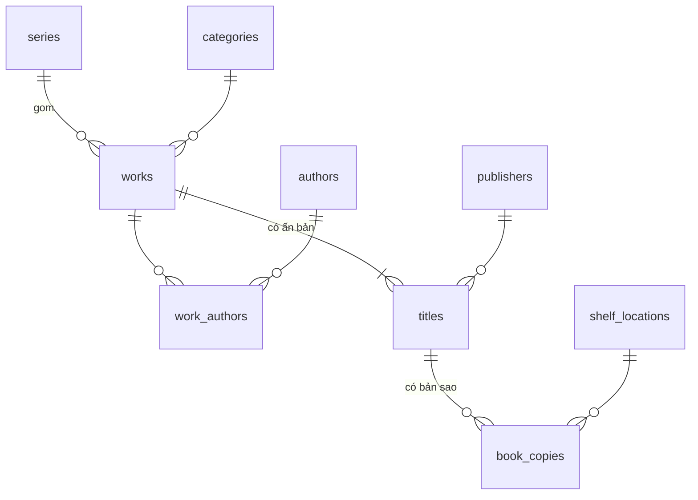
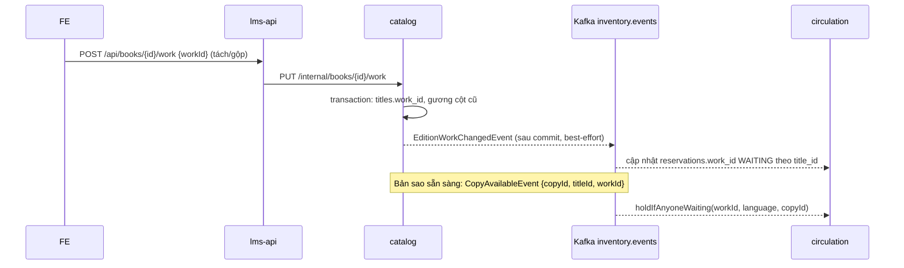

# ADR-0026: Mô hình sách 3 tầng kiểu FRBR: tác phẩm (work), ấn bản (edition), bản sao (copy), kèm bộ sách (series)

- Trạng thái: đề xuất (SA). Chưa có code. Người dùng đã chốt hướng B (mô hình 3 tầng đầy đủ); ba câu hỏi ở mục 9 cần chốt trước pha 2 (Q2 đổi thiết kế circulation).
- Liên quan: ADR-0001 (Kafka best-effort), ADR-0003 (khóa `Controller/method`), ADR-0004 (migration tập trung), ADR-0005 (BFF), ADR-0006 (multi-tenant, RLS fail-closed), ADR-0008 (`platform_read_all`), ADR-0010 (sales), ADR-0011/0019 (storefront), ADR-0018 (dữ liệu demo), ADR-0023 (cổng độc giả), ADR-0024 (nhập Excel).
- Số hiệu: đã kiểm `docs/decisions/` ngay trước khi ghi (có tới 0025). Số migration kế tiếp lúc viết: catalog `V10`, circulation `V11`, sales `V13`, identity `V32`. ⚠️ Kiểm lại ngay trước khi tạo file vì nhiều phiên cùng sửa.

## 1. Bối cảnh và mục tiêu

### 1.1. Yêu cầu

Thư viện/hiệu sách cần phân biệt:

- **Tác phẩm (work)**: nội dung trừu tượng. Gồm tên tác phẩm, tên gốc, ngôn ngữ gốc, tác giả, mô tả, thể loại, bộ sách và số tập trong bộ.
- **Ấn bản (edition)**: một lần xuất bản cụ thể của tác phẩm. Gồm ISBN, định dạng (bìa mềm/bìa cứng/ebook), ngôn ngữ, dịch giả, NXB, năm, lần tái bản, số trang, giá bìa, ảnh bìa. Bản gốc, bản dịch, bìa mềm, bìa cứng, ebook, tái bản đều là các ấn bản của cùng một tác phẩm.
- **Bản sao (copy)**: cuốn sách vật lý. Gồm mã vạch, vị trí kệ, tình trạng, thông tin nhập. Mỗi bản sao gắn với một ấn bản.
- Phải xử lý được: sách nhiều tập (Harry Potter 1-7), tập chia nhiều phần (phần 1/2), bộ hộp, biến thể, và liên kết bản gốc với bản dịch.

### 1.2. Hiện trạng (đã đối chiếu code, không suy từ tài liệu)

| Điểm | Hiện trạng | Nguồn |
|---|---|---|
| Đầu sách phẳng | `titles` (name, author NOT NULL, isbn, cover_price, description, preview_text, publisher_id, category_id, các cột V7: subtitle, publication_year, edition chuỗi, language, page_count, format `PAPERBACK/HARDCOVER/EBOOK`, translator, series chuỗi, series_number, cover_image_url, tags) | catalog `V1`, `V4`, `V5`, `V7`; `Title`, `TitleExtras` |
| ISBN duy nhất theo tenant | `uq_titles_isbn (tenant_id, isbn) WHERE isbn IS NOT NULL` | catalog `V2` |
| Tác giả chuẩn | `title_authors (title_id, author_id, tenant_id, sort_order)` | catalog `V5` |
| Bản sao gắn đầu sách | `book_copies.title_id` FK kép `(title_id, tenant_id)` → `titles (id, tenant_id)` | catalog `V2` |
| Số bản sao sẵn có | `CopyAvailabilityQuery.countAvailable(titleIds)` đếm `status = AVAILABLE` theo `title_id`, một truy vấn | `inventory.application` |
| Đặt trước | `reservations.title_id`; hàng đợi FIFO `idx_reservations_queue (tenant_id, title_id, reserved_at, id) WHERE WAITING`; mỗi độc giả một đặt trước còn hiệu lực mỗi đầu sách `uq_reservations_active (tenant_id, reader_id, title_id)`; chỉ đặt khi `availableCopies = 0` (lấy từ `GET /internal/books/{id}` bằng token người dùng) | circulation `V2`, `V3`, `V6`; `ReserveTitleUseCase`, `CatalogRestClientAdapter` |
| Giữ bản sao | `CopyAvailableEvent (copyId, titleId)` trên `inventory.events` → circulation `holdIfAnyoneWaiting(titleId, copyId)`; circulation trả `ReservationReadyEvent`/`CopyReleasedEvent` trên `reservation.events` → catalog giữ/nhả | `InventoryEventConsumer`, `ReservationEventConsumer` |
| Mượn | Theo bản sao; `borrowing_items.title_id` là snapshot (nullable) phục vụ top sách mượn | circulation `V9` |
| Bán hàng | `stock_items.title_id` UNIQUE `(tenant_id, title_id)`; `sales_order_lines.title_id` + snapshot tên/ISBN; `cover_price_snapshot` đồng bộ lười (ADR-0019) | sales `V1`, `V6` |
| Storefront | `GET /internal/sales/storefront/items[/{titleId}]`, khách đặt hàng theo `titleId`; sales tra catalog qua `POST /internal/books/lookup` (`@StorefrontAccessible`, tối đa 100 id) | `StorefrontQueryUseCases`, `HttpCatalogLookupAdapter`, customer-api `HttpCatalogClient`, `ShopDtos.LineRequest` |
| Nhập Excel | Loại `titles` (sheet `DauSach` + `BanSao`), sales `stock-items` tra `POST /internal/books/lookup-by-isbn` lúc upload | ADR-0024, `TitleImportHandler` |
| Khóa quyền | `TitleController/{search,get,create,update,lookup,lookupByKeyword,lookupByIsbn,preview,updatePreview}`, `BookCopyController/*` đã gán cho role của các tenant | ADR-0003, identity `V9`..`V31` |
| Mọi bảng catalog | `tenant_id` + `ENABLE`/`FORCE RLS` (`tenant_isolation`) + `platform_read_all` chỉ SELECT; entity có `@TenantId` | catalog `V2`, `V3`, `V5` |

ID đầu sách (`titles.id`) đang được lưu ở **ngoài catalog_db** và không có FK: `reservations.title_id`, `borrowing_items.title_id`, `stock_items.title_id`, `goods_receipt_lines.title_id`, `sales_order_lines.title_id`, sự kiện Kafka, `DemoIds.title(n)`, URL FE và storefront (`/items/{titleId}`), khóa đặt hàng của khách. Đổi id này là đổi hợp đồng của 4 service, 2 BFF và FE.

### 1.3. Ràng buộc

- Mỗi service một DB, không atomicity xuyên DB; Kafka publish best-effort (ADR-0001).
- Migration chỉ thêm file mới ở `system-service`, không sửa file đã chạy; system-service migrate trước, service khác chỉ `validate`. Trong lúc triển khai, code catalog **cũ** có thể vẫn chạy trên schema **mới** (và ngược lại khi rollback ứng dụng).
- FORCE RLS áp cả cho chủ bảng: migration ghi dữ liệu phải đặt `app.tenant_id` (và `app.tenant_scope = 'all'` khi cần đọc mọi tenant, khuôn `sales/V3`).
- Không đổi tên controller/method đang có (khóa quyền). Không N+1, index composite `tenant_id` đứng đầu.
- Không thiết kế vượt nhu cầu: tái dùng khuôn sẵn có (danh mục `Reference`, snapshot lười kiểu `cover_price_snapshot`, `CopyAvailableEvent`).

## 2. Quyết định

### 2.1. Bảng `titles` hiện có trở thành tầng ẤN BẢN, giữ nguyên id; thêm `works` và `series`

- `titles` = ấn bản. **Không đổi tên bảng, không đổi id, không đổi tên `TitleController`/`/internal/books/**`/`/api/books/**`.** Mọi tham chiếu ngoài catalog (`title_id`, `titleId`) từ nay có nghĩa là **id ấn bản** và vẫn đúng mà không cần backfill ở service khác.
- Thêm bảng `works` (tác phẩm) và `series` (bộ sách). `titles.work_id` trỏ tới tác phẩm.
- Tầng bản sao giữ nguyên (`book_copies.title_id` = ấn bản).
- Ngôn ngữ chung (glossary): trong code và API, `Title` / `titleId` / "book" = **ấn bản**; `Work` / `workId` = tác phẩm; `Series` / `seriesId` = bộ sách. Ghi rõ vào README glossary. Không đổi tên lớp domain `Title` thành `Edition` (đổi tên rải hàng trăm chỗ, tăng rủi ro gộp với phiên khác, không thêm giá trị nghiệp vụ); Javadoc ghi "ấn bản".

Lý do: giữ được mọi FK/tham chiếu xuyên service mà không đổi dữ liệu ngoài catalog_db, không đổi khóa quyền đã gán, và hợp đồng cũ chỉ được **thêm trường**. Phần thực sự mới (work, series) là bảng mới, migration thuần cộng thêm, rollback ứng dụng an toàn.

### 2.2. Phân bổ trường giữa tác phẩm và ấn bản

| Trường | Tầng | Ghi chú |
|---|---|---|
| `title` (tên tác phẩm chuẩn), `original_title`, `original_language` | work | mới |
| `author` (chuỗi hiển thị), tác giả chuẩn (`work_authors`) | work | `titles.author` (NOT NULL) **giữ** ở ấn bản làm chuỗi hiển thị cũ (sales snapshot, lookup đang dùng) |
| `category_id` | work | chuyển từ `titles`; `titles.category_id` giữ làm bản gương trong giai đoạn chuyển tiếp (mục 4) |
| `series_id`, `series_number`, `series_label` | work | chuyển từ chuỗi `titles.series`/`series_number`; `series_label` tùy chọn ("Ngoại truyện", "Tập 4.5") |
| `description` | cả hai | `works.description` là mô tả nội dung; `titles.description` giữ làm mô tả riêng của ấn bản (bản dịch có lời giới thiệu riêng). Hiển thị `edition.description ?? work.description` |
| `kind` (`SINGLE`, `COLLECTION`) | work | `COLLECTION` cho bộ hộp (Q1) |
| `isbn`, `name` (tên in trên ấn bản), `subtitle`, `format`, `language`, `translator`, `publisher_id`, `publication_year`, `edition` (lần tái bản), `page_count`, `cover_price`, `cover_image_url`, `preview_text`, `tags` | ấn bản | giữ nguyên chỗ cũ (`tags` không chuyển: nhãn tiếp thị, đổi chỗ không thêm giá trị) |
| `part_number`, `part_label` | ấn bản | mới: một tác phẩm in thành nhiều cuốn ("Phần 1/2"), mỗi cuốn một ISBN (Q1) |
| mã vạch, kệ, tình trạng, thông tin nhập | bản sao | không đổi |

### 2.3. Cách mô hình hóa các trường hợp khó (khuyến nghị, chờ chốt ở mục 9)

| Trường hợp | Mô hình |
|---|---|
| Harry Potter 1-7 | 7 **work** riêng (mỗi tập một nội dung), cùng một `series` "Harry Potter", `series_number` 1..7 (Q3) |
| HP 1 bản tiếng Anh, bản dịch tiếng Việt, bìa cứng, ebook, tái bản 2020 | Nhiều **ấn bản** của cùng work "HP 1", phân biệt bằng `language`, `translator`, `format`, `edition`, `publication_year` |
| Bản gốc và bản dịch liên kết | Cùng work là đủ liên kết (FRBR gộp tầng expression vào ấn bản). `works.original_title`/`original_language` cho biết bản gốc; ấn bản có `language = original_language` và không có `translator` là ấn bản gốc. Không cần bảng quan hệ |
| Tập 5 bản Việt in thành 2 cuốn | 2 **ấn bản** cùng work "HP 5", cùng ngôn ngữ, `part_number` 1 và 2, `part_label` "Phần 1"/"Phần 2", mỗi cuốn ISBN, giá, bản sao riêng (Q1) |
| Bộ hộp HP 1-7 | Một **ấn bản** (ISBN, giá riêng) thuộc một work `kind = COLLECTION` gắn series, không có bảng thành phần ở v1 (mượn/bán nguyên hộp). Cần bán lẻ từng cuốn trong hộp hoặc đếm tồn theo thành phần thì làm sau bằng bảng `edition_components` (Q1) |

### 2.4. Phương án đã loại

| Phương án | Vì sao loại |
|---|---|
| **A. Giữ 2 tầng, chỉ thêm `titles.work_key` để nhóm** (không có entity work) | Trường cấp tác phẩm (tác giả, thể loại, bộ sách, tên gốc) vẫn lặp ở từng ấn bản và lệch nhau khi sửa; không có chỗ đặt quy tắc "mọi ấn bản cùng tác phẩm cùng thể loại"; không có API tác phẩm cho storefront gộp biến thể. Người dùng đã chọn B |
| **B'. Tạo bảng mới `editions` (id mới), chuyển dữ liệu, `titles` thành view/bỏ** | Phải đổi `title_id` ở circulation/sales/demo/FE hoặc giữ bảng ánh xạ id cũ → mới; FK `book_copies`, RLS, native query, khóa quyền `TitleController/*` đều phải làm lại. Chi phí và rủi ro cao, lợi ích duy nhất là tên đẹp hơn |
| **C. EAV** (`title_attributes(title_id, key, value)`) | Mất kiểu dữ liệu, CHECK, FK; truy vấn lọc/sắp xếp phải pivot; không mô hình được quan hệ 1-n tác phẩm/ấn bản |
| **D. JSON/JSONB** (`titles.work jsonb`, `variants jsonb`) | Dữ liệu tác phẩm vẫn lặp theo ấn bản; không FK tới tác giả/thể loại/series; khó index theo tenant; Hibernate validate và RLS không giúp gì; khó cho import và ArchUnit |
| **E. Bốn tầng đủ FRBR (work, expression, manifestation, item)** | Expression (bản dịch như một thực thể) không có nhu cầu nghiệp vụ riêng ngoài ngôn ngữ và dịch giả, đã đặt được ở ấn bản. Thêm một tầng làm mọi màn hình và import phức tạp hơn |
| **F. Trigger DB tự tạo work khi chèn `titles` không có `work_id`** | Giấu quy tắc nghiệp vụ trong DB, khó test, trái quy ước "quy tắc ở domain/application". Thay bằng tạo work trong use case và migration bắt kịp (mục 4) |
| **G. Cùng id cho work backfill và ấn bản** (`work.id = title.id`) | Tiện backfill nhưng che lỗi truyền nhầm `titleId` vào API work (vẫn chạy với dữ liệu cũ, hỏng với dữ liệu mới). Thay bằng id tất định khác giá trị (mục 4.2) |

## 3. Thiết kế

### 3.1. Mô hình dữ liệu (catalog_db)



**`series`** (bộ sách, tái dùng khuôn danh mục `Reference` của V5: thêm `ReferenceKind.SERIES`):

```
id UUID PK, tenant_id UUID NOT NULL, name VARCHAR(255) NOT NULL CHECK (btrim(name) <> ''), name_key VARCHAR(255) NOT NULL,
description VARCHAR(500), active BOOLEAN NOT NULL DEFAULT TRUE, created_at TIMESTAMPTZ NOT NULL DEFAULT now(),
UNIQUE (tenant_id, name_key), UNIQUE (id, tenant_id)
```

**`works`**:

```
id UUID PK, tenant_id UUID NOT NULL,
title VARCHAR(255) NOT NULL CHECK (btrim(title) <> ''),
original_title VARCHAR(255) CHECK (original_title IS NULL OR btrim(original_title) <> ''),
original_language VARCHAR(8) CHECK (original_language IS NULL OR original_language ~ '^[a-z]{2,8}$'),
author VARCHAR(255) NOT NULL,                      -- chuỗi hiển thị, như titles.author
description VARCHAR(500) CHECK (description IS NULL OR btrim(description) <> ''),
category_id UUID, series_id UUID,
series_number INTEGER CHECK (series_number IS NULL OR series_number > 0),
series_label VARCHAR(50) CHECK (series_label IS NULL OR btrim(series_label) <> ''),
kind VARCHAR(20) NOT NULL DEFAULT 'SINGLE' CHECK (kind IN ('SINGLE','COLLECTION')),
created_at TIMESTAMPTZ NOT NULL DEFAULT now(),
UNIQUE (id, tenant_id),
CHECK (series_number IS NULL OR series_id IS NOT NULL),
FK (category_id, tenant_id) → categories (id, tenant_id),
FK (series_id, tenant_id)   → series (id, tenant_id)
```

Không UNIQUE `(tenant_id, series_id, series_number)`: backfill sẽ sinh trùng hợp lệ (HP 1 bìa mềm và HP 1 bìa cứng đang là hai đầu sách, thành hai work cùng số tập cho tới khi gộp). Trùng số tập trong một bộ là **gợi ý gộp** (mục 3.4), không phải lỗi.

**`work_authors`** (thay dần `title_authors`): `work_id, author_id, tenant_id, sort_order`, PK `(work_id, author_id)`, FK kép tới `works` (ON DELETE CASCADE) và `authors`.

**`titles`** thêm: `work_id UUID` (NULL ở pha expand, NOT NULL ở pha contract), FK `(work_id, tenant_id)` → `works (id, tenant_id)`; `part_number INTEGER CHECK (> 0)`, `part_label VARCHAR(50) CHECK (btrim <> '')`.

**Index** (tenant_id đứng đầu, không thừa):

| Index | Phục vụ |
|---|---|
| `works (tenant_id, title)` | danh sách tác phẩm sắp theo tên (`ORDER BY title LIMIT`) như `idx_titles_tenant_id_name` V9 |
| `works (tenant_id, series_id, series_number, id) WHERE series_id IS NOT NULL` | tác phẩm của một bộ theo thứ tự tập; gợi ý gộp trùng số tập |
| `works (tenant_id, category_id) WHERE category_id IS NOT NULL` | lọc theo thể loại |
| `work_authors (tenant_id, author_id)` | lọc theo tác giả, kiểm tác giả đang được dùng |
| `titles (tenant_id, work_id)` | ấn bản của work, đếm bản sao theo work (join `book_copies (title_id, status)` V1 đã có) |
| `series`: `UNIQUE (tenant_id, name_key)` | đủ cho tra/sắp theo tên, không thêm index đơn |

Tìm theo từ khóa vẫn là `lower(x) LIKE '%kw%'` như hiện tại (không index nào phục vụ wildcard đầu). ⚠️ Nếu tenant lớn cần nhanh hơn thì cân nhắc `pg_trgm` ở ADR riêng, không làm trong ADR này.

**RLS và tenant**: `series`, `works`, `work_authors` đều `ENABLE` + `FORCE ROW LEVEL SECURITY`, policy `tenant_isolation` (USING/WITH CHECK theo `app.tenant_id`) và `platform_read_all` (chỉ SELECT), đúng khuôn V5. Quyền cho `catalog_app` do `afterMigrate.sql` cấp sẵn (default privileges). Entity `SeriesJpaEntity` (kế thừa `ReferenceJpaEntity`), `WorkJpaEntity`, `WorkAuthorJpaEntity` có `@TenantId`. **Không** thêm bảng nào vào `TenantArchitectureRules.TENANT_EXEMPT_TABLES`. Native query mới (đếm theo work, mục 3.3) chỉ đặt trong lớp đã rà (`SpringDataBookCopyRepository` hoặc adapter đã có trong danh sách `noUnreviewedNativeQueries` của catalog) và lọc `tenant_id` tường minh trên mọi bảng join.

### 3.2. Domain và ranh giới (catalog-service, context `catalog` và `inventory`)

- `Work` (aggregate mới, `lms.catalog.catalog.domain`): quy tắc tên không trống, ngôn ngữ gốc 2-8 chữ thường, `series_number > 0` chỉ khi có series, `kind`. Java thuần.
- `Title` (ấn bản): thêm `workId` (bắt buộc khi tạo mới), `partNumber`/`partLabel`. Bỏ dần `series`/`seriesNumber`/`categoryId`/`authorIds` khỏi `TitleExtras`/`Title` sau pha contract; trong giai đoạn chuyển tiếp chúng là **giá trị đọc từ work** khi trả API.
- `Series`: một `ReferenceKind.SERIES` trong khuôn `Reference` (tên, `name_key`, mô tả, `active`), dùng lại `ReferenceUseCases`, cache, import tham chiếu.
- Use case mới (POJO, bean trong `CatalogBeanConfiguration`): `CreateWorkUseCase`, `UpdateWorkUseCase`, `GetWorkUseCase` (kèm danh sách ấn bản và số bản sao sẵn có), `SearchWorksUseCase`, `MoveEditionToWorkUseCase` (đổi `work_id` của một ấn bản: dùng để tách), `MergeWorksUseCase` (chuyển mọi ấn bản của các work nguồn sang work đích, hợp tác giả, xóa work nguồn; một transaction trong catalog_db).
- `CreateTitleUseCase` (tương thích ngược): không có `workId` → tạo work 1:1 từ trường của ấn bản (tên, tác giả, thể loại, tác giả chuẩn, chuỗi `series` → tìm series theo `name_key`, không có thì tạo) trong **cùng transaction**. Có `workId` → kiểm work tồn tại cùng tenant.
- `UpdateTitleUseCase` (tương thích ngược): trường cấp tác phẩm gửi kèm (`categoryId`, `authorIds`, `extras.series`, `extras.seriesNumber`) **ghi thẳng vào work** của ấn bản (FRBR: các ấn bản cùng tác phẩm vốn cùng giá trị) và ghi gương sang `titles` (mục 4.3). Tài liệu API ghi rõ: sửa thể loại trên một ấn bản đổi cho mọi ấn bản cùng tác phẩm.
- `inventory.application.CopyAvailabilityQuery` thêm `countAvailableByWork(workIds)` (một truy vấn: `book_copies JOIN titles ON title_id WHERE titles.work_id IN (:ids) AND status = 'AVAILABLE' GROUP BY work_id`, tùy chọn lọc `language`). `catalog` chỉ gọi tầng `application` của `inventory` như hiện tại (ArchUnit giữ nguyên).
- Sự kiện:
  - `CopyAvailableEvent` thêm trường `workId` (cộng thêm, consumer cũ bỏ qua). Lúc phát theo lô (`RegisterCopiesInBatchUseCase`) tra `titleId → workId` bằng một truy vấn cho cả lô, không theo từng bản sao.
  - Mới `EditionWorkChangedEvent (editionId, oldWorkId, newWorkId)` phát sau commit khi tách/gộp, trên topic `inventory.events` sẵn có (không thêm topic, không thêm biến môi trường). Consumer: circulation (nếu Q2 chọn đặt trước theo work).

### 3.3. Hợp đồng API catalog (`/internal/**`, BFF chuyển thành `/api/**`)

**Giữ tương thích (chỉ thêm trường, không đổi khóa):**

| Endpoint | Thay đổi |
|---|---|
| `GET/POST/PUT /internal/books[/{id}]` (`TitleController/search,create,update,get`) | Response `TitleResponse` thêm `workId`, `workTitle`, `originalTitle`, `originalLanguage`, `seriesId`, `seriesName`, `partNumber`, `partLabel`, `workAvailableCopies` (số bản sao sẵn có của mọi ấn bản cùng work **cùng ngôn ngữ với ấn bản này**, mục 3.5). `series`, `seriesNumber`, `categoryId`, `authors` vẫn trả, giá trị lấy từ work. Request thêm `workId` (tùy chọn), `partNumber`, `partLabel`. Không gửi `workId` = tạo work mới (hành vi cũ) |
| `POST /internal/books/lookup`, `GET /internal/books/lookup`, `POST /internal/books/lookup-by-isbn` | `TitleLookupView` thêm `workId`, `workTitle`, `seriesId`, `seriesName`, `partNumber`, `partLabel`. Vẫn `@StorefrontAccessible` như cũ ở hai lookup đầu |
| `GET /internal/books` | Thêm lọc tùy chọn `workId`, `seriesId` vào record `SearchTitlesQuery` sẵn có |
| `/internal/book-copies/**` | `CopyDetailsResponse`, `CopyLookupView` thêm `workId` |

**Mới (controller mới, khóa mới):**

| Endpoint | Khóa | Vào / ra chính | Lỗi nghiệp vụ |
|---|---|---|---|
| `GET /internal/works` `@CrossTenantReadable` | `WorkController/search` | query record `{keyword, seriesId, categoryId, authorId, page, size}` → trang `WorkSummary {id, title, originalTitle, author, seriesId, seriesName, seriesNumber, editionCount, availableCopies, coverImageUrl (của ấn bản đại diện)}` | |
| `GET /internal/works/{id}` | `WorkController/get` | → `WorkDetail` + `editions[] {titleId, isbn, name, format, language, translator, edition, publicationYear, partNumber, partLabel, coverPrice, coverImageUrl, availableCopies}` | `404 WORK_NOT_FOUND` |
| `POST /internal/works` | `WorkController/create` | `{title, originalTitle, originalLanguage, author, authorIds, categoryId, seriesId, seriesNumber, seriesLabel, description, kind}` | `400 INVALID_WORK`, `*_NOT_FOUND`/`*_INACTIVE` của tham chiếu |
| `PUT /internal/works/{id}` | `WorkController/update` | như create, thay toàn bộ | như trên, `404 WORK_NOT_FOUND` |
| `POST /internal/works/{id}/merge` | `WorkController/merge` | `{sourceWorkIds[]}` (tối đa 20) → `WorkDetail` của work đích | `409 WORK_MERGE_SELF`, `404 WORK_NOT_FOUND` |
| `PUT /internal/books/{id}/work` | `TitleController/changeWork` | `{workId}` hoặc `{newWork: {...}}` (tách ra work mới) | `404`, `409 WORK_WOULD_BE_EMPTY` (tùy chọn: work cũ không còn ấn bản thì xóa luôn, be-dev chốt) |
| `/internal/series` (list, options, get, create, update, status) | `SeriesController/{search,options,get,create,update,setStatus}` (cùng tên method với `AuthorController`) | như danh mục tham chiếu; thêm `GET /internal/series/{id}/works` không cần, dùng `GET /internal/works?seriesId=` | như `ReferenceKind` |
| (tùy chọn, pha 2) `GET /internal/works/merge-candidates` | `WorkController/mergeCandidates` | cặp work cùng series + cùng số tập, hoặc cùng `lower(title)` + `lower(author)` | |

`/internal/works/**` **không** `@StorefrontAccessible` ở v1: storefront gộp biến thể từ dữ liệu sales (mục 3.6), không cần khóa storefront mới.

### 3.4. Luồng dữ liệu chính



### 3.5. Circulation (phụ thuộc Q2)

Mượn luôn theo **bản sao** (quét mã vạch): không đổi. `borrowing_items.title_id` vẫn là snapshot ấn bản; top sách mượn theo tác phẩm (nếu cần) do lms-api gộp bằng `workId` từ lookup, không thêm cột.

**Khuyến nghị (Q2): đặt trước theo tác phẩm, giới hạn cùng ngôn ngữ với ấn bản độc giả chọn.**

- Hợp đồng giữ nguyên: `POST /internal/reservations {titleId}` (FE, customer-api ADR-0023, khóa của token storefront không đổi). Circulation gọi `GET /internal/books/{titleId}` như hiện tại (khóa `TitleController/get` không đổi) và đọc thêm `workId`, `language`, `workAvailableCopies`.
- QĐ5 "chỉ đặt khi hết bản sao": dùng `workAvailableCopies` (mọi ấn bản cùng work, cùng ngôn ngữ) thay cho `availableCopies` của một ấn bản.
- Migration circulation `V11`: `reservations` thêm `work_id UUID NULL`, `language VARCHAR(8) NULL` (NULL = mọi ngôn ngữ). Backfill `work_id` bằng công thức tất định của mục 4.2 (thuần SQL trong circulation_db, không đọc catalog_db), `language` để NULL cho dòng cũ (hành vi cũ: theo đúng ấn bản, mà ấn bản cũ là work 1:1 nên tương đương). Index `(tenant_id, work_id, reserved_at, id) WHERE status = 'WAITING'` (hàng đợi) và UNIQUE `(tenant_id, reader_id, work_id) WHERE status IN ('WAITING','READY')`. Index cũ theo `title_id` bỏ ở pha contract.
- `HoldCopyForNextReservationUseCase.holdIfAnyoneWaiting(workId, language, copyId)`: lấy người đầu hàng đợi `WHERE work_id = ? AND (language IS NULL OR language = ?)`. Event `CopyAvailableEvent` cũ (không có `workId`, còn trong topic lúc triển khai) thì rơi về hàng đợi theo `title_id` như hiện tại.
- Consumer `EditionWorkChangedEvent`: `UPDATE reservations SET work_id = :new WHERE tenant_id = :t AND title_id = :edition AND status = 'WAITING'` (idempotent).
- Chính sách mượn (`circulation_policies`) theo tenant, không đổi; không có chính sách theo work.

Nếu người dùng chọn **theo ấn bản cụ thể**: circulation không đổi gì ngoài đọc thêm trường (bỏ `V11`, bỏ consumer).

### 3.6. Sales, storefront và customer-api

- `stock_items.title_id`, `goods_receipt_lines.title_id`, `sales_order_lines.title_id` **giữ nguyên nghĩa ấn bản** (bán, nhập, tồn kho theo đúng cuốn có ISBN). Không đổi UNIQUE `(tenant_id, title_id)`.
- Migration sales `V13`: `stock_items` thêm `work_id UUID NULL` làm **snapshot** để gộp ở DB (cùng khuôn `cover_price_snapshot` ADR-0019: ghi lúc đưa vào bán, tự sửa khi xem nếu lookup trả `workId` khác). Backfill bằng công thức mục 4.2. Index `(tenant_id, work_id) WHERE active`.
- `GET /internal/sales/storefront/items` thêm query `group` (`EDITION` mặc định để tương thích, `WORK`). Khi `WORK`: một truy vấn gộp `GROUP BY COALESCE(work_id, title_id)` lấy `priceFrom = min(effective_price)`, `inStock = bool_or(on_hand - reserved > 0)`, `listedAt = max(created_at)`, ấn bản đại diện (còn hàng, rẻ nhất, mới nhất) bằng `DISTINCT ON`; rồi **một** lời gọi `POST /internal/books/lookup` cho các ấn bản đại diện. `ItemView` thêm `workId`, `variantCount`, `priceFrom`. Sau khi FE chuyển xong mới đổi mặc định sang `WORK`.
- `GET /internal/sales/storefront/items/{titleId}`: `ItemDetailView` thêm `workId`, `variants[] {titleId, format, language, translator, edition, publicationYear, partNumber, partLabel, coverImageUrl, price, inStock}`: một truy vấn `stock_items WHERE tenant_id = ? AND work_id = ? AND active` + một lời gọi lookup theo lô. Khách chọn biến thể = chọn `titleId`; đặt hàng vẫn theo `titleId` (không đổi hợp đồng đặt hàng).
- Không lộ thêm dữ liệu nhạy cảm: `variants` chỉ có `inStock`, không có tồn.
- customer-api: `BookSummaryView` thêm `workId`, `variantCount`, `priceFrom`; `BookDetailView` thêm `workId`, `variants`; chuyển `group` qua (danh sách cho phép `EDITION|WORK`, giá trị khác `400`). Cổng độc giả (ADR-0023) không đổi, tên sách đặt trước vẫn tra theo `titleId`.

### 3.7. lms-api (BFF)

- DTO `TitleView`, `CopyView`, `CopyDetailsView`, `CreateTitleRequest`, `UpdateTitleRequest` thêm trường như mục 3.3 (record cộng thêm trường).
- Controller mới `WorkController` (`/api/works/**`) và `SeriesController` (`/api/series/**`, có thể gộp vào `ReferenceCatalogController` nếu khuôn sẵn hỗ trợ thêm một danh mục) cùng client `WorkCatalogClient`. lms-api không kiểm khóa (khóa nằm ở catalog), chỉ chuyển header `Authorization`, `X-Tenant-Id`, `X-Correlation-Id` như hiện tại.
- Route import `series` theo khuôn `CatalogImportController`.
- Dashboard top sách mượn: giữ theo ấn bản; tùy chọn gộp theo `workId` từ lookup (không bắt buộc ở pha này).

### 3.8. Nhập Excel (ADR-0024)

- Loại `titles`, sheet `DauSach`: `templateVersion = 2`, thêm cột tùy chọn `sameWorkAsIsbn` ("Cùng tác phẩm với ISBN": ISBN của ấn bản đã có trong tenant hoặc của dòng khác trong cùng file), `workTitle`, `originalTitle`, `originalLanguage`, `seriesLabel`, `partNumber`, `partLabel`. Cột `series` đổi nghĩa thành **tên bộ sách chuẩn**, phải tồn tại và đang hoạt động (như tác giả/NXB, ADR-0024 mục 3.4.1), không tự tạo.
- Quy tắc nhóm: trống `sameWorkAsIsbn` → work mới 1:1 (hành vi file v1). Có → gắn vào work của ấn bản đó; trường cấp tác phẩm của dòng đi sau lấy từ work/dòng đầu nhóm, giá trị khác thì `VALID` kèm cảnh báo `WORK_FIELD_IGNORED`. Trỏ tới ISBN không có → `INVALID` `WORK_REF_NOT_FOUND`; trỏ tới dòng `INVALID` → `INVALID` `WORK_REF_ROW_INVALID`; vòng tham chiếu → `INVALID`. Confirm ghi dòng được trỏ trước dòng trỏ (như thể loại cha trước con).
- File v1 vẫn được nhận (thiếu cột mới = trống).
- Sheet `BanSao` không đổi (bản sao gắn ấn bản qua ISBN).
- Loại tham chiếu mới `series` (`ReferenceImportHandler` theo `ReferenceKind.SERIES`, controller `SeriesImportController`).
- Tra trong lúc upload theo lô, không N+1: ISBN → `(titleId, workId)` một truy vấn IN; tên bộ sách → id một truy vấn.
- Sales `stock-items`: không đổi cột; `lookup-by-isbn` trả thêm `workId`, sales ghi vào snapshot `stock_items.work_id` khi confirm.

### 3.9. Dữ liệu demo (ADR-0018)

- `DemoPlan.TitlePlan` thêm `workId`, `partNumber`, `partLabel`; thêm `WorkPlan` và `SeriesPlan`; `DemoIds.work(n)`, `DemoIds.series(n)`.
- Giữ 64 ấn bản và mọi id cũ (circulation/sales demo tham chiếu `DemoIds.title(n)`). Gộp một nhóm nhỏ để minh họa: một bộ 3 tập (mỗi tập 2 ấn bản Việt/Anh hoặc bìa mềm/cứng), một tập chia 2 phần, một bộ hộp; còn lại work 1:1. Số đầu sách trên README đổi thành "64 ấn bản, N tác phẩm".
- `CatalogDemoSeedStep` tạo series → works → ấn bản (theo thứ tự FK), idempotent theo id như hiện tại; sales demo ghi `stock_items.work_id`.
- ✅ Đã làm ở pha 2f: 64 ấn bản gốc là 64 tác phẩm 1:1 (id md5) trong 6 bộ sách có số tập (mỗi tập một tác phẩm, sẵn từ dữ liệu cũ); 7 ấn bản bổ sung (bìa cứng, ebook, bản dịch/bản gốc khác ngôn ngữ, tập 2/2 của một tác phẩm in hai cuốn, một ấn bản bộ hộp `COLLECTION`), nên là 71 ấn bản của 65 tác phẩm. Bộ sách đã backfill cùng tên được dùng lại (tra theo `name_key`), không tạo trùng. Circulation demo có 5 đặt trước theo tác phẩm (WAITING, chọn `vi`/`en`/mọi ngôn ngữ) và mọi đặt trước READY mang `work_id` + `language`. Chi tiết: `docs/api/catalog-works-series.md` mục "Dữ liệu demo".

### 3.10. Cache

- `series`: cache như danh mục tham chiếu (60 giây, evict khi ghi) qua `CachedReferenceUseCases`.
- `works`, `/internal/books/**`: **không cache** (kèm số bản sao sẵn có, cùng lý do `TitleController` không cache ở CLAUDE.md). Gộp/tách tác phẩm không cần evict thêm namespace nào.

### 3.11. N+1 (quy ước CLAUDE.md)

Mọi danh sách gom id rồi truy vấn một lần:

| Chỗ | Cách nạp |
|---|---|
| `SearchWorksUseCase` | 1 trang works → 1 truy vấn `titles WHERE work_id IN` (đếm ấn bản, ấn bản đại diện) → 1 truy vấn đếm bản sao theo work → 1 truy vấn tên series/thể loại/tác giả (`TitleClassificationService` mở rộng) |
| `GetWorkUseCase` | work + ấn bản (1) + đếm bản sao theo `title_id IN` (1, `countByTitleIds` có sẵn) |
| `SearchTitlesUseCase` / `TitleResponse` | thêm 1 truy vấn `works WHERE id IN` cho cả trang (không nạp lazy theo dòng); `work_authors` nạp theo lô |
| Storefront `group=WORK`, `variants` | mục 3.6: 1 SQL + 1 lookup theo lô |
| Import | mục 3.8 |

tester thêm test đếm câu SQL (Hibernate Statistics) cho `GET /internal/works` và `GET /internal/books` với 50 dòng.

### 3.12. Phân quyền động (ADR-0003)

- **Không đổi tên** `TitleController`, `BookCopyController`, `TitleImportController` và method hiện có. Mọi endpoint cũ giữ khóa.
- Khóa mới: `WorkController/{search,get,create,update,merge}` (+ `mergeCandidates` nếu làm), `TitleController/changeWork`, `SeriesController/{search,options,get,create,update,setStatus}`, `SeriesImportController/{upload,confirm}`. Tên method được chốt trong ADR này; be-dev đặt đúng tên, sau phát hành không đổi.
- Migration identity `V32` theo khuôn `V31`: chèn `permissions` + `role_template_permissions` (`ON CONFLICT DO NOTHING`): LIBRARY_ADMIN, LIBRARIAN, STORE_MANAGER nhận mọi khóa trên; các mẫu đang có `TitleController/search|get` nhận `WorkController/search|get` và `SeriesController/search|options|get`.
- Khuyến nghị **backfill khóa đọc** (`WorkController/search|get`, `SeriesController/search|options|get`) cho role của tenant đang chạy đã có `TitleController/search` hoặc `TitleController/get`, khác với ADR-0024 (không backfill). Lý do: màn danh mục mới của FE dùng `/api/works`; không backfill thì thủ thư đang dùng được mất màn danh mục cho tới khi admin tự gán. Khóa ghi không backfill. ⚠️ `role_permissions` có RLS theo tenant (identity `V13`): migration phải lặp từng tenant và đặt `app.tenant_id`, kiểm khuôn trước khi viết. Quyền mới chỉ có hiệu lực từ lần đăng nhập/refresh kế tiếp (ADR-0003).
- Menu (system `V6` nếu cần): mục "Tác phẩm" và "Bộ sách" dưới "Sách" với `permission_key` `WorkController/search`, `SeriesController/search`. Phiên FE chốt.

## 4. Chiến lược migration (expand → chuyển → contract)

### 4.1. Thứ tự phát hành

| Bước | Phát hành | Nội dung | Code cũ còn chạy được? | Rollback |
|---|---|---|---|---|
| E1 | R1 | catalog `V10__works_series_expand.sql`: tạo `series`, `works`, `work_authors` (RLS, policy, index); `titles` thêm `work_id` NULL, `part_number`, `part_label`, FK, index; **backfill** mục 4.2 | Có: chỉ thêm bảng và cột NULL; Hibernate `validate` của code cũ không thấy cột mới; insert cũ không có `work_id` vẫn hợp lệ | Ứng dụng: chạy lại jar cũ. Schema giữ nguyên |
| E2 | R1 | catalog code mới: đọc/ghi work, ghi gương cột cũ (4.3), tạo work cho mọi `titles.work_id IS NULL` gặp khi ghi | | Jar cũ đọc cột gương nên vẫn thấy thể loại/bộ sách đúng |
| E3 | R1 | circulation `V11` (nếu Q2 = work), sales `V13`, identity `V32`; code circulation/sales/customer-api/lms-api đọc trường mới, không bắt buộc có | Có: mọi trường mới tùy chọn ở phía đọc | Jar cũ của từng service |
| E4 | R1 → R2 | FE chuyển sang `/api/works`, storefront `group=WORK`, import v2 | | |
| C1 | R2 (sau khi R1 chạy ổn ít nhất một chu kỳ) | catalog `V11__works_contract_not_null.sql`: backfill bắt kịp các `titles` có `work_id IS NULL` (do code cũ chèn trong cửa sổ triển khai), rồi `ALTER COLUMN work_id SET NOT NULL`. circulation: bỏ index cũ theo `title_id` nếu không còn dùng | **Không**: jar catalog cũ chèn đầu sách không có `work_id` sẽ lỗi | Từ đây rollback catalog chỉ về R1, không về trước R1 |
| C2 | R3 (tùy chọn) | dừng ghi gương; bỏ `titles.series`, `titles.series_number`, `title_authors` (và cân nhắc `titles.category_id`) bằng migration mới | Không | Không rollback được về trước R2 |

Không sửa `V1`..`V9`. Không dùng Flyway undo; "rollback" là rollback ứng dụng trên schema đã mở rộng. Cần bỏ hẳn tính năng thì viết migration tiến mới.

### 4.2. Backfill: mỗi đầu sách hiện có → 1 work + giữ nguyên làm 1 ấn bản

- Id work **tất định**, tính được bằng SQL thuần ở mọi DB: `work_id = md5('lms-work:' || titles.id::text)::uuid`. Circulation (`reservations.work_id`) và sales (`stock_items.work_id`) backfill bằng **cùng công thức** từ `title_id` của chính DB mình, không cần đọc catalog_db, không cần gọi API. Id series: `md5('lms-series:' || tenant_id::text || ':' || name_key)::uuid`. Ghi công thức thành hằng số dùng chung (ví dụ `lms.catalog.catalog.domain.LegacyIds`, có test so với SQL) để demo-seed và test tái dùng. Công thức chỉ đúng cho dữ liệu backfill; work tạo mới dùng `UUID.randomUUID()`.
- Trình tự trong `V10` (một transaction Flyway):
  1. `SELECT set_config('app.tenant_scope', 'all', true)` để đọc danh sách tenant qua `platform_read_all`.
  2. Lặp từng tenant trong khối `DO $$ ... FOR t IN SELECT DISTINCT tenant_id FROM titles LOOP PERFORM set_config('app.tenant_id', t::text, true); ... END LOOP $$`; mọi INSERT/UPDATE lọc `WHERE tenant_id = t` **tường minh** (vì `app.tenant_scope = 'all'` làm SELECT thấy mọi tenant; WITH CHECK của `tenant_isolation` chặn ghi lệch tenant).
  3. `series`: `INSERT ... SELECT DISTINCT` từ `titles.series` (chuẩn hóa `name_key` giống `Reference.nameKey()`: NFC đã có sẵn khi ghi, gộp khoảng trắng, chữ thường) `ON CONFLICT (tenant_id, name_key) DO NOTHING`.
  4. `works`: một dòng cho mỗi `titles`: `title = name`, `author = author`, `description = description`, `category_id`, `series_id` (join series theo `name_key`), `series_number`, `kind = 'SINGLE'`, `created_at = titles.created_at`. `ON CONFLICT (id) DO NOTHING` để chạy lại an toàn.
  5. `work_authors`: chép từ `title_authors` với `work_id` theo công thức.
  6. `UPDATE titles SET work_id = md5(...)::uuid WHERE tenant_id = t AND work_id IS NULL`.
- ⚠️ Chuẩn hóa `name_key` bằng SQL phải khớp `Reference.nameKey()` (Java): khác nhau thì series backfill trùng với series tạo sau. be-dev viết hàm SQL tương đương và test so sánh trên bộ chuỗi mẫu có dấu tiếng Việt, khoảng trắng kép.
- Không gộp tự động các đầu sách có vẻ cùng tác phẩm (cùng tên + tác giả, cùng series + số tập). Gộp là thao tác của người dùng qua `merge` (gợi ý ở `merge-candidates`), vì gộp sai làm hỏng hàng đợi đặt trước và storefront.
- Kích thước: bảng nhỏ đến vừa, chạy trong transaction như `V9`. ⚠️ Chưa đo với tenant có hàng trăm nghìn đầu sách (perf-tester đo thời gian `V10` và khóa trên `titles`; `ALTER TABLE ADD COLUMN` NULL không viết lại bảng, `UPDATE` toàn bảng thì có).
- Migration `V11` circulation và `V13` sales chỉ backfill bằng công thức trên dòng của chính bảng mình, cũng lặp tenant với `app.tenant_id` (`reservations`, `stock_items` đều FORCE RLS).

### 4.3. Ghi gương trong giai đoạn chuyển tiếp (R1 → R2)

Code catalog mới khi ghi work thì cập nhật luôn `titles.category_id`, `titles.series` (tên series), `titles.series_number`, `title_authors` cho mọi ấn bản của work, bằng một câu `UPDATE ... WHERE tenant_id = ? AND work_id = ?` (và thay `title_authors` theo lô) trong cùng transaction. Mục đích: rollback ứng dụng về R0 vẫn thấy dữ liệu đúng, và các truy vấn cũ còn sót (báo cáo, native query) không lệch. Dừng ghi gương ở C2.

## 5. Danh sách thay đổi hợp đồng cho phiên FE

| Màn / luồng | Thay đổi |
|---|---|
| Danh mục sách (thủ thư) | Màn mới "Tác phẩm" dùng `GET /api/works` (tìm, lọc bộ sách/thể loại/tác giả, phân trang); chi tiết `GET /api/works/{id}` liệt kê ấn bản + số bản sao sẵn có từng ấn bản. Màn "Đầu sách" cũ (`/api/books`) giữ, đổi nhãn thành "Ấn bản" |
| Thêm sách | Luồng 2 bước: chọn tác phẩm có sẵn (tìm theo tên/ISBN) hoặc tạo mới, rồi nhập ấn bản (`POST /api/books` kèm `workId`). Không chọn = hành vi cũ |
| Sửa ấn bản | Form tách khối "Tác phẩm" (sửa ở `PUT /api/works/{id}`, cảnh báo áp cho mọi ấn bản) và khối "Ấn bản"; thêm `partNumber`, `partLabel`; nút "Chuyển sang tác phẩm khác / tách" (`PUT /api/books/{id}/work`) |
| Gộp tác phẩm | `POST /api/works/{id}/merge`; có thể dùng `merge-candidates` gợi ý sau backfill |
| Bộ sách | Màn danh mục `series` như tác giả/NXB (`/api/series`, options cho dropdown) |
| Bản sao | Hiển thị `workTitle` cạnh tên ấn bản; không đổi thao tác |
| Đặt trước (thủ thư, độc giả, cổng độc giả) | Body không đổi (`titleId`). Hiển thị "giữ bất kỳ ấn bản cùng ngôn ngữ" nếu Q2 = work; số sẵn có dùng `workAvailableCopies` |
| Storefront | Danh sách dùng `group=WORK`: thẻ sách hiện `priceFrom`, `variantCount`; chi tiết có bộ chọn biến thể (định dạng/ngôn ngữ/phần) từ `variants`, đổi biến thể = đổi `titleId` cho giỏ hàng; đặt hàng không đổi |
| Nhập Excel | Template `titles` v2 (cột mới mục 3.8), loại mới `series`; mã lỗi mới `WORK_REF_NOT_FOUND`, `WORK_REF_ROW_INVALID`, cảnh báo `WORK_FIELD_IGNORED` |
| Quyền / menu | Khóa mới mục 3.12; mục menu "Tác phẩm", "Bộ sách" |
| Mã lỗi mới | `WORK_NOT_FOUND`, `INVALID_WORK`, `WORK_MERGE_SELF`, `SERIES_*` (theo khuôn `ReferenceKind`) |

## 6. Phân việc

### Pha 0: chốt câu hỏi (điều phối viên hỏi người dùng)

Q1, Q2, Q3 ở mục 9. Q2 bắt buộc trước 2a; Q1, Q3 có thể đi theo khuyến nghị nếu người dùng không phản đối.

### Pha 1: catalog (tuần tự trong catalog, 1c song song)

| # | Ai | Việc | Phụ thuộc |
|---|---|---|---|
| 1a | be-dev catalog | `V10` (mục 3.1, 4.2) + IT backfill: 2 tenant, có/không series, có `title_authors`, chạy bằng chủ bảng với FORCE RLS rồi kiểm bằng vai trò `catalog_app`; kiểm chạy lại `V10` trên DB đã backfill không nhân đôi | Pha 0 (Q1 quyết có cột `kind`, `part_*`) |
| 1b | be-dev catalog | Domain `Work`, `ReferenceKind.SERIES`, persistence (`@TenantId`), use case mục 3.2, `TitleController/changeWork`, `WorkController`, `SeriesController`, DTO cộng thêm trường, `countAvailableByWork`, `CopyAvailableEvent.workId`, `EditionWorkChangedEvent`, ghi gương 4.3, `LegacyIds`. Chốt và ghi hợp đồng vào `docs/api/catalog-works.md` trước khi pha 2 bắt đầu | 1a |
| 1c | be-dev identity | `V32` khóa + role template + backfill khóa đọc theo tenant (mục 3.12) | Tên method chốt ở mục 3.12 (không chờ 1b) |
| 1t | tester | WebMvc khóa sinh đúng tên (`@TestPropertySource` bật kiểm khóa, `@MockitoBean PermissionKeyRegistrar`); ArchUnit (`TenantArchitectureRulesTest`, native query); test đếm câu SQL; test tương thích: `POST /internal/books` không `workId` tạo work 1:1 | 1b |

### Pha 2: các thành phần còn lại (song song sau khi hợp đồng 1b chốt; mỗi agent một phạm vi file)

| # | Ai | Phạm vi file | Việc | Phụ thuộc |
|---|---|---|---|---|
| 2a | be-dev circulation | `services/circulation-service/**`, `migration/circulation/V11*` | Mục 3.5 theo Q2 | 1b, Q2 |
| 2b | be-dev sales | `services/sales-service/**`, `migration/sales/V13*` | Snapshot `work_id`, `group=WORK`, `variants`, import `stock-items` ghi `work_id` | 1b |
| 2c | be-dev customer-api | `customer-api/**` | DTO, chuyển `group`, danh sách giá trị cho phép | hợp đồng 2b |
| 2d | be-dev lms-api | `lms-api/**` | DTO, `WorkController`, `SeriesController`, route import `series` | 1b |
| 2e | be-dev catalog import | `catalog/application/imports/**`, `*ImportController` của catalog | Mục 3.8 | 1b (cùng service với 1b: chạy sau 1b, không song song với 1b) |
| 2f | be-dev demo | `shared-libraries/demo-seed/**`, `*DemoSeedStep` của catalog/circulation/sales | Mục 3.9 | 1b; chạm `DemoSeedStep` của circulation/sales nên giao **sau** 2a, 2b hoặc giao cho chính agent 2a/2b phần step của họ |
| 2t | tester | IT circulation (hàng đợi theo work + ngôn ngữ, event cũ không `workId`, `EditionWorkChangedEvent` giao lại), IT sales (gộp, variants, heal snapshot), test customer-api | 2a, 2b, 2c |
| 2p | perf-tester | Thời gian `V10` trên 100k/500k đầu sách; `GET /internal/works` và storefront `group=WORK` p95 với 10k mặt hàng; `EXPLAIN` các truy vấn mới | 1a, 2b |

### Pha 3: FE (phiên FE)

Theo mục 5, sau khi 2c, 2d có trên môi trường dev. Storefront đổi mặc định `group=WORK` ở sales sau khi FE storefront phát hành.

### Pha 4: contract

C1 (catalog `V11`, bỏ index cũ của circulation) sau ít nhất một chu kỳ R1 ổn định; C2 tùy chọn. Kiểm lại số `V<n>` lúc đó.

## 7. Triển khai

- Thứ tự: system-service (migrate `V10` catalog, `V11` circulation, `V13` sales, `V32` identity) → catalog → circulation, sales → customer-api, lms-api → FE. Không đổi cổng, nginx, biến môi trường hay topic Kafka.
- Sau khi pull: `mvn clean` (CLAUDE.md). Không build jar khi service đang chạy.
- DB dev có dữ liệu demo: chạy system-service là đủ backfill; muốn demo mới (nhiều ấn bản/tác phẩm) thì `docker compose down -v` rồi `seed-demo.ps1`.

## 8. Rủi ro và việc chưa kiểm chứng

- ⚠️ Backfill trong khối `DO` lặp tenant với `set_config` đổi giữa vòng lặp: chưa kiểm chứng RLS đánh giá lại `current_setting` cho từng câu trong cùng transaction như mong đợi (khuôn `sales/V3` chỉ đọc với `tenant_scope`). IT 1a bắt buộc.
- ⚠️ Hàm SQL tạo `name_key` cho series phải khớp `Reference.nameKey()`; lệch thì sinh series trùng.
- ⚠️ `md5(...)::uuid` cho id không phải UUID chuẩn phiên bản 4/5 (không có bit phiên bản). PostgreSQL và `java.util.UUID` nhận được; chưa kiểm thư viện/validator nào ở FE hoặc `@Valid` có kiểm phiên bản UUID.
- ⚠️ Cửa sổ triển khai: code catalog cũ chèn đầu sách không có `work_id` sau `V10`. Code mới phải xử lý `work_id IS NULL` (tạo work khi ghi, trả `workId = null` khi đọc) cho tới C1; mọi consumer phải chịu được `workId` null.
- ⚠️ Kafka best-effort (ADR-0001): mất `EditionWorkChangedEvent` làm đặt trước WAITING nằm ở work cũ sau khi gộp/tách (độc giả không được giữ bản sao của ấn bản đã chuyển). Giảm nhẹ: circulation khi lập hàng đợi vẫn có `title_id` của ấn bản đã chọn; cân nhắc job đối soát định kỳ (gọi `lookup` theo lô các `title_id` đang WAITING) nếu sự cố thực tế xảy ra. Chưa làm ở v1.
- ⚠️ Mất `CopyAvailableEvent` (đã có từ trước, không mới) vẫn là rủi ro hiện hữu.
- ⚠️ Gộp tác phẩm khi có đặt trước READY/WAITING ở cả hai work: hàng đợi hợp nhất theo `reserved_at`, một độc giả có thể có hai đặt trước còn hiệu lực trên cùng work mới (vi phạm UNIQUE mới khi circulation cập nhật `work_id`). Consumer phải xử lý xung đột: giữ đặt trước sớm hơn, hủy bản còn lại kèm thông báo. be-dev 2a chốt và tester viết IT.
- ⚠️ `UpdateTitleUseCase` ghi thẳng trường cấp tác phẩm: FE cũ sửa một ấn bản sẽ đổi thể loại/tác giả của mọi ấn bản cùng work. Chấp nhận (đúng mô hình), ghi rõ ở `docs/api/catalog-books.md`.
- ⚠️ Storefront `group=WORK` dùng `GROUP BY` + `DISTINCT ON` trên `stock_items`: chưa đo; snapshot `work_id` lệch (chưa heal) làm một biến thể hiện thành thẻ riêng cho tới lần xem kế tiếp.
- ⚠️ Backfill khóa đọc cho role tenant (identity `V32`) cần khuôn lặp tenant với RLS của `role_permissions`; chưa đối chiếu cấu trúc bảng.
- ⚠️ Ebook: ấn bản `format = EBOOK` có thể có bản sao trong `book_copies` (không chặn ở DB). Có tính vào `workAvailableCopies` không là quyết định nghiệp vụ chưa có; mặc định giữ như hiện tại (đếm mọi bản sao AVAILABLE).
- ℹ️ Không đổi mã số tiền, giá bìa phạt (QĐ4 dùng `coverPrice` của ấn bản của bản sao, đúng nghĩa).
- ℹ️ Không có bộ hộp có thành phần ở v1 (Q1); thêm sau bằng bảng `edition_components` mà không đổi bảng nào của ADR này.

## 9. Câu hỏi mở (điều phối viên hỏi người dùng)

1. **Q1. "Phần" của một tập là nhãn hiển thị hay thực thể? Bộ hộp xử lý thế nào?**
   Khuyến nghị: phần là **nhãn trên ấn bản** (`part_number`, `part_label`), mỗi phần là một ấn bản riêng (ISBN, giá, bản sao riêng) cùng tác phẩm. Bộ hộp là một **ấn bản riêng** thuộc tác phẩm `kind = COLLECTION` gắn bộ sách, mượn/bán nguyên hộp; chưa làm bảng thành phần. Nếu cần bán lẻ cuốn trong hộp hoặc trừ tồn theo từng cuốn thì cần bảng `edition_components` (thêm việc cho sales).
2. **Q2. Đặt trước theo tác phẩm (bất kỳ ấn bản) hay theo ấn bản cụ thể?**
   Khuyến nghị: **theo tác phẩm, giới hạn cùng ngôn ngữ với ấn bản độc giả chọn** (đặt "HP 1 tiếng Việt" thì nhận bản bìa mềm hoặc bìa cứng tiếng Việt, không nhận bản tiếng Anh); "chỉ đặt khi hết bản sao" tính trên cả tác phẩm cùng ngôn ngữ. Hợp đồng đặt trước của FE/cổng độc giả không đổi. Chọn theo ấn bản thì circulation gần như không đổi, nhưng độc giả có thể phải chờ dù ấn bản khác cùng tác phẩm đang sẵn có.
3. **Q3. Ranh giới tác phẩm: mỗi tập Harry Potter là một tác phẩm riêng thuộc một bộ sách, hay cả bộ là một tác phẩm?**
   Khuyến nghị: **mỗi tập là một tác phẩm riêng**, gom bằng `series` có số tập. Lý do: mỗi tập có nội dung, ISBN và hàng đợi đặt trước riêng (độc giả đặt "tập 3" chứ không phải "cả bộ"); gộp cả bộ thành một tác phẩm thì Q2 "theo tác phẩm" sẽ giao nhầm tập.
