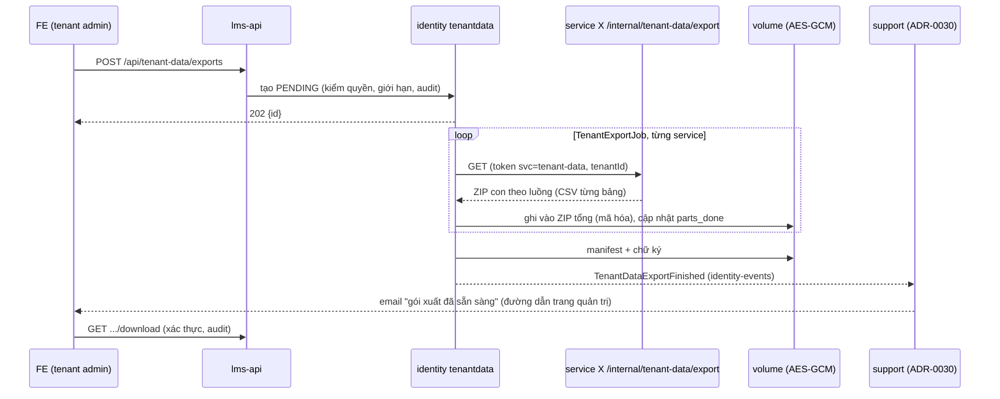

# ADR-0031: Xuất trọn dữ liệu tenant và vòng đời dữ liệu sau chấm dứt hợp đồng

- Trạng thái: Đề xuất (chưa cài đặt). Mức ưu tiên Cao (người dùng bổ sung cùng đợt ADR-0030).
- Ngày: 19/11/2026
- Liên quan: ADR-0001 (Kafka best-effort), ADR-0002/0004 (mỗi service một DB, không truy cập DB chéo; system-service chỉ
  chạy DDL), ADR-0003 (khóa `Controller/method`), ADR-0006 (RLS, `TenantContext`), ADR-0008/0016 (platform admin hành động
  trong tenant bằng `X-Tenant-Id`), ADR-0009 (module theo tenant), ADR-0010 2.8 (ẩn danh khách vãng lai), ADR-0011
  (token dịch vụ `svc`), ADR-0012 (hợp đồng, `ContractLifecycleJob`, suspend `CONTRACT_EXPIRED`), ADR-0017 (phiên),
  ADR-0030 (hạ tầng thông báo theo sự kiện, hóa đơn, ca thu ngân).

## 1. Bối cảnh và hiện trạng đã đối chiếu code (19/11/2026)

LMS là SaaS cho thuê: khi hợp đồng chấm dứt, bên thuê phải lấy lại được dữ liệu của mình (data portability) và nhà cung cấp
phải xử lý dữ liệu còn lại theo chính sách rõ ràng (giữ, khóa, xóa/ẩn danh), có bằng chứng.

| | Điểm | Kết quả thật (file) |
|---|---|---|
| ✅ | Vòng đời hợp đồng | `ContractStatus {DRAFT, ACTIVE, EXPIRED, CANCELLED}`, pha suy ra `UPCOMING / IN_EFFECT / IN_GRACE` (`identity/contract/domain`). `ProcessContractLifecycleUseCase.runOnce` (gọi mỗi giờ bởi `ContractLifecycleJob`, cron `0 7 * * * *`, múi `Asia/Ho_Chi_Minh`): áp dụng module → hết hạn sau ân hạn `lms.contract.grace-period` (mặc định `P7D`) → nhắc hạn (mốc 30/7/1 ngày, phát `TenantContractExpiringSoon` cho quản trị tenant). |
| ✅ | Hết hạn làm gì | `expire`: thu hồi module (`ModuleRevocationPlan`), hết module thì tenant `SUSPENDED` với `SuspensionCause.CONTRACT_EXPIRED`; ghi lịch sử, `PlatformOperationEvent CONTRACT_EXPIRED`, log `platform-audit`. |
| ✅ | SUSPENDED làm gì | `SetTenantStatusUseCase`: chặn cấp và làm mới token vào tenant (đăng nhập, refresh, đổi tenant); access token đang sống hết hạn tối đa 15 phút (`access-token-ttl: PT15M`); **dữ liệu giữ nguyên**. Tự kích hoạt lại khi hợp đồng mới áp dụng chỉ với `CONTRACT_EXPIRED`. |
| ✅ | Không có chế độ chỉ đọc | Không claim/cờ "read-only" nào trong `JwtClaims` hay `PermissionInterceptor`. Có sẵn cơ chế tương tự để bắt chước: claim `modules` + `MODULE_NOT_ENABLED` kiểm ở `PermissionInterceptor` cho mọi service. |
| ✅ | Xuất dữ liệu hiện có (rời rạc, đồng bộ) | identity `ExportUsersUseCase` (`GET /internal/users/export`, CSV UTF-8 BOM, tối đa 5000 dòng, theo bộ lọc); circulation `ExportOverdueBorrowingsCsvUseCase`; sales `OrdersCsvReportUseCase`, `StockCsvReportUseCase`. Không có xuất trọn tenant, không có job nền, không có nơi lưu file. |
| ✅ | Ẩn danh hiện có | sales `AnonymizeWalkInContactsUseCase`/`AnonymizeWalkInBatchUseCase` + `AnonymizeWalkInJob` (tên/điện thoại khách vãng lai sau `walkInPiiRetentionMonths`), `ShopContactAnonymizationJob`. Không có xóa/ẩn danh theo tenant. |
| ✅ | Danh sách tenant cục bộ | circulation `known_tenants` (qua `identity-events`), sales `sales_tenants`; catalog không có. |
| ✅ | Dữ liệu ngoài Postgres | Mongo `LOG_DB` lưu envelope thô có trường `tenantId` (`MongoRawEventArchive`); Redis cache khóa `lms:v1:t:{tenantId}:…` TTL 30 đến 60 giây (`cache-common`); Kafka giữ message theo retention của topic. |
| ✅ | Token dịch vụ | identity tự phát hành token có claim `svc` (`JwtTokenIssuer`, `IssueStorefrontTokenUseCase`, TTL ngắn); `PermissionInterceptor` cho token `svc` chỉ vào endpoint `@StorefrontAccessible`. |
| ✅ | Bảng theo DB | identity: `users` (toàn cục), `credentials`, `refresh_tokens`, `external_logins`, `password_reset_tokens`, `email_verifications`, `tenant_memberships`, `roles`, `user_roles`, `role_permissions`, `departments`, `reader_profiles`, `applications`, `application_credentials`, … ; catalog: `authors, publishers, categories, series, shelf_locations, works, work_authors, titles, title_authors, book_copies`; circulation: `borrowings, borrowing_items, borrow_rules, reservations, fines, fine_adjustment_requests, fine_refunds, circulation_policies, compensation_policies, damage_levels`; sales: đơn, dòng, thanh toán, lệnh thanh toán, trả hàng, hoàn tiền, tồn, sổ cái, phiếu nhập, NCC, cấu hình, banner, liên hệ, audit (+ hóa đơn, ca của ADR-0030); audit_db: `audit_logs`, `notifications` (+ bảng thông báo ADR-0030); system_db: `menus` (RLS), `cms_*` (nền tảng). |
| ✅ | Không có object storage | Không có MinIO/S3 trong `docker-compose.yml`. |

Số migration hiện tại: identity `V38` → kế tiếp `V39` (ADR-0030 đã đặt chỗ `V39` cho khóa quyền; ADR này dùng `V40`), các
target khác xem ADR-0030 mục 1.4. ⚠️ Kiểm lại ngay trước khi tạo.

## 2. Quyết định

### D1. Điều phối ở identity-service (context mới `tenantdata`), mỗi service tự xuất/xóa phần của DB mình

**Chọn**: context `lms.identity.tenantdata` trong identity-service điều phối cả xuất dữ liệu lẫn xóa dữ liệu theo tenant.
Mỗi service (identity, catalog, circulation, sales, support, system) có endpoint nội bộ đọc/xóa **chỉ DB của mình** trong
`TenantContext` của tenant đích. Điều phối gọi các endpoint đó bằng **token dịch vụ** do chính identity ký: claim
`svc = "tenant-data"`, `tenantId`, TTL 10 phút, `aud = lms-tenant-data`. security-common thêm annotation
`@TenantDataAccess`: chỉ token `svc = tenant-data` vào được endpoint mang annotation này, và token đó không vào được endpoint
nào khác (cùng cách `@StorefrontAccessible` của ADR-0011).

Lý do: identity đã sở hữu tenant, hợp đồng, job vòng đời và khóa ký JWT; không cần bí mật mới để các service tin lời gọi;
trạng thái tenant và vòng đời dữ liệu nằm cùng transaction với hợp đồng.

Phương án đã loại:

| Phương án | Lý do loại |
|---|---|
| system-service điều phối | Đã có quyền DDL lên mọi DB nên dễ trượt sang đọc trực tiếp (vi phạm ADR-0004 "chỉ chạy DDL"); không ký được token, phải thêm bí mật chung; không biết trạng thái hợp đồng. |
| system-service đọc thẳng mọi DB để xuất/xóa | Phá ranh giới DB của từng service, bỏ qua quy tắc domain (ví dụ không xuất băm mật khẩu, giữ chứng từ tài chính). |
| Điều phối bằng sự kiện Kafka (`TenantExportRequested`, `TenantPurgeRequested`) | Best-effort (ADR-0001): mất sự kiện là phần dữ liệu không được xuất/xóa mà điều phối không biết; vẫn phải có kênh trả kết quả. HTTP có trạng thái từng phần và thử lại rõ ràng. |
| Service điều phối mới | Thêm cổng, DB, compose cho việc chạy vài lần mỗi tháng. |

Đánh đổi: identity là service đăng nhập; đóng gói ZIP chạy trên identity. Giảm thiểu: một luồng nền riêng (executor 1 thread,
hàng đợi 1), ghi trực tiếp ra đĩa theo luồng (không giữ trong RAM), giới hạn kích thước (D3).

### D2. Định dạng gói xuất

ZIP gồm:

- `manifest.json`: `schemaVersion` (bắt đầu `1`), `tenantId`, `tenantCode`, `requestedBy`, `requestedAt`, `generatedAt`,
  danh sách phần `[{service, schemaVersion, files[{path, rows, sha256, bytes}]}]`, danh sách bảng **bị loại có chủ đích**
  kèm lý do, phiên bản ứng dụng.
- `manifest.json.sig`: chữ ký JWS tách rời (RS256) bằng khóa ký JWT hiện hành của identity, `kid` trong header; kiểm bằng
  JWKS công khai. ⚠️ Khóa đã xoay vòng và gỡ khỏi JWKS thì không kiểm lại được gói cũ; gói chỉ sống 7 ngày nên chấp nhận.
- `<service>/<bảng>.csv`: UTF-8 có BOM (mở được bằng Excel như `ExportUsersUseCase`), dòng đầu là tên cột, cột JSON/mảng ghi
  dạng chuỗi JSON. Mỗi service tự quyết định bảng và cột (danh sách cố định trong code, có test), không dump schema thô.
- `README.txt` tiếng Việt: cách đọc, ý nghĩa trạng thái, cách kiểm chữ ký.

Luôn loại: băm mật khẩu (`credentials`), `refresh_tokens`, `password_reset_tokens`, `email_verifications`,
`external_sign_in_tickets`, mã bí mật/băm của `application_credentials`, site key, bí mật webhook, `qr_payload`/chữ ký của
lệnh thanh toán, khóa nội bộ, bảng toàn cục không thuộc tenant (`permissions`, `role_templates`, `cms_*`), bản thô Mongo
(đã có bản chuẩn trong `audit_logs`). `users` chỉ xuất người dùng có membership trong tenant và chỉ các cột hồ sơ
(tên đăng nhập, họ tên, email, trạng thái, ngày tạo).

Dữ liệu cá nhân: gói xuất chứa dữ liệu cá nhân của độc giả/khách của chính tenant (bên thuê là bên kiểm soát dữ liệu);
không che. Vì vậy quyền xuất chỉ dành cho quản trị tenant, mọi lần yêu cầu và tải đều ghi audit.

Phương án đã loại: JSON Lines (khó mở cho người dùng nghiệp vụ), dump SQL (`pg_dump` theo tenant không làm được với RLS và
lộ cấu trúc nội bộ), một file JSON lớn (không xử lý theo luồng được).

### D3. Xuất bất đồng bộ, lưu file trên volume của identity, tải qua lms-api có xác thực

- Trạng thái: `PENDING → RUNNING → READY → EXPIRED`, hoặc `FAILED`. Tiến độ = số phần xong / tổng phần.
- Job `TenantExportJob` (`@Scheduled fixedDelay 30s`): lấy một yêu cầu `PENDING` (cập nhật có điều kiện
  `PENDING → RUNNING`, an toàn khi nhiều instance), gọi lần lượt từng service `GET /internal/tenant-data/export` (luồng ZIP
  con hoặc nhiều phần CSV dạng `multipart/mixed`; be-dev chọn, khuyến nghị ZIP con), sao từng mục vào ZIP tổng đang ghi ra
  file tạm, tính SHA-256 trong lúc ghi. Lỗi một phần: thử lại phần đó tối đa 3 lần; vẫn lỗi → `FAILED` với `error_code`
  (không lưu thông điệp lỗi thô). Yêu cầu `RUNNING` quá 2 giờ (instance chết) → `FAILED` `STALE`.
- Lưu trữ: `ExportStoragePort` với adapter `LocalFileExportStorage` ghi vào thư mục `lms.tenant-data.export.dir` (volume
  Docker riêng cho identity, ví dụ `/data/tenant-exports`). File được mã hóa lúc lưu bằng AES-256-GCM, khóa từ biến môi
  trường `TENANT_EXPORT_ENCRYPTION_KEY` (thiếu khóa → tính năng tắt, API trả 503 `EXPORT_NOT_CONFIGURED`), giải mã theo luồng
  khi tải. ZIP tải về **không** đặt mật khẩu (Java chuẩn không có ZIP AES; thêm thư viện không đáng): bảo vệ bằng HTTPS +
  xác thực + hạn dùng.
- Giới hạn: một yêu cầu đang chạy mỗi tenant (chỉ mục duy nhất một phần); tối đa 1 yêu cầu thành công/24 giờ/tenant
  (`429 EXPORT_RATE_LIMITED`, platform admin được bỏ qua khi chấm dứt hợp đồng); kích thước tối đa
  `lms.tenant-data.export.max-bytes` (mặc định 2 GB) → `FAILED` `SIZE_LIMIT`.
- Hạn dùng: `READY` sống 72 giờ (`expires_at`), job dọn xóa file và chuyển `EXPIRED`. Tải nhiều lần trong hạn (trình duyệt
  có thể đứt mạng), mỗi lần ghi `download_count`, `last_downloaded_at`, audit.
- Tải: `GET /api/tenant-data/exports/{id}/download` qua lms-api (stream, `Cache-Control: no-store`); lms-api phải chuyển tiếp
  theo luồng, không đọc cả thân vào bộ nhớ (⚠️ client HTTP hiện tại của lms-api đọc `byte[]` hay stream: chưa kiểm, be-dev
  xác nhận và viết client stream riêng nếu cần). Không phát hành "liên kết công khai có chữ ký": email chỉ dẫn tới trang
  quản trị, người tải phải đăng nhập.
- Xong (READY/FAILED): identity phát `TenantDataExportFinished` lên `identity-events` (`exportId`, `status`,
  `recipientUserIds` = người yêu cầu + quản trị tenant, `expiresAt`); support gửi email theo pipeline ADR-0030 (nhóm `ACCOUNT`,
  bắt buộc).

Phương án đã loại cho lưu trữ:

| Phương án | Lý do loại |
|---|---|
| Thêm MinIO/S3 ngay | Thành phần hạ tầng mới để chạy vài lần mỗi tháng; để `ExportStoragePort` sẵn chỗ thay. |
| Lưu ZIP thành `bytea` trong `identity_db` | File hàng trăm MB làm phình DB, sao lưu, WAL; đọc ghi chiếm nhiều RAM. |
| Mỗi service giữ phần của mình, người dùng tải nhiều file | Không có một gói có manifest/chữ ký; phải mở endpoint tải ở mọi service. |

Giới hạn: volume cục bộ chỉ đúng khi identity chạy **một instance** (compose hiện tại). Chạy nhiều instance thì phải chuyển
sang lưu trữ dùng chung trước (⚠️ ghi ở rủi ro).

### D4. Chế độ chỉ đọc bằng claim JWT, chặn ở `PermissionInterceptor`

**Chọn**: identity thêm claim `tenantAccess` vào mọi token gắn tenant (người dùng, storefront `svc`, tích hợp):
`FULL` (mặc định, có thể bỏ claim) hoặc `READ_ONLY`. `PermissionInterceptor` (security-common) từ chối mọi request có
phương thức khác `GET`/`HEAD`/`OPTIONS` khi `tenantAccess = READ_ONLY`, trả 403 `TENANT_READ_ONLY`, trừ endpoint đánh dấu
`@AllowedWhenReadOnly` (yêu cầu xuất dữ liệu, đăng xuất, đổi mật khẩu của chính mình, đổi tenant, đánh dấu đã đọc thông báo,
tùy chọn thông báo). Endpoint `GET` có tác dụng ghi phụ (đăng ký khóa quyền lần đầu) vẫn chạy, vì đó là dữ liệu nền tảng.
Platform admin dùng `X-Tenant-Id` không bị chặn (cần để xử lý chấm dứt), nhưng mọi thao tác ghi bị log `platform-audit`
như hiện có.

Lý do: một thay đổi ở thư viện dùng chung có hiệu lực ở mọi service (cùng điểm kiểm `modules`/`MODULE_NOT_ENABLED`), không
service nào phải biết trạng thái tenant. Độ trễ tối đa 15 phút (TTL access token); khi chuyển sang chỉ đọc, identity thu
hồi refresh token đang sống của tenant (cơ chế phiên ADR-0017) để token mới mang claim ngay lần làm mới tiếp theo.

Phương án đã loại:

| Phương án | Lý do loại |
|---|---|
| Mỗi service tra trạng thái tenant (bảng cục bộ qua `identity-events`, như `known_tenants`) | 5 service phải thêm bảng + consumer; mất sự kiện là tenant không bao giờ bị chặn ghi (hoặc không bao giờ được mở lại). |
| Chặn ở lms-api (filter theo phương thức) | Bỏ sót customer-api (đơn storefront), integration-api và lời gọi liên service. |
| Gọi identity mỗi request | Thêm độ trễ và phụ thuộc đồng bộ vào identity cho mọi request ghi. |
| Thu hồi quyền ghi bằng cách gỡ khóa khỏi role | Admin (`is_admin`) bỏ qua kiểm khóa; phá cấu hình role của tenant, khó khôi phục khi gia hạn. |

Không áp dụng cho: webhook thanh toán công khai (không có JWT; tiền đã chuyển phải ghi nhận), job nền (không có JWT), consumer
Kafka. Đơn online đang dở khi vào chỉ đọc: job hết hạn giữ hàng tự hủy; nhân viên không xác nhận được nữa (ℹ️ ghi trong thông
báo gửi tenant).

### D5. Các pha sau chấm dứt hợp đồng (bảng trạng thái riêng, không đổi `TenantStatus`)

Thêm bảng `tenant_data_lifecycle` (identity, toàn cục) với `phase`:

| Pha | Bắt đầu khi | Truy cập tenant | Xuất dữ liệu | Thời lượng (cấu hình) |
|---|---|---|---|---|
| `ACTIVE` | mặc định | đầy đủ | tenant admin | |
| (`IN_GRACE` của hợp đồng) | `ends_at` | đầy đủ (giữ ADR-0012) | tenant admin | `lms.contract.grace-period` 7 ngày |
| `READ_ONLY` | hợp đồng hết hạn sau ân hạn và không có hợp đồng nối tiếp | đăng nhập được, chỉ đọc (D4), module **giữ nguyên** | tenant admin (cửa sổ xuất) | `lms.tenant-data.read-only-days` 30 |
| `LOCKED` | hết `READ_ONLY` | không đăng nhập được (tenant `SUSPENDED` như hiện nay, module thu hồi) | chỉ platform admin xuất thay | `lms.tenant-data.retention-days` 90 |
| `PURGE_PENDING` | platform admin yêu cầu xóa (bước 1) sau khi hết `LOCKED` | như `LOCKED` | platform admin | chờ xác nhận bước 2 |
| `PURGING` | xác nhận bước 2 | như `LOCKED` | không | đến khi mọi phần xong |
| `PURGED` | mọi service báo xong | tenant không còn dùng được | không | vĩnh viễn (giữ chứng nhận) |

- Thay đổi hành vi ADR-0012: `ProcessContractLifecycleUseCase.expire` khi bật tính năng (`read-only-days > 0`) **không thu hồi
  module và không suspend ngay**, mà chuyển pha `READ_ONLY`; bước thu hồi + suspend hiện có dời sang lúc vào `LOCKED`.
  `read-only-days = 0` giữ nguyên hành vi cũ (tương thích).
- Gia hạn/hợp đồng mới áp dụng trong `READ_ONLY` hoặc `LOCKED` → về `ACTIVE` (dùng lại logic tự kích hoạt lại
  `CONTRACT_EXPIRED`). Từ `PURGE_PENDING` trở đi không quay lại.
- Hủy hợp đồng (`CONTRACT_CANCELLED`) và suspend tay (`MANUAL`) **không** đi vào luồng này (giữ ADR-0012); platform admin
  có thể chủ động chuyển một tenant đã suspend vào `LOCKED` bằng thao tác riêng có lý do.
- Thông báo trước mỗi mốc: job phát `TenantDataLifecycleNotice` lên `identity-events` với `notice` ∈
  `READ_ONLY_STARTED`, `EXPORT_WINDOW_ENDING` (7 và 1 ngày trước khi hết `READ_ONLY`), `LOCKED`, `PURGE_SCHEDULED`,
  `PURGED`, kèm `recipientUserIds` (quản trị tenant, như `TenantContractExpiringSoon`). Ghi bảng nhắc
  `tenant_data_lifecycle_notices (tenant_id, notice, due_on)` duy nhất để không phát trùng. support gửi qua pipeline ADR-0030
  (nhóm `ACCOUNT`, bắt buộc). Thông báo `PURGED` gửi tới email người dùng (bảng `users` toàn cục còn giữ nếu họ còn
  membership tenant khác; nếu không, gửi trước khi ẩn danh ở bước identity).

### D6. Xóa vĩnh viễn: hai bước, từng service tự xóa phần mình, idempotent, có chứng nhận

- Bước 1: platform admin `POST /api/platform/tenants/{id}/purge-requests` `{reason}` (chỉ khi pha `LOCKED` đã hết hạn giữ hoặc
  có cờ `force` kèm lý do pháp lý) → `PURGE_PENDING`, phát thông báo `PURGE_SCHEDULED`.
- Bước 2: sau tối thiểu `lms.tenant-data.purge-cooldown` (mặc định 24 giờ) và trước 7 ngày, platform admin
  `POST .../purge-requests/{rid}/confirmation` `{tenantCode}` (gõ lại mã tenant). Cờ
  `lms.tenant-data.purge.require-distinct-approver` (mặc định `false` vì có thể chỉ có một platform admin; bật thì người xác
  nhận phải khác người yêu cầu).
- Thực thi: `TenantPurgeJob` gọi tuần tự mỗi service `POST /internal/tenant-data/purge` (`@TenantDataAccess`), mỗi service
  xóa theo lô (ví dụ 1000 dòng/transaction, theo thứ tự con → cha) trong `TenantContext` của tenant, trả
  `{status: DONE|PARTIAL, deleted: {bảng: số dòng}, retained: {bảng: số dòng, lý do}}`. `PARTIAL` (hết thời gian một lượt)
  → gọi lại lượt sau. Idempotent: gọi lại khi đã xóa hết trả `DONE` với số 0. Lỗi → thử lại theo lịch (1 phút → 1 giờ, tối đa
  24 lần) rồi `FAILED` chờ platform admin bấm chạy lại; **không có rollback xuyên DB**: phần đã xóa của service khác giữ
  nguyên, trạng thái từng phần nằm ở `tenant_purge_parts`. Thứ tự: sales, circulation, catalog, support, system, identity
  cuối cùng (identity giữ tenant, người dùng và sổ cái điều phối).
- Chứng từ tài chính (hóa đơn, đơn, dòng, thanh toán, hoàn tiền, phiếu trả, phiếu nhập, ca thu ngân, `sales_audit_log`):
  **không xóa** mà ẩn danh dữ liệu cá nhân (tên/điện thoại/địa chỉ khách lẻ, người nhận, ghi chú khách; giữ thông tin người
  mua trên hóa đơn có MST vì là thông tin doanh nghiệp bắt buộc trên chứng từ) và giữ tới
  `lms.tenant-data.financial-retention-until-years`. **Mặc định: không tự xóa chứng từ tài chính** (giữ vô hạn) cho tới khi
  người dùng cấu hình theo tư vấn pháp lý. ⚠️ Thời hạn lưu trữ chứng từ kế toán theo luật Việt Nam cần tư vấn pháp lý/kế toán;
  ADR này không khẳng định số năm. Phần giữ lại vẫn chịu RLS; không ai đọc được qua ứng dụng sau `PURGED` trừ platform admin
  qua quy trình riêng (⏭️ chưa thiết kế màn đọc).
- Dữ liệu ngoài Postgres:
  - Mongo `LOG_DB`: support xóa `deleteMany({tenantId})` trong lượt purge của mình.
  - Redis: khóa cache tự hết hạn sau ≤ 60 giây; identity xóa thêm khóa cache đăng nhập/quyền của tenant (ADR-0022) nếu có.
  - Kafka: không xóa chọn lọc được; message hết theo retention của topic. Payload các topic chính chỉ có id (ADR-0010 2.6,
    ADR-0030 D5); topic `notification.direct`, `auth.password-reset` chứa dữ liệu nhạy cảm nên phải có retention ngắn.
  - File xuất của tenant trên volume: xóa ngay khi vào `PURGING`.
  - Bản sao lưu (backup): dữ liệu đã xóa còn trong backup tới khi backup đó bị xoay vòng. Khi khôi phục từ backup, chạy lại purge
    cho mọi tenant trong sổ `tenant_deletion_certificates` (tombstone) trước khi mở dịch vụ. ⚠️ Repo chưa có quy trình backup;
    ghi thành yêu cầu vận hành.
- identity (cuối cùng): xóa membership, role, phòng ban, hồ sơ độc giả, ứng dụng/credential, origin storefront, phiên của tenant;
  người dùng không còn membership nào khác thì ẩn danh hàng `users` (tên đăng nhập/email thay bằng giá trị không định danh,
  xóa credential, external login). Tenant giữ một hàng tối thiểu (`id`, `status = PURGED` hoặc cờ tương đương, thời điểm) để
  tránh tái sử dụng `id`/`code` nhầm và để chứng nhận tham chiếu.
- Chứng nhận xóa (`tenant_deletion_certificates`, identity, toàn cục): `tenant_id`, `tenant_code_hash` (SHA-256, không giữ mã
  rõ), `requested_by`, `confirmed_by`, thời điểm từng bước, theo từng service: số dòng đã xóa, số dòng giữ lại và lý do,
  thời điểm xong; JSON chuẩn hóa + chữ ký JWS như manifest xuất. Platform admin tải được; không chứa dữ liệu cá nhân.

Phương án đã loại: `DROP`/xóa theo tenant bằng system-service (vượt vai trò DDL, bỏ qua quy tắc giữ chứng từ); xóa ngay khi
hết hạn hợp đồng (không có cửa sổ lấy dữ liệu); xóa mềm vĩnh viễn (không đáp ứng yêu cầu xóa dữ liệu cá nhân).

## 3. Thiết kế

### 3.1. Mô hình dữ liệu (identity_db, bảng toàn cục, lọc `tenant_id` tường minh trong use case, thêm vào `TENANT_EXEMPT_TABLES` như `tenant_contracts`)

Migration `identity/V40__tenant_data_export_lifecycle.sql` (⚠️ kiểm số; nếu ADR-0030 chưa dùng V39 thì số dịch theo).

| Bảng | Cột chính | Ràng buộc / chỉ mục |
|---|---|---|
| `tenant_data_exports` | `id`, `tenant_id`, `status`, `requested_by`, `requested_by_platform` bool, `reason`, `created_at`, `started_at`, `finished_at`, `expires_at`, `parts_total`, `parts_done`, `size_bytes`, `sha256`, `storage_key`, `error_code`, `download_count`, `last_downloaded_at` | `UNIQUE (tenant_id) WHERE status IN ('PENDING','RUNNING')`; chỉ mục `(tenant_id, created_at DESC)`, `(status, created_at)` (job) |
| `tenant_data_export_parts` | `export_id`, `service`, `status`, `attempts`, `rows` JSONB, `sha256`, `error_code`, `finished_at` | PK `(export_id, service)` |
| `tenant_data_lifecycle` | `tenant_id` PK, `phase`, `phase_since`, `phase_until`, `contract_id`, `updated_by`, `version` | chỉ mục `(phase, phase_until)` (job) |
| `tenant_data_lifecycle_notices` | `tenant_id`, `notice`, `due_on`, `sent_at`, `recipient_count` | PK `(tenant_id, notice, due_on)` |
| `tenant_purge_requests` | `id`, `tenant_id`, `status` (`PENDING_CONFIRMATION`/`CONFIRMED`/`RUNNING`/`DONE`/`FAILED`/`EXPIRED`), `reason`, `requested_by`, `requested_at`, `confirmed_by`, `confirmed_at`, `force` bool | `UNIQUE (tenant_id) WHERE status IN ('PENDING_CONFIRMATION','CONFIRMED','RUNNING')` |
| `tenant_purge_parts` | `request_id`, `service`, `status`, `attempts`, `next_attempt_at`, `deleted` JSONB, `retained` JSONB, `error_code`, `finished_at` | PK `(request_id, service)`; chỉ mục `(status, next_attempt_at)` |
| `tenant_deletion_certificates` | `id`, `tenant_id` UNIQUE, `tenant_code_hash`, `issued_at`, `document` JSONB, `signature` | |

Khóa quyền: tenant admin dùng khóa động riêng (`TenantDataExportController/request`, `/list`, `/get`, `/download`), không gán
mẫu vai trò nào (chỉ `is_admin` có, đúng ADR-0003 vì admin bỏ qua kiểm khóa); platform admin dùng controller
`@PlatformAdminOnly` riêng.

### 3.2. API

| Method, lms-api | Service / khóa |
|---|---|
| `POST /api/tenant-data/exports` `{reason?}` → 202 `{id, status}` | identity `TenantDataExportController/request` (`@AllowedWhenReadOnly`) |
| `GET /api/tenant-data/exports`, `GET /api/tenant-data/exports/{id}` | `TenantDataExportController/list`, `/get` |
| `GET /api/tenant-data/exports/{id}/download` (stream ZIP) | `TenantDataExportController/download` |
| `GET /api/tenant-data/lifecycle` (pha hiện tại, mốc kế tiếp) | `@AuthenticatedOnly` |
| `POST /api/platform/tenants/{id}/data-exports` | identity `PlatformTenantDataController/export` `@PlatformAdminOnly` |
| `GET /api/platform/tenants/{id}/data-lifecycle`, `POST .../data-lifecycle/lock` `{reason}` | `PlatformTenantDataController/lifecycle`, `/lock` |
| `POST /api/platform/tenants/{id}/purge-requests` `{reason, force?}`; `POST .../purge-requests/{rid}/confirmation` `{tenantCode}`; `POST .../purge-requests/{rid}/retry`; `GET .../purge-requests/{rid}` | `PlatformTenantDataController/requestPurge`, `/confirmPurge`, `/retryPurge`, `/getPurge` |
| `GET /api/platform/tenants/{id}/deletion-certificate` | `PlatformTenantDataController/certificate` |
| (nội bộ, mỗi service) `GET /internal/tenant-data/export`, `POST /internal/tenant-data/purge` | `@TenantDataAccess`, không qua lms-api |

Lỗi: 409 `EXPORT_IN_PROGRESS`, `PURGE_NOT_ALLOWED_IN_PHASE`, `PURGE_COOLDOWN`, `PURGE_CONFIRMATION_MISMATCH`; 429
`EXPORT_RATE_LIMITED`; 410 `EXPORT_EXPIRED`; 503 `EXPORT_NOT_CONFIGURED`; 403 `TENANT_READ_ONLY` (từ interceptor).

### 3.3. Luồng xuất

## 4. Phân việc

| Gói | Ai | Phạm vi | Phụ thuộc |
|---|---|---|---|
| ⏳ F0 | be-dev | security-common: `@TenantDataAccess`, nhánh token `svc = tenant-data` trong `PermissionInterceptor`; claim `tenantAccess` + `@AllowedWhenReadOnly` + từ chối 403 `TENANT_READ_ONLY` (dùng chung cho G); `JwtClaims` hằng mới. Test đơn vị interceptor. | S0 của ADR-0030 (không chung file); làm trước F và G |
| ⏳ F1 Xuất, phía service | be-dev (có thể chia theo service, song song) | Mỗi service một package `<root>.tenantdata` (hoặc trong context chính) với `TenantDataExportController` (`@TenantDataAccess`) + use case xuất theo luồng, danh sách bảng/cột cố định: identity (`user`, `accesscontrol`, `department`, hồ sơ độc giả, ứng dụng không bí mật), catalog, circulation, sales (gồm hóa đơn, ca của ADR-0030 nếu đã có), support (`audit_logs`, `notifications`, deliveries đã che), system (`menus` của tenant). Đọc theo lô keyset, không N+1. | F0 |
| ⏳ F2 Xuất, điều phối | be-dev | identity `lms.identity.tenantdata.**` (mới): domain, use case yêu cầu/job/tải, `ExportStoragePort` + `LocalFileExportStorage`, client gọi service, ký manifest; `identity/V40`; `TENANT_EXEMPT_TABLES` (tenant-common) thêm bảng mới; lms-api controller + client stream. Phát `TenantDataExportFinished`. | F0; chạy end-to-end cần F1 |
| ⏳ F3 Thông báo xuất | be-dev gói C | support: ánh xạ `TenantDataExportFinished` → loại `TENANT_DATA_EXPORT_READY|FAILED` + mẫu email. | gói C (ADR-0030) |
| ⏳ G1 Vòng đời + chỉ đọc | be-dev | identity `tenantdata` (pha, job `TenantDataLifecycleJob`, thông báo mốc), sửa `contract/application/ProcessContractLifecycleUseCase.expire` và `ContractTransitions` (dời thu hồi/suspend sang `LOCKED`, có cờ), `JwtTokenIssuer`/nơi dựng claim (thêm `tenantAccess`), thu hồi phiên khi vào `READ_ONLY`; gắn `@AllowedWhenReadOnly` ở các endpoint ngoại lệ trong từng service (mỗi service một commit nhỏ). | F0, gói C (thông báo), F2 (xuất trong cửa sổ chỉ đọc) |
| ⏳ G2 Xóa theo tenant | be-dev (chia theo service) | Mỗi service `TenantDataPurgeController` (`@TenantDataAccess`) + use case xóa theo lô/ẩn danh, giữ chứng từ tài chính ở sales; support xóa Mongo; identity: `TenantPurgeJob`, hai bước xác nhận, chứng nhận. | G1, F0 |
| ⏳ G3 Thông báo vòng đời | be-dev gói C | support: loại `TENANT_LIFECYCLE_*` + mẫu. | gói C |
| ⏳ FE-F/G | fe-dev | `src/pages/admin/`: trang "Dữ liệu của tenant" (yêu cầu xuất, tiến độ, tải, lịch sử), băng cảnh báo chỉ đọc toàn ứng dụng khi gặp `TENANT_READ_ONLY` hoặc pha `READ_ONLY`; `src/pages/platform/`: vòng đời dữ liệu tenant, xuất thay, yêu cầu/xác nhận xóa (gõ mã tenant), tải chứng nhận; menu `system/V8` (⚠️ kiểm số sau ADR-0030 V7). | API F2, G1, G2 |

Thứ tự: F0 → (F1 ∥ F2) → F3 (sau gói C) → G1 → G2 → G3; FE theo hợp đồng. G1 sửa file của context `contract` (identity)
mà các phiên khác có thể đang sửa: đọc lại, sửa có mục tiêu.

Kiểm thử bắt buộc (tester):

- F0: WebMvc từng loại token × annotation: `svc=tenant-data` vào `@TenantDataAccess` được, vào endpoint thường bị 403; token
  người dùng (kể cả admin) vào `@TenantDataAccess` bị 403; `READ_ONLY` chặn POST/PUT/DELETE, cho GET và
  `@AllowedWhenReadOnly`; platform admin với `X-Tenant-Id` không bị chặn.
- F1: IT từng service với vai trò `<svc>_app`: chỉ dữ liệu tenant đích (hai tenant), không có cột bị loại (băm mật khẩu,
  token, bí mật), số dòng khớp `COUNT(*)`; số câu SQL không tăng theo số dòng (keyset theo lô).
- F2: IT identity: một yêu cầu đang chạy mỗi tenant; giới hạn 24 giờ; lỗi một phần → thử lại → `FAILED`; file mã hóa trên đĩa
  (không đọc được ZIP thô); manifest khớp SHA-256; chữ ký kiểm được bằng JWKS; hết hạn xóa file; tải ghi audit.
- G1: IT identity: hết hạn + ân hạn → `READ_ONLY` (module giữ), token mới có `tenantAccess=READ_ONLY`; hết 30 ngày → `LOCKED`
  + `SUSPENDED` + module thu hồi; gia hạn trong `READ_ONLY`/`LOCKED` → `ACTIVE`; `read-only-days=0` giữ hành vi ADR-0012 cũ
  (chạy lại bộ IT T3 của ADR-0012); thông báo mốc không trùng khi job chạy hai lần.
- G2: IT từng service: purge hai lần = như một lần; `PARTIAL` rồi `DONE`; sales giữ chứng từ đã ẩn danh; identity ẩn danh
  người dùng không còn membership, giữ người dùng còn tenant khác; một service lỗi không làm hỏng phần đã xong, chạy lại tiếp
  tục; chứng nhận đúng số liệu.
- perf-tester: xuất tenant demo nhân 50 lần dữ liệu (thời gian, RAM identity, không ảnh hưởng độ trễ đăng nhập p95 khi xuất
  đang chạy).

## 5. Giả định đã tự chốt (người dùng sửa được)

1. Điều phối ở identity-service; lưu file trên volume cục bộ của identity, chạy một instance.
2. Định dạng CSV UTF-8 BOM theo bảng + `manifest.json` + chữ ký JWS; không đặt mật khẩu ZIP.
3. Gói xuất sống 72 giờ; 1 lần thành công/24 giờ/tenant; tối đa 2 GB.
4. Chỉ quản trị tenant (`is_admin`) yêu cầu và tải; platform admin xuất thay được ở mọi pha trước `PURGING`.
5. Ân hạn 7 ngày (giữ ADR-0012) → chỉ đọc 30 ngày → khóa và giữ 90 ngày → xóa chỉ khi platform admin yêu cầu và xác nhận
   (không tự xóa theo lịch).
6. Chế độ chỉ đọc giữ nguyên module để người dùng đọc được dữ liệu; khi vào `LOCKED` mới thu hồi module và suspend.
7. Hủy hợp đồng và suspend tay không tự đi vào luồng xóa.
8. Chứng từ tài chính không bao giờ tự xóa cho tới khi cấu hình thời hạn theo tư vấn pháp lý; dữ liệu cá nhân trong đó được
   ẩn danh khi purge (trừ thông tin người mua có MST trên hóa đơn).
9. Không cần người xác nhận thứ hai khác người yêu cầu (cờ để bật).
10. Bản sao lưu không bị sửa; khôi phục phải chạy lại purge theo sổ chứng nhận.

## 6. Rủi ro và việc chưa kiểm chứng

- ⚠️ Pháp lý: thời hạn lưu chứng từ kế toán, nghĩa vụ xóa dữ liệu cá nhân (Nghị định 13/2023/NĐ-CP về bảo vệ dữ liệu cá nhân),
  điều khoản hợp đồng SaaS về trả dữ liệu: cần tư vấn; các số ngày trong ADR là mặc định cấu hình, không phải tư vấn pháp lý.
- ⚠️ Đổi hành vi ADR-0012 khi bật `read-only-days > 0`: tenant hết hạn không còn bị suspend ngay; cần người dùng chấp nhận (đã
  để cờ tương thích).
- ⚠️ Độ trễ 15 phút khi chuyển chỉ đọc (TTL access token); thu hồi phiên chỉ ép làm mới, không hủy access token đang sống.
- ⚠️ lms-api chuyển tiếp tải file theo luồng: chưa kiểm client HTTP hiện tại (có thể đọc toàn bộ vào `byte[]`).
- ⚠️ Volume cục bộ không dùng được khi identity nhiều instance; cần `ExportStoragePort` adapter dùng chung trước khi mở rộng.
- ⚠️ Xuất chạy trên identity có thể ảnh hưởng đăng nhập khi dữ liệu lớn: cần số đo perf trước khi bật cho tenant lớn.
- ⚠️ Xóa xuyên 6 DB không nguyên tử: có thể dừng ở trạng thái một phần trong thời gian dài nếu một service hỏng; chứng nhận chỉ
  phát khi mọi phần `DONE`.
- ⚠️ Kafka, backup và log ứng dụng có thể còn dữ liệu sau purge cho tới khi hết retention/xoay vòng; repo chưa có quy trình
  backup.
- ⚠️ Danh sách bảng mỗi service phải cập nhật khi thêm bảng mới; đề xuất test ArchUnit/IT so danh sách bảng có `tenant_id`
  trong DB với danh sách xuất/xóa (bảng mới chưa khai báo → test đỏ).
- ⚠️ Số migration `identity/V40`, `system/V8` là dự kiến sau ADR-0030.

## 7. Câu hỏi mở (đã có mặc định để làm tiếp)

1. Các mốc 7/30/90 ngày có khớp hợp đồng mẫu đang ký với khách không? Mặc định như mục 5.
2. Có cho phép tenant tự yêu cầu xóa sớm (trước hết 90 ngày) không? Mặc định: không, chỉ platform admin với `force` và lý do.
3. Gói xuất có cần kèm tệp đính kèm (ảnh bìa, file nhập Excel) không? Mặc định: không (repo hiện chưa lưu tệp nhị phân của
   tenant ngoài DB; ⚠️ chưa kiểm hết).
4. Thời hạn giữ chứng từ tài chính: chờ người dùng cung cấp theo tư vấn pháp lý; trước đó giữ vô hạn.

## Phụ lục A. Hợp đồng exporter đã chốt (gói F2, 19/11/2026)

Chốt để F1 (exporter từng service) và F2 (điều phối ở identity) làm song song. Chọn phương án "ZIP con" mà D3 khuyến nghị.

**Endpoint** (mỗi service catalog, circulation, sales, support; system tùy chọn): `GET /internal/tenant-data/export`,
`@TenantDataAccess`, không tham số query (tenant lấy duy nhất từ claim `tenantId` của token `svc = tenant-data`, đặt vào
`TenantContext`; tuyệt đối không nhận `tenantId` từ query/header). Header gửi kèm: `Authorization: Bearer <token>`,
`X-Correlation-Id`, `Accept: application/zip`.

**Phản hồi thành công**: `200`, `Content-Type: application/zip`, thân là ZIP ghi theo luồng (không giữ cả gói trong RAM, đọc
DB theo lô keyset), không `Content-Length`. Các entry ở gốc ZIP (không thư mục con):

1. `<bảng>.csv` mỗi bảng một file: UTF-8 **có BOM**, phân tách dấu phẩy, bao trong dấu nháy kép khi cần (RFC 4180), dòng
   đầu là tên cột, xuống dòng `\r\n`, cột JSON/mảng ghi dạng chuỗi JSON, thời điểm ISO-8601 UTC, boolean `true/false`,
   giá trị null là ô rỗng. Tên bảng khớp `[a-z0-9_]+`. Bảng rỗng vẫn có file (chỉ dòng tiêu đề).
2. `_meta.json` là entry **cuối cùng** (ghi sau khi đã đếm xong), UTF-8 không BOM:
   `{"service":"catalog","schemaVersion":1,"tables":[{"name":"authors","file":"authors.csv","rows":123,"columns":["id","name"]}],"excluded":[{"table":"x","reason":"..."}]}`.
   `rows` là số dòng dữ liệu (không tính dòng tiêu đề). `excluded` là bảng/cột bị loại có chủ đích kèm lý do (có thể rỗng).
   Điều phối không chép `_meta.json` vào gói tổng mà gộp vào `manifest.json`.

Điều phối tự tính SHA-256 và số byte của từng CSV khi chép sang gói tổng (exporter không cần tính).

**Lỗi**: lỗi trước khi bắt đầu ghi thân → mã HTTP `401/403` (token sai), `404/501` không dùng; `5xx` (điều phối thử lại tối đa
3 lần). Lỗi giữa chừng khi đã ghi thân → đóng kết nối/để ZIP cụt, **không** ghi `_meta.json`: điều phối coi thiếu
`_meta.json` hoặc ZIP không đọc được là lỗi nguồn đó. Thông điệp lỗi của exporter không bao giờ được đưa tới người dùng cuối
(điều phối chỉ lưu `error_code` chung: `SOURCE_HTTP_<status>`, `SOURCE_UNREACHABLE`, `SOURCE_TRUNCATED`, `SOURCE_INVALID`).

**Giới hạn**: điều phối ngắt nguồn khi tổng byte vượt `lms.tenant-data.export.max-bytes` (`SIZE_LIMIT`). Exporter nên giữ mọi
entry theo luồng, mỗi lô đọc 500 đến 1000 dòng. Timeout đọc socket của điều phối: 120 giây giữa hai lần nhận dữ liệu
(exporter nên flush đều).

**Cấu hình nguồn ở identity**: `lms.tenant-data.export.sources.<service>.base-url` (catalog `http://catalog-service:8082`,
circulation `:8083`, support `:8084`, sales `:8087`, local dev `localhost`). Nguồn không khai base-url thì bị bỏ qua và ghi
trong manifest là "không cấu hình".

**Phần của identity** do identity tự xuất trong tiến trình (không qua HTTP): `users` (chỉ người có membership trong tenant,
cột hồ sơ), `tenant_memberships`, `roles`, `role_permissions`, `user_roles`, `departments`, `reader_profiles`, `applications`
(không secret), `tenant_contracts`.

**Số migration thật**: identity `V41__tenant_data_exports.sql` (V40 đã dùng cho seed khóa quyền hóa đơn/ca/thông báo).
Chỉ tạo `tenant_data_exports` và `tenant_data_export_parts` ở gói F2; các bảng vòng đời/purge để G1/G2.
